# music-recsys

- [English](README.en.md)
- 従来型推薦・LLM/Agentによる戦略選択を比較する音楽推薦の研究用リポジトリ
- Python 3.12・uv・Parquetによるオフライン評価、React＋TypeScript＋FastAPIの試聴MVP
- LLM/Agentは未実装、Music4Allはデータ提供の連絡を受領、ファイル受領・ID接続・Web試聴条件の確認はこれから

- バックエンドとUIはドメイン・ユースケース・技術依存・表示へ分離、依存方向をテストで検証する

## 始める

```bash
uv sync --locked --group data --group models --group notebook --group tracking
.venv/bin/python -m src.interfaces.cli.lab_data
.venv/bin/python -m src.interfaces.cli.full_evaluation --config configs/popularity-plays.json
.venv/bin/jupyter lab --no-browser --ip=127.0.0.1 --port=8888
```

- 研究室の標準経路は`lab_data → Parquet → CLI評価 → Notebook確認`、Docker・sudo・常駐DBは不要
- Notebookで同じ実験JSONを明示選択して「読み込む」、初期状態は未選択
- 全学習ユーザー・K=2〜20・4観点で比較し、Validationでの比較と最終Testを分ける
- 学習前にホスト`nvidia-smi`を確認、空きGPUを優先、採用モデルや主指標を自動確定しない

## 文書

| 読みたい内容 | 文書 |
| --- | --- |
| 推薦器・共通API・将来のLLM/Agent | [推薦システムのアーキテクチャ](docs/architecture.md) |
| コード構成・Notebook/CLI・保存先・開発 | [コード構成・実行フロー](docs/experiment-workflow.md) |
| 取得元・checksum・提供状況 | [データ出典](docs/data-sources.md) |
| UI/API・データ配置/容量・Mac Docker・Tunnel/Access | [アプリ全体のアーキテクチャ](docs/app-architecture.md) |
| 取得ログ・同意・保存/管理・削除・被験者比較 | [オンライン評価](docs/online-study.md) |
| 正解/候補・Recall/NDCG・多様性・効率・欠測 | [オフライン評価指標](docs/listening-evaluation.md) |
| 11月末の中間報告・1月末頃の最終報告 | [研究計画](docs/research-plan.md) |
| 既存実験の観測・仮説 | [考察](docs/discussion.md) |

## Notebook

| Notebook | 用途 |
| --- | --- |
| [00_lab_start](notebooks/00_lab_start.ipynb) | 入力準備・状態・明示した評価開始 |
| [01_data](notebooks/01_data.ipynb) | 時系列分割・母集団・再生分布 |
| [02_analysis](notebooks/02_analysis.ipynb) | 保存結果の4観点比較・明示選択/固定 |
| [03_recommendation](notebooks/03_recommendation.ipynb) | 選択済み小規模条件の推薦・根拠確認 |

## アプリ・データ保護

- 研究室は学習・オフライン評価、MacのDocker 1コンテナでReact＋FastAPIを配信、Pages/Workersは不要
- Mac版はZIPを展開して`bash deploy/mac.sh start`でローカル確認、遠隔用は`start-remote`＋MacホストのCloudflare Tunnel/Access
- 学習データ/評価結果は研究室、元データ・配信モデル・必要曲の情報/MP3・被験者評価/操作ログはMacへ配置する方針、実転送は未実施
- 参加者ログの保存・保持期間・再開は[オンライン評価](docs/online-study.md#保存権限削除)、容量と転送手順は[アプリ構成](docs/app-architecture.md)
- 研究室の外部公開・ポート開放は禁止、遠隔接続の実地検証はMacで行う
- 生データ・音源・モデル・個別結果・ログ・認証情報はGit管理外、[作業ルール](AGENTS.md)に従う

## アーキテクチャ図

- 現行と将来案を分けたSVG図 / 画像を開くと拡大可能
- ノードの説明は[対話型HTML](docs/architecture.html)、仕様と制約は[文書一覧](#文書)を参照

### UI・API・DBと配置



### 研究バッチ・Notebook



### 将来のLLM・Agent



### 将来の多段階推薦



## ライセンス

- 本リポジトリの原著コード・文書は[MIT License](LICENSE)、適用範囲と第三者資料は[NOTICE](NOTICE)
- データセット・音源・画像・学習済み成果物・参加者ログはMIT対象外、それぞれの提供条件に従う
