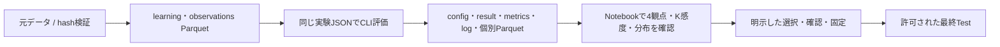

# music-recsys

音楽推薦の研究用リポジトリ / Python 3.12・uv・Parquet・GPU評価 / React・FastAPIの試聴アプリ

[English](README.en.md) / [作業ルール](AGENTS.md)

## 文書

| 内容 | 入口 |
| --- | --- |
| 全体・実行・データ出典・保存 | このREADME |
| DDD・依存方向・推薦モデル・多段階・配置 | [アーキテクチャ](docs/architecture.md) |
| new/repeat・4観点・欠測・オンライン指標 | [評価指標](docs/evaluation.md) |
| 参加者操作・Mac起動・共有・認証・削除 | [UIと運用](docs/ui.md) |
| 未実装・未確認・次に決める事項 | [TODO](docs/todo.md) |
| Validation/Test・図・対応差・限界 | [結果と考察](docs/discussion.md) |

- `docs/`のMarkdownは上の5本だけ、各200行以内。仕様を重複させず、正確な数値・出典は保存結果へリンクする
- 過去の詳細仕様・処理版は`data/provenance/`に保持する。現在の操作と過去の記録を混在させない

## 実行と確認

```bash
uv sync --locked --group data --group models --group notebook --group tracking
# GPU実行を使う環境は --group gpu も指定する
.venv/bin/python -m src.interfaces.cli.lab_data
.venv/bin/python -m src.interfaces.cli.evaluate --config configs/popularity-plays.json
.venv/bin/jupyter lab --no-browser --ip=127.0.0.1 --port=8888
```

- 標準は`lab_data → Parquet → CLI評価 → Notebook確認`。Docker・sudo・常駐DBは不要
- 上は初回実行の例。保存済み入力・結果を上書きせず、既存結果の確認はNotebookまたは原本CSV/JSONを使う
- Notebookで同じJSONを選び「読み込む」。初期状態は未選択、未準備を別データで埋めない
- 全学習ユーザー・K2〜20・4観点を維持し、主タスク/主指標・採用モデルを自動確定しない
- 長時間処理前はホストの`nvidia-smi`を確認。GPUがsandbox内で見えないだけでCPUへ切り替えない
- CPU/GPUの解法・精度・seed・処理版・実測秒を保存し、単発APIとバッチ償却を区別する



## 主なCLI

| 目的 | モジュール・指定 |
| --- | --- |
| 入力取得・照合・分割 | `src.interfaces.cli.lab_data` |
| 単独方式の全件評価 | `src.interfaces.cli.evaluate --config <JSON>` |
| 因子数/epoch・感度 | `factor_study` / `sensitivity` / `bm25_grid` |
| 保存結果・対応差・共通ILD | `catalog` / `audit` / `als_report` |
| 固定済み単独Test | `popularity_test` / `itemcf_test` / `als_test` / `final_test` |
| 固定Hybridの計画 | `hybrid --config configs/hybrid.json`、既定は計画表示のみ |
| 固定HybridのValidation | 同じ引数へ`--run`を追加。Testや採用選択は行わない |
| 元値を変えず図を再生成 | `figure_redraw --result <JSON> --output <新規保存先>` |
| 表示metadata・配信用bundle | `music4all_metadata` / `online_bundle` / `online_distribution` |
| ローカルログ管理・集計 | `online_logs` / `online_metrics` / `online_analysis` |

- モジュールは`python -m src.interfaces.cli.<名前>`で起動し、詳細は各`--help`を使う
- JSON共通条件は`configs/common.json`。比較・GPU・一括実行のためだけに設定や出力先を増やさない
- CLI・Notebook・HTTP・配布スクリプトからの参照を更新して命名を揃える。外部CLIや動的登録を未使用コードと誤判定しない

## Notebook

| ファイル | 役割 |
| --- | --- |
| [00_lab_start](notebooks/00_lab_start.ipynb) | 入力状態と明示した評価開始 |
| [01_data](notebooks/01_data.ipynb) | 時系列分割・母集団・再生回数/日数分布 |
| [02_analysis](notebooks/02_analysis.ipynb) | 同じJSONの保存結果・4観点・明示選択/固定 |
| [03_recommendation](notebooks/03_recommendation.ipynb) | 選択済み小規模条件の推薦確認 |

- 評価本体はCLI。Notebookへ学習・数値処理・保存処理を複製しない
- Gitへ保存するNotebookは出力とexecution_countをクリアし、処理変更はfresh kernelでも確認する

## データの出典

| 出典・保存先 | 内容 |
| --- | --- |
| Zenodo record 15394646 / Music4All-Onion v2 | 聴取履歴・重み付きタグ、取得時のrecord.jsonとchecksumを保持 |
| `userid_trackid_timestamp.tsv.bz2` | 2,211,449,511 bytes、MD5 `dfe82201036765f7463e6f3ce3d0f991` |
| `id_tags_dict.tsv.bz2` | 14,817,003 bytes、MD5 `9c1ca4a3e04a9696b9449ec54ac40cd5` |
| `data/raw/music4all-original/` | 原版テキスト7ファイル、Mac報告のSHA-256と照合済み |
| `data/benchmarks/music4all/` | 検証済みlearning/observations・manifest・特徴artifact |

- 元IDは文字列を維持する。履歴timestampのタイムゾーンは未確認、取得済み分割条件を勝手に変えない
- 原版109,269曲と既存配信用45,888曲のID対応を確認済み。表示用metadataは元表記・順序・hashを保持し、学習特徴やモデルを変更しない
- 利用・招待者へのWeb試聴は研究者の確認記録を保持し、期限指定なしは明示的なnullで表す。データ公開と音源の配信許諾を同一視しない
- listening-v2入力を使う。未取得時に合成fixture・旧結果・DBへ暗黙に切り替えない
- 元データ・音源・個別ログ・認証情報をGitやZIPへ広範囲コピーしない

## 保存と保持

- 原本は`data/experiments/<手法>/<条件>/`、共通集約は各手法の`summary/`・`paper/`・`test/`。方法名付き条件を手法外へ平置きしない
- BPRはepoch、ItemCFは類似度→近傍数、ALSは因子数/感度、Popularityは集計方法で整理する
- 標準出力はconfig.json・result.json・metrics.csv・run.log・PNG。論文図は同名PDFも保存し、1指標1図・300dpi・埋込みフォントとする
- 個別推薦・スコア・候補はParquetへ保存し、JSONへ巨大に重複展開しない。index.htmlや二重の設定コピーを新設しない
- 原本のhash・出典・処理版を維持し、成功マーカー前の保存物を公開しない。未測定nullを0へ補わず、全値nullのPNGは作らない
- 元データ・分割・結果・モデル・参加者ログを通常の掃除へ混ぜない。稼働中ジョブやMacのstateと競合する削除・移動をしない
- 重みの明示削減は元manifestとretention.jsonを残す。BPR500epochの12モデル等の保持対象を維持し、CSVから重みを復元した扱いにしない
- 削減済み重みは推論時に明確に拒否し、別モデルへ自動切替しない。図も削減記録と原本数値があるものだけ新規出力先へ再生成する
- 配布物は`data/app/releases/`、配信原本は`data/app/music4all/`、デモは`demo/`、非公開設定は`private/`へ分ける
- 配布ZIPの整理は後継版の検証後に行い、固有のmetadata・許諾・モデルを失わないこととchecksumを記録する

## テスト

```bash
.venv/bin/pytest
.venv/bin/ruff check src tests notebooks migrations
.venv/bin/ruff format --check src tests notebooks migrations
# 空きGPUでのみ明示実行
MUSIC_RECSYS_TEST_GPU=1 CUDA_PATH=/usr .venv/bin/pytest tests/test_gpu_evaluation.py tests/test_pipeline.py tests/test_hybrid.py
```

- 変更に対応する試験から実行し、必要に応じて全体確認。DB/大規模試験は専用環境で明示的に有効化する
- Markdownの200行制限・リンク、Notebook構文/出力クリア、配布物の内容と参照も確認する
- アプリの起動・公開・同意/削除と実機での未確認事項は[UI](docs/ui.md)と[TODO](docs/todo.md)に集約する

## ライセンス

原著コード・文書は[MIT](LICENSE)。第三者資料は[NOTICE](NOTICE)、データセット・音源・画像・学習済み成果物・参加者ログはそれぞれの提供条件に従う
