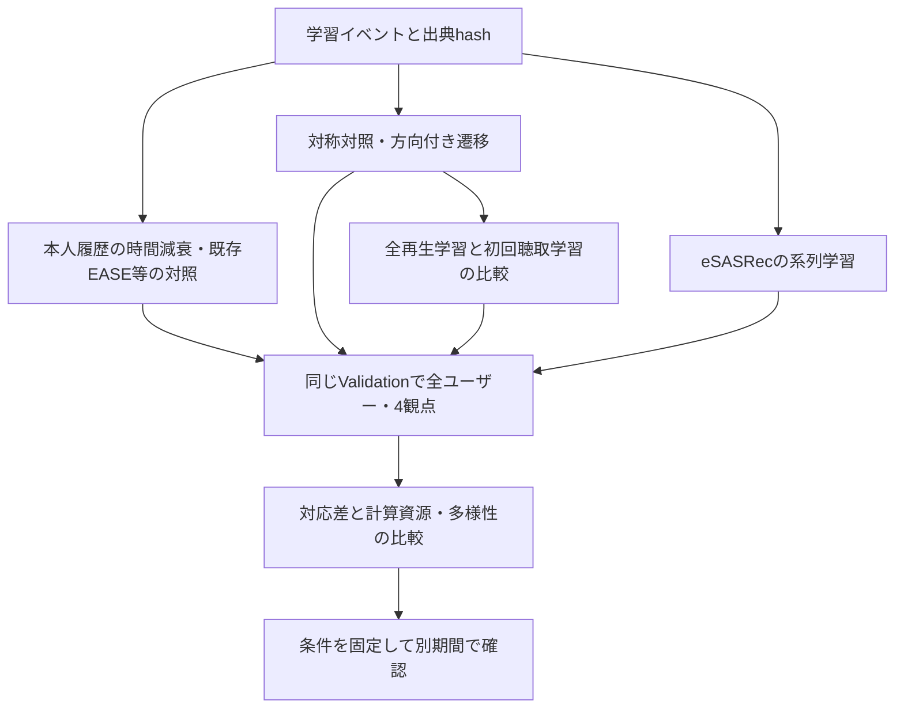

# 論文に基づく精度改善の比較設計

## 結論と対象

- 優先する仮説は「本人の再生頻度・時間」に「他ユーザーから学ぶ曲間の方向付き遷移」を加えること
- [本人履歴](history-combination.md)は再聴を改善したが、新規曲の個人別スコアは同点のまま。新規発見には別の信号が必要
- 以下は一次資料に基づく実験候補。文献の数値は本データの改善予測ではなく、遷移・初回聴取は全件比較済み。PCTMは未実装。[eSASRec型モデル](sequence-model.md)はCPU小規模試験までで、GPU・実データ評価は未実施
- 研究上の問いは「音楽の新規発見・再聴で、時間減衰・曲間遷移・系列表現・タスク別学習がそれぞれ何を改善するか」。組合せの新規性自体は未確認

## 一次資料と適用範囲

| 論文 | 確認できた根拠 | 本研究への示唆と限界 |
| --- | --- | --- |
| [PCTM / Sequential Rules, RecSys 2026](https://arxiv.org/html/2608.19833v1) | 直近性を考慮した曲間遷移に相当するモデルをTransformerと同条件比較。5データ中4つで少なくとも一方がeSASRec再現を上回るが、ML-20Mでは下回る | 遷移モデルを強い対照にする根拠。Amazon/MovieLensの次アイテムNDCG@10であり、音楽の長期・反復評価への効果は未確認 |
| [eSASRec, RecSys 2025](https://arxiv.org/html/2508.06450v1) | SASRecの学習目的、LiGR層、Sampled Softmaxを組み合わせた強い系列モデル。主実験では全体時系列分割と精度・Coverageを評価 | 古いSASRecの標準設定だけを対照にしない。訓練目的・負例・モデル容量の差を記録する |
| [Why One Size Doesn't Fit All, WSDM Companion 2026 / GenAI4SM](https://www.amazon.science/publications/why-one-size-doesnt-fit-all-improving-music-discovery-and-familiar-listening-with-specialized-models) | 音楽の初回聴取列と既聴曲の再生列に分けた学習を、汎用モデルの出力フィルタと比較 | new/repeatを評価時に分けるだけでなく、学習時にも目的を揃える候補。論文のNDCG@100や次曲予測と本研究のK2〜20・期間内複数正解は異なる |

- [Spotifyの著者解説](https://research.atspotify.com/2026/10/do-sequential-recommendation-benchmarks-require-higher-order-sequence-modelling)も、遷移・直近性で説明できる改善と、複数履歴の相互作用による改善を区別している
- 論文の優位なデータセットだけを引用して「必ず改善」とはしない。既存方式の弱い設定との比較や異なる分割から得た改善率は持ち込まない

## 優先1: 方向付き遷移と時間履歴

**入力**: 学習期間内のuser_id・item_id・event_time。外部API・音声・LLMは不要

1. ユーザーごとに再生を時間順に並べ、近い位置にある曲A→曲Bの出現を全ユーザーで集計する
2. SeqRulesでは遷移重み、PCTMでは平滑化した条件付き確率を作る。A→BとB→Aを区別する
3. 対象者の過去の曲から候補Bへの証拠を、最近の履歴ほど重く集約する
4. newは未聴曲、repeatは既聴曲の許可集合に分けて全カタログ内で順位を取得する

- PCTMの対数確率の加重和とSeqRulesの加算を混同しない。人気度補正・平滑化を含む原式を先に再現し、改変版を別条件にする
- 既存ItemCFの共起とは、方向・再生順・履歴位置の重みが異なる。単なる方式名の追加ではなく、順序なし対照で増分を測る
- 同時刻の再生から根拠のない順序を作らない。同曲連続再生・長時間隔・自己遷移の扱いは実行前に固定する
- 疎な遷移行列を使い、構築・採点・順位・集計のGPU適用とメモリ上限を確認する。近傍枝刈りは近似として記録し、人数を減らさない
- **仮説**: 本人未聴の曲にも個別スコアが付くため、新規発見を改善し得る。再聴の時間減衰との融合は追加実験であり、改善済みとは扱わない

### 現行CLIの初期比較

- [方向付き](../configs/transition_rules/directed.json) / [対称対照](../configs/transition_rules/symmetric.json) / [事前固定](../data/provenance/transition-rules-20261112/protocol.json)
- SeqRulesを参考にした改変版で、原論文の完全再現・PCTMではない。入力は同じ全学習履歴
- 順序が一意なイベントだけから、位置距離1〜5・時間差24時間以内を重み`1/位置距離`で加算。自己遷移も保持する
- 同じユーザー・時刻に複数イベントがあれば、その時刻の全イベントを遷移構築から除外する。本人履歴の時間減衰には保持する
- 方向付き行列Tと対称化`(T+T.T)/2`を比較し、各行の正の上位100遷移を残す。同点は曲ID順。対称対照も近接性を使うので「全順序情報なし」とは呼ばない
- 推薦スコアは半減期30日の減衰和を`log1p/ln(2)`で変換した本人履歴と遷移行列の積。全カタログ内で順位付けし、同点は学習全体の再生回数→曲ID
- DuckDBで入力を検証・整列し、CUDA float64疎行列で集約・枝刈り・推薦・評価を行う。大きなソート中間物のディスク退避は禁止し、メモリ不足時は失敗させる
- CPU/GPUの小規模独立計算、バッチ境界、ユーザー境界、同時刻除外、未来イベント拒否、Validation→Testの入力分離を試験済み

```bash
CUDA_PATH=/usr PYTHONUTF8=1 .venv/bin/python -m backend.interfaces.cli.evaluate --config configs/transition_rules/directed.json
CUDA_PATH=/usr PYTHONUTF8=1 .venv/bin/python -m backend.interfaces.cli.evaluate --config configs/transition_rules/symmetric.json
```

- 条件別に`data/experiments/transition_rules/`へ保存し、既存の重み比較CLIで保存済み対照と対応差・共通ILDを比較する
- 実行前に空き容量とGPUを確認する。処理中のコード変更・競合GPUジョブ・出力上書きは行わない

### 方向付き遷移のValidation

- [原本](../data/experiments/transition_rules/directed-d5-n100/result.json) / [検算](../data/provenance/transition-rules-20261112/directed-verification.json)
- 全119,133人、90日/K20/日数重み1。新規精度18,601人、再聴精度19,268人。対称対照・対応差・共通ILDは下記で確認

| 指標 | EASE binary λ500 | 方向付き遷移 | 本人履歴の時間減衰 |
| --- | ---: | ---: | ---: |
| 新規Binary NDCG | 0.034995 | 0.039417 | 0.010974 |
| 新規Recall | 2.8675% | 3.1034% | 0.6076% |
| 再聴Graded NDCG | 0.105796 | 0.224659 | 0.375783 |
| Repeat Recall | 6.3716% | 16.1290% | 22.3247% |
| 新規Catalog Coverage | 73.1738% | 80.4720% | — |
| 新規Novelty（bit） | 5.527907 | 5.197005 | — |
| 入力準備・学習（秒） | 96.31 | 127.32 | 69.87 |
| GPU順位取得・全238,266要求（秒） | 42.46 | 27.81 | 24.04 |

- EASEに対して新規NDCG相対+12.63%、Recall相対+8.23%（+0.2360ポイント）。両指標の平均は全57条件で高い。EASEとの差の95%対応区間はNDCG +0.002891〜+0.005973、Recall +0.0565〜+0.4106ポイント
- 新規Coverageは増加したがNoveltyは低下。共通ILDも低下した（以下参照）。全4観点の各Kの原本値は上記JSONに保存
- 再聴は時間減衰より低いため、全タスクの全面置換とはしない。新規専用の候補として、対称対照・融合・期間一般化を順に確認する
- 元イベント202,396,019件中202,087,218件を遷移に使用し、802,506,725ペアから4,483,727本の遷移を保持。除外は同時刻の曖昧なイベント約0.15%で、本人履歴・評価人数は削減していない
- 評価全体125.42秒、順位取得はGPUバッチ償却約0.117ms/要求。オンライン応答時間・電力費は未測定、外部API未使用
- 627精度値のCPU平均は最大差2.92e-15、母集団・出典・保存物hashを照合。新規順位は全119,133人で本人履歴方式と異なる

### 対称遷移との比較

- [原本](../data/experiments/transition_rules/symmetric-d5-n100/result.json) / [対応差](../data/experiments/transition_rules/symmetric-d5-n100/comparison/paired.csv) / [共通ILD](../data/experiments/transition_rules/symmetric-d5-n100/comparison/ild.csv) / [検算](../data/provenance/transition-rules-20261112/symmetric-verification.json)

| 指標 | 方向付き | 対称化 |
| --- | ---: | ---: |
| 新規Binary NDCG | 0.039417 | 0.040843 |
| 新規Recall | 3.1034% | 3.1414% |
| 再聴Graded NDCG | 0.224659 | 0.233201 |
| Repeat Recall | 16.1290% | 16.4138% |
| 新規共通ILD（104,696人） | 0.614999 | 0.599349 |
| 再聴共通ILD（95,492人） | 0.643440 | 0.640575 |
| 新規Catalog Coverage | 80.4720% | 80.1626% |
| 新規Novelty（bit） | 5.197005 | 5.137719 |
| 入力準備・学習（秒） | 127.32 | 127.22 |
| GPU順位取得・全238,266要求（秒） | 27.81 | 27.10 |

- 対称化はEASE比で新規NDCG相対+16.71%、Recall相対+9.55%（+0.2739ポイント）。差の95%区間はNDCG +0.004271〜+0.007406、Recall +0.0927〜+0.4526ポイント。両指標の平均は全57条件で高い
- 対称化−方向付きの新規NDCG差+0.001426、区間+0.001017〜+0.001849。新規Recall差+0.0380ポイント、区間−0.0176〜+0.0919ポイントで0を含む
- **方向を保持することの優位は示せなかった。近接再生と時間履歴を使った関係の有効性として解釈する**。一方、対称化も近接性を使うため、再生順全体が不要とは結論しない
- 共通ILDは5方式の特徴あり対象の積集合。EASEの新規0.710753より両遷移方式とも低く、精度向上と多様性の低下が併存する
- 対称化の評価全体123.83秒、順位取得はバッチ償却約0.114ms/要求。627精度値のCPU検算最大差3.09e-15。[独立CPU検算](../data/provenance/transition-rules-20261112/interval-verification.json)で12対応条件・2,000再標本化の平均と区間も確認（最大差1.68e-15）。外部API未使用

## 優先2: 新規発見に合う学習データ

- 学習期間内で「その時点までに初めて聴いた曲」を抽出し、新規発見用の系列を作る。再聴側は過去に聴いた曲へのイベントとして分ける
- 全再生で学習して後から既聴除外する方式と、同じモデルを初回聴取列で学習する方式を比較する
- 本人履歴の時間減衰は再聴の強い対照として保持する。新規専用モデルに置き換えて全タスクの改善とは呼ばない
- 全期間から初出・再生回数を求めない。学習用の時点を動かす場合も、その予測時点以前だけで特徴・既聴判定を作る
- これは論文の考え方を遷移モデルへ適用する仮説。疎になる初回系列と、長い時間隔を挟む遷移の影響を確認する
- [初回聴取条件](../configs/transition_rules/first-listen.json)は対称条件を継承し、遷移学習だけを初回に制限する。本人履歴の減衰・候補・期間・近傍数は維持し、タスク全体を変更した比較と混同しない
- 初回日時は曖昧な時刻を除く前の学習データで決める。除外後の再聴を初回へ昇格させない。初回遷移のない人も評価母集団へ残す
- CLIは`--config configs/transition_rules/first-listen.json`。評価結果による半減期・時間差・距離の追加調整は別条件に分ける

### 初回聴取学習のValidation

- [事前固定](../data/provenance/transition-first-listen-20261112/protocol.json) / [原本](../data/experiments/transition_rules/first-listen-symmetric-d5-n100/result.json) / [対応差](../data/experiments/transition_rules/first-listen-symmetric-d5-n100/comparison/paired.csv) / [検算](../data/provenance/transition-first-listen-20261112/first-listen-verification.json)
- 全119,133人、90日/K20/日数重み1。学習遷移は42,561,139初回イベント・110,826,962ペア、保持遷移4,353,099本

| 指標 | 全再生の対称遷移 | 初回聴取の対称遷移 |
| --- | ---: | ---: |
| 新規Binary NDCG | 0.040843 | 0.041422 |
| 新規Recall | 3.1414% | 3.2301% |
| 再聴Graded NDCG | 0.233201 | 0.171941 |
| Repeat Recall | 16.4138% | 12.1809% |
| 新規共通ILD（108,030人） | 0.599674 | 0.604439 |
| 再聴共通ILD（96,303人） | 0.640404 | 0.610263 |
| 新規Catalog Coverage | 80.1626% | 81.0866% |
| 新規Novelty（bit） | 5.137719 | 5.277246 |
| 入力準備・学習（秒） | 127.22 | 114.67 |
| GPU順位取得・全238,266要求（秒） | 27.10 | 27.36 |

- 全再生版との差の95%区間は新規NDCG +0.000083〜+0.001082、Recall +0.0220〜+0.1549ポイント。平均が高いのはNDCG33/57条件、Recall42/57条件で、一律な優位ではない
- EASE比では新規NDCG相対+18.36%、Recall相対+12.65%（+0.3626ポイント）。両指標の平均は全57条件で高く、表示条件の区間はNDCG +0.004920〜+0.008015、Recall +0.1811〜+0.5471ポイント
- 新規共通ILD・Coverage・Noveltyは全再生版より高いが、EASEの共通ILD0.712196・Novelty5.527907には届かない。共通ILDの分母は今回の4方式で、前の5方式比較とは異なる
- **初回聴取での学習は表示条件の新規発見を改善した一方、再聴精度を下げた。タスクを分ける根拠にはなるが、総合的な採用・全条件の優位・独立期間の再現は未確定**
- 評価全体124.56秒、GPUバッチ償却約0.115ms/要求。外部API未使用、電力費・オンライン待ち時間は未測定
- 627精度値のCPU検算最大差2.25e-15。[12対応条件・2,000再標本化の独立検算](../data/provenance/transition-first-listen-20261112/interval-verification.json)は最大差1.87e-15。出典・処理版・保存物hashを照合

## 優先3: eSASRecによる系列学習

- 実装・候補設定・現在の容量制約は[eSASRec型モデル](sequence-model.md)へ集約する。未測定の精度・実行時間を改善根拠に使わない

- [遷移量の正規化](transition-normalization.md)の2固定条件では、指数0.5で新規精度が改善し、指数1は悪化した。正規化後の等重みEASE融合は追加の精度改善にならなかった。系列モデルの代替検証とはしない

- [補完性と固定RRF比較](transition-fusion.md)では、等取得枠での候補増分と表示条件の新規精度改善を確認。再聴悪化・K感度を保持し、系列モデルと期間一般化は別に検証する

- 入力は学習期間内の曲ID列。全履歴の単純集計では表せない、複数の過去曲の関係を学習する候補
- [著者実装](https://github.com/blondered/transformer_benchmark)の損失・負例・マスク・パディングを確認し、依存環境を現行パッケージへ無条件に持ち込まない
- まず強い遷移モデルと比較する。系列モデルを大きくする前に、Sampled Softmax等の学習条件と計算量を揃える
- 学習時の負例サンプリングと評価時の候補間引きは別。評価は全カタログ、全学習ユーザーを維持する
- 履歴長の上限は明示的な条件として扱う。RTX 3090のVRAM24GBで全件が収まるとは未確認なので、バッチのメモリと所要時間を先に測る
- 次曲予測と30/90/180日内の推薦は目的が異なる。長期ラベルでの追加学習は別の仮説として分離する

## 比較と判定



- 比較は一段ずつ実行し、前段の結果で必要性を判断する。無制限なパラメータ探索をせず、試す条件と探索予算を実行前に記録する
- newのBinary NDCG・Recall、repeatのGraded NDCG・Repeat Recall、ILD・Coverage・Novelty、時間・料金・呼出し数を省略しない
- K2〜20、期間30/90/180日、日数重みと再生回数・日数分布は[共通仕様](evaluation.md)を維持する
- 同じユーザーの差と信頼区間を報告する。Recall悪化をNDCG改善で隠さず、主指標未指定のまま勝者を決めない
- 既見Testで調整しない。独立した未使用期間の確保とオンライン満足度の評価は別に必要
- 未実行候補の実行時間・電力費・追加保存容量は未測定。外部APIを使わない実装を優先し、APIを使う場合は事前に日本円概算を申告する

## 優先度を上げないもの

- 現在の4特徴による個人別ルールは[追加改善なし](history-selection.md)。同じ情報のまま選択器だけ複雑にする根拠は弱い
- LLM選択は独立した比較課題として残す。まず候補推薦自体を改善し、API利用前の費用申告を守る
- 音声・歌詞・豊富なメタデータの導入は、欠測・時点可用性・許諾・容量を確認してから検討する
