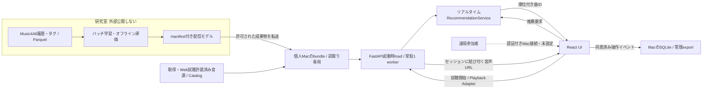

# UIを含むアプリ全体のアーキテクチャ

## 配置とデータフロー



- React＋TypeScript＋Vite、FastAPI、既存RecommendationServiceのモジュラーモノリス
- 学習/評価はバッチ、アプリは保存済みモデルを起動時に検証ロードしてリアルタイム推論する
- APIリクエストごとの学習・重み再読込み・モデル選択の自動確定は行わない
- 研究室サーバーの外部公開・ポート開放・Tunnel起動は禁止、Mac側の遠隔設定と分離する

## 保存先・コンポーネント

| 要素 | 実体・保存場所 |
| --- | --- |
| 実験データ/結果 | 研究室のParquet/JSON、[コード実行フロー](experiment-workflow.md#保存物) |
| 配信モデル | `data/models/`または`data/app/`のmanifest＋NPY、ユーザー因子はサーバー専用 |
| 配信用bundle | config・catalog・モデル・音源・transfer.json、Macで`/bundle`へread-only mount |
| 楽曲情報 | TrackCatalog/CatalogTrack/TrackRef、catalog.json等のhash固定ファイル、常駐DBは不要 |
| 音源 | bundle内の許諾済み音源、またはAdapterで解決する提供元stream、API鍵はサーバーだけ |
| React | `frontend/src`、通常buildは`src/music_recsys/webapp/static`へ生成 |
| ログ | Macの`~/music-recsys/state/sessions.sqlite`、Dockerでは`/state/sessions.sqlite` |
| 管理export | 同stateの`exports/SESSION_ID.json`、[権限・期限・削除](online-study.md#保存権限削除) |

- 名称・Compose project・コンテナ利用者・主要環境変数をmusic-recsysへ統一する
- 設定は`MUSIC_RECSYS_*`、旧`OTOLAB_*`は読込み互換だけ、新名を優先する
- Dockerのstateは更新するコード/ZIPフォルダの外、通常の掃除でログを消さない
- 少人数向け1 workerと直列化を使い、一般公開の同時接続性能は未検証
- 8実モデル常駐の既存測定は約364MiB・ロード0.91秒、Macでの値は別途測定する
- GPUバッチ評価と単発配信のNumPy CPU経路は別、デバイス選択は実測に基づく

## Macで起動・更新

```bash
cd "$HOME/Downloads/music-recsys-mac-0.4.0"
# 旧版のログがある場合だけ実行、両Composeを停止して非上書き移動
bash deploy/mac.sh migrate-state
bash deploy/mac.sh start
bash deploy/mac.sh status
bash deploy/mac.sh stop
```

- Docker Desktopを起動し、版付きZIPを新しいフォルダへ展開する、旧コードへ重ねない
- Finderの`MusicRecsys.command`も利用可、URLは`http://127.0.0.1:8765`
- ホストの待受は127.0.0.1のみ、MacへのPython/Node導入は不要
- 移行対象は旧配布の`state/`または`~/OtoLab/state`、既存移行先への上書きを拒否する
- 旧ログを検出した場合は移行まで新規起動を拒否、`MUSIC_RECSYS_STATE`で保存先を明示変更できる
- 起動中の移行・実験中の更新は行わない、再起動後のセッション継続は未実装
- `logs`はプロセス診断、参加者ログの管理は`sessions` / `export SESSION_ID`を使う

```bash
.venv/bin/python -m music_recsys.webapp.bundle \
  --config data/app/demo/config.json --study deploy/demo-study.json --output data/app/mac-demo-new
.venv/bin/python -m music_recsys.webapp.distribution \
  --root . --bundle data/app/mac-demo-new --version 0.4.0 \
  --output data/app/music-recsys-mac-0.4.0.zip
```

- 作成先は新規だけ、既存ZIP/bundleを上書きしない、元履歴・評価JSON・ログ・認証情報を配布へ混ぜない
- 公開Releaseへ添付するのは許諾済み合成デモだけ、実データ/実モデル/実音源は提供条件に従う

## Pythonでの開発

```bash
uv sync --locked --group app --group data --group models
(cd frontend && npm ci && npm run build)
# 未作成の場合だけ、合成デモを新規作成
.venv/bin/python -m music_recsys.webapp.prepare --demo --output data/app/demo
.venv/bin/python -m music_recsys.webapp.server \
  --config data/app/demo/config.json --model-version demo-itemcf --port 8765
```

- 準備済みならprepareを省略、Vite開発は`cd frontend && npm run dev`、Node22.12以上が必要
- 研究者画面は`--audience researcher`の別プロセス、参加者向けに公開しない
- 実験計画は`--study <JSON>`で指定、[共通比較条件](online-study.md#比較実験)を適用する

## APIとUI

| 操作 | エンドポイント |
| --- | --- |
| 稼働案内 | GET /availability、モデルや個人ログを含めない |
| 状態/曲 | GET /api/status、GET /api/catalog |
| 開始/初期選択 | POST /api/sessions、PUT /api/profile |
| 初期試聴 | POST /api/previews、GET /api/preview-audio/{id}、推薦評価と分離 |
| 推薦/音声 | POST /api/recommendations、POST /api/playbacks、GET /api/audio/{id} |
| 行動/到達 | POST /api/events、POST /api/session/progress |
| 終了/本人ログ/削除 | POST /api/session/finish、GET /api/session/export、DELETE /api/session |

- 説明・同意→曲を試聴して初期選択→推薦/試聴→任意の満足度1問、モデル条件は秘匿する
- 外側は100dvh内に固定、同意文/楽曲一覧/PCキューだけ内部スクロール、ライト表示
- プレイヤーはシャッフル・前曲・再生/停止・次曲・リピートを等間隔に配置する
- 実際にplayした曲だけheardへ加える、初期選択を再生履歴と混同しない
- 「おまかせ」は現在未聴推薦、既聴・未聴を混ぜた総合推薦は未対応
- likeはログのみ、saveの参加者UIはなし、[オンライン評価](online-study.md)に従って記録する

## Music4Allの接続状況

| 対象 | 現状 |
| --- | --- |
| Popularity / ItemCF | 実学習の2条件 / 6条件が配信済み、採用条件は未確定 |
| ALS / BPR | export/load対応、配信用の実データ重みは未保存、過去の評価JSONは重みではない |
| BM25 / Content | 全件Validation対応、BM25の配信用重み保存済み、Content疎行列exportは未実装 |
| 実曲表示/音源 | 45,888学習IDのタイトル/artist未接続、実音源なし、提供元への申請回答待ち |
| 合成デモ | 架空12曲・独自CC0 WAV、実Music4Allの音源や推薦評価と混ぜない |

- [Music4All公式申請先](https://sites.google.com/view/contact4music4all): contact4music4all@gmail.com
- [Onion v2](https://zenodo.org/records/15394646)の公開履歴取得と、原版clip/メタデータの提供・Web試聴許諾は別
- 音源は取得条件・少人数への認証付きブラウザ試聴・帰属表示・期限を確認するまで配信しない
- 外部IDはTrackRefで保持、タイトル/artist一致だけで同一録音を確定せず、live/remix等の版を区別する
- Playback Adapterはavailable/unavailable/unknown/expiredを区別、URL取得をブラウザ再生成功としない

```bash
.venv/bin/python -m music_recsys.webapp.audit --config data/app/music4all/config.json \
  --audio-root /許可された音源保存先 --output data/app/music4all/audio-audit-new.json
.venv/bin/python -m music_recsys.webapp.media --config data/app/music4all/config.json \
  --metadata /private/tracks.csv --audio-root /private/clips \
  --permission /private/permission.json --output data/app/music4all-listening
```

- metadataは`item_id,title,artists`、複数artistは`|`区切り、音源stemはitem_idと一致させる
- permissionは`web_preview=true`・`access_scope=restricted-study`・確認済み`evidence_ref`・timezone付き`expires_at`・明示`item_ids`
- 許諾JSONは確認済み条件の記録であり、それ自体が法的許諾を発生させるものではない
- mediaは新bundleへコピー/hash検証、モデルの絶対参照を残すので別ホストへ移す場合はbundle化する
- 外部サービスPoCは既定と分離、`catalog_poc` / `jamendo_poc` / `listenbrainz_poc --help`で明示操作する
- JamendoはAPI承認待ち、ListenBrainz履歴は音源配信権を含まず、未許諾の外部データを学習可能と推測しない
- 公式資料: [Jamendo tracks/規約](https://developer.jamendo.com/v3.0/tracks) / [規約](https://devportal.jamendo.com/api_terms_of_use) / [ListenBrainz](https://listenbrainz.org/data/) / [FMA](https://github.com/mdeff/fma)

## 公開デモ・遠隔接続・稼働案内

- Cloudflare公開デモは合成音源/合成ItemCFだけをブラウザ内実行、実モデル/研究ログ/秘密情報を含めない
- [公開合成デモ](https://musicrecsys.pages.dev)、実モデルの参加者実験とは別環境
- Pagesは`frontend/wrangler.jsonc`、旧Workersは`frontend/wrangler.workers.jsonc`、既存Workers設定を保持
- Mac未接続の公開デモを、実モデルが稼働中と表示しない
- `/availability`は稼働・停止・認証必要・未接続を区別、応答の有無だけで本人認証の成功を偽らない
- 次回予定はMacの`MUSIC_RECSYS_NEXT_OPEN_AT` / Workerの`NEXT_OPEN_AT`で手動指定、timezone付きISO日時が必要
- 未指定/過去日時は予定未定、Macのスリープ・ネット切断・Docker停止中は実アプリを利用できない

```bash
.venv/bin/python -m music_recsys.webapp.public_demo \
  --config data/app/demo/config.json --output frontend/public/demo
(cd frontend && npm run build:preview && npm run test:worker && npm run check:deploy)
(cd frontend && npm run preview:cloudflare -- --port 8787)
# 認証済み・公開合成デモだけを配信
(cd frontend && npm run deploy:pages)
# 旧Workersの公開デモを更新する場合だけ使用
(cd frontend && npm run deploy:preview)
```

- 既に生成済みならpublic_demoを省略、実データmodeの公開exportは拒否する
- 公開buildだけ`VITE_PUBLIC_DEMO=1`、通常buildはFastAPIへ接続、VITE変数に認証情報を入れない
- 遠隔実験は個人Macのnamed tunnel＋[Cloudflare Access](https://developers.cloudflare.com/cloudflare-one/access-controls/applications/http-apps/self-hosted-public-app/)を全パスへ適用する案、実接続は未設定
- `deploy/cloudflared.example.yml`をprivate領域へコピーし、参加者Allow、TEAM/AUD、HTTPSの許可Origin/hostを設定する
- Mac側`MUSIC_RECSYS_ACCESS_TEAM/ACCESS_AUD/ALLOWED_ORIGINS/ALLOWED_HOSTS`でJWTをAPIでも検証、認証は研究同意と別
- `mac.sh start`はローカル確認専用、遠隔運用は設定確認後にComposeで起動し、401確認後にMacでTunnelを開始する
- API中継はWorkerのBACKEND_ORIGIN/UPSTREAM_API_TOKENとMacのMUSIC_RECSYS_API_TOKENを使い、Bearerをブラウザへ渡さない
- 有料リソース・独自ドメイン・研究室の公開設定は自動作成しない
- UI/音声/APIは同一Origin、更新APIはOrigin/専用ヘッダー、cookieはHttpOnly/SameSite、API/音声はno-store
- テストは`tests/test_webapp*.py`・`test_lab_study.py`・`test_distribution.py`、ブラウザE2Eは明示有効化時だけ実行する
- スクリーンショットは通常生成しない、Mac実機・実曲E2E・遠隔Tunnelの成功をMock試験から推測しない
