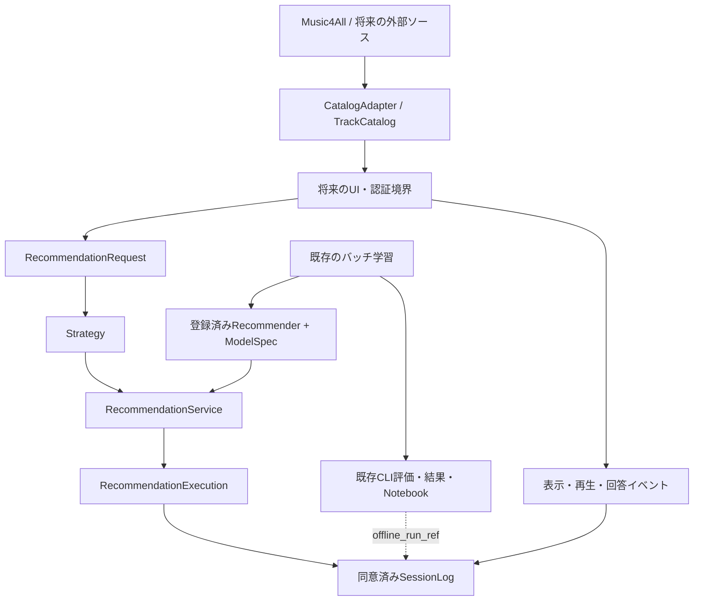

# アプリ基盤の設計

## 範囲と現在地

研究用評価を維持し、モジュラーモノリス内にアプリ向けの契約を追加する
UI・HTTP API・開発用永続ログは[アプリMVP](app-mvp.md)を参照
外部接続・LLM・Agentは未実装
既存の入力、モデル内item_id、実験JSON、指標計算は変更しない



## 1. 楽曲の共通モデル

### 現状

- Parquet・学習・評価はMusic4Allのsource_idを使用
- `TrackRecord`と`DatasetAdapter`はバッチ取り込み用
- タグ特徴量の検証はMusic4All向けで、配信サービスの再生情報は持たない
- 任意のPostgreSQL経路のUUIDもdataset/source_id単位で、サービス横断の同一性ではない

### 候補と推奨

| 候補 | 利点 | コスト・制約 |
| --- | --- | --- |
| 全IDを新しいUUIDへ置換 | 一律の識別体系 | 学習済みインデックスと実験結果の移行が必要 |
| 既存item_idに外部参照を追加 | 後方互換、段階導入可能 | 対応表と衝突検査が必要 |
| ISRCや曲名で自動統合 | 対応付けを省力化 | 別録音・ライブ・リマスターの誤統合 |

**推奨は既存item_id＋確認済み外部参照**
`TrackRef(provider, source_id)`を別名前空間として扱う
`CatalogTrack`は内部item_idと複数の`TrackSource`を持ち、メタデータの出典revisionを残す
同一参照の二重割当ては拒否し、同じISRCでも自動統合しない
同一性は原則「同一録音・バージョン」とし、ISRC・曲名・アーティスト・時間は照合候補の根拠にする
永続的な対応表と照合の承認履歴はまだ実装していない

### 実装と境界

- `catalog.py`: カタログ型、参照解決、Music4AllからのID保持変換、外部Adapter契約
- `CatalogTrack.music4all()`はタグや未知のタイトルを作り替えない
- 新規曲はカタログに登録できるが、既存の因子行列に自動追加しない
- 新規曲を推薦候補に入れるにはContent等の明示的な経路が必要、配信Adapterは学習index外を返さない
- 新規内部IDの採番・永続化方式は未確定、既存IDとの衝突検査が必要
- `PlaybackAvailability`はユーザー・市場・再生形式・有効期間に限定した判定
- `unknown`や期限切れは再生可能とみなさず、タイトルがあることとも区別する
- 再生権・認証トークン・署名URLを楽曲メタデータへ保存しない
- `CatalogAdapter`はlookup/availabilityの契約、ローカル音源の制御は[アプリMVP](app-mvp.md)のPlayback Adapterが担当

## 2. 推薦器の共通API

### 現状

`types.py`のRecommendationRequest/Response、`Recommender`、`eligible_candidates`を再利用できる
小規模Popularity・ItemCF・ALS・BPRは同じrecommend契約を持つ
`create_recommender`は学習を伴うため、リクエストごとに呼ばない
全件モデルはrank契約で、共通recommendとは候補集合・ユーザーの扱いが異なる
保存済み評価結果は、そのままロードできる配信用の学習済み重みではない

### 候補と推奨

| 候補 | 利点 | コスト・制約 |
| --- | --- | --- |
| HTTPサービスをモデル別に分離 | 個別運用可能 | 研究MVPには運用と通信が過剰 |
| 既存契約＋プロセス内の登録方式 | 再利用、学習と推論の分離 | 全件モデルの接続が別途必要 |
| 戦略と推薦を一つのモデルに集約 | 初期コードが少ない | 選択とランキングの比較が難しい |

**推奨は登録済み推薦器＋独立したStrategy**
`ModelSpec`にモデル版、アルゴリズム、実パラメータ、seed、学習・カタログ・コード出典を記録する
パラメータは正規化JSONの不変スナップショットで、利用者がリクエスト時に変更しない
登録時に実モデルとmanifestの一致を保証する責務は呼び出し側にある
手動登録では呼び出し側が照合し、配信用load_modelではmanifest・配列hashを検証する

### 実装と境界

- `serving.py`: ModelSpec、Strategy契約、FixedStrategy、RecommendationService
- サービスは学習せず、登録済みモデルを選択して推論する
- 応答ID、重複、top_k、new/repeat候補制約をアプリ境界で検査する
- 既存Evaluatorの違反計測契約は維持し、既存Response自体を厳格化しない
- 選択時間と推論時間を別々に実測、ネットワークや画面描画時間は含まない
- 既存ALS/BPRの小規模実装にある未知ユーザー向けPopularityフォールバックを維持
- 新規ユーザーは仮名user_idと空履歴を渡せるが、repeat候補は空になる
- 既存ユーザーの履歴はサーバーが認可の上で組み立て、クライアントを信用しない
- ルール・LLM・AgentはStrategyの将来の実装、現段階は固定選択だけを提供
- 自然言語を戦略へ渡す契約やAgentの複数ステップ実行は未実装
- 複数推薦器の融合は既存hybridを優先し、必要になれば同じRecommender契約で追加
- 全件モデルの重み・index保存/読込み、候補制約、初期プロフィールは[モデル配信](model-serving.md)を参照

### 最小の呼び出し例

```python
from music_recsys.serving import FixedStrategy, ModelSpec, RecommendationService

# modelは既存factory等で事前に学習済み、requestは既存RecommendationRequest
spec = ModelSpec(
    version_id="pop-v1", algorithm="popularity", parameters_json='{"basis":"play_count"}',
    training_ref="実際の学習入力hash", catalog_ref="実際のカタログhash",
    implementation_ref="実際のGit revision", seed=42,
)
service = RecommendationService(((spec, model),))
execution = service.recommend(request, FixedStrategy("pop-v1"))
```

## 3. 評価・ログ

現状、CLI結果とMLflowはオフラインの集約評価、実験SQLiteは探索の状態管理を担う
どちらもユーザー操作ログの保存先として流用しない

| 候補 | 利点 | コスト・制約 |
| --- | --- | --- |
| MLflowへ全操作を追加 | 既存ツールで参照 | セッション整合性・撤回・操作追跡に不向き |
| 別Schemaを同一アプリで管理 | 評価と行動の意味を維持 | 保存層と認可が必要 |
| 専用イベント基盤 | 大規模配信向け | 少人数研究には過剰 |

**推奨は別Schema＋共通のモデル・条件・出典参照**
実装した契約・プライバシー上の境界は[オンライン研究ログ](online-study.md)を参照
オフラインとオンラインの数値を同一指標と見なして混ぜず、主観評価も別列で保持する

## 判断待ちと次の実装

| 判断事項 | 推奨する初期方針 | 決定後の実装 |
| --- | --- | --- |
| 利用者と初期履歴 | 研究参加者の仮名ID＋本人が選んだ曲 | 認証、履歴収集、既存モデルIDとの対応 |
| 最初の再生元 | 利用許諾を確認した音源・提供方式から一つ選択 | Adapter、再生、失敗/期限切れ表示 |
| 同一曲の粒度・採番 | 録音単位、確認済み対応、既存ID維持 | 対応表の永続化と訂正履歴 |
| 保持期間・同意範囲 | 自由文保存は既定OFF、期間は研究計画で明示 | ログ保存、アクセス制御、削除とバックアップ対応 |
| 被験者内比較条件 | 固定推薦器の比較から開始 | 順序割付、回答票、分析計画 |
| 配信用モデル | 検証済み設定から選択、Test結果を選択に使わない | 実装済みexport/loadで実データ成果物を作成 |

実参加者の利用前には、楽曲表示/再生元、参加者認証、研究同意とログ運用の確定が必要
主指標や採用モデルは今回の基盤整備では決定しない

## 外部サービスの制約

具体的な取得・試聴方法と比較は[再生方式](playback-options.md)を参照

技術的に複数ソースへ対応できても、混在再生・学習利用が許可されるとは限らない
[Spotify Developer Policy](https://developer.spotify.com/policy)には他サービスとの統合、分析、ML/AI利用の制限がある
Spotify由来データの学習・LLM入力・研究分析を前提にせず、用途ごとに適用条件を確認する
[Apple MusicKit](https://developer.apple.com/musickit/)はユーザー認可・購読状態に応じた再生対応が必要
[SoundCloud API Terms](https://developers.soundcloud.com/docs/api/terms-of-use)も統合・再生用途の制約確認が必要
外部APIや再生の実接続、利用許諾の確定は今回の実装範囲外
