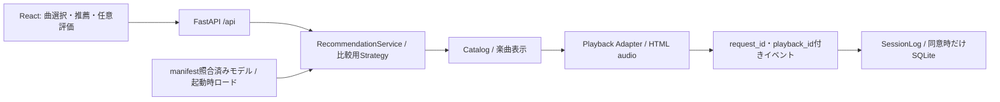

# music-recsys：ローカル音楽推薦MVP

## 構成

React＋TypeScript＋Viteで画面を部品化し、FastAPIからビルド済みファイルとAPIを配信する
ローカル版は常駐Node・外部CDN・外部サービスの認証は不要
Cloudflareへの配信・環境分離は[music-recsysの配信](cloudflare.md)を参照
ビルドには[Node.js 22.12以上](https://vite.dev/guide/)が必要、npmのlockをGit管理する
CSSは画面部品と分離し、デザイン変更は推薦・研究ログの契約を変更せず行える



## 起動

```bash
uv sync --locked --group app --group data --group models
cd frontend
npm ci
npm run build
cd ..
# 新規出力先のみ使用する。既存成果物へ上書きしない
OMP_NUM_THREADS=1 OPENBLAS_NUM_THREADS=1 .venv/bin/python \
  -m music_recsys.webapp.prepare --demo --output data/app/demo
.venv/bin/python -m music_recsys.webapp.server \
  --config data/app/demo/config.json --model-version demo-itemcf --port 8765
```

既に `data/app/demo/config.json` があればprepareを省略する
サーバーは既定で `http://127.0.0.1:8765` にbindする
Macへの配布・更新は[Macでの運用](mac-study.md)を使用する。研究室から外部公開しない
開発時は別ターミナルで `cd frontend && npm run dev`、Viteが `/api` を同じバックエンドへproxyする
ビルド先は `src/music_recsys/webapp/static`、生成物はGit管理外
Python wheelを配布する場合も先にUIをビルドする

## 操作

参加者・研究者モードと複数条件の比較は[オンライン予備実験](online-pilot.md)を参照

1. 説明文を内部スクロールして同意する。ログ保存は別の任意チェック
2. 曲をタップして試聴し、選択する
3. 推薦曲をプレイヤーで聴き、任意でいいね・保存を行う
4. 満足度1問に回答、または未回答で終了する
5. 必要なら画面上部の「終了・削除」からセッションを削除する

ページ全体はPC/スマホとも画面内に固定し、同意文・曲一覧・PCのキューだけをスクロールする
スマホはアートワークの下に曲名・再生位置・シャッフル・前曲・再生/一時停止・次曲・リピートを表示
PCはプレイヤーの右に再生キューを並べる。未取得の実曲アートワークを捏造しない
検索・アーティスト選択・端末プロフィール保存・折りたたみメニューは参加者画面に置かない

初期選択は再生履歴ではない。実際のplayイベント後に再聴取の候補へ加える
「いつもの好み」で履歴がなければ初期プロフィール経路を使う
「おまかせ」は暫定的に未聴候補を提示し、既聴・未聴を混ぜる総合推薦は未対応
自由文は将来の入力欄で、現在の順位付け・戦略選択には使わない
いいね・保存はログのみで、モデルをオンライン更新しない

## 実モデルとデモ

| モード | 推薦 | 楽曲表示・試聴 |
| --- | --- | --- |
| demo | 合成履歴で実際に学習・保存した4方式 | 架空曲名、独自合成の8秒音源、抽象アート |
| music4all | 全件学習入力からPopularity 2条件、検証済みキャッシュからItemCF 6条件 | Music4All ID、曲名・アーティスト未取得、音源未確認 |

デモは固定のダミー推薦を返さないが、実データの性能を表すものでもない
実モデルへデモ音源・架空メタデータを割り当てない
実データのALS・BPR重みは未準備。保存済み成果物のロードは対応済みで、大規模再学習を自動開始しない
学習・重みの保存方法とcold-start制約は[モデル配信](model-serving.md)を参照
BPRの新規ユーザーはPopularity補完で、BPR固有の性能と混同しない

```bash
OMP_NUM_THREADS=1 OPENBLAS_NUM_THREADS=1 .venv/bin/python \
  -m music_recsys.webapp.prepare --music4all --output data/app/music4all \
  --bundle data/benchmarks/music4all/validation \
  --cache data/processed/itemcf --experiments data/experiments
.venv/bin/python -m music_recsys.webapp.server \
  --config data/app/music4all/config.json --audience researcher --port 8765
```

prepareはValidation学習ファイルのhashを検査し、manifest付きの新しい配信ディレクトリを作る
既存キャッシュ・モデル・評価結果を上書きせず、Testは読み込まない
配信configは全成果物のmanifest hashとCatalog hashを固定し、起動時に照合する
設定の採用・固定は行わず、8条件を比較用に登録する
学習済みの入力・Git revision・パラメータ等は[モデル配信](model-serving.md)のmanifestで確認する

## Validation指標と未実装の総合評価

| 推薦目的 | 今後の主指標 | 既存保存値との対応 |
| --- | --- | --- |
| 新規発見 | New Recall@20 | discovery / recall |
| 再聴取 | Repeat Recall@20 | repeat / repeat_recall |
| 総合推薦 | Binary NDCG@20 | 既聴・未聴混合の全件結果は未測定 |

New Recallの正解は「評価期間に観測され、学習期間には未聴」の楽曲集合
通常の全聴取曲を分母にするRecallとは区別する
既存 `full_scoring.py` が学習履歴で正解を分け、`streaming_metrics.py` が集計済み
New NDCGも `discovery / binary_ndcg` として実装済みで、総合NDCGへ読み替えない
正解が空のユーザーの除外数・評価対象数は既存結果に従う
研究者画面は期間別のK=20比較と、全K=2〜20・Graded NDCG・多様性・効率の保存値を提示する
未測定はnullのまま保持し、総合指標の0埋めや最良モデルの自動確定は行わない

総合評価の追加案：全候補を既聴・未聴で除外せず一つのランキングにし、同じValidation期間の
両正解集合の和集合でBinary NDCGを算出する。新しいtaskと結果版を追加し、既存値を保持する
同じ学習ユーザー母集団・期間・K・空正解の扱いを記録し、既存のnew/repeat評価との互換性を試験する
Testを設定選択へ使わず、候補・評価設計を確認した後に追加実装・全件評価する

## API・同意と保存

| 操作 | API |
| --- | --- |
| モード・モデル / Validation比較 / 検索 | GET /api/status /api/comparison /api/catalog |
| 開始 / 初期プロフィール | POST /api/sessions / PUT /api/profile |
| 初期選択の試聴 / 音声取得 | POST /api/previews、GET /api/preview-audio/{id}（推薦評価と分離） |
| 推薦 / 試聴URL発行 / 音声取得 | POST /api/recommendations /api/playbacks、GET /api/audio/{id} |
| 行動 / 終了 / 自分のログ / 削除 | POST /api/events /api/session/finish、GET /api/session/export、DELETE /api/session |

- HttpOnly・SameSite cookieでローカルセッションを識別、別セッションの曲・再生IDを拒否
- 更新APIは同一Originと専用ヘッダーを検査、API/音声はno-store、アクセスログは無効
- 未同意はメモリのみ。同意時だけ `data/app/local.sqlite`（0600）へ保存、生cookieは保存しない
- 開発用の保持期限は24時間、稼働時の60秒タイマー・操作時・起動時に期限切れを削除
- サーバー停止中は期限削除を実行できない。再起動時に処理する
- 新規開始・削除操作は旧データも削除する。再起動後はログ復元・セッション継続はしない
- 参加者画面に自由文入力は置かない。研究者APIの自由文保存は別の同意項目
- 保存先・保持条件は開発専用。実被験者収集には研究同意、認証、アクセス管理、削除・バックアップ方針が必要

推論入力の全ID集合は保存せず件数を保持するため、ログ単独では完全再現できない
詳細な研究契約・限界は[オンライン研究ログ](online-study.md)を参照

## レイテンシと検証

モデルと候補集合を起動時に保持し、リクエスト内では再学習・ディスクからの重み読込みをしない
比較表は開いたときに読込み、ハッシュ付きJS/CSSは圧縮・長期キャッシュする
研究者画面に推論時間と要求開始〜描画の実測値を別表示する
現行配信AdapterはCPU NumPy、GPUバッチ評価とは別。GPU配信の優劣は未測定
ローカル少人数向けに操作をロックで直列化するため、一般公開の同時負荷性能は未検証

```bash
.venv/bin/pytest -q tests/test_webapp.py tests/test_app_foundation.py tests/test_model_artifacts.py
(cd frontend && npm run build)
# デモAPIを8765で起動済み、Chromium取得済みの場合のみ
MUSIC_RECSYS_TEST_UI=1 .venv/bin/pytest -q tests/test_webapp_browser.py
```

Browserは `.venv/bin/playwright install chromium` で準備する
日本語フォントがないサーバーでは検証環境側にNoto等を用意し、アプリへ巨大なWeb fontを強制配信しない
E2Eは試聴時間の進行、行動ログ、任意回答、削除、モバイル幅を確認する
スクリーンショットは `data/app/screenshots/`、生成物はGit管理外

実音源の許諾・Music4Allと外部IDの確認・契約は[再生方式調査](catalog-poc.md)を参照
実曲の配信と実参加者収集は、音源・同意・認証・保存規程を確定してから行う
