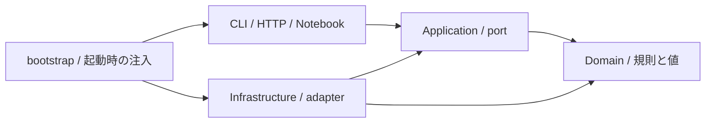
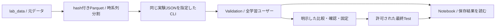
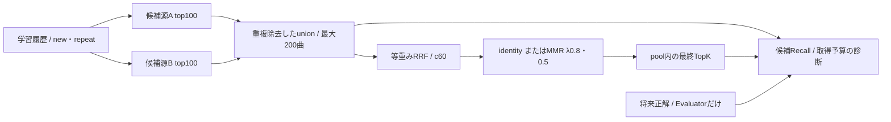

# アーキテクチャ

## 層と責務

| 層 | 責務 | 許可する依存 |
| --- | --- | --- |
| Domain | 推薦条件・候補制約・評価定義・参加者とセッションの不変条件 | 標準ライブラリとDomain |
| Application | 推薦・参加・試聴・削除・実験の実行順、外部機能のport | DomainとApplication |
| Infrastructure | モデル、GPU、Parquet、SQLite、認証、音源、外部APIのadapter | 内側の層と技術ライブラリ |
| Interfaces | CLI、Notebook、HTTP、表示・入出力の変換 | 内側の層と起動時に選ぶadapter |
| bootstrap | 具象adapterの生成・注入と構成 | 起動に必要な各層 |

- 推薦と参加者実験を別の文脈として扱う。学習済みモデルの版・カタログ・入力種別を契約で結び付ける
- Pythonは`src/domain`・`application`・`infrastructure`・`interfaces`。フロントエンドは`domain`・`application`・`infrastructure`・`presentation`
- DomainへNumPy/CuPy・DB・HTTPを入れず、ApplicationはProtocol等のportを使う
- InfrastructureからInterfacesをimportしない。描画はInterfacesから関数を渡し、永続化・数値処理へ表示依存を戻さない
- `tests/test_architecture.py`がPythonとフロントエンドの依存方向、adapter交換時の契約を確認する
- source hash・学習出典・モデルmanifest・候補Parquet・探索処理・grid生成・保存Testの検証を共有部品へ分離し、Python全層の循環importも検査する
- 依存方向が正しいことと、全機能の研究妥当性・本番運用確認は別。未確認事項は[TODO](todo.md)へ置く

## 共通処理の配置と命名

- パッケージ名で分かる接頭辞は重ねない。Notebook補助は`config.ConfigPicker`・`display`・`inspection.Inspection`・`plots`を使う
- 実験条件の展開は`infrastructure/research/grid.py`、保存結果の比較・出典照合・公開処理は`comparison.py`に置く
- Notebook補助からCLIをimportしない。CLIとNotebookは共通のInfrastructureを利用し、描画用の結果抽出は`interfaces/notebook/report_data.py`へ置く
- DDDの中心は推薦条件・候補規則と参加者セッションの文脈。DomainとApplicationの依存制約、adapter差替え、循環importは自動テストで確認する
- 研究用CLIには実行順制御、Notebookのreportモジュールには結果保存が残る。全ユースケースがApplicationへ分離された構成ではなく、層の依存検査だけで完全なDDD・クリーンアーキテクチャとは判断しない

## 研究の標準経路

- Python 3.12とuv.lockを維持する。Docker・sudo・常駐DBを研究の前提にしない
- 設定は`configs/common.json`を継承し、CLIとNotebookで同じJSONを明示指定する
- Notebookは既定で読込みだけ。評価開始・選択・確認・固定は明示操作で、主タスク・主指標は未指定でもよい
- 成功マーカーは`result.json`。途中出力は公開せず、再開時は入力・設定・処理版・成果物hashを確認する

## 単独推薦

| 方式 | 学習・推薦の実体 | 注意点 |
| --- | --- | --- |
| Popularity | 学習再生回数またはユニーク人数の降順 | 個人化対照、同点は曲ID |
| ItemCF | 二値履歴、Cosine/Jaccard/Pearsonの正の近傍 | Pearsonは全学習ユーザーに対するφ係数 |
| ALS | implicitの信頼度付きMF、α・正則化・因子数 | CPUとGPUで解法・精度が異なる |
| BPR | 二値履歴、項目bias付きpairwise SGD | CSR由来の負例、既聴負例はskip、学習seedを保持 |
| EASE | 二値X、正則化した曲間行列の逆行列、対角0 | GPU FP32 Cholesky、メモリ予算と残差を検査 |
| BM25 | 曲×ユーザーの再生回数を重み付け、曲間近傍 | 推論履歴は二値、nは内部近傍数 |
| Content | 学習カタログのタグIDFと履歴プロファイルcosine | IDFとbinary/log_count集約を区別 |

- 全件モデルの学習器へ渡すのはlearningと許可された静的特徴だけ。将来正解はEvaluatorが読む
- newは本人の学習曲を除外、repeatは学習曲内。単独順位の同点は学習再生回数→曲ID
- 保存済みモデルは入力hash・版・配列hash・bias・実推論経路を照合する。CSVから重みを復元できた扱いにしない
- BPRの既知ユーザー因子、未知ユーザー時の補完、ALS fold-inは別の経路。補完を元モデルの性能と呼ばない

## 多段階推薦

- 初期10条件は単独4方式、EASE+BPR/BM25+ContentのRRF 2構成、各構成のMMR 2条件
- 比較版は`configs/hybrid.json`へ記録する。EASE λ500、BPR128因子/500epoch/seed42・43・44、BM25 n20/k1.2/b0.75、Content IDFあり/log_count
- これらはValidationに基づく比較版。研究上の採用モデル・主指標を決定したものではない
- 同じ学習済み重みを単独・RRF・MMRで共有し、BPRのseedを対応させる
- 候補生成は元順位・raw score・版・実経路をParquetへ保持する。未取得scoreはnullであり、0へ補わない
- 候補100の比較と等取得枠のA200/B200診断を分ける。取得200の実測費用から取得100の費用を推測しない
- raw union全体へRRFを適用する。round-robin P100やRRF後top-Pは後続の削減対照で、初期条件へ混ぜない
- nはモデル内部近傍数、mは源ごとの取得数、Pはpool上限、Kは最終推薦数
- 同じ候補artifactとpool hashでRRF/MMRの集合一致を確認する。pool外へのPopularity補完をしない
- 候補源の失敗は要求失敗として保持し、片源だけの成功へ読み替えない

## RRF・MMRの規則

- `RRF(i)=Σ w_j/(c+rank_j(i))`。元順位は1始まり、未取得源の寄与0は定義上の0で、raw scoreの欠測とは別
- RRF同点は学習再生回数→曲ID。MMR同点は固定した許容差内で元RRF順位を使う
- 関連度は`rel=(c+1)*RRF/Σw`。0〜1への変換であり、cosineとの尺度合わせや確率校正を保証しない
- MMRは`λ*rel-(1-λ)*max cosine`。λ1はRRFをそのまま返し、最初の有効曲も元順位に従う
- 欠損・ゼロノルム曲はRRFの位置を固定し、有効曲だけを残る位置へ配置する。未知類似度を0として優遇しない
- タグは非負。負の埋込みは初期比較へ混ぜず、別の特徴版とする
- raw/正規化RRF、固定seedの候補対cosine、選択時最大cosine、重み付き2項の分布を記録する
- Content・MMR・ILDは同じタグへ依存するため、ILD上昇から独立な音楽的多様性や満足度を証明しない

## 計算資源と効率

- 長時間処理前にホスト`nvidia-smi`でGPU・VRAM・利用プロセスを確認し、他ジョブと競合させない
- 学習・推薦スコア・順位・指標・bootstrapをGPU対象とする。sandboxで見えないだけでCPUへ自動切替しない
- MMR・ILDは疎な特徴とバッチを使い、全カタログの密な類似度行列を常設しない
- backend・デバイス・精度・solver・seed・依存版・thread・実測秒を保存する。GPUのbitwise一致を保証しない
- 段階別の学習・取得・融合・再ランキング・評価を区別し、GPUバッチ償却値を単発API待ち時間と呼ばない
- DuckDBの一時書出しに空きを確保する。作業ディレクトリとTMPDIRも対象で、成功済みデータの削除で対処しない

## アプリと将来接続

- 現行はReact/TypeScript＋FastAPI、参加者状態はMacのSQLite、研究データは研究室に置く。[UIと運用](ui.md)を参照
- LLM/Agentの研究用Adapterと研究者HTTPは既存実装。参加者UI・実API運用・汎用多段階選択には未接続
- 固定Hybridの検証後、固定・ルール・LLM単発・明示要求によるReactive Agentの順に比較する
- 将来の選択対象は完成済みPipelineSpecの版ID。初期に内部パラメータをLLMへ自由生成させない
- task、履歴量・偏り、特徴可用性、同意済み嗜好、観測済みfeedback、残予算を候補Contextとし、ルールにも同じ情報を渡す
- 詳細な新registry・常設cache管理・汎用GPU runner・Agent loop・UI接続をPhase 2の前提にしない
