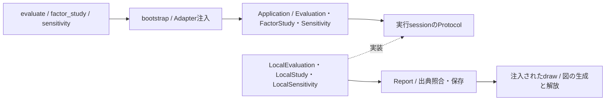
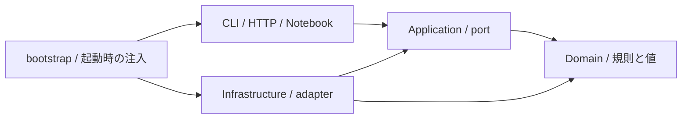
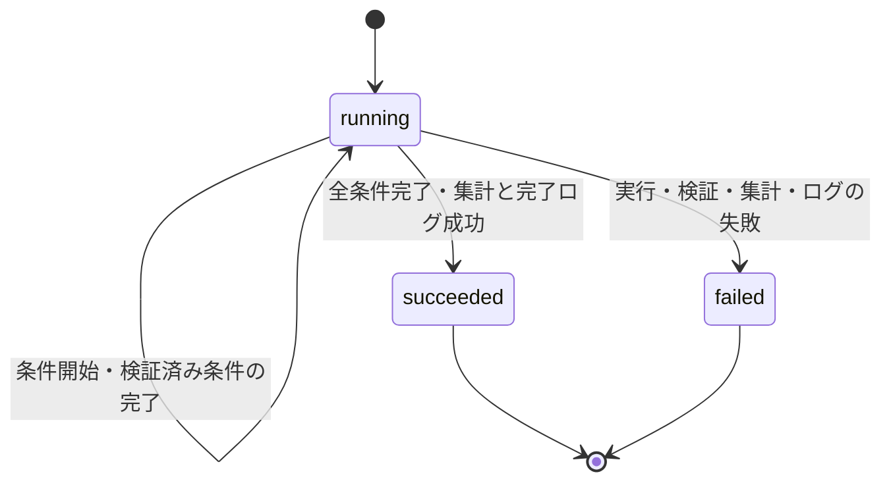
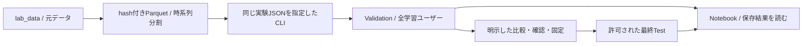
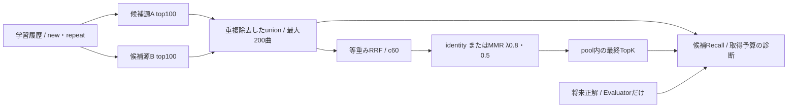
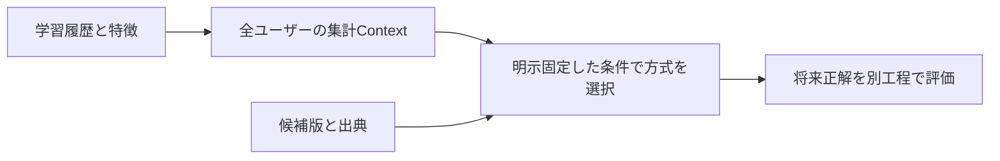

# アーキテクチャ

## 層と責務

| 層 | 責務 | 許可する依存 |
| --- | --- | --- |
| Domain | 推薦条件・候補制約・評価定義・参加者とセッションの不変条件 | 標準ライブラリとDomain |
| Application | 推薦・参加・試聴・削除・実験の実行順、外部機能のport | DomainとApplication |
| Infrastructure | モデル、GPU、Parquet、SQLite、認証、音源、外部APIのadapter | 内側の層と技術ライブラリ |
| Interfaces | CLI、Notebook、HTTP、表示・入出力の変換 | 内側の層と起動時に選ぶadapter |
| bootstrap | 具象adapterの生成・注入と構成 | 起動に必要な各層 |

- 推薦と参加者実験を別の文脈として扱う。学習済みモデルの版・カタログ・入力種別を契約で結び付ける
- Pythonは`backend/domain`・`application`・`infrastructure`・`interfaces`。フロントエンドは`domain`・`application`・`infrastructure`・`presentation`
- DomainへNumPy/CuPy・DB・HTTPを入れず、ApplicationはProtocol等のportを使う
- InfrastructureからInterfacesをimportしない。描画はInterfacesから関数を渡し、永続化・数値処理へ表示依存を戻さない
- `tests/test_architecture.py`がPythonとフロントエンドの依存方向、adapter交換時の契約を確認する
- source hash・学習出典・モデルmanifest・候補Parquet・探索処理・grid生成・保存Testの検証を共有部品へ分離し、Python全層の循環importも検査する
- 依存方向が正しいことと、全機能の研究妥当性・本番運用確認は別。未確認事項は[TODO](todo.md)へ置く

## 共通処理の配置と命名

- 実行順はApplication、入力照合・学習・保存はInfrastructure、引数と表示はInterfacesが担う
- CLIとNotebookは共通処理を呼び出す。Notebook補助からCLIをimportせず、描画関数をInfrastructureへ注入する
- HTTPもCLIへ依存しない。Parquet変換は`datasets/listening_export.py`、配布bundleの照合・梱包は`models/bundle.py`、要求単位のユーザーbootstrapは`domain/evaluation/uncertainty.py`を共有する
- Protocolと依存注入でAdapterを交換する。状態や振る舞いを共有しないクラスには、継承を追加しない

| 処理 | 実行順・規則 | 具象処理・保存 |
| --- | --- | --- |
| 単独評価 | `Application.Evaluation` | `LocalEvaluation`、`FullReport` |
| 因子数・epoch比較 | `Application.FactorStudy`、`Domain.Progress` | `LocalStudy`、`FactorReport` |
| 感度分析 | `Application.Sensitivity` | `LocalSensitivity`、`SensitivityReport` |
| 多段階推薦 | `application/hybrid.py`、`Domain.FusionSpec` | `research/hybrid.py`、`recommenders/pipeline.py` |
| 条件展開・過去結果照合 | `research/grid.py`、`parameters.py` | `comparison.py`、`results.py` |
| 固定Test・保存比較 | `bootstrap`で評価器と描画を注入 | `research/fixed_test.py`、`final_report.py`、`hybrid_report.py` |
| 保存結果の索引 | CLIは引数を渡す | `research/catalog.py`、`additional_validation.py`で出典照合・保存 |
| 表・図 | `interfaces/notebook/report_data.py`と各描画モジュール | `FigureWriter`で保存、生成した図は成功・失敗時とも解放 |

- 実行sessionはAdapter内に保持する。ApplicationはProtocolを介して操作し、モデル・設定・ログを直接変更しない
- `Progress`は重複完了・未完了での成功・終了後の更新を拒否する。変更不可のSnapshotを保存形式へ変換し、再開時は出典を検証して進捗を再構築する
- 過去の成功条件を再利用するときも入力・処理版・成果物を照合する。描画・指定モデルの保存・完了ログが成功した後に結果を公開する
- メモリAdapterによる順序・失敗・再開試験と、保存物を使う統合試験を併用する。一部の研究用CLIには実行順制御が残っており、全ユースケースのApplication分離は未完了
- ItemCF比較図は`python -m backend.interfaces.cli.itemcf_report --config <JSON>`から生成する。Notebook側は描画だけを担当する

## 研究の標準経路

探索の公開操作は`infrastructure/research/search/__init__.py`から利用する。内部の担当は次のとおりで、内部モジュール同士は公開入口を経由せず直接依存する

| モジュール | 担当 |
| --- | --- |
| `config` | 設定読込み・検証とStudyConfig |
| `runner` | 公開操作からApplicationのSearchへ渡す入口 |
| `backend` | LocalSearch / 入力・排他ロック・試行・保存のAdapter |
| `progress` | 試行履歴と型付き状態の変換 |
| `trials` | 1試行の学習・評価・保存・再利用時の検証 |
| `state` | 比較条件・進捗読込み・排他ロック・固定後の書込み制限 |
| `selection` | 順位付け・選択・確認記録・固定 |
| `final` | 固定済みTest入力の検証・最終評価・再開 |
| `artifacts` | 内容hashと選択記録の改変検知 |

- JSONの保存と読込みは既存の`research/store.py`を共有する
- Applicationの`Search`がSmoke確認・件数/時間予算・試行・途中保存を制御する。計画は遅延生成し、予算を超えて候補を読み進めない
- Domainの`SearchProgress`は成功・失敗・予算切れを区別し、再利用数と実行数を記録する。`TrialProgress`は中断を失敗履歴へ残し、成功済み試行の再学習と終了後の結果変更を拒否する

- Notebookは既定で読込みだけ。評価開始・選択・確認・固定は明示操作で、主タスク・主指標は未指定でもよい
- 成功マーカーは`result.json`。途中出力は公開せず、再開時は入力・設定・処理版・成果物hashを確認する

## 単独推薦

| 方式 | 学習・推薦の実体 | 注意点 |
| --- | --- | --- |
| Popularity | 学習再生回数またはユニーク人数の降順 | 個人化対照、同点は曲ID |
| ItemCF | 二値履歴、Cosine/Jaccard/Pearsonの正の近傍 | Pearsonは全学習ユーザーに対するφ係数 |
| ALS | implicitの信頼度付きMF、α・正則化・因子数 | CPUとGPUで解法・精度が異なる |
| BPR | 二値履歴、項目bias付きpairwise SGD | CSR由来の負例、既聴負例はskip、学習seedを保持 |
| EASE | 二値X、正則化した曲間行列の逆行列、対角0 | GPU FP32 Cholesky、メモリ予算と残差を検査 |
| BM25 | 曲×ユーザーの再生回数を重み付け、曲間近傍 | 推論履歴は二値、nは内部近傍数 |
| Content | 学習カタログのタグIDFと履歴プロファイルcosine | IDFとbinary/log_count集約を区別 |

- 全件モデルの学習器へ渡すのはlearningと許可された静的特徴だけ。将来正解はEvaluatorが読む
- newは本人の学習曲を除外、repeatは学習曲内。単独順位の同点は学習再生回数→曲ID
- 保存済みモデルは入力hash・版・配列hash・bias・実推論経路を照合する。CSVから重みを復元できた扱いにしない
- BPRの既知ユーザー因子、未知ユーザー時の補完、ALS fold-inは別の経路。補完を元モデルの性能と呼ばない

## 多段階推薦

- 初期10条件は単独4方式、EASE+BPR/BM25+ContentのRRF 2構成、各構成のMMR 2条件
- 比較版は`configs/hybrid/base.json`へ記録する。EASE λ500、BPR128因子/500epoch/seed42・43・44、BM25 n20/k1.2/b0.75、Content IDFあり/log_count
- これらはValidationに基づく比較版。研究上の採用モデル・主指標を決定したものではない
- 同じ学習済み重みを単独・RRF・MMRで共有し、BPRのseedを対応させる
- 候補生成は元順位・raw score・版・実経路をParquetへ保持する。未取得scoreはnullであり、0へ補わない
- 候補100の比較と等取得枠のA200/B200診断を分ける。取得200の実測費用から取得100の費用を推測しない
- raw union全体へRRFを適用する。round-robin P100やRRF後top-Pは後続の削減対照で、初期条件へ混ぜない
- nはモデル内部近傍数、mは源ごとの取得数、Pはpool上限、Kは最終推薦数
- 同じ候補artifactとpool hashでRRF/MMRの集合一致を確認する。pool外へのPopularity補完をしない
- 候補源が失敗すると比較処理を停止し、途中出力を保持する。片源だけで推薦を続けず、成功結果も公開しない

## RRF・MMRの規則

- `RRF(i)=Σ w_j/(c+rank_j(i))`。元順位は1始まり、未取得源の寄与0は定義上の0で、raw scoreの欠測とは別
- RRF同点は学習再生回数→曲ID。MMR同点は固定した許容差内で元RRF順位を使う
- 関連度は`rel=(c+1)*RRF/Σw`。0〜1への変換であり、cosineとの尺度合わせや確率校正を保証しない
- MMRは`λ*rel-(1-λ)*max cosine`。λ1はRRFをそのまま返し、最初の有効曲も元順位に従う
- 欠損・ゼロノルム曲はRRFの位置を固定し、有効曲だけを残る位置へ配置する。未知類似度を0として優遇しない
- タグは非負。負の埋込みは初期比較へ混ぜず、別の特徴版とする
- raw/正規化RRF、固定seedの候補対cosine、選択時最大cosine、重み付き2項の分布を記録する
- Content・MMR・ILDは同じタグへ依存するため、ILD上昇から独立な音楽的多様性や満足度を証明しない

## 計算資源と効率

- 長時間処理前にホスト`nvidia-smi`でGPU・VRAM・利用プロセスを確認し、他ジョブと競合させない
- 学習・推薦スコア・順位・指標・bootstrapをGPU対象とする。sandboxで見えないだけでCPUへ自動切替しない
- MMR・ILDは疎な特徴とバッチを使い、全カタログの密な類似度行列を常設しない
- backend・デバイス・精度・solver・seed・依存版・thread・実測秒を保存する。GPUのbitwise一致を保証しない
- 段階別の学習・取得・融合・再ランキング・評価を区別し、GPUバッチ償却値を単発API待ち時間と呼ばない
- DuckDBの一時書出しに空きを確保する。作業ディレクトリとTMPDIRも対象で、成功済みデータの削除で対処しない

## アプリと将来接続

- 現行はReact/TypeScript＋FastAPI、参加者状態はMacのSQLite、研究データは研究室に置く。[UIと運用](ui.md)を参照
- HTTPの`server.py`は組立と寿命管理、`boundary.py`は認証・Origin・試行制限、`schemas.py`は厳密な入力、`session_views.py`は所有者照合と公開範囲、`sessions.py`・`playback.py`・`catalog.py`は各APIを担う
- LLM/Agentの研究用Adapterと研究者HTTPは既存実装。参加者UI・実API運用・汎用多段階選択には未接続
- 固定Hybridの検証後、固定・ルール・LLM単発・明示要求によるReactive Agentの順に比較する
- 将来の選択対象は完成済みPipelineSpecの版ID。初期に内部パラメータをLLMへ自由生成させない
- task、履歴量・偏り、特徴可用性、同意済み嗜好、観測済みfeedback、残予算を候補Contextとし、ルールにも同じ情報を渡す
- 詳細な新registry・常設cache管理・汎用GPU runner・Agent loop・UI接続を、選択器比較の前提にしない

### 選択器の共通入力

- `hybrid_selection --config configs/hybrid/base.json`は計画表示、`--prepare`で学習期間の集計だけを作成する。CLIは`python -m backend.interfaces.cli.hybrid_selection`で起動する
- 出力はHybrid Validation直下の`selection-context/`（config.json・result.json・contexts.parquet・run.log）。既存出力を上書きせず、全学習ユーザー×新規/再聴を保存する
- 共通入力はtask、学習ユニーク曲数、適格曲数、学習再生回数、曲ごとの再生日数合計、最多再生曲の再生割合、非ゼロ特徴を持つ学習曲の割合。再生日数合計は曲間の重複日を含む
- user_idはローカルParquetの照合用。`SelectionContext.payload()`にはID・曲名・元履歴・将来正解・評価値を含めない。特徴の時点可用性の制約を維持する
- Validationは成功状態・人数・候補版の照合に使う。4論理IDをEASEの1実行と融合各3seedへ結び付け、推薦・スコア・取得候補・同一pool・処理版を照合する。入力・特徴・全参照を再照合して公開し、準備の成功を選択器評価の成功とは呼ばない
- EASE/RRF/MMR0.8/MMR0.5の[比較設計と接続前監査](selector-study.md)を参照する。両タスク別比較・採用保留・APIなしで共通入力を準備し、7項目Contextと既存`DecisionInput`の実API接続は未実装
- 既存Adapterは[OpenAI Decisions API](https://developers.openai.com/api/docs/guides/decisions)を使用する。実接続には`MUSIC_RECSYS_DECISION_API_KEY`が必要で、キーを保存物へ記録しない。全件LLM選択・品質比較・費用計測は未実行
- 選択器の出力は登録済み版IDに限定する。失敗・拒否・再試行・課金の扱いを比較前に固定し、未測定の利用量を0や推測値で埋めない

