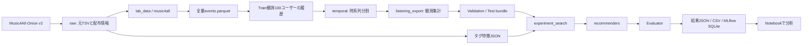

# 現在の構成

## データと評価の流れ

## モジュール

| 場所 | 責務 |
| --- | --- |
| `notebook_config.py` | 設定選択UI・明示的な読込み・変更検知 |
| `lab_data.py` | 取得・照合・ファイル保存のみのコホート生成 |
| `music4all.py` | 全量Parquet変換・全量EDA |
| `temporal.py` | 時刻境界による分割・読戻し検証 |
| `listening_export.py` / `listening_data.py` | v2入力の生成・hashと観測整合性の検証 |
| `features.py` | 重み付きタグ特徴・checksum |
| `recommenders/` | 7モデルの学習・推薦・説明 |
| `candidates.py` / `types.py` | 共通要求・応答・候補の判定 |
| `evaluation/` | 精度・多様性・効率の評価、追跡 |
| `experiment_search.py` / `search_protocols.py` | 探索・再利用・選択・確認・固定・Test |
| `search_analysis.py` / `listening_analysis.py` | 保存結果の分析・可視化 |
| `recommendation_inspection.py` | 選択設定の個別推薦・根拠・音源確認 |
| `ingestion/` / `adapters/` / `temporal_cli.py` | 任意のDB経路、[接続手順](optional-storage.md) |

## 保存物

| 場所 | 内容 |
| --- | --- |
| `data/raw/music4all-onion-v2/` | 元TSV.bz2・record.json・取得途中の.part |
| `data/processed/music4all-onion-v2/` | 全量Parquet・変換manifest |
| `data/benchmarks/lab-100/` | 履歴・分割・v2入力・features.json・ready.json |
| `data/experiments/lab-100/` | 試行・結果・ログ・tracking.db |
| `configs/workflow-lab-popularity.toml` | 研究室の予備分析用設定 |
| `configs/workflow-suite-*.toml` | 合成データで7モデルを確認する設定 |
| `examples/` | 自動テスト・明示した操作確認用の合成fixture |

## 保存と再現性

- 元ファイルは配布サイズ・MD5、加工物はSHA-256で照合
- 完了したファイル一式を公開し、途中生成物を完了扱いにしない
- `ready.json` はファイル経路の完了目印、DBのsnapshot公開とは別の仕組み
- ファイル経路のsnapshot / split IDは内容由来の識別子、DB用UUIDとして渡さない
- 実験はデータ・特徴・処理コード・依存lock・設定・seedを記録
- binary-v1のJSON入力とReaderも実装されているが、研究室の標準入力はlistening-v2
- 合成fixtureはテスト・明示した操作確認用で、Notebookから暗黙に読み込まない
- LLM・Agentは未実装、実測使用量を受け取る型のみ存在
