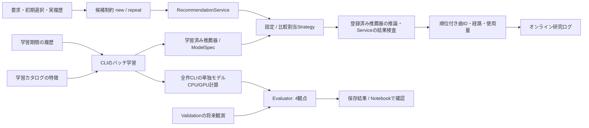
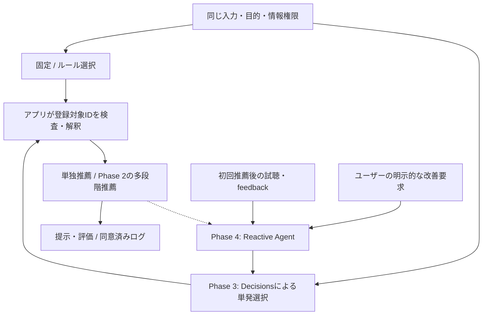

# 推薦システムのアーキテクチャ

## 責務と境界

- 対象は推薦の学習・候補制約・戦略選択・順位付け・評価
- UI・音源配信・配置は[アプリ全体](app-architecture.md)、コードと保存先は[実行フロー](experiment-workflow.md)
- アイコン付き全体図は[READMEのSVG](../README.md#アーキテクチャ図)、補足説明は[設計図HTML](architecture.html)を参照
- モジュラーモノリスを維持し、推薦器と推薦戦略を分離する
- 推薦実行側は単独/候補生成/融合/再ランキング/返却、戦略制御側は固定/ルール/LLM選択/Reactive Agentを担う構想。詳細は[拡張設計](recommendation-design.md)
- Domainは推薦・評価・比較計画・参加者状態、Applicationはユースケースと必要なportを持つ
- モデル・SQLite・音源・ファイル・HTTPの具象処理は外側へ置き、`src/bootstrap.py`で接続する
- Music4Allの既存item_id・実験結果・学習indexを維持し、コードは[実行フロー](experiment-workflow.md#パッケージ構成)の層へ分ける

現行の配信Serviceと全件CLI。全件の最終Testは未対応で、小規模RunnerのTestとは区別する

- 推薦器へ渡すのは学習由来の状態・要求・候補のみ
- 将来の正解はEvaluatorだけが読み、候補選択や負例抽出へ渡さない
- newは学習カタログの本人未聴曲、repeatは本人既聴曲に制限する
- 初期選択と実際の再生履歴は別入力とし、初期選択をRepeat Recallの正解にしない
- オンラインの履歴・長期嗜好・Session Contextの分離と比較入力の固定は[長期嗜好管理](participant-profile.md)を参照

## 推薦器

| 方式 | 学習・順位付け | 実装範囲 |
| --- | --- | --- |
| Popularity | 学習総再生回数またはユニーク再生ユーザー数 | 小規模・全件評価・配信 |
| ItemCF | 二値曲共聴のCosine/Jaccard、履歴曲の上位近傍スコア和 | 小規模・全件評価・配信 |
| BM25 ItemCF | 再生回数をBM25重みへ変換した曲内積、履歴近傍スコア和 | 全件評価・ItemCF形式の配信 |
| UserCF | 本人を除く類似ユーザーの既聴曲へ近傍重みを加算 | 小規模共通Runner |
| Implicit ALS | 信頼度付き行列分解、ユーザー・楽曲因子の内積 | 小規模・全件CPU/GPU・配信 |
| BPR-MF | 観測正例を未観測負例より高くするペア学習、因子内積 | 小規模・全件CPU/GPU・配信 |
| EASE | 二値聴取行列の対角ゼロ制約付きridge、密な曲間係数 | 全件GPU評価・小規模CPU参照、配信未対応 |
| Content | 学習カタログのタグTF-IDFと履歴プロファイルのCosine | 小規模・全件GPU評価・タグ特徴モデルの配信 |
| Hybrid | ItemCF/UserCFとContentの順位を重み付きRRFで融合 | 小規模共通Runner |

- Contentの曲類似は聴取履歴由来のItemCFと区別する
- 楽曲統計・タグ頻度を、ユーザー履歴のPopularity/協調フィルタと読み替えない
- 同点は原則として学習再生回数降順・item_id昇順、Popularityはスコア降順・item_id昇順
- 根拠不足のPopularity補完と実際の推論経路を記録し、方式固有の成果として数えない

## モデルごとの重要な条件

| 方式 | 現行の全件設定・制約 |
| --- | --- |
| ItemCF | cosine/jaccard × neighbors=20/50/100、履歴を二値化、自己近傍を除外 |
| BM25 | K1=1.2、B=0.75、neighbors=20/50/100、曲共起を128曲ブロック処理、推論履歴は二値 |
| ALS | factors=32/64/128/256/512、iterations=20、alpha=10、regularization=0.1、seed=0 |
| ALS信頼度 | 既定は `c_ui=1+alpha*log1p(n_ui)`、`p_ui=1[n_ui>0]`、未観測の信頼度1を含む |
| ALS数値解法 | CPUはfloat64直接解法、512のGPUはfloat32共役勾配・cg_steps=20、差を因子数だけの効果にしない |
| BPR | implicit 0.7.2、factors=32/64/128/256、iterations=30/100/200/500、lr=.01、reg=.01、seed=42/43/44、float32 |
| BPR負例 | 学習CSRの楽曲エントリ由来、既聴負例を棄却して更新スキップ、全曲既聴ユーザーはPopularity補完 |
| EASE | λ=500の単一診断、二値X、GPU float32 Choleskyと列ブロック解法 / [条件とCLI](ease.md) |
| Content | 学習曲だけでIDFを計算、L2正規化した曲特徴をbinary/log_count履歴で集約、欠損を嗜好根拠にしない |
| Hybrid | CFとContentのRRF、cf_weight・rrf_constant・pool_sizeを明示、未取得成分の寄与は0 |

- 小規模BPRは未聴曲の一様抽出、全件implicit BPRとは負例分布・bias・更新方式が異なる
- CPU/GPUのsolver・精度・並列更新順の違いを出典へ残し、seed固定でもビット一致を保証しない
- 長時間計算前にホスト側の`nvidia-smi`を確認し、空いていれば対応GPU実装を優先する
- 学習だけでなく順位付け・指標集計・bootstrapもGPU化の対象とする
- 全件Contentの疎行列モデルexportは未実装、タグ特徴JSONの小規模配信とは別経路

## 共通契約

| 契約 / 実装 | 責務 |
| --- | --- |
| RecommendationRequest / Response | request_id・user_id・履歴・候補・task・top_k / 順位付き曲ID・状態・使用量 |
| InitialProfile / ProfileRequest | 曲・内部artist IDの初期選択を要求へ変換、実履歴とinput_kindで区別 |
| ModelSpec | モデル版・アルゴリズム・不変のパラメータ・seed・学習/カタログ/実装の出典 |
| Strategy / FixedStrategy / ComparisonStrategy | 登録済みModelSpecから利用モデルを選択、現在は固定/比較割当 |
| RecommendationService | 学習せず推薦、応答ID・重複・top_k・候補を検査、選択時間と推論時間を別計測 |
| DeployedRecommender | 全件モデル配列を共通recommend契約へ接続、fold-in/補完経路を明示 |
| Evaluator | 同じ候補・正解・期間で4観点を採点、[オフライン評価](listening-evaluation.md)に従う |

## 保存済みモデルとCold-start

- `src.infrastructure.models.model_artifacts`の`export_model/load_model`を使用し、manifest＋NPYで保存、pickleは使わない
- manifestにModelSpec・学習hash・Git revision・ソース/lock hash・配列hash/shape/dtype・実行環境を保持
- item順序hash、ファイル集合、有限値、index範囲・重複、manifest hashをロード時に検証する
- NPYをread-only mmapで開き、推論要求ごとに重みを読み直さない
- 既存保存先へのexportを拒否、モデル更新は新しい版とディレクトリを使う
- 過去の評価JSONからALS/BPRの重みを復元することはできない

| 入力 | Popularity | ItemCF/BM25 | ALS | BPR |
| --- | --- | --- | --- | --- |
| 既存ユーザー | 保存統計 | 入力履歴の近傍 | 保存ユーザー因子 | 保存ユーザー因子 |
| 新規ユーザーの初期選択 | 保存統計 | 学習曲の近傍 | 明示有効化したfold-in | 因子適応は未実装、Popularity |
| 学習外の新曲 | 学習統計なし | 近傍なし | 因子なし | 因子なし |

- ALS fold-inは固定楽曲因子と学習時のalpha/正則化で小さな正規方程式を解く、全モデルの再学習ではない
- 初期選択を二値重み1で扱うfold-inの推薦品質は別途検証が必要
- BPR未知ユーザーのPopularity補完をBPRとして比較しない、必要経路の不一致を実験計画で拒否する
- Catalog登録だけではCFの新曲推薦は増えない、特徴ベース経路またはバッチ再学習が必要

## 将来のオーケストレーション

- 配信は固定/比較割当Strategy。[LLM/Agent検証基盤](llm-agent-evaluation.md)は研究用CLIのみで、配信UI/HTTPへ未接続。ルール/汎用多段階は未実装
- Phase 1単独→2多段階→3LLM戦略選択→4Reactive Agentの順で検証する
- Decisionsを活用する方向は確定し、判断の型とアプリによる実行責務は[拡張設計](recommendation-design.md#decisions-apiとagentの境界)へ集約する
- 単発LLMは直接の楽曲ランキング生成を主目的とせず、登録済み処理を選択する。推薦器/完成パイプラインの選択粒度は未確定
- Agentは明示要求でのみ起動。破線は結果の参照であり、自発介入するProactive型は対象外
- 入力Context・許可行動・融合/再ランキング・反復基盤・停止/予算は未確定。既存契約の再利用案は[対応表](recommendation-design.md#現行コードとの対応)を参照
- 試聴/feedback・追加回数の公平性は[オンラインUI/UX](online-ux.md#公平な比較と提示バイアス)、検討順は[研究計画](research-plan.md#未確定事項と推奨検討順序)

## 参考

- [Implicit ALS原論文](https://yifanhu.net/PUB/cf.pdf)
- [BPR原論文](https://proceedings.mlr.press/r7/rendle09a.html)
- [implicit近傍・BM25仕様](https://benfred.github.io/implicit/api/models/cpu/knn.html)
- [RRF原論文](https://research.google/pubs/reciprocal-rank-fusion-outperforms-condorcet-and-individual-rank-learning-methods/)
