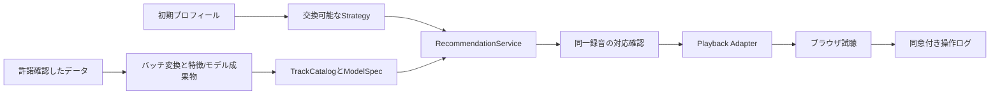

# music-recsysの学習データと再生元

確認日: 2026-10-16 / アプリ用カタログは未採用、Music4Allベンチマークを維持
以下の件数は公開データの規模であり、現在再生できる曲数ではない

## 比較と推奨

| 組み合わせ | データ・新しさ | 学習・Cold-start | 再生・費用・制約 |
| --- | --- | --- | --- |
| A MTG-Jamendo＋Jamendo | 2019年由来、タグ対象55,609曲、195タグ、曲/artist/album ID、音響特徴も配布 | 履歴なし、タグ/音響Content向け、新曲は特徴登録で対応 | 共通track IDが有利、非商用API無料・client ID必要、音源は曲別CC、データセットは非商用研究/学術用途限定 |
| B ListenBrainz＋外部再生 | 継続更新、ユーザー別時刻付き履歴、MBID等、現在のユニーク録音数は未集計 | Popularity/ItemCF/ALS/BPRが可能、音響特徴は別取得、新ユーザーはseed/Popularity | 履歴CC0は音源配信権を含まない、SoundCloud等との録音一致と提供可否を別検証 |
| C FMA＋許諾音源直接配信 | 2016–2017年由来、106,574曲、smallは8,000曲、タグ/ジャンル/音響特徴 | 配布物をユーザー別聴取行列とは扱わない、Content向け | 曲別CCを選別、HTML audioで試聴、配信容量・転送量が費用要因 |
| D Music4All＋外部再生 | 原版109,269曲、Onion v2は2025年公開、119,140ユーザー・約2.53億履歴 | 既存CFモデルを活用できる、未知曲には再学習/Contentが必要 | 原版spotifyidあり、現行録音と再生権は別確認、原版音源は提供申請 |
| E 許諾カタログ＋music-recsys内履歴 | 少数曲から開始、同意取得後の実操作のみ | 当初Content、履歴蓄積後にCF、露出偏りに注意 | 曲単位の学習/配信許諾を確保できれば外部APIを省ける |

Aを最初の非商用PoC候補、Bを協調フィルタリング継続候補とする
A/Cに架空のユーザー再生履歴を与えてALS/BPRを学習しない
曲の累計人気が得られてもユーザー別履歴とは区別する
Aのタグ頻度を再生Popularityと呼ばない。新規ユーザーは明示選択曲の特徴を集約する
一般向け公開・商用化へは、Aの研究用データを無条件に持ち出さず別途許諾を確認する

根拠（上記確認日）:
- [MTG公式・規模/特徴/ライセンス](https://github.com/MTG/mtg-jamendo-dataset)
- [ListenBrainzデータ・CC0/更新](https://listenbrainz.org/data/)、[推薦目的](https://listenbrainz.org/about/)
- [FMA公式・配布/特徴/曲別ライセンス](https://github.com/mdeff/fma)
- [Music4All原版](https://sites.google.com/view/contact4music4all)、[Onion v2](https://zenodo.org/records/15394646)

## 再生サービス

| サービス | ブラウザ・認証 | 無料運用と学習/分析条件 |
| --- | --- | --- |
| Jamendo | read API client ID、audio URLをHTML audioへ、個人操作はOAuth | 非商用無料、個別CCに従う、50万hitsを超える見込みは連絡、研究データの学習条件とAPI提供条件は別 |
| SoundCloud Widget | 公式iframe＋Widget API、PLAY/PAUSE/FINISH等 | Widgetと検索APIは別。API登録にArtist Pro、集約配信・AI入力等に制限、Widgetで全面許諾になるわけではない |
| Spotify | Web API OAuth、SDKブラウザ再生にはPremium | 開発者Premium、原則5認証ユーザー、学習/AI入力・分析の制限、previewは提供保証なし |
| Apple Music | MusicKit JS、developer token・ユーザー認可、フル再生は購読 | 全員無料の前提に合わない、メタデータ/再生用途は契約に従う |
| 許諾済み直接配信 | HTML audio、必要なら短命URL/アプリ認証 | 外部購読不要、曲別帰属表示・改変/NC/SA条件、配信費、アクセスログ管理が必要 |

外部の聴取イベントを取得できることと、その分析・再学習が許可されることを分ける
既存ベンチマークの条件と、配信先の利用規約を混同しない
詳細は[再生方式](playback-options.md)を参照
追加根拠（2026-10-16確認）:
- [Jamendo認証・公式試験ID](https://developer.jamendo.com/v3.0/authentication)、[API規約](https://devportal.jamendo.com/api_terms_of_use)
- [SoundCloud API登録](https://developers.soundcloud.com/docs/api/register-app)、[Widget](https://developers.soundcloud.com/docs/api/html5-widget)、[規約](https://developers.soundcloud.com/docs/api/terms-of-use)
- [Spotify quota](https://developer.spotify.com/documentation/web-api/concepts/quota-modes)、[SDK](https://developer.spotify.com/documentation/web-playback-sdk)、[規約](https://developer.spotify.com/terms)
- [MusicKit](https://developer.apple.com/musickit/)

## 実データPoC

対象A、音源取得・外部公開・API登録なし。実メタデータとタグを取得して推薦まで実行
抽出母集団はtags.tsvとraw.meta.tsvをTRACK_IDで内部結合した55,522曲
55,609という公開タグ件数を、タイトル等の揃った母集団件数と混同しない
TRACK_IDでソート後、Python random.Random(42).sampleで重複なし100曲

| 測定 | 結果 | 解釈 |
| --- | --- | --- |
| 正規化・Catalog登録 | 100/100 | NFKC＋空白整理、録音版表記は削除しない |
| データセット内IDとJamendo URL末尾ID | 100/100 | 静的ID整合のみ、現在のサービスでの一致率ではない |
| 曲別ライセンスURL | 100/100 | 配布時の記録、現在のサービス提供可否は未確認 |
| seed 1曲から正のCosineで推薦可能 | 98/100プロフィール | 残り2はこの小標本内に共通タグなし、偽の人気補完をしない |
| 現行サービスとの録音照合率 | 未測定/null | API認証段階で停止 |
| 実ブラウザ再生率 | 未測定/null | 音源URLを取得できず未実行、0%と記録しない |
| CLI最大RSS | 約166 MiB | 元メタデータ全体の読込み含む、FastAPI常駐値ではない |

公式文書のread試験IDで1件を照会したところHTTP成功でもJSON headers.status=failed/code=11
エラーは「Jamendo Api Suspended Application Error」。曲の削除・地域制限とは分類しない
同じ停止IDで100回繰り返さず、応答をapi-probe.jsonへ保存
現在推薦・再生の両方が確認された曲数は未確定。55,522曲への再生率外挿はできない
API復旧後はこの同じ100曲を照合し、ID/artist/title/duration/版の矛盾を要確認に分類する
名前の類似だけで同一録音を確定せず、live/remix/re-recordingは別版として保持する
地域・認証状態・観測日時を添え、音声の実再生進行をブラウザで測る

現在のAPI設定・実曲モード・承認後の検証は[Jamendo実曲モード](jamendo.md)を参照
協調フィルタリング用履歴の実測は[ListenBrainz PoC](listenbrainz-poc.md)を参照

## 実装と再実行

`src/music_recsys/catalog_poc.py` は既存のCatalogTrack/TrackCatalog/ModelSpec/RecommendationServiceを再利用
MetadataCatalogAdapterは静的lookupだけ提供し、availabilityは常にunknown
TagSeedRecommenderは学習履歴を捏造せず、特徴をL2正規化したCosineを使用
このPoCだけrequest.historyを選択seedとして渡す。アプリへの導入時はInitialProfileから明示変換する
既存ContentRecommenderは観測履歴からカタログを構成するため、履歴のない本PoCへ無理に流用しない
バッチ成果物とAPI推論を分離。既存アプリ設定・デモ・モデルは変更しない

入力URL（各ファイルのSHA256はresult.json）:
- https://raw.githubusercontent.com/MTG/mtg-jamendo-dataset/master/data/raw.meta.tsv
- https://raw.githubusercontent.com/MTG/mtg-jamendo-dataset/master/data/raw_30s_cleantags_50artists.tsv
- https://raw.githubusercontent.com/MTG/mtg-jamendo-dataset/master/audio_licenses.txt

```bash
.venv/bin/python -m music_recsys.catalog_poc \
  --inputs data/poc/mtg-jamendo-input \
  --output data/poc/mtg-jamendo-next --count 100 --seed 42
.venv/bin/pytest -q tests/test_catalog_poc.py tests/test_app_foundation.py
```

出力先は新規のみ。tracks.csv/catalog.json/features.json/result.jsonを生成、元データと生成物はGit管理外
既存成果物は `data/poc/mtg-jamendo-100/`。入力は配布元MTGに帰属、メタデータCC BY-NC-SA 4.0
テストはunknown再生状態、録音版保持、候補制限、seed除外、空入力時の棄却を確認



LLM/AgentはStrategyの交換で接続。外部メタデータをLLMへ送る許諾は別途確認する
評価時の候補数・再生可能曲への絞込み・入力プロフィールを固定し、モデル差と配信差を分離する

## 月額0円の構成と次の判断

Cloudflare無料枠＋小規模ContentモデルのFastAPI＋Jamendoの非商用read APIを第一候補とする
- Cloudflare静的配信無料、API中継はWorkers無料枠（10万要求/日等）に収める
- Render無料FastAPIは512 MB、15分無通信で停止・復帰約1分、ローカル変更は再起動で消える
- ログ永続化を前提にせず、まず同意付きローカル検証。モデルは起動時に復元する
- 研究室サーバーは既存資源なら追加利用料を抑えられるが、公開許可・通信経路が必要
- Hugging FaceのCPU Basicは時間単価無料でも、現在の公式説明ではDocker Space作成に有料プランが必要。0円FastAPI候補と断定しない
- API待ち時間と再生開始時間は今回未測定。学習用GPUは本タグPoCに不要

根拠（2026-10-16確認）: [Workers](https://developers.cloudflare.com/workers/platform/pricing/)、[Render無料枠](https://render.com/docs/free)、[Render計算資源](https://render.com/docs/compute-plans)、[Spaces](https://huggingface.co/docs/hub/spaces-overview)

判断事項はJamendo非商用開発者登録を行うか、履歴CFを優先してListenBrainz照合を先行するか
推奨は前者。本人のclient ID取得後に100曲のlive照合・再生を測り、Contentモデルと外部Playback AdapterをUIへ接続する
FMA直接配信は曲別許諾・ファイルサイズ・配信量を確認してから音源を取得する第二候補
新規契約・被験者データ収集・本番公開・課金リソース作成は行っていない
