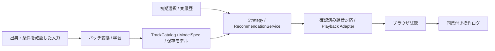

# 楽曲カタログと再生元

現在はMusic4Allの既存モデルと30秒clipを使う方針。取得・試聴条件は申請済み、回答待ち
Music4Allの準備と接続は[実曲の実験準備](lab-study.md)、アプリ配置は[Macでの運用](mac-study.md)を参照
外部サービスのAdapter・PoCは独立した任意機能として保持し、既定カタログへ自動適用しない
以下の資料・件数の確認日: 2026-10-16。公開規模と現在の再生可能曲数は別

## データと推薦方式

| データ | 内容 | 適用できる推薦 | 音源の扱い |
| --- | --- | --- | --- |
| Music4All-Onion v2 | 119,140ユーザー・約2.53億履歴、タグ | Popularity・ItemCF・ALS・BPR | 履歴配布には音声clipを含まない。原版109,269曲のclip・メタデータは別途申請 |
| MTG-Jamendo | タグ対象55,609曲、195タグ、曲/artist/album ID | タグ・音響Content。ユーザー別履歴はない | Jamendo client IDと曲別条件の確認が必要。アプリ登録は承認待ち |
| ListenBrainz | 継続更新のユーザー別時刻付き履歴・録音MBID等 | Popularity・ItemCF・ALS・BPRの入力候補 | 履歴のCC0は音源配信権を含まない。再生元との録音対応が必要 |
| FMA | 106,574曲、small 8,000曲、タグ・ジャンル・音響特徴 | Content。配布物をユーザー別聴取行列と扱わない | メタデータCC BY 4.0、音源は曲別ライセンス。既存Music4All因子は流用できない |

履歴のないカタログに架空の聴取履歴を与えてCFを学習しない
タグ頻度・楽曲の累計人気・ユーザー別履歴は区別する
新規ユーザーは明示選択曲を入力とし、新曲は特徴があればContent、CFでは次のバッチ学習が必要

公式資料:
- [Music4All原版](https://sites.google.com/view/contact4music4all)、[Onion v2](https://zenodo.org/records/15394646)
- [MTG-Jamendo・特徴/ライセンス](https://github.com/MTG/mtg-jamendo-dataset)
- [ListenBrainzデータ・CC0](https://listenbrainz.org/data/)、[ダンプ](https://listenbrainz.readthedocs.io/en/latest/users/listenbrainz-dumps.html)
- [FMA配布・ライセンス](https://github.com/mdeff/fma)

## 再生元の境界

| 再生元 | 現在の接続状態・制約 | 公式資料 |
| --- | --- | --- |
| Music4All / 許諾済みローカル音源 | Playback Adapter＋HTML audio。ID・hash・許諾記録を検査して登録 | [実曲登録手順](lab-study.md#音源と許諾) |
| Jamendo | read API・URL再解決・イベント接続済み、実再生は未確認。非商用APIと曲別CCを別確認 | [実曲モードと登録](jamendo.md)、[API規約](https://devportal.jamendo.com/api_terms_of_use) |
| Spotify | Adapter未実装。SDK再生にはPremium等の条件、preview URLは欠損可能。学習・AI入力・分析の制限あり | [SDK](https://developer.spotify.com/documentation/web-playback-sdk)、[Policy](https://developer.spotify.com/policy) |
| SoundCloud | Adapter未実装。Widgetの操作イベントと、検索APIの認証・利用条件は別 | [Widget](https://developers.soundcloud.com/docs/api/html5-widget)、[API規約](https://developers.soundcloud.com/docs/api/terms-of-use) |
| Apple Music | Adapter未実装。MusicKitの認可・購読・メタデータ用途を確認する必要あり | [MusicKit](https://developer.apple.com/musickit/)、[契約](https://developer.apple.com/support/terms/apple-developer-program-license-agreement/) |

外部APIで技術的に取得できても、学習・試聴・分析・再配布が許可されるとは扱わない
別サービスの曲を曲名だけでMusic4Allの同一録音へ置き換えない
外部コンテンツのLLM入力は別途条件確認が必要。実音源の一般公開・再配信は行わない

## MTG-Jamendo PoC

母集団はタグとメタデータをTRACK_IDで内部結合した55,522曲
TRACK_ID順に並べ、random.Random(42).sampleで重複なし100曲を抽出

| 項目 | 結果 |
| --- | --- |
| 正規化・Catalog登録 | 100/100 |
| データセットIDと保存Jamendo URLのID整合 | 100/100。現行サービスでの録音一致を意味しない |
| 曲別ライセンスURL | 100/100。配布時の記録 |
| seed 1曲から正のCosineで推薦可能 | 98/100プロフィール |
| 現行録音照合率・ブラウザ再生率 | 未測定/null。API認証段階で停止 |

MetadataCatalogAdapterは静的lookup、availabilityはunknown
TagSeedRecommenderはL2正規化タグのCosineで、聴取履歴によるItemCFとは異なる
NFKC・空白だけ正規化し、live/remix等の版表記を保持する
API成功、URL取得、録音一致、ブラウザ再生進行は別々に測定する

```bash
.venv/bin/python -m music_recsys.catalog_poc \
  --inputs data/poc/mtg-jamendo-input \
  --output data/poc/mtg-jamendo-next --count 100 --seed 42
```

入力URLとhashは保存result.jsonを参照。入力と成果物はGit管理外
既存成果物はdata/poc/mtg-jamendo-100/。再実行は新しい出力先を指定する
API認証後の同じ100曲での検証は[Jamendo手順](jamendo.md)を使用する

## ListenBrainz照合PoC

便宜標本は公開1アカウントの最近の500イベント。Jamendoは上記100曲を固定
recording MBIDは499/500イベント・247種類、投稿Jamendo URL候補と正規化名一致候補はいずれも0/500
同一録音の照合率・誤一致率・再生率は未測定/null。全体の重なりへ外挿しない
1ユーザーかつ照合候補なしなので、CFモデルは学習していない

```bash
.venv/bin/python -m music_recsys.listenbrainz_poc \
  --listens data/poc/listenbrainz-input/listens.json \
  --catalog data/poc/mtg-jamendo-100/tracks.csv \
  --output data/poc/listenbrainz-jamendo-check
```

元履歴は0600・Git管理外。集計はdata/poc/listenbrainz-jamendo-500/のresult.jsonとmatches.csv
録音MBID・ISRC・MusicBrainzのURL関係を確認するまでは名前一致も投稿URL一致も未確定候補
[MusicBrainzのライセンス区分](https://musicbrainz.org/doc/About/Data_License)と[API制限](https://listenbrainz.readthedocs.io/en/latest/users/api/index.html)に従う
十分な複数ユーザーの重複聴取があるか、時間分割後の被覆率を含めて次の学習可否を判断する

## アプリへの接続



カタログ・モデル・再生元を独立して交換し、ベンチマークとアプリの評価条件を分ける
共通契約は[構成](architecture.md#アプリの共通契約)、保存・cold-startは[モデル配信](model-serving.md)を参照
