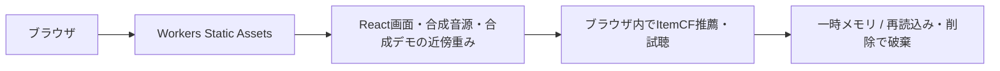

# music-recsysのCloudflare配信

公開プレビューはWorkers Static Assetsで配信し、ブラウザ内で合成デモを実行する
研究室サーバーへの接続・外部公開・ポート開放は行わない
実モデルとSQLiteを使うアプリは[Macでの運用](mac-study.md)を参照



## 公開する内容

- 架空の曲名・アーティスト、独自作成のCC0合成音源
- 合成履歴だけで学習した小規模ItemCFの楽曲近傍と再生数
- 同意画面・曲選択・プレイヤー・任意評価・削除のUI

Music4Allのデータ・重み・音源・ユーザー因子・秘密情報・行動ログを含めない
公開デモではAPIへプロフィールやイベントを送信せず、ログ保存チェックも表示しない
ホスティング基盤の通常のアクセス記録とは別。実参加者の研究データ収集用ではない
デモ推薦はPythonの同じ配列・候補制約・同点処理と比較する

## 生成とビルド

Node 22.12以上、Python側はapp/data/modelsの依存が必要
既存データ・静的出力を上書きせず、準備済みならprepare/exportを省略する

```bash
uv sync --locked --group app --group data --group models
.venv/bin/python -m music_recsys.webapp.prepare \
  --demo --output data/app/demo
.venv/bin/python -m music_recsys.webapp.public_demo \
  --config data/app/demo/config.json --output frontend/public/demo
cd frontend
npm ci
npm run build:preview
npm run test:worker
npm run check:deploy
```

public_demoはdemo以外を拒否し、音源hash・sampleフラグ・CC0出典を検査する
生成物はGit管理外。画像・音源・メタデータを手動で追加して公開対象へ混ぜない
Mac/Python用の通常ビルドは`npm run build`で、FastAPIへ接続する
公開ビルドだけVITE_PUBLIC_DEMO=1を使う。公開可能なVITE変数はAPIパスとデモフラグのみ

## プレビューと配信

```bash
cd frontend
npm run preview:cloudflare -- --port 8787
# 認証がなければ、ポートを開かないデバイス認証を使う
npx wrangler login --device --browser=false
npm run deploy:preview
```

previewは`music-recsys-preview` Workerのworkers.dev URLを使用する
productionは別の`music-recsys` Workerで、既定の公開経路は無効
独自ドメイン・有料サービス・本番への切替を自動作成しない
SPAの深いURLを静的アプリへ返し、未知の/apiはJSONエラーを返す
アセットとAPIの配信設定はfrontend/wrangler.jsoncで管理する

## FastAPIへの接続を追加する場合

`npm run build`で公開デモフラグなしにし、別の環境として構成する
WorkerのBACKEND_ORIGINへHTTPS Origin、UPSTREAM_API_TOKENへsecretを登録する
FastAPIは同じOTOLAB_API_TOKENと明示的な許可Origin/hostを要求する
Bearerをブラウザへ渡さず、同一Originの限定APIだけ中継する
音声RangeとセッションCookieを転送し、API/音声はno-store、redirectは追わない
参加者認証・同意・音源条件・保持規程が整ってから実データへ接続する

## Gitと検証

mainへのpush/PRで.github/workflows/ci.ymlがPythonテスト・UIビルド・デモ生成・配信dry-runを行う
Cloudflareの認証情報はローカルのWrangler管理下。GitHubへ自動転送しない
自動デプロイを有効にする場合は、CloudflareのGit連携または専用のGitHub Secretを別途設定する

公式資料:
- [Static Assets](https://developers.cloudflare.com/workers/static-assets/)
- [Wrangler認証](https://developers.cloudflare.com/workers/wrangler/commands/general/)
