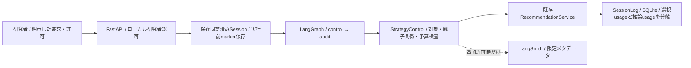

# LangGraphの研究者向けFastAPI接続

## 対象と境界

- LangGraphで既存StrategyControlを実行し、固定・単発LLM・Reactiveの同じ推薦契約を呼ぶ研究者専用HTTP経路
- `POST /api/control/recommendations`はlocal researcher audienceだけに公開する。参加者向けは404、探索的な被験者実験の割当と混ぜない
- 採用するLang系はLangGraphとLangSmith。[制御仕様とSDK](llm-agent-evaluation.md)を再利用し、LLM判断は既存Adapterから呼ぶ
- LangSmithは明示設定＋送信許可があるときだけ、限定メタデータを送る任意Adapter
- 実LLMモデル・予算・同意が未指定のため、付属例は固定戦略・外部API呼出し0回。実API・実トレース送信は未実施



## ローカルPythonで起動

```bash
uv sync --locked --group app --group llm
.venv/bin/python -m src.interfaces.http.server \
  --config /private/demo/config.json --database /private/control/sessions.sqlite \
  --audience researcher --control deploy/control.example.json --port 8766
```

- 起動は既存の検証済みbundleに対して行う。例の`demo-itemcf`等は合成bundle用で、実データの採用モデルではない
- control JSONのtargetsは登録済みversionと固定説明、feedback_choicesは許可語彙、budgetはcall数・timeout・任意費用上限を明示する
- LLM利用時は`decision: {"model": "明示モデル名"}`と非公開の`MUSIC_RECSYS_DECISION_API_KEY`を設定する。既定モデル・自動retryは設けない
- LangSmith利用時は`trace: {"project": "明示project", "api_url": "https://明示endpoint"}`と`MUSIC_RECSYS_LANGSMITH_API_KEY`を設定する
- 設定JSONへ秘密値・参加者情報・自由文を埋め込まない。環境変数名だけでは送信許可にならない

## MacのDockerで任意に有効化

```bash
# stateは既存ログと同じ非公開の保存先。control.jsonは秘密値を含めない
export MUSIC_RECSYS_RESEARCH_CONTROL=1
export MUSIC_RECSYS_CONTROL_CONFIG=/state/control.json
bash deploy/mac.sh researcher
```

- 研究者サービスだけ追加のllm dependency groupを組み込む。通常の参加者imageにLang系は必須にしない
- `control.json`をMacのstateディレクトリへ事前に配置し、登録versionをbundleと一致させる
- 必要なAPIキーだけ研究者containerへ渡す。参加者containerはcontrol設定を読み込まず、参加者HTTPへ研究用経路を公開しない
- Mac実機・Docker build・外部API疎通は未確認。ローカルの実LangGraph＋FastAPI試験とは区別する

## HTTPでの明示操作

- 新規の研究者セッションで保存に同意し、初期プロフィールを登録してから呼ぶ
- 通常APIと同じ本人cookie・`X-Music-App: 1`・Origin検査を使う。ブラウザへAPIキーを渡さない

```json
{
  "request_id": "research-control-1",
  "mode": "fixed",
  "top_k": 5,
  "fixed_target": "demo-itemcf"
}
```

- modeは`fixed`・`llm_once`・`reactive`。外部判断は要求ごとの`decision_input: true`が必要
- 自由文は`feedback_text`に加えて`feedback_text_permission: true`が必要。HTTPの研究用ログへ本文・本文hashを保存しない
- 外部traceは要求ごとの`trace_metadata: true`が必要。長期嗜好の保存同意から推定しない
- 2回目以降は`explicit_adjustment: true`と最新の`parent_request_id`を指定。各modeの条件内で初回＋最大2調整、入力・対象集合を固定する
- 応答はstatus・reason・監査と、成功した場合だけ推薦リスト。失敗を代替推薦や0評価で埋めない
- 同内容のrequest_id再送は保存済み応答を返して外部判断を重複実行しない。異なる選択肢/許可の再利用を拒否する
- 自由文を含む再送は本文の同一性を保存・照合しないため拒否する。新IDでの再判断は予算を消費する

## 保存・再起動・削除

- 課金し得る判断の前にSQLiteへ実行中markerを保存し、結果と監査を既存セッションへ保存する
- 制御オブジェクト自体はプロセスメモリ内。再起動や不確実な保存失敗後は同じ研究セッションのcontrolを再開せず、call予算を黙って0へ戻さない
- 新しい研究者セッションは別の明示操作。参加者セッションの通常再開にこの研究用制御を混ぜない
- 保持期限・本人削除に制御ログも従う。削除後は対応するメモリ内controlも破棄する
- LangSmith側の保持/削除を実被験者の規程へ接続するまでは実参加者向けに有効化しない

## 検証

```bash
.venv/bin/pytest -q tests/test_control_http.py tests/test_strategy_control.py tests/test_architecture.py
```

- 実LangGraphとFastAPI、合成モデル、一時SQLite、ネットワークなしの判断portを使う
- 親子関係・2調整上限・外部許可・本文非保存・重複防止・実行前保存・再起動/保存失敗時の停止・削除を確認する
- 外部SDKへの実呼出し・料金・実参加者の推薦品質を試験値から推測しない
