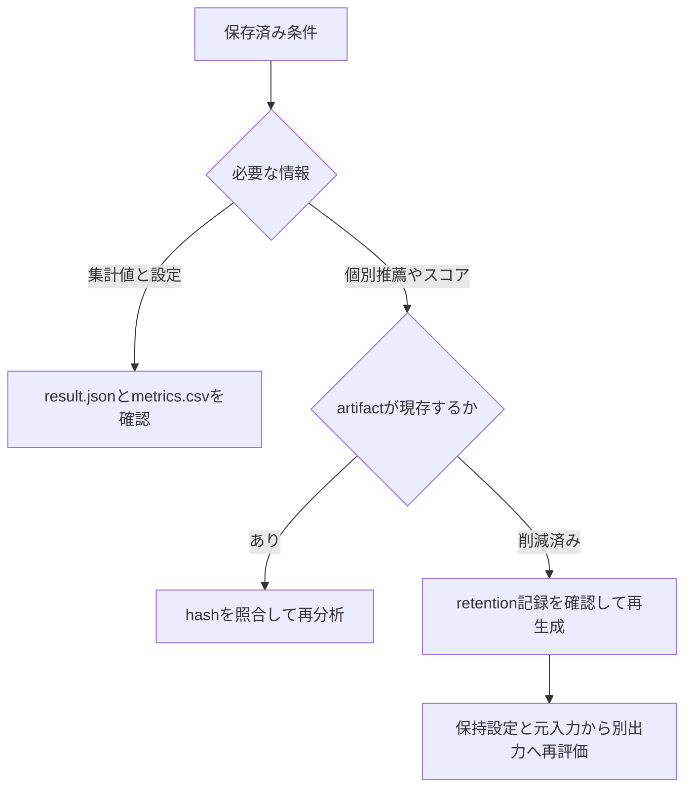

# 研究成果の保持範囲

## 保存先と整理方針

| 保存先 | 内容・整理条件 |
| --- | --- |
| `data/raw` | 取得した原本・ライセンスを保持 |
| `data/processed` | 変換結果と出典を保持、再生成キャッシュは個別に判定 |
| `data/benchmarks` | 評価入力・分割・manifestを一緒に保持 |
| `data/experiments` | 手法別の成果物、以下の保持範囲に従う |
| `data/provenance` | hash照合・削減対象・保持検証の記録 |
| `/tmp/music-sequence-uv-cache` | 再取得可能な依存キャッシュ、uv稼働中は整理しない |

- 容量確認ではハードリンクを区別する。依存キャッシュと`.venv`が実体を共有する場合、見かけの容量すべては解放されない
- キャッシュ整理に研究成果や稼働中テストの一時ディレクトリを含めない
- [保存物のサイズと集計hash一覧](../data/provenance/storage-maintenance-20261113/inventory.json) / [キャッシュ整理と保持検証](../data/provenance/storage-maintenance-20261113/verification.json)
- [10MiB超・同サイズ候補の重複hash照合](../data/provenance/storage-duplicates-20261113/inventory.json)は読取り専用の調査。内容が一致しても、別実験の出典・参照先として保持するファイルは自動削除しない

## 残すもの

- 元データ・データ分割・特徴量・参加者ログ
- 最新の時間減衰・遷移・初回聴取・正規化と固定融合の全件結果、比較・検算・出典
- 修正版HybridのValidation/Testと、その取得候補・個別推薦・スコア
- 後半検証・手法比較で参照するBM25条件と標準設定
- 保持対象の学習済みモデル、配信用モデル、BPR500epochの12モデル
- 探索条件も含む設定・result.json・metrics.csv・run.logと、研究本文・感度分析の集計図

## 個別データを削減した範囲

| 対象 | 削減範囲 | 残る情報 |
| --- | --- | --- |
| BM25の75条件探索 | 外部比較参照・標準条件を除く65条件の個別推薦とスコア | 全75条件の設定・集計値・ログ、保持10条件の個別値 |
| 旧Hybrid Validation | 修正版に置き換わった取得候補Parquet | 旧集計値・最終推薦・スコア・費用・診断と元のhash |
| 中断したHybrid Test | 中断出力のParquet中間物 | 中断時の設定・ログ・出典、完了した修正版Test一式 |
| ItemCFの処理キャッシュ | cosine/Jaccard/Pearsonの再生成可能な近傍npz | 元入力・実験結果・保持対象モデル |

- [削減対象・元hash・保持条件](../data/provenance/research-retention-20261112/plan.json) / [使用状況確認](../data/provenance/research-retention-20261112/busy-check.json) / [実行と保持検証](../data/provenance/research-retention-20261112/verification.json)
- ユーザーの「既存結果も重要なものだけ残す」という明示指示による削減。元の集計値・設定・ログ774ファイルはhash不変を確認
- 削減は144ファイル・5,502,363,175バイト。条件フォルダ内の`artifacts.retention.json`に対象名・サイズ・元hash・理由を残す
- 元のresult.jsonやartifact manifestを書き換えて「全ファイルが現存する」ようには扱わない

## 読込みと再分析

- 削減済み個別値を必要とする検証・対応差・再順位付けは実行不可。集計CSVから個別値を復元した扱いにせず、別方式へ自動切替しない
- 個別artifact検証は削減記録がある場合、その旨と再生成の必要性を明示して拒否する
- 同じ設定で再生成しても、GPU・ライブラリ・処理版の違いによる差は照合する。元のファイルと同一hashになる保証はしない
- 再生成キャッシュと、研究の根拠となる原本を区別する。追加削減は参照先・保持条件・稼働中ジョブを確認してから行う
