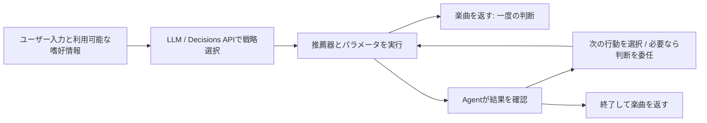

# 推薦実験の考察

## 比較条件

- Music4All-Onion v2の学習履歴がある119,133人を対象
- 学習期間の再生は202,396,019件、推薦カタログは45,888曲
- Validationで評価、最終Testは未実行
- Kは2〜20の整数、以下の比較表は90日間・K=20・日数重み1
- 新規曲の精度は正解がある18,601人、既聴曲の精度は19,268人の平均
- ユーザーごとの正解なしを0点として平均しない
- 正解は実際の再生履歴であり、嗜好そのものを完全に測るわけではない

## Popularityの定義

| 方式 | 人気の集計 | 設定 |
| --- | --- | --- |
| 総再生回数 | 同じユーザーの繰り返し再生も加算 | [popularity-plays.json](../configs/popularity-plays.json) |
| 再生ユーザー数 | ユーザー・曲の組を1件として集計 | [popularity-users.json](../configs/popularity-users.json) |

- 両方式で学習データ・評価期間・候補・指標は共通
- 人気順位は全ユーザー共通、同点は曲ID順
- 未聴曲推薦は個人の既聴曲を除外、既聴曲推薦は個人の履歴内に限定
- 個人の履歴で候補を絞るため、全ユーザーに同じ20曲を出すわけではない
- 嗜好に応じて人気順位自体を変更する学習は行っていない

## Popularity（総再生回数）

### Recallの推移

- 観測: Kが大きいほどRecallが上がり、K=2〜20ではほぼ直線的に増加
- 同じランキングの先頭から曲を追加するため、Recallは原理的に下がらない
- 上昇自体を順位付け性能の改善とは解釈しない
- 着眼点は、推薦曲を追加するごとに平均Recallが同程度ずつ増加していること
- 仮説: 最上位の人気曲だけが圧倒的に有効というより、20曲までは曲数を追加する効果が継続している可能性
- ユーザーごとの割合の平均なので、各順位で同数の正解曲が追加されたとは限らない

### Recallの絶対値

- 観測: 90日間のRecall@20は約0.608%
- 各ユーザーが評価期間に聴いた、推薦対象となる未聴の正解曲のうち、平均約0.608%を拾えたという意味
- 全カタログのカバー率や、推薦20曲のうちの正解率ではない
- 今回の条件では、人気順だけで個人の未聴の正解曲を幅広く拾うことは難しかった
- 仮説: ユーザーごとの嗜好の違いを順位に反映しないことが、低いRecallの一因である可能性
- 正解曲数・候補数・人気の時間変化も影響し得るため、原因の断定には個人化モデルとの比較が必要

### Recallのヒートマップ

- 横軸はK、縦軸は評価期間30/90/180日、色はRecall
- 90日の行はRecallの推移図と同じ値
- 特にKが大きい領域では180日のRecallが高い
- 学習データと推薦順位は同じで、正解を観測する期間だけを変更
- 仮説: 推薦した人気曲を時間を置いて聴くことが、長い期間でのRecall上昇に寄与した可能性
- 期間を延ばすと正解曲数と評価対象者も変わるため、同一ユーザーに揃えた追加分析が必要

### Repeat Recall

- 観測: Repeat Recall@20は約5.181%で、未聴曲のRecallより高い
- 仮説: 個人の嗜好を学習しなくても、人気順で再聴される曲をある程度拾える可能性
- ただし既聴曲に候補を限定しており、未聴曲推薦とは候補数・正解曲数・評価対象者が異なる
- 数値の大小だけで、再聴予測への有効性が特に高いとは結論づけない
- 既聴曲からのランダム推薦や、ユーザー自身の再生回数順との比較で効果を確認したい

### NDCG

- 当初の着眼点: 推薦件数を増やしても、順位を考慮した指標が同様に改善するとは限らない
- Binary NDCGはK=2の0.01247からK=20の0.01097へ低下
- 既聴曲のGraded NDCGは0.05484から0.07111へ上昇
- 未聴曲のGraded NDCGも0.00674から0.00798へ上昇
- 「NDCG系はすべてほぼ変わらない」とまとめず、指標とタスクを分けて読む
- Kで評価範囲と正規化の分母が変わるため、同じランキングの異なる範囲を評価している点に注意

## Popularity（再生ユーザー数）との比較

| 指標 | 総再生回数 | 再生ユーザー数 |
| --- | ---: | ---: |
| Recall | 0.608% | 0.644% |
| Binary NDCG | 0.01097 | 0.01208 |
| Graded NDCG（未聴曲） | 0.00798 | 0.00864 |
| Repeat Recall | 5.181% | 4.970% |
| Graded NDCG（既聴曲） | 0.07111 | 0.06837 |

- 観測: 再生ユーザー数版は、今回の新規曲のRecallとNDCGが高い
- 仮説: 総再生回数は一部ユーザーの繰り返し再生の影響を受けるため、ユーザー数版は広く聴かれる傾向を捉えやすい可能性
- 観測: Repeat Recallと既聴曲のGraded NDCGは総再生回数版が高い
- 仮説: 繰り返し聴かれやすい曲を優先することが、再聴予測に有利に働いた可能性
- 差の統計的有意性は未検証で、どちらが常に優れているとは結論づけない
- 人気の定義によって新規曲・既聴曲の結果が異なるため、今後のモデル比較では両者を基準として残す

## ItemCF: 新規発見と再聴で最適な近傍数が異なる

以下は同じ90日間・K=20の実測値。Recallは既聴曲を除いた新規曲のRecallであり、全聴取曲をまとめた指標ではない。

| 類似度 / 近傍数 | Recall | Repeat Recall | Binary NDCG |
| --- | ---: | ---: | ---: |
| Cosine / 20 | 0.022720 | 0.051548 | 0.030334 |
| Cosine / 50 | 0.020393 | 0.057439 | 0.030171 |
| Cosine / 100 | 0.019265 | 0.059764 | 0.029625 |
| Jaccard / 20 | 0.022052 | 0.044668 | 0.028490 |
| Jaccard / 50 | 0.020615 | 0.049701 | 0.029200 |
| Jaccard / 100 | 0.019830 | 0.053146 | 0.029514 |

- 観測: 全条件でPopularityよりRecallが高い。Cosine・Jaccardとも20近傍がRecall最大で、近傍を増やすほど低下した
- 仮説: 類似度の低い曲まで参照すると、新規曲の推薦では嗜好と関係の薄い情報が混ざる可能性
- 観測: Repeat Recallは両類似度とも近傍数とともに上昇し、同じ近傍数ならCosineが高い
- 仮説: 再聴曲は既存嗜好と結びつきやすく、近傍を広げることで履歴周辺の共聴取構造を拾える可能性
- Cosineが再聴に有利な類似関係を捉える可能性はあるが、類似度分布や的中曲の分析なしに原因は断定しない
- 観測: 6条件中、Recall・Binary NDCGはCosine/20、Repeat RecallはCosine/100が最大
- JaccardのBinary NDCGは近傍数とともに上昇するため、「少数近傍が常に良い」とは一般化しない
- 推薦目的によって良い設定が異なることが、戦略を選択する研究の動機になる

## ALS: 因子数の効果は指標によって異なる

| 因子数 | Recall | Repeat Recall | Binary NDCG |
| --- | ---: | ---: | ---: |
| 32 | 0.015642 | 0.062842 | 0.026117 |
| 64 | 0.017847 | 0.064409 | 0.027526 |
| 128 | 0.020700 | 0.065377 | 0.029893 |
| 256 | 0.021917 | 0.066336 | 0.030558 |
| 512 | 0.023083 | 0.063075 | 0.030495 |

- 観測: 32→128でRecallは約32%増、Repeat Recallは約4%増。新規曲のRecallの方が因子数の影響が大きい
- 仮説: 再聴される曲は少ない因子でも捉えられ、新規曲の予測には高次元の潜在表現が役立つ可能性
- 観測: 256までは両Recallが改善するが、Repeat Recallの改善幅は小さい。256→512ではRecallが上昇し、Repeat Recallは低下した
- ALSの因子数比較は今回512で区切る。最大値はRecallが512、Repeat Recall・Binary NDCGが256
- 「256まで指標低下がない」ことは過学習がない証拠ではない。512の低下だけでも過学習とは断定できない
- 512はGPU・float32・共役勾配法、32〜256はCPU・float64・直接解法。同じ目的関数だが因子数だけを変えた比較ではない
- 解法差が大きいと確認したわけではない。影響を切り分けるなら、まず同じ256因子をGPUでも測定する
- 計算量・学習時間も考慮する。実装差を含むCPU/GPU時間を因子数だけの効果として比較しない
- ItemCF Cosine/20はALS 32〜256よりRecallが高いが、ALS 512はそれを上回った
- ALSは今回の全因子数でItemCF最良条件よりRepeat Recallが高い
- 仮説: 履歴から学ぶユーザーの潜在的な嗜好が再聴予測に有効な可能性。ただし候補制約・信頼度重み等の寄与は未分離
- Binary NDCGの最大値はALS 256の0.030558とItemCF Cosine/20の0.030334で近い。統計的な同等性は未検証

## BPR: ランキング学習の効果を確認する

- 32/64/128/256因子、30 epochs、学習率0.01、正則化0.01、seed=0を比較
- 学習入力は学習期間のみ。未観測負例で観測曲との相対順位を学習するが、NDCGを直接最適化するわけではない
- 観測: NDCG@20は順に0.022584 / 0.023116 / 0.023113 / 0.023251。256が最大だが、64以降の差は小さい
- 今回の設定ではALS・ItemCFの最良Binary NDCGを上回らず、「BPRはNDCGに優れる」とは言えない
- Recallは64因子、Repeat Recallは128因子が最大。単調な因子数増加による改善は見られない
- 分析順はBPR内のBinary NDCG→Recall→Repeat Recall、次に他方式との比較、Latency・学習時間、Coverage・ILD等
- 表示の優先順は設定選択用の主指標を確定するものではない。他方式の「最良」は指標ごとのValidation診断値
- GPU Latencyは128人のバッチ時間を按分した値。CPUの単発リクエスト時間と同一条件の速度比較にはならない
- Epoch別のValidation NDCGは未測定。学習不足・過学習の判断には、検証条件を固定したEpoch別測定が必要
- Negative Sampling・学習率・正則化・複数seedも未比較。ユーザーbootstrapは学習のばらつきを測らない

## LLM・Agentによる推薦戦略選択の研究案

以下は未実装・未検証の構想。Decisions APIは検討候補名で、提供元・仕様・料金・速度・対応出力は未確認。

- 最終出力は文章でなく楽曲でもよい。推薦器・パラメータ・tool選択を構造化された判断として返す設計を検討する
- LLM段階の主題は「どの推薦器・設定を使うか」。ユーザー入力・学習時点の嗜好情報から一度選択し、推薦器を実行して楽曲を返す
- 通常LLMとDecisions APIによる選択を比較する。結果を見た戦略変更はこの段階には含めない
- Agent段階の主題は「推薦結果を見て次に何をするか」。tool選択→実行→結果確認→再判断を繰り返す
- Agent単独と、Agentが全体を制御してDecisions APIへ選択・スコアリングを委任する構成を比較する
- 「安価で高速」は仮説として検証する。判断の適切さ・推薦性能・Latency・料金・トークン・LLM/tool呼出し数を測る
- 最適戦略の正解は目的によって変わる。判断精度を測る前に目的と採点基準を定義し、最良戦略を知るoracleは評価上限として分ける
- Agentの再判断に未来の正解を渡さない。利用可能な推薦結果・特徴・明示的フィードバックと呼出し上限を揃える

## 次に確認したいこと

- 同じ評価ユーザーに揃えて期間別の正解曲数・的中曲数を比較
- ユーザー単位の対応のある差を用いて、方式間の差の不確実性を確認
- 精度と併せてILD・Coverage・Novelty・効率性を確認
- 実装・候補・正解の詳細は[評価仕様](listening-evaluation.md)と[モデル](models.md)を参照

## 図と原本

- 総再生回数: [Recall](../data/experiments/popularity-plays/recall.png) / [ヒートマップ](../data/experiments/popularity-plays/recall_heatmap.png) / [Repeat Recall](../data/experiments/popularity-plays/repeat_recall.png)
- 総再生回数: [Binary NDCG](../data/experiments/popularity-plays/binary_ndcg.png) / [既聴曲Graded NDCG](../data/experiments/popularity-plays/graded_ndcg_repeat.png)
- 再生ユーザー数: [Recall](../data/experiments/popularity-users/recall.png) / [ヒートマップ](../data/experiments/popularity-users/recall_heatmap.png) / [Repeat Recall](../data/experiments/popularity-users/repeat_recall.png)
- 原本: [総再生回数の結果](../data/experiments/popularity-plays/result.json) / [再生ユーザー数の結果](../data/experiments/popularity-users/result.json)
- ItemCF・ALS・BPR: [比較CSV](../data/experiments/bpr/metrics.csv) / [BPR NDCG因子比較](../data/experiments/bpr/binary_ndcg_factors.png)
- 図と実験原本はGit管理外のため、上記リンクは実験成果物がある環境で利用
