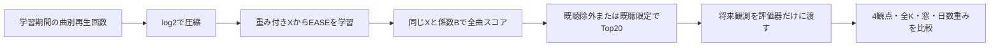

# EASEの学習入力を見直す実験

## 仮説と範囲

- 個人別に方式を選ぶ前に、基礎モデルが捨てている情報を調べる。従来EASEは学習内の正の再生回数を全て1へ変換する
- 比較する変更は`binary`から`log_count`への入力変換。`X[u,i] = log2(1 + play_count[u,i])`を学習・推薦の両方で使う
- 1回の再生を1に保ち、多数の再生は対数で圧縮。未観測は0。重複行は生の回数を合計してから変換する
- 全119,133人・同じValidation・正則化500・同じ候補制約・同点規則を維持。Testを使った調整はしない
- 閉形式の係数`B = -P / diag(P)`、`P = inverse(X.T X + lambda I)`、`diag(B)=0`は維持。[基礎手法](https://arxiv.org/abs/1905.03375)
- これは再生強度の利用を試す仮説であり、時間減衰や直近履歴を導入した実験ではない
- 入力尺度が変わるため、同じlambdaでも相対的な正則化の強さは変わる。重み付けと正則化の最適組合せをこの1条件で確定しない

## 実装と検証

- [学習実装](../backend/infrastructure/recommenders/full_ease.py)の`history_weighting`で明示指定。既定はbinaryを維持
- 元の再生回数による人気度・同点処理と、回帰に渡す重みを分離。学習・推論の変換を一致させる
- CPUはfloat64の線形方程式、GPUはfloat32 Cholesky。GPUで逆行列残差・有限性を確認する
- [試験](../tests/test_full_ease.py)で各曲を目的変数とする独立した制約付きridge回帰と係数・推薦スコアを照合
- 入力ソートと検証用DuckDBのRAM上限を`input_memory_mb`で記録。ホストRAMとGPUモデル用メモリを区別する
- 通常の入力RAM既定は2,048MB。今回の条件は16,384MBで、空きディスクへの一時書込みを抑える。評価母集団や計算式を変える設定ではない



## 実行と保存

```bash
CUDA_PATH=/usr PYTHONUTF8=1 OMP_NUM_THREADS=1 OPENBLAS_NUM_THREADS=1 MKL_NUM_THREADS=1 .venv/bin/python -m backend.interfaces.cli.evaluate --config configs/ease/log-count.json
```

- [実験JSON](../configs/ease/log-count.json)は既存base/commonを継承し、入力変換と入力RAM上限を明示する
- 出力は`data/experiments/ease/log-count/l500/`。既存結果を上書きしない。個別順位・スコアはParquet
- 新規Binary NDCG/Recall、再聴Graded NDCG/Repeat Recall、多様性・発見性、時間を測り、全K2〜20・30/90/180日・日数重みを保持
- API未使用。API料金・tokenの未測定値はnull。学習・一括順位取得とオンライン応答時間を区別する

## 二値入力との比較結果

- [重み付き原本](../data/experiments/ease/log-count/l500/result.json) / [全条件比較](../data/experiments/ease/log-count/l500/comparison/result.json) / [対応差](../data/experiments/ease/log-count/l500/comparison/paired.csv) / [共通ILD](../data/experiments/ease/log-count/l500/comparison/ild.csv)
- 全119,133人。以下はValidationの90日/K20/日数重み1で、新規精度18,601人・再聴19,268人が有効。Testの結果ではない

| 指標 | binary λ500 | log_count λ500 | 解釈 |
| --- | ---: | ---: | --- |
| 新規Binary NDCG | 0.034995 | 0.034071 | 平均低下。差の95%区間−0.001800〜−0.000107 |
| 新規Recall | 2.8675% | 2.7613% | 平均低下。差の95%区間−0.2232〜+0.0098ポイント |
| 再聴Graded NDCG | 0.105796 | 0.187329 | 大幅改善。差の95%区間+0.079273〜+0.083926 |
| Repeat Recall | 6.3716% | 10.8558% | 大幅改善。差の95%区間+4.2856〜+4.6797ポイント |

- 区間は2,000回のユーザー対応bootstrapによる探索的な95%区間。多重比較補正・学習の反復不確実性は含まない
- binary λ100/2000とも比較し、再聴2指標ではlog_count λ500との差の区間が正。新規の最大平均は重み付き条件ではない
- 共通ILDは新規108,576人・再聴111,886人。binary λ500→log_count λ500で新規0.7120→0.7356、再聴0.6250→0.6330
- GPU FP32 Choleskyの逆行列サンプル残差は約3.93e-5。学習89.9秒・評価142.8秒・順位取得42.3秒、GPUバッチ償却0.178ms/要求。学習前の入力検証やオンライン通信は別
- [独立再計算](../data/provenance/ease-weighting-20261112/log-count-verification.json)で個別精度607,302行から627集計値を照合。CPU平均との差最大約2.39e-15、238,266推薦行の一意性・母集団とartifact hashを確認
- 原本`definitions.ranking`に旧binary説明が残っていたため[訂正記録](../data/provenance/ease-weighting-20261112/metadata-correction.json)を併記する。実際の`model_parameters`・`execution.input_transform`はlog_count。説明生成コードを修正し、原本・数値は上書きしない

## 本人の再生頻度という対照

- 大幅改善が協調学習の効果か、単に再生回数を使った効果かを区別するため、本人の学習内`play_count`で既聴曲を並べる対照を置く
- [実装](../backend/infrastructure/recommenders/full_history.py) / [実験JSON](../configs/history_frequency/base.json)。学習パラメータはなく、同点は学習全体の再生回数→曲ID
- 新規曲の本人回数は全て0なので、新規タスクは全体Popularityで同点を解消する。この挙動を明示した対照であり、新規の個人化モデルとは呼ばない
- 既存の評価器で両タスク・全4観点・全K/窓・日数重みを計測し、将来の再生回数を推薦器へ渡さない
- 出力は`data/experiments/history_frequency/count/`。この対照も含めて初めて、重み付きEASEの追加価値を評価する

### 頻度対照を加えた結論

- [本人頻度の原本](../data/experiments/history_frequency/count/result.json) / [3方式比較](../data/experiments/ease/log-count/l500/history-control/result.json) / [対応差](../data/experiments/ease/log-count/l500/history-control/paired.csv) / [独立照合](../data/provenance/ease-weighting-20261112/history-frequency-verification.json)
- 同じ90日/K20/日数重み1。本人頻度は再聴NDCG **0.225217**、Repeat Recall **14.0711%**。従来binary EASE比でそれぞれ**+112.88%、+120.84%**
- 重み付きEASEに対しても再聴NDCG+20.23%、Repeat Recall+29.62%。差の95%区間はNDCG+0.036118〜+0.039640、Recall+3.0091〜+3.4069ポイント
- 再聴の両指標で、30/90/180日・全K2〜20の平均が重み付きEASEより高い。各Kの有意差や全日数重みでの一律優位まで意味しない
- 3方式の共通ILD母集団は再聴107,593人。binary→log_count→本人頻度で0.6242→0.6314→0.7022
- 再聴Coverageは71.33→79.95→89.35%、Noveltyは5.198→5.544→5.620bit。本人頻度はこの表示条件では精度だけでなく多様性・露出も高い
- 新規の本人頻度はNDCG0.010974、Recall0.6076%、Coverage0.3574%。未聴曲には本人回数がなく、Popularity同点解消へ退化するため、新規推薦へそのまま使わない
- 本人頻度はパラメータ学習なし。入力準備約54.0秒、GPU順位取得全238,266要求で24.0秒、評価全体120.0秒。バッチ償却0.101ms/要求でオンライン待ち時間ではない
- 個別精度607,302行から627値を独立CPU再計算し、最大差約3.05e-15。推薦238,266行・原本hashを確認
- **結論: 既存の再聴比較には強い本人頻度対照が不足していた。重み付きEASEの改善を、協調学習固有の優位とは呼べない**
- 新規と再聴を分け、再聴では本人頻度を必須の対照に置き直す。既存の固定Hybrid・個人別選択・Oracle上限は旧候補集合内の結果で、新対照への優位を示していない
- 次の再聴改善は「本人頻度を上回れるか」を検証する。新規側は二値EASE/融合を保持し、時間情報・負例抽出・候補取得などを別の要因として切り分ける
- 本結果は探索的Validation。採用判断・独立期間の確認・オンライン試験は未完了。APIは未使用

### 比較の再現コマンド

```bash
CUDA_PATH=/usr PYTHONUTF8=1 .venv/bin/python -m backend.interfaces.cli.evaluate --config configs/history_frequency/base.json
CUDA_PATH=/usr PYTHONUTF8=1 .venv/bin/python -m backend.interfaces.cli.weighting_comparison --config configs/ease/log-count.json --reference binary-l500=data/experiments/ease/l500 --reference history-frequency=data/experiments/history_frequency/count --comparison-name history-control --run
```

- 比較は元のconfig/result/artifact hash・母集団・評価条件を照合。保存順位から多様性を再集計し、原本との一致を確認する
- APIなしの金銭費用や電力は未測定。利用料0と研究全体の費用0を混同しない

## 本人の再生回数と再生日数

- 強い再聴対照をさらに見直し、`history_basis=play_count`と`active_days`を比較する。[日数条件](../configs/history_frequency/active-days.json)
- 回数は短期間の集中再生も強調する。日数は「何日その曲を聴いたか」という継続性の代理。最終再生日・直近性を使う方式ではない
- 変更するのは本人の曲別スコアだけ。母集団・カタログ・評価窓・同点の全体再生回数→曲IDは揃える。日数版でも人気度の同点解消を総再生日数に変えない
- 全員の両タスクを評価。新規曲は両方式ともスコア0なので同じPopularity順位になることを照合する
- 日数版でも学習期間の集約値だけを使う。将来の再生日数は評価器にだけ渡し、日数重み0/0.5/1/2を全て保持する
- 同じ指標で片方だけ有利な条件を選ばず、90日/K20の代表値、全K/全窓の変化、Coverage/Novelty/共通ILDと処理時間を確認する
- 実装は[本人履歴モデル](../backend/infrastructure/recommenders/full_history.py)。CPU/GPU双方で、100回を1日で聴いた曲と10回を10日で聴いた曲の順位が意図どおり変わることを試験する

```bash
CUDA_PATH=/usr PYTHONUTF8=1 OMP_NUM_THREADS=1 OPENBLAS_NUM_THREADS=1 MKL_NUM_THREADS=1 .venv/bin/python -m backend.interfaces.cli.evaluate --config configs/history_frequency/active-days.json
CUDA_PATH=/usr PYTHONUTF8=1 .venv/bin/python -m backend.interfaces.cli.weighting_comparison --config configs/history_frequency/active-days.json --reference history-count=data/experiments/history_frequency/count --run
```

- 日数版は`data/experiments/history_frequency/active-days/`、比較はその配下`comparison/`へ保存。回数版の結果は上書きしない
- 入力`active_days`は正・有限・`play_count`以下を要求する。回数版の既定と既存EASE/BPR/ALSの学習入力は維持する

### 日数対照の結果と判断

- [日数版原本](../data/experiments/history_frequency/active-days/result.json) / [対応比較](../data/experiments/history_frequency/active-days/comparison/paired.csv) / [共通ILD](../data/experiments/history_frequency/active-days/comparison/ild.csv) / [独立検算](../data/provenance/history-active-days-20261112/verification.json)
- 全119,133人、Validationの90日/K20/日数重み1。再聴精度の有効人数は19,268人

| 観点・指標 | 再生回数順 | 再生日数順 |
| --- | ---: | ---: |
| 再聴Graded NDCG | 0.225217 | 0.226522 |
| Repeat Recall | 14.0711% | 14.0066% |
| 再聴共通ILD（108,699人） | 0.702661 | 0.695061 |
| 再聴Catalog Coverage | 89.3545% | 87.8487% |
| 再聴Novelty（bit） | 5.620360 | 5.573596 |
| 入力準備（秒、パラメータ学習なし） | 53.97 | 54.58 |
| 全238,266要求のGPU順位取得（秒） | 23.98 | 23.96 |

- 日数順−回数順の再聴NDCGは+0.001304（相対+0.58%）、ユーザー対応bootstrap 2,000回の95%区間は+0.000256〜+0.002368。探索的区間で多重比較補正なし
- Recallは−0.0646ポイント（相対−0.46%）、95%区間−0.1705〜+0.0458ポイントで0を含む。明確な低下とも改善とも断定しない
- 30/90/180日×K2〜20の57条件で、日数順の再聴NDCG平均が高い条件数は日数重み0/0.5/1/2で49/50/50/51。一方、Repeat Recallで高いのは10条件。条件数は独立な検定回数や勝率を意味しない
- 新規順位は全119,133人で完全一致。新規NDCG0.010974、Recall0.6076%で、日数化は新規推薦を改善しない
- 日数版の評価全体119.91秒、GPUバッチ償却0.101ms/要求。単発オンライン待ち時間ではない。外部API未使用、料金等の未測定nullを保持する
- 627精度集計値をCPUで再計算し最大差3.55e-15。無作為100人の再聴順位を学習日数から独立照合し、全artifact/hashも確認
- **日数化は順位品質の小幅な改善と、多様性・露出の低下を伴う。回数順を全面置換する根拠はなく、両方を対照として保持する**
- 直近性との比較は下記の最終再生日条件を参照。現在の日数集約を直近性と読み替えない
- 主指標・採用版は未選択。これらを改善済みの実運用性能や独立Testの結果とは呼ばない

## 最終再生日による直近性

- [設定](../configs/history_frequency/last-play.json)は`history_basis=last_play`。本人の学習内の最終再生日時が新しい曲から推薦し、回数順・日数順を対照にする
- スコアは`1/(1+予測時点から最終再生までの日数)`。日時の降順と同じ順位で、半減期や窓幅の探索はしない。同点は全体の学習再生回数→曲ID
- Validationでは同じ親の`source/train.parquet`を読み、manifestのtrain SHA256と照合。後半期間ではTrain＋Validationを使用し、予測時点以降のイベントを含む入力は拒否する
- 全ユーザー・曲のイベント数を既存learningと完全照合してから最終日時を疎行列へ対応させる。元データ・学習集約・既存結果は上書きしない
- 日時集約はDuckDBのRAM内、推薦スコア・順位・評価は既存GPU経路。入力準備時間にhash検証・全件集約を含む
- 正解側の日時や最後の観測を使わず、新規曲は従来と同じPopularity順位。出力は`data/experiments/history_frequency/last-play/`

```bash
CUDA_PATH=/usr PYTHONUTF8=1 OMP_NUM_THREADS=1 OPENBLAS_NUM_THREADS=1 .venv/bin/python -m backend.interfaces.cli.evaluate --config configs/history_frequency/last-play.json
CUDA_PATH=/usr PYTHONUTF8=1 .venv/bin/python -m backend.interfaces.cli.weighting_comparison --config configs/history_frequency/last-play.json --reference history-count=data/experiments/history_frequency/count --reference history-active-days=data/experiments/history_frequency/active-days --run
```

### 直近性の比較結果

- [原本](../data/experiments/history_frequency/last-play/result.json) / [対応差](../data/experiments/history_frequency/last-play/comparison/paired.csv) / [共通ILD](../data/experiments/history_frequency/last-play/comparison/ild.csv) / [独立検算](../data/provenance/history-last-play-20261112/verification.json)
- 全119,133人のValidation、90日/K20/日数重み1。再聴精度の有効人数は19,268人、正解なし99,865人は精度平均から除外

| 観点・指標 | 再生回数順 | 再生日数順 | 最終再生日時順 |
| --- | ---: | ---: | ---: |
| 再聴Graded NDCG | 0.225217 | 0.226522 | 0.290691 |
| Repeat Recall | 14.0711% | 14.0066% | 20.1238% |
| 再聴共通ILD（94,777人） | 0.698798 | 0.691847 | 0.714404 |
| 再聴Catalog Coverage | 89.3545% | 87.8487% | 97.1627% |
| 再聴Novelty（bit） | 5.620360 | 5.573596 | 6.048409 |
| 入力準備（秒、パラメータ学習なし） | 53.97 | 54.58 | 67.66 |
| 全238,266要求のGPU順位取得（秒） | 23.98 | 23.96 | 24.03 |

- 回数順に対してNDCGは相対+29.07%、Recallは+6.0527ポイント（相対+43.02%）。NDCGは正解率ではない
- ユーザー対応bootstrap 2,000回の95%区間はNDCG差+0.061684〜+0.069400、Recall差+5.6890〜+6.4321ポイント。日数順との差も両区間が正。探索的区間で多重比較補正・別期間への一般化保証は含まない
- 回数順より再聴の両指標の平均が高い傾向は、30/90/180日×K2〜20の全57条件で一致。NDCGは日数重み0/0.5/1/2の全条件で一致し、各条件の有意性を一律には主張しない
- 共通ILD母集団は3方式の特徴ありユーザーの積集合。上の2方式比較と分母が異なるため値を直接混ぜない。曲タグ欠損による除外は直近性で増える
- 新規順位は全119,133人で回数順と一致し、新規精度の改善はない。直近性は既聴曲の再推薦に限定した改善
- 評価全体119.68秒、GPUバッチ償却0.101ms/要求。入力検証を含むCLI全体やオンライン応答時間と区別する。API未使用、未測定料金/tokenはnull
- 全627精度値の独立CPU再計算の最大差3.72e-15。無作為100人は元の学習イベントの最終日時から順位を独立照合。artifact/hash一致を確認
- **再聴は頻度だけでなく直近性が強い対照となる。既存モデルや個人別選択の追加価値は、この対照を含めて評価し直す必要がある**
- 条件を固定した[後半期間の追加検証](history-temporal.md)と未使用期間の独立検証を区別する。新規推薦・オンライン有効性・採用版は未確定
