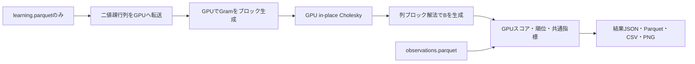

# EASEの学習とValidation評価

## 方式と入力

- [EASE原論文](https://arxiv.org/abs/1905.03375)の対角ゼロ制約付き線形モデル
- 学習期間の正のuser-item対を二値化したXだけを学習へ渡す
- `P = (XᵀX + λI)⁻¹`、`B[:, j] = -P[:, j] / P[j, j]`、`B[j, j] = 0`
- スコアは`X @ B`、負の係数も保持する / 切り捨て・近傍数制限・因子分解近似はしない
- 対角ゼロにより対象曲自身の再生をそのまま再現する経路を除く
- newは履歴を除外、repeatは履歴内に限定 / 同点は学習再生回数、曲ID順
- Validation/Test正解・未来の観測はモデルに渡さない

## 共通CLI

```bash
uv sync --locked --group data --group models --group notebook --group gpu
nvidia-smi
CUDA_PATH=/usr OMP_NUM_THREADS=1 OPENBLAS_NUM_THREADS=1 MKL_NUM_THREADS=1 \
  .venv/bin/python -m src.interfaces.cli.full_evaluation --config configs/ease.json
```

- `configs/ease.json`は共通JSONを継承、`regularization=500`の単一条件で動作・比較を確認する設定
- λ=500は採用値・本データの最適値を意味しない / 探索・選択・固定・最終Testは別の明示操作
- 保存先は`data/experiments/ease/l500/`、既存の成功結果は上書きしない
- 全学習ユーザー、K=2〜20、4観点、再生回数/日数の分布は[共通評価条件](listening-evaluation.md)に従う
- CLIとNotebookは同じ設定JSON・標準結果・Parquetを使う / EASEの配信用exportは未対応



## GPU・資源・数値精度

- GPU経路はCuPy/CuPyX、float32、cuSOLVER CholeskyとcuBLAS三角行列解法を使う
- 45,888曲では正方配列1枚約7.84GiB / 同時2枚＋疎行列・列ブロック・作業領域・予備を見積もる
- Gramを256曲ずつGPUで生成、Choleskyを同じ配列へ上書きし、逆行列も列ブロック単位で係数へ変換する
- 推薦スコア・安定順位付け・指標集計・bootstrapも既存GPU共通経路を使う
- Parquet読込み・IDの索引作成・成果物の保存はCPU / GramやスコアをCPUへ切り替える経路はない
- 実行前にGPU競合・空きVRAM・メモリ予算を検査、不足時は失敗させる / 人数・曲数を減らさない
- 推定メモリはCUDA内部確保を含む厳密な総VRAM上限ではない / デバイス・解法・精度・作業領域・時間をconfig.jsonへ記録する
- 4列の逆行列残差をGPU上で測定 / 非有限値・逆行列の非正対角・大きい残差は失敗させる
- CPU参照はfloat64の密行列解法、小規模の独立した制約付きridge解とGPUを比較する
- float32/64・解法・GPU並列計算によりCPUとbitwise一致は保証しない
- 係数の正方配列はGPUメモリ内に保持し、8GiB超の重みを評価結果へ不要に複製しない

## 検証

```bash
.venv/bin/pytest -q tests/test_full_ease.py tests/test_full_evaluation.py
CUDA_PATH=/usr MUSIC_RECSYS_TEST_GPU=1 \
  .venv/bin/pytest -q tests/test_full_ease.py tests/test_gpu_evaluation.py
```

- 独立した列別ridge解との一致、二値化、対角ゼロ、候補制約、全件保存を検証する
- GPUの係数・スコア・順位をCPU正解と比較し、共通GPU評価の全指標をCPU評価と照合する
- GPU試験は専用環境で明示有効化し、他のGPUジョブと並列実行しない
