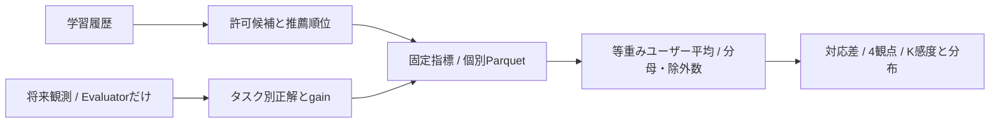

# 評価指標と比較条件

## オフラインの母集団とタスク

- 母集団は学習履歴のある全ユーザー。人数を暗黙に制限せず、未来に活動した人だけを推薦対象にしない
- Train/Validation/Testは時系列分割。ValidationはTrain、最終Testは固定後のTrain＋Validationから学習する
- 推薦器へ将来正解・将来再生回数・再生日数を渡さない。特徴は版とhashを固定し、付与日時が不明な静的タグの時点可用性は別の制約として示す
- newは学習中に未聴の曲、repeatは学習中にも評価期間にも聴いた曲。本人が知らない曲という自己申告とは別
- 全方式で同じ期間・カタログ・許可候補・正解・同点規則を照合する。入力変換・solver・精度・seedの差は保持する
- 正解なしは精度平均から除外し、`n_evaluated`・`n_excluded`を表示する。推薦生成と多様性の母集団は全学習ユーザー
- 表示基準は90日・K20・日数重み1。選択用主タスク・主指標を確定する設定ではない
- 観測窓30/90/180日、K=2〜20、日数重み0/0.5/1/2を保存する。効率性以外のK感度を省略しない



## 固定する4観点

| 観点 | 主な指標 | 分母・意味 |
| --- | --- | --- |
| 新規発見 | Binary NDCG・Recall | new正解を持つユーザーの等重み平均 |
| 継続的な嗜好 | Graded NDCG・Repeat Recall | repeat正解を持つユーザーの等重み平均 |
| 多様性・発見性 | ILD・Catalog Coverage・Novelty | 全要求、または特徴が有効な要求を明示 |
| 効率性 | レイテンシ・token・API料金・LLM/tool call | 実測した単位・取得範囲・失敗も保持 |

- 未聴Graded NDCGは定着の代理として別表示する。観測期間内の再生であり、長期嗜好の確定ではない
- 選択用の主指標が未指定でも4観点を測定・表示する。異なる指標を勝手に総合点へ混ぜない

## 精度の定義

- `Recall@K=|推薦上位K∩正解|/|正解|`。repeatでは学習曲内の再聴正解を分母にする
- Binary DCGは上位Kの正解曲へ`1/log2(rank+1)`を加算し、全正解から作る理想順位のIDCGで割る
- Graded gainは`log2(1+再生回数)+日数重み*log2(1+再生日数)`。同じ窓・重みの全正解でIDCGを作る
- 候補pool内の正解だけでIDCGやRecall分母を作り直さない
- 短いリストは返した曲の位置を使い、残り位置を的中として埋めない。正解なしはnull
- 再生回数・再生日数は指標とは別に、窓/task別のユーザー・曲ペア分布をCSV・個別図へ保存する

## 多様性・発見性

| 指標 | 定義・有効条件 | 注意点 |
| --- | --- | --- |
| ILD | 上位Kの全曲ペアのcosine距離平均。2曲以上、全曲のタグが存在し非ゼロ | 短いリスト・特徴欠損・ゼロノルムの人数を別記 |
| Coverage | 推薦に現れたユニーク曲数 / taskの許可候補の和集合 | 条件ごとのpool数を全カタログの分母へ置換しない |
| Novelty | 学習ユニーク人数の`-log2((人数+1)/(全学習人数+2))`を曲・要求で平均 | 学習人気度による自己情報量、本人の未知や満足ではない |

- 同じ特徴artifactを全方式に使い、hashが異なるILDを同条件として比較しない
- ILDは欠損を0距離・0類似度へ補わない。元の有効人数と共通有効ユーザー集合での値を分ける
- 共通集合はtask/Kごとに全比較条件で特徴が有効な人の積集合。集合が異なる図を直接順位付けしない
- 現行GPU ILDはFP64の累積ベクトル和による恒等式を使い、独立した曲ペア計算と照合する。旧経路の差と原本保持は[考察](discussion.md)を参照
- Content/MMRと同じタグを使うILDは、そのタグ空間での評価。音響・主観的多様性の独立な検証とはしない

## Hybridの段階別評価

| 問い | 比較 | 指標・判断 |
| --- | --- | --- |
| RQ1 候補統合 | A100・B100・union、等取得枠のA200/B200 | Pool Recall・共有/固有候補・実件数・対応差・取得費用 |
| RQ2 順位融合 | 単独・同じunion上のRRF、可能なら同じunionを単独で再採点 | 固定精度・全K・順位差・融合費用 |
| RQ3 多様性制御 | 同じpool/RRFのλ1/0.8/0.5 | 精度・共通ILD・Coverage・Novelty・追加費用のトレードオフ |

- Pool Recallは`|pool∩正解|/|正解|`。unionが各部分集合以上になること自体は集合包含の性質
- A100＋B100は取得枠200。単独A100との差をRRFだけの効果と呼ばず、A200/B200との対照を添える
- 取得枠が同じでもunique候補数・実計算量は同じとは限らない。取得m・pool件数・段階時間を保存する
- RRF/MMR比較では候補artifact・pool hashを固定する。λ1は完全なidentityとして検査する
- raw/正規化RRF・cosine・重み付き関連度/多様性項の分布を記録する。0〜1化だけで尺度が揃ったと判断しない
- pool内理想順位はoracle上限診断。候補Recallやoracleの増分を、達成した最終TopKの改善と呼ばない

## 不確実性と選択

- 同じユーザー・task・窓・重みを対応付けて差を計算する。差の向きはCSV/JSONに記録する
- 基準はユーザーbootstrap2,000回・seed42・95%区間。多数比較の補正なしの区間は探索的と明記する
- 3seedはユーザーごとに平均してからbootstrapし、学習seedの標準偏差を別表示する。ユーザー数を3倍にしない
- seedごとの区間端を平均しない。未測定の区間はnull、単発学習時間へ未測定の誤差棒を付けない
- CIの重なりだけで差を判断せず、対応差の区間を確認する。0を含む差から同等性・効果なしを証明しない
- Validation/Testは時期・カタログ・正解保有人数が異なる。絶対値差だけを過学習・時間変化の原因へ帰属させない
- Testから採用条件を選び直さない。既存Testを見た後の追加探索・固定比較は、その経緯を出典とともに区別する

## 欠測・失敗・効率

- 未取得・未測定・未実行はnull、実測0は0。全値nullの指標はPNGを生成・表示しない
- 候補不足・候補源失敗・不正なID/重複・pool外出力・数値非有限を検査し、失敗を成功人数から黙って除かない
- 失敗した条件の途中ファイルを保持し、成功マーカーを作らない。再開時は出典と処理版を一致させる
- 学習・重み復元・候補取得・cache読込み・融合・再ランキング・指標/描画の時間を区別する
- GPUバッチ償却、CPU単発推論、API往復、ブラウザ表示時間は同じ量ではない
- cacheを使っても元の取得/学習費用を保存し、再利用した重みを新規学習0秒として扱わない
- token・料金・LLM/tool callは実測のみ。非LLMという理由で未計測値を0にしない

## オンラインの集計単位

- 履歴予測とは別に、参加者が提示をどう受け取ったかを測る。[UI・同意・ログ運用](ui.md)を参照
- 曲単位は参加者×session×period/condition×request×item。再生単位にはplayback_idを加える
- event_idの同内容再送を除去し、同一要求のimpression/Likeを重複加点しない
- 分母は実際に提示を確認した曲・リスト。生成しただけの曲を含めない
- 未完了・通信断・非表示・観測間隔欠損・再生可否不明を分け、未観測の非発生を実測0にしない
- rate出力はvalue・numerator・denominator・missing。分母0や未確定対象を含む率はnull

| 指標 | 分子・分母 / 操作 | 欠測・限界 |
| --- | --- | --- |
| Satisfaction | リスト全体の1〜5、任意、1要求1回。有効rating合計 / 回答リスト数 | 未回答null、平均・回答数・未回答数を併記。オンラインの主指標 |
| Like Rate | Likeされた提示済みユニーク曲 / 提示済みユニーク曲 | 観測不十分な非Likeは欠測。Likeなしは不満足の確定でない |
| Play Start Rate | playを確認した曲 / 提示時availableの曲 | 可否不明はnull、unavailable/expiredを分ける |
| Engaged Listen Rate | 累積10秒以上の曲 / 同上 | 感度5/15/20秒、閾値未到達を確定できない対象は欠測 |
| Track Switch Rate | 再生中の別曲移動 / play確認済み再生ID | pause・hidden・error・endedは移動へ変換しない |
| Early Skip Rate | 10秒未満で再生中に別曲へ移動 / 同上 | 10秒ちょうどは含めず、中断を不満足の確定値にしない |
| Discovery Success | Like曲から「初めて知った曲」を任意選択。成功リスト / 有効回答リスト | selected/none/unansweredを区別。noneは0、未回答null |

- listened_secondsは同じplayback_id内の最大値、別ID間は実測秒を合算する。seekした音源位置を試聴秒に加算しない
- list_evaluationで観測を閉じ、同一要求の別ID再評価を拒否する。未送信の操作・最終秒のACKを確認する
- Discoveryの回答率は、Likeがあり質問を提示したリストが分母。学習上の未聴を本人の未知とみなさない
- selection_seconds・inference_seconds・API応答・初回可視時刻を区別し、後方カードのスクロール待ちを分ける
- 新旧ログの測定定義を混ぜない。旧skipや曖昧な曲/リスト評価は診断として保持する
- 最大5人、通常3条件の探索的比較。参加者内平均・対応差・順序/重複曲/休憩を記述し、一般的優位や有意差を断定しない

```bash
.venv/bin/python -m src.interfaces.cli.online_metrics \
  --input /private/exports/SESSION_ID.json --output /private/metrics-new.json
```

- 読取り専用の集計。元ログ/DB/モデルを変更せず、新規0600出力へ完成後に公開する
