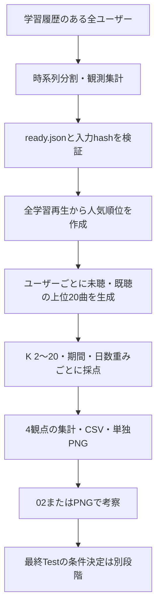

# 検証手順

## 全件Popularity



```bash
.venv/bin/python -m music_recsys.full_evaluation --config configs/popularity-plays.json
```

- 学習期間に履歴がある全119,133人が対象
- 評価期間に正解がある人数は指標・期間ごとに集計
- 人気順位は決定的なので1回評価、seedを変えた同一推薦を複製しない
- 期間30/90/180日、日数重み0/0.5/1/2を保存
- 主表示は90日・重み1、Kは2〜20の整数
- 選択用の主タスク・主指標は未指定、固定・最終Testは未実行
- 4観点の定義は[評価仕様](listening-evaluation.md)に従う

## 設定と保存物

- 総再生回数版は `configs/popularity-plays.json`、ユニーク再生ユーザー数版は `configs/popularity-users.json`
- `model.parameters.basis` は `play_count`（省略時）または `user_count`
- user_countは学習期間のユーザー・曲の組を1件として集計、同じ人の再生回数は加算しない
- 両者は同じ入力・期間・候補・指標で評価し、出力先を分ける
- 入力・出力パスは設定ファイルの位置を基準に解決
- Notebookでも同じJSONを選択し「読み込む」を押す
- 初期状態は未選択、環境変数から自動選択しない

実験直下に保存する

| ファイル | 用途 |
| --- | --- |
| config.json | 実行時の解決済み設定・入力出典・コードhash |
| result.json | 母集団・条件別集計・定義・個別結果への参照 |
| metrics.csv | 正確な値を条件別に並べた集計 |
| recommendations.parquet | 全ユーザーの未聴・既聴の推薦曲と時間 |
| scores.parquet | 正解があるユーザーの条件別スコア、K順の配列 |
| run.log | 実行進捗 |
| PNG | 1指標につき1グラフ |

- 個別履歴を巨大なJSONに複製せずParquetへ分離
- scoresのday_weight=-1は適用なし、未記録のユーザー条件は正解なし
- scoresの配列順はconfigのksと一致
- 未測定はnull、正解なしを0点として平均しない
- index.html・設定の二重コピー・logs/report/trials階層は作らない

## 図の読み方

- 点は実測した整数K、細い線は点の関係を読みやすくする補助
- 縦軸は0始まりで指標ごとに拡大、図間の比較は目盛りを確認
- 帯はユーザー単位bootstrapの95%区間、seed間のばらつきではない
- ヒートマップはK × 評価期間、日数重みは主表示条件
- ヒートマップの色範囲は図ごとに異なるためカラーバーの数値を確認
- graded_ndcg_newは未聴曲の評価期間内の嗜好強度で、因果的な定着を示さない
- 多様性は未来の正解の有無にかかわらず全ユーザーで測定
- 表は折りたたみ・スクロール表示、CSVは全行・全精度を保存

## 他モデルの探索とTest

小規模共通RunnerはJSON/TOML設定と次の操作に対応する

```bash
.venv/bin/python -m music_recsys.experiment_search --config <設定ファイル> smoke
.venv/bin/python -m music_recsys.experiment_search --config <設定ファイル> search
.venv/bin/python -m music_recsys.experiment_search --config <設定ファイル> select
.venv/bin/python -m music_recsys.experiment_search --config <設定ファイル> review --accept --note '<確認内容>'
.venv/bin/python -m music_recsys.experiment_search --config <設定ファイル> freeze
.venv/bin/python -m music_recsys.experiment_search --config <設定ファイル> test
```

- 主タスク・主指標を事前指定してから選択・固定・Testへ進む
- 同一条件の成功試行はhashを照合して再利用
- 既存Runnerは2,000人・500万再生まで、全件への展開は別途対応が必要
- 合成入力とモデル別設定例は `tests/fixtures/`、実データの代用にしない
- 全件Popularity/ItemCF/ALSは `full_evaluation`、小規模探索は `experiment_search` を使用

- 全値が未測定の指標はPNGを生成・表示しない / 実測0は表示 / JSONのnullは保持

## ItemCFのパラメータ比較

```bash
.venv/bin/python -m music_recsys.grid --config configs/itemcf.json
```

- `search.grid.similarity`: cosine / jaccard
- `search.grid.neighbors`: 20 / 50 / 100
- 近傍数は各履歴曲から使う類似曲数、推薦曲数Kとは別
- 二値のユーザー・曲行列をブロック積で計算し、全曲の密行列を保持しない
- 履歴曲ごとの近傍類似度を合計し、同点は学習再生回数・曲ID順
- 同じ類似度の上位100近傍を再利用して、3つの近傍数を比較
- 学習キャッシュは `data/processed/itemcf/`、学習入力hashを照合して再利用
- 条件別JSONは `configs/itemcf/` へ自動生成、編集対象は親のitemcf.json
- 生成済みJSONと条件が異なる場合は上書き拒否、別の設定・出力を使う
- 各結果は `data/experiments/itemcf-{similarity}-{neighbors}/` に保存
- 比較結果は `data/experiments/itemcf/`、親のJSONをNotebookで選択して確認
- Recall・Repeat Recall・Binary NDCGは6条件のK=2〜20を重ねて表示
- 色は類似度、線種と点の形は近傍数 / 線は離散的なKの点を結ぶ補助
- `*_neighbors.png` はK=20固定の近傍数比較、`*_heatmap.png` は類似度×近傍数
- 比較図は主評価期間90日の平均値、信頼区間と正確な値はmetrics.csv
- 再描画は `python -m music_recsys.itemcf_report --config configs/itemcf.json`
- Notebookでは条件別JSONを選択して確認、未指定時に自動選択しない
- training_secondsは近傍構築の実測時間、再利用の有無はconfig.jsonのtraining_cache_hit
- 主指標未指定のまま6条件を比較、最良条件の固定や最終Testは行わない
