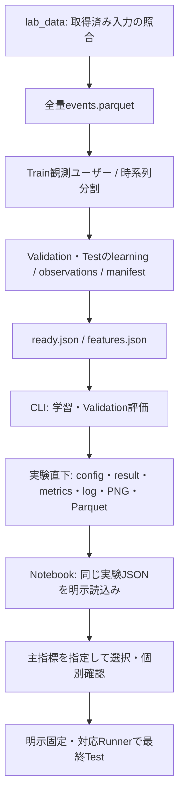

# コード構成・実行フロー

## パッケージ構成

- Python 3.12・uv.lock・srcレイアウトを維持する
- `src/`はインストール対象のルート、`music_recsys/`はimportするPython名前空間
- `pyproject.toml`のwheel対象・`music_recsys.*` import・CLI・Notebook・配布物がこの名前空間を共有する
- `src`直下への平坦化はそれらの互換変更を必要とし、推論速度やメモリを改善しないため行わない

| 場所 | 責務 |
| --- | --- |
| `src/music_recsys/lab_data.py` / `music4all.py` | 取得・checksum照合・全量Parquet変換・学習ユーザー抽出 |
| `temporal.py` / `listening_export.py` / `listening_data.py` | 時系列分割・窓別観測の生成・hash検証 |
| `features.py` | タグ特徴の変換・checksum |
| `configuration.py` / `notebook_config.py` | 共通JSON継承・パス解決・Notebookの明示読込み |
| `recommenders/` | [推薦器](architecture.md)の学習・rank・説明、CPU/GPU実装 |
| `full_evaluation.py` / `grid.py` | 全件Validation・条件展開・保存済み成功結果の再利用 |
| `full_scoring.py` / `gpu_evaluation.py` / `gpu_metrics.py` | 順位付け・全指標・bootstrap |
| `streaming_metrics.py` / `evaluation/` | [評価定義](listening-evaluation.md)と集計・追跡 |
| `comparison.py` / `factor_report.py` / `itemcf_report.py` | 比較出典の検証・単独PNG・CSV |
| `experiment_search.py` / `search_protocols.py` | 小規模探索・選択・確認・固定・最終Test |
| `full_analysis.py` / `search_analysis.py` / `listening_analysis.py` | 保存済み結果・観測分布の分析 |
| `serving.py` / `profiles.py` / `model_artifacts.py` | 共通推薦契約・初期選択・学習なしのモデルload |
| `catalog.py` / `webapp/` | [アプリ全体](app-architecture.md)・[オンライン評価](online-study.md) |
| `notebooks/` | 操作・分析・可視化、再利用処理はsrcへ置く |
| `tests/` / `tests/fixtures/` | 互換性試験・明示した合成fixture、実データの暗黙代替は禁止 |

## 標準経路



```bash
uv sync --locked --group data --group models --group notebook --group tracking
.venv/bin/python -m music_recsys.lab_data
.venv/bin/python -m music_recsys.full_evaluation --config configs/popularity-plays.json
.venv/bin/jupyter lab --no-browser --ip=127.0.0.1 --port=8888
```

- 標準経路にDocker・sudo・常駐DBは不要、Test入力生成とTest採点は別操作
- 全学習ユーザーを母集団とし、`lab_data --users N`は明示した小規模確認だけに使う
- 境界・候補・正解・4観点の測定条件は[オフライン評価](listening-evaluation.md)
- 選択用の主タスク・主指標が未指定でも測定を省かず、選択・固定・Testは開始しない

## 実験設定

- `configs/common.json`へ入力・期間・K・seedを集約、各JSONは`extends`で差分指定
- 辞書はキー単位で上書き、配列・値は置換、相対パスはその値を定義したJSONが基準
- CLIとNotebookは同じ解決済み設定を使い、別の既定JSONや環境変数で自動選択しない

| 設定 | 実行入口 | `data/experiments/`以下の出力 |
| --- | --- | --- |
| `popularity-plays.json` / `popularity-users.json` | full_evaluation | `popularity-plays/` / `popularity-users/` |
| `itemcf.json` | grid | `itemcf/`、`itemcf-{cosine,jaccard}-{20,50,100}/` |
| `als.json` | grid | `als/`、`als-{32,64,128}/` |
| `als/256.json` / `als/512.json` | full_evaluation | `als-256/` / `als-512/` |
| `bpr-30epoch.json` / `bpr-100epoch.json` | factor_study | `bpr-30epoch/` / `bpr-100epoch/` |
| `bpr-30epoch/seed0.json` | grid | `bpr-30epoch/seed0/`、`seed0-{32,64,128,256}/` |
| `content.json` / `bm25.json` | full_evaluation | `content/` / `bm25/` |
| `bm25/{50,100}.json` | full_evaluation | `bm25-{50,100}/` |

```bash
.venv/bin/python -m music_recsys.grid --config configs/itemcf.json
.venv/bin/python -m music_recsys.grid --config configs/als.json --compare configs/itemcf.json
CUDA_PATH=/usr OMP_NUM_THREADS=1 OPENBLAS_NUM_THREADS=1 MKL_NUM_THREADS=1 \
  .venv/bin/python -m music_recsys.factor_study --config configs/bpr-100epoch.json
```

- `--compare`は保存済み比較元を指定、入力・特徴・母集団・評価条件・成果物hashを検査する
- `configs/itemcf/`・`configs/bpr-30epoch/seed0/`・ALS 32/64/128はgridが展開、親JSONを編集する
- 展開済みJSONは結果からの参照があるため保持、GPUや一括実行だけの設定を増やさない
- コード/lock/条件変更で再利用できない結果は保持し、再実験だけ新しい出力先へ保存する
- ItemCF比較の再描画は`python -m music_recsys.itemcf_report --config configs/itemcf.json`

## 保存物

| 場所 / ファイル | 内容 |
| --- | --- |
| `data/raw/music4all-onion-v2/` | 元TSV.bz2・配布record・取得途中の.part |
| `data/processed/music4all-onion-v2/` | events.parquet・変換manifest |
| `data/benchmarks/music4all/` | 履歴・分割・Validation/Test bundle・features.json・ready.json |
| bundleの`learning.parquet` | user_id・item_id・play_count・active_daysの学習集約 |
| bundleの`observations.parquet` | 各窓の学習/評価回数・再生日数、モデルへ渡さない |
| 実験の`config.json` | 解決済み条件・入力出典・コード/lock hash・実行デバイス |
| 実験の`result.json` | 成功状態・母集団・指標集計・定義・個別成果物のhash参照 |
| 実験の`metrics.csv` / `run.log` / `*.png` | 正確な集計・進捗・1指標1図 |
| 実験の`recommendations.parquet` | 全ユーザーのnew/repeat推薦と実測時間 |
| 実験の`scores.parquet` | 正解保有ユーザーの条件別スコア、K配列順はconfig.ks |
| `data/processed/itemcf/` | 学習入力hash付き近傍キャッシュ |
| `data/models/` / `data/app/` | 配信用重み・bundle、評価JSONを重みとして扱わない |
| `data/provenance/` | 移行済み出典の保管、通常の実験一覧から分離 |

- `.partial`やresult未生成の出力は未完了、結果JSONを成功マーカーとする
- 個別推薦・スコアを巨大JSONへ複製せず、index.html・設定の二重コピーも作らない
- scoresのday_weight=-1は適用なし、未記録ユーザー条件は正解なし、未測定はnull
- 小規模Runnerは試行・selection/review/frozen/Test成果物と`tracking.db`を別管理する
- 実験終了後にSQLiteと成果物を一緒に保管し、元データ・モデル・参加者ログを掃除へ混ぜない

## Notebookの操作

| Notebook | 入力・処理 | 次の操作 |
| --- | --- | --- |
| 00_lab_start | JSON選択、ready/hash・進捗確認、ACTION指定時だけ評価CLIを開始 | 01で分割・観測を確認 |
| 01_data | 選択JSONのValidation入力・母集団・再生回数/日数分布を検証 | CLI評価後に02へ |
| 02_analysis | 保存済み4観点・K曲線・詳細表、明示指定時だけ選択/固定/Test | 選択可能なRunnerでは03で個別確認 |
| 03_recommendation | 小規模Runnerのselectionを読込み、推薦・根拠・許可音源を確認 | 確認済み記録後に02で固定 |

- 初期状態は未選択、JSONを選んで「読み込む」、設定変更後は再読込みする
- 全件の個別推薦はParquetへ保存、03へ小規模fixtureを自動補完しない
- 全件full_evaluationはValidation用、小規模Runnerの選択・Test手順を全件対応済みとみなさない
- 図を先に表示、4観点を分離、詳細表は折りたたみ・スクロール・CSV保存
- Gitへ保存するNotebookの出力・execution_countはクリアする

## 明示的な選択・固定

```bash
.venv/bin/python -m music_recsys.experiment_search --config <設定JSON> smoke
.venv/bin/python -m music_recsys.experiment_search --config <設定JSON> search
.venv/bin/python -m music_recsys.experiment_search --config <設定JSON> select
.venv/bin/python -m music_recsys.experiment_search --config <設定JSON> review --accept --note '<確認内容>'
.venv/bin/python -m music_recsys.experiment_search --config <設定JSON> freeze
.venv/bin/python -m music_recsys.experiment_search --config <設定JSON> test
```

- この共通Loaderは2,000ユーザー・500万イベントまで、全件採点の代わりに人数を暗黙制限しない
- 将来の目的別候補は新規発見=New Recall@20、再聴取=Repeat Recall@20、総合=混合Binary NDCG@20
- 現状の主表示90日・日数重み1・selection.k=10と、将来の採用方針は区別する
- 主指標未指定の比較結果を自動採用せず、混合総合評価は追加実装が必要

## 学習と配信export

```bash
.venv/bin/python -m music_recsys.full_evaluation --config <未使用出力先の設定JSON> \
  --export-model data/models/model-v1 --model-version model-v1
```

- 同じ学習プロセスの重みをexport、アプリ起動・推薦リクエスト内では学習しない
- 保存形式・検証・Cold-startは[推薦アーキテクチャ](architecture.md#保存済みモデルとcold-start)
- Content全件モデルの疎行列exportは未対応、BM25はItemCF配信形式へ接続する

## BPRの因子数・epoch・seed比較

```bash
CUDA_PATH=/usr OMP_NUM_THREADS=1 OPENBLAS_NUM_THREADS=1 MKL_NUM_THREADS=1 \
  .venv/bin/python -m music_recsys.factor_study --config configs/bpr-30epoch.json
CUDA_PATH=/usr OMP_NUM_THREADS=1 OPENBLAS_NUM_THREADS=1 MKL_NUM_THREADS=1 \
  .venv/bin/python -m music_recsys.factor_study --config configs/bpr-100epoch.json
```

- epoch別の設定から32/64/128/256因子×seed42/43/44の各12条件を順次実行、100epochは30epoch設定の差分だけを指定する
- 30/100epochsは独立した学習であり、同一学習の学習曲線ではない、GPU BPRはseed固定でも並列更新順の非決定性がある
- 全学習ユーザー・Validationのみ・K=2〜20・全観点は既存条件と共通、主指標選択・採用・Testは実行しない
- `data/experiments/bpr-{30,100}epoch/<条件>/`に標準結果と`model/`を保存、各epoch直下のresult.jsonは完了数・実行中条件・失敗を示す
- 初回seed0の4条件と従来手法比較は`bpr-30epoch/seed0/`と`seed0-{因子数}/`へ分離し、3シードの平均へ混ぜない
- 保存先の移動では評価値・成果物hash・ModelSpecのID・学習時のsource/lock/Git revisionを保持、config.jsonのrelocationに元設定と移動前hashを記録する
- 各epoch直下へCSVとseed平均±標準偏差の図を保存、標準偏差はモデル採用の検定や信頼区間ではない
- 同じコマンドで再開し、入力・コード・lock・条件・結果/モデルhashが一致する成功条件だけを再利用する
- 空き5GiB未満・GPU競合・不整合・学習失敗では停止する。途中モデルが残る条件は自動削除せず点検する
- コードや条件が変わった場合は設定の出力先を新しくし、保存済み実験・重みを上書きしない

## 長時間運用・開発

```bash
nvidia-smi
tmux new -s music-recsys
# 上のCLIをtmux内で実行、Ctrl-b dで切断、再接続は次のコマンド
tmux attach -t music-recsys
.venv/bin/pytest
.venv/bin/ruff check src tests notebooks migrations
.venv/bin/ruff format --check src tests notebooks migrations
uv build
```

- GPUのVRAM・使用率・プロセスをホスト側で確認、競合時は待機、勝手にCPUへ切り替えない
- CUDA配置に応じてCUDA_PATHを指定、必要時は`uv sync --locked --group gpu`も追加する
- 実行中の入力・設定・コードを書き換えず、進捗はrun.log、成功はresult.jsonで確認する
- SSHでNotebookへ接続する例: `ssh -L 8888:127.0.0.1:8888 <研究室サーバー>`、外部公開は禁止
- DB/大規模試験は専用環境で`MUSIC_RECSYS_TEST_DB=1` / `MUSIC_RECSYS_TEST_SCALE=1`を明示する
- 任意のPostgreSQL経路は`compose.yaml`＋Alembic、`music_recsys.ingestion.cli` / `temporal_cli` / `features --help`を参照
- DBの公開済みsnapshotは不変、ファイル経路の内容由来IDをDB用UUIDとして渡さない
- コード・lock・設定をGit管理、生成物・履歴・音源・モデル・.env・ログ・認証情報は管理外
- 作業ブランチを使用し、依頼時だけ`種別: 日本語の変更内容`でコミット・pushする
