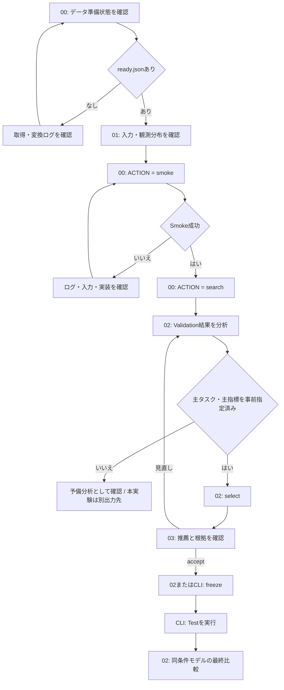

# 検証手順

## 操作の流れ



## 設定と役割

- 各Notebookの選択欄で同じTOMLを選び、「読み込む」で確定
- 初期状態は未選択、環境変数や既定ファイルから自動選択しない
- CLIは同じファイルを `--config` で明示する
- TOMLの入力・出力パスはTOMLの位置を基準に解決
- 研究室の予備分析用ファイルは `configs/workflow-lab-popularity.toml` / 使用時に選択する
- このファイルは100ユーザーの予備分析用、主タスク・主指標は未指定
- 予備分析結果から主条件を事後選択せず、本実験では目的から条件を決めて別出力先を使用

| Notebook | 入力 | 操作・出力 |
| --- | --- | --- |
| 00 | ready.json・TOML | 準備確認、明示したSmoke / Searchを別プロセスで起動 |
| 01 | 選択したValidation | 品質・分布・評価可能性 |
| 02 | 保存済み試行 | 表・曲線・SELECT / FREEZEを明示した選択と固定 |
| 03 | selection.json・Validation | 個別推薦・根拠・明示した確認記録 |

01はTOMLで選択したValidationだけを読む / 全Notebookでlistening-v2を明示し、旧形式は拒否
03は学習履歴・候補だけを推薦へ渡し、Testの正解を表示しない

## CLIでの操作

リポジトリのルートで、導入済み `.venv` を使用する

```bash
export MUSIC_RECSYS_EXPERIMENT_CONFIG="$PWD/configs/workflow-lab-popularity.toml"
.venv/bin/python -m music_recsys.experiment_search --config "$MUSIC_RECSYS_EXPERIMENT_CONFIG" status
.venv/bin/python -m music_recsys.experiment_search --config "$MUSIC_RECSYS_EXPERIMENT_CONFIG" smoke
.venv/bin/python -m music_recsys.experiment_search --config "$MUSIC_RECSYS_EXPERIMENT_CONFIG" search
```

以下は主タスク・主指標を事前指定した実験だけで実行する

```bash
.venv/bin/python -m music_recsys.experiment_search --config "$MUSIC_RECSYS_EXPERIMENT_CONFIG" select
# 03で実際に確認した後に実行
.venv/bin/python -m music_recsys.experiment_search --config "$MUSIC_RECSYS_EXPERIMENT_CONFIG" review --accept --note "確認内容"
.venv/bin/python -m music_recsys.experiment_search --config "$MUSIC_RECSYS_EXPERIMENT_CONFIG" freeze
.venv/bin/python -m music_recsys.experiment_search --config "$MUSIC_RECSYS_EXPERIMENT_CONFIG" test
```

## 探索と再開

| 条件 | 動作 |
| --- | --- |
| Stage A | 1変数以下、Popularityは探索パラメータなし |
| Stage B | 小規模な組合せGrid |
| Stage C | parentで指定した探索の範囲を絞る |
| 成功済み試行 | 条件と内容hashを照合して再利用 |
| 失敗・予算切れ | ログを確認しsearchを再実行 |
| 主指標未指定 | 診断結果を表示、選択・固定・Testは不可 |
| 固定済み | 探索・再選択を禁止、Testは固定条件だけ |

- `max_trials` はseedを含む試行数の上限
- 時間予算は試行開始前に確認、実行中の試行を強制終了しない
- 入力・コード・主指標の変更は新しい `experiment.output` で開始
- 02の `DIAGNOSTIC_TRIAL_ID` はセル内で指定する診断表示対象、未指定なら最初の成功試行
- `[comparison].configs` へ同条件の実験TOMLを指定して最終比較
- 保存先は `study.json`・`selection.json`・確認/固定artifact・試行ごとの結果

## 結果の読み方

- K曲線は主期間・主日数重みに限定、補助条件と平均しない
- 95% CIはユーザー単位bootstrap、seed間標準偏差と区別
- 正解なし・未実行・失敗・特徴欠損の件数を指標と一緒に確認
- Testから探索範囲・モデル設定を変更しない
- 指標と候補の定義は[評価仕様](listening-evaluation.md)、接続・再開は[運用](lab-operation.md)

- Notebookは図を先に表示し、表はクリックで開いて縦横スクロール
- 各表のCSV保存は同じ列順の全行・全精度を出力（UTF-8 BOM付き）
- CSVはブラウザのダウンロード先に保存 / 実験artifactは変更しない
- 表示名は日本語、CSVの列名は元の識別名 / 欠測値はCSVでは空欄
- 02は主指標と補助指標を分離 / 主指標未指定なら全て診断表示
