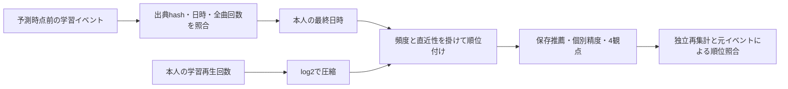

# 直近性と再生頻度の組合せ

## 比較条件

- [直近順の前半結果](ease-weighting.md#直近性の比較結果)に対し、本人頻度を加えた追加価値をValidationで測る。既見Testで調整しない
- 固定スコアは`log2(1+学習再生回数)/(1+最終再生から予測時点までの日数)`。日数は小数日を保持する
- 頻度を対数で圧縮し、直近順で使った`1/(1+日数)`を掛ける。半減期・混合係数・別の式の探索はしない
- これは1つの組合せ仮説。失敗しても頻度を組み合わせる全方式が無効とは言えない
- [事前固定](../data/provenance/history-combination-20261112/protocol.json) / [実験JSON](../configs/history_frequency/recency-log-count.json)
- 比較相手は本人回数順と最終再生日時順。同じValidation、全119,133人・同じ候補集合と同点規則を使用する
- 両タスク・4観点、K2〜20・30/90/180日・日数重み0/0.5/1/2・再生回数/日数分布を保持する
- 90日/K20/日数重み1は表示条件。主タスク・主指標・採用版は未選択

## 入力と検算



- [履歴モデル](../backend/infrastructure/recommenders/full_history.py)の`history_basis=recency_log_count`で明示指定。既存方式の既定値は維持する
- 最終日時はTrainだけから取得し、将来イベントとhash違いを拒否。全ユーザー・曲の回数をlearningと照合する
- 新規曲の本人スコアは0。同点は全体の学習再生回数→曲IDで解消するため、既存対照と新規順位が同じことを検算する
- CPU/GPUで、古い多頻度曲と新しい低頻度曲の順位・スコアを独立した期待値と比較する
- GPU採点・順位・指標集計を使用。学習入力準備・一括順位取得とオンライン応答時間を区別する

## 実行と保存

```bash
CUDA_PATH=/usr PYTHONUTF8=1 .venv/bin/python -m backend.interfaces.cli.evaluate --config configs/history_frequency/recency-log-count.json
CUDA_PATH=/usr PYTHONUTF8=1 .venv/bin/python -m backend.interfaces.cli.weighting_comparison --config configs/history_frequency/recency-log-count.json --reference history-count=data/experiments/history_frequency/count --reference history-last-play=data/experiments/history_frequency/last-play --run
```

- 出力は`data/experiments/history_frequency/recency-log-count/`、比較はその`comparison/`。保存済み入力・対照結果を上書きしない
- API未使用。料金・token等の未測定値はnullを保持する

## 結果と判断

- [原本](../data/experiments/history_frequency/recency-log-count/result.json) / [対応差](../data/experiments/history_frequency/recency-log-count/comparison/paired.csv) / [共通ILD](../data/experiments/history_frequency/recency-log-count/comparison/ild.csv) / [独立検算](../data/provenance/history-combination-verification-20261112/verification.json)
- 全119,133人のValidation。90日/K20/日数重み1の再聴精度は19,268人、正解なし99,865人は精度平均から除外

| 観点・指標 | 回数順 | 直近順 | 直近性×対数頻度 |
| --- | ---: | ---: | ---: |
| 再聴Graded NDCG | 0.225217 | 0.290691 | 0.334802 |
| Repeat Recall | 14.0711% | 20.1238% | 22.3703% |
| 再聴共通ILD（94,307人） | 0.698683 | 0.714145 | 0.707473 |
| 再聴Catalog Coverage | 89.3545% | 97.1627% | 95.9554% |
| 再聴Novelty（bit） | 5.620360 | 6.048409 | 5.912659 |
| 入力準備（秒） | 53.97 | 67.66 | 67.79 |
| GPU順位取得・全238,266要求（秒） | 23.98 | 24.03 | 23.97 |

- 直近順に対してNDCGは相対+15.17%、Repeat Recallは相対+11.16%（+2.2464ポイント）。NDCGは正解率ではない
- 対応ユーザーbootstrap 2,000回の探索的95%区間はNDCG差+0.042579〜+0.045616、Recall差+2.0779〜+2.4257ポイント。多重比較補正や未知期間への保証は含まない
- 30/90/180日×K2〜20の全57条件で再聴の両指標の平均が直近順より高い。NDCGは日数重み0/0.5/1/2全てで一致。各条件の有意性を一律には主張しない
- 共通ILD・Coverage・Noveltyは直近順より低い。頻度を加えた精度向上と推薦の広がりの縮小を分けて報告する
- 新規順位は全119,133人で回数順と完全一致。新規精度の改善はない
- 評価全体120.61秒、GPUバッチ償却0.101ms/要求。入力準備・順位取得は直近順とほぼ同程度だが、オンライン応答時間や反復した速度優位の証拠ではない
- 627精度値の独立CPU再集計は最大差4.44e-15。無作為100人の元学習イベントから回数・最終日時・順位を再計算し、artifact/hash・事前固定した処理版も照合
- **この1条件では、直近性と頻度の併用による再聴精度の追加改善を確認した。ただし多様性の低下があるため、自動的に採用版とはしない**
- 同じ式の後半期間への適用結果は以下を参照。既見Testで重みを調整せず、未使用期間の独立検証とは区別する


## 後半期間での固定式の検証

- [事前固定](../data/provenance/history-combination-test-20261112/protocol.json) / [原本](../data/experiments/history_frequency/recency-log-count/test/result.json) / [対応差](../data/experiments/history_frequency/recency-log-count/test/comparison/paired.csv) / [共通ILD](../data/experiments/history_frequency/recency-log-count/test/comparison/ild.csv) / [独立検算](../data/provenance/history-combination-test-20261112/verification.json)
- 予測時点2018-09-21、学習はTrain＋Validationの全履歴。式と評価条件は変更しない。[後半期間の仕様](history-temporal.md)と同じく既見Testの探索的追加検証で、未使用の独立確認ではない
- 全119,133人。90日/K20/日数重み1の再聴精度は14,594人、正解なし104,539人を精度平均から除外

| 観点・指標 | 直近順 | 直近性×対数頻度 |
| --- | ---: | ---: |
| 再聴Graded NDCG | 0.308218 | 0.359843 |
| Repeat Recall | 17.8967% | 19.9717% |
| 再聴共通ILD（90,712人） | 0.713461 | 0.705826 |
| 再聴Catalog Coverage | 96.5539% | 94.5196% |
| 再聴Novelty（bit） | 6.027387 | 5.863988 |
| 入力準備（秒） | 77.40 | 77.56 |
| GPU順位取得・全238,266要求（秒） | 27.40 | 27.34 |

- 直近順に対してNDCG相対+16.75%、Recall相対+11.59%（+2.0750ポイント）。95%対応bootstrap区間はNDCG差+0.049691〜+0.053425、Recall差+1.8910〜+2.2488ポイント
- 再聴2指標の平均は30/90/180日×K2〜20の全57条件で直近順を上回る。NDCGは日数重み0/0.5/1/2全てで一致。区間は表示条件の探索的なものとし、全条件の有意差や未知期間への保証としない
- ILD・Coverage・Noveltyの低下も再現。共通ILDの母集団は今回の3方式の積集合で、別の比較表と混ぜない
- 新規順位は全119,133人で回数順と一致。新規推薦への追加効果はない
- 評価全体124.91秒、GPUバッチ償却約0.115ms/要求。単発オンライン応答時間・反復した速度優位は未測定。外部APIは使わず、未測定料金等はnull
- 627集計値の独立CPU再計算で最大差4.22e-15。無作為100人の元Train＋Validationから式と順位を再計算し、入力・原本・事前固定した処理版hashを照合
- **直近性と頻度の併用による精度向上と、多様性の低下が両期間で再現した。単純な本人履歴方式を、学習モデル・融合・選択器の必須対照に置く根拠となる**
- [個人別の改善・悪化と履歴量の診断](history-diagnostics.md)を併記。主指標・多様性の許容幅・採用版は未選択。未使用期間の独立確認、満足度、オンライン費用・応答時間は残課題

```bash
CUDA_PATH=/usr PYTHONUTF8=1 .venv/bin/python -m backend.interfaces.cli.evaluate --config configs/history_frequency/recency-log-count.json --phase test
CUDA_PATH=/usr PYTHONUTF8=1 .venv/bin/python -m backend.interfaces.cli.weighting_comparison --config configs/history_frequency/recency-log-count.json --phase test --reference history-count=data/experiments/history_frequency/count/test --reference history-last-play=data/experiments/history_frequency/last-play/test --run
```

## 累積頻度を直近30日頻度に置き換える比較

- [設定](../configs/history_frequency/recency-recent-30d.json) / [事前固定](../data/provenance/history-recent-30d-20261112/protocol.json)
- スコアは`log2(1+直近30日再生回数)/(1+最終再生からの日数)`。既存の累積頻度版から、分子の集計範囲だけを変更する
- 集計窓は予測時点の30日前を含み、予測時点を含まない。最終日時は学習全期間の値を維持する
- 最近の再生がない曲はスコア0。その曲も既聴候補に残し、同点は全体の学習再生回数→曲IDで解消する。古い曲への補完スコアは追加しない
- 全学習ユーザーを保持し、最近の活動の有無で母集団を絞らない。新規順位は本人スコア0のままで対照と一致することを確認する
- 比較相手は直近性×累積頻度と直近順。窓幅探索・Testでの調整はせず、全4観点・全K/期間/日数重みを保存する
- CPU/GPUで30日前ちょうどのイベント、窓外、最近の再生なし、予測時点のイベント拒否を試験する

```bash
CUDA_PATH=/usr PYTHONUTF8=1 .venv/bin/python -m backend.interfaces.cli.evaluate --config configs/history_frequency/recency-recent-30d.json
CUDA_PATH=/usr PYTHONUTF8=1 .venv/bin/python -m backend.interfaces.cli.weighting_comparison --config configs/history_frequency/recency-recent-30d.json --reference history-last-play=data/experiments/history_frequency/last-play --reference history-recency-log-count=data/experiments/history_frequency/recency-log-count --run
```

- 出力は`data/experiments/history_frequency/recency-recent-30d/`。入力・既存結果は上書きせず、APIは使わない

### 直近30日頻度の結果

- [原本](../data/experiments/history_frequency/recency-recent-30d/result.json) / [対応差](../data/experiments/history_frequency/recency-recent-30d/comparison/paired.csv) / [共通ILD](../data/experiments/history_frequency/recency-recent-30d/comparison/ild.csv) / [独立検算](../data/provenance/history-recent-30d-20261112/verification.json)
- 全119,133人のValidation、90日/K20/日数重み1。再聴精度の分母は19,268人

| 指標 | 直近性×累積頻度 | 直近性×30日頻度 |
| --- | ---: | ---: |
| 再聴Graded NDCG | 0.334802 | 0.282915 |
| Repeat Recall | 22.3703% | 15.2139% |
| 再聴共通ILD（95,303人） | 0.707881 | 0.678786 |
| 再聴Catalog Coverage | 95.9554% | 88.0208% |
| 再聴Novelty（bit） | 5.912659 | 4.512474 |
| 入力準備（秒） | 67.79 | 68.49 |
| GPU順位取得・全238,266要求（秒） | 23.97 | 24.02 |

- 累積頻度版に対しRecall相対−31.99%（−7.1564ポイント）、NDCG相対−15.50%。95%対応区間はRecall差−7.4690〜−6.8552ポイント、NDCG差−0.054219〜−0.049662
- Recall平均は30/90/180日×K2〜20の全57条件で低下。NDCGは各日数重みで57条件中52条件が低下し、すべての条件で劣るとは言わない
- 全学習ユーザーのうち直近30日再生あり18,124人、なし101,009人。再生なしの人では全既聴曲スコアが0となり、既聴内の全体人気度順へ退化する
- [精度対象者内の診断](../data/provenance/history-recent-30d-20261112/recent-activity.json): 最近の再生あり16,495人もRecall21.1682→16.1642%、再生なし2,773人は29.5207→9.5613%。最近の活動がない人だけが低下の原因ではない
- 元学習イベントからの無作為100人の順位再計算、627精度値の独立CPU平均（最大差2.84e-15）、全員の新規順位一致・出典hashを確認
- 評価全体118.83秒、GPUバッチ償却約0.101ms/要求。API未使用、未測定料金等はnull。計算速度改善のために精度低下を許容した設計ではない
- **この30日打切り方式は累積頻度版の改善として採用しない。最近の情報を使うだけでは不十分で、古い履歴を一律に0へする情報損失が大きい**
- 次の仮説は古い再生も保持して連続的に重みを下げる時間減衰。別の30日窓・補完・係数を結果に合わせて追加せず、新条件を事前固定してValidationで比較する。今回の失敗を全ての短期頻度方式の否定とはしない

## 各再生への連続的な時間減衰

- [設定](../configs/history_frequency/decayed-count-30d.json) / [事前固定](../data/provenance/history-decay-30d-20261112/protocol.json)
- 各学習イベントの重みを`2^(-予測時点までの経過日数/30)`として曲別に合計する。30日前は1/2、60日前は1/4。窓外として切り捨てない
- スコアは`log1p(減衰重み合計)/ln(2)`。`log1p`で古い履歴の微小な正の値を保持する。最終再生日時による追加の乗算はしない
- 半減期30日の1条件を固定。時間情報の表現全体が変わる比較で、打切りの有無だけを変えた純粋な一要因比較とは呼ばない
- 全学習ユーザー・曲を保持。全件回数とlearningの照合、予測時点以降のイベント拒否、出典hash確認は既存経路を維持する
- GPU採点・順位・全4観点を評価し、全K・期間・日数重みを保存。原本は`data/experiments/history_frequency/decayed-count-30d/`

```bash
CUDA_PATH=/usr PYTHONUTF8=1 .venv/bin/python -m backend.interfaces.cli.evaluate --config configs/history_frequency/decayed-count-30d.json
CUDA_PATH=/usr PYTHONUTF8=1 .venv/bin/python -m backend.interfaces.cli.weighting_comparison --config configs/history_frequency/decayed-count-30d.json --reference history-recency-log-count=data/experiments/history_frequency/recency-log-count --reference history-recency-recent-30d=data/experiments/history_frequency/recency-recent-30d --run
```

### 時間減衰の結果

- [原本](../data/experiments/history_frequency/decayed-count-30d/result.json) / [対応差](../data/experiments/history_frequency/decayed-count-30d/comparison/paired.csv) / [共通ILD](../data/experiments/history_frequency/decayed-count-30d/comparison/ild.csv) / [検算](../data/provenance/history-decay-30d-20261112/verification.json)
- 全119,133人のValidation。90日/K20/日数重み1、再聴精度の有効人数19,268人

| 指標 | 直近性×累積頻度 | 半減期30日の時間減衰 |
| --- | ---: | ---: |
| 再聴Graded NDCG | 0.334802 | 0.375783 |
| Repeat Recall | 22.3703% | 22.3247% |
| 再聴共通ILD（94,999人） | 0.707837 | 0.717094 |
| 再聴Catalog Coverage | 95.9554% | 97.1278% |
| 再聴Novelty（bit） | 5.912659 | 6.045794 |
| 入力準備（秒） | 67.79 | 69.87 |
| GPU順位取得・全238,266要求（秒） | 23.97 | 24.04 |

- NDCGは相対+12.24%、対応差+0.040981の95%区間は+0.038939〜+0.043158。Recallは相対−0.20%（−0.0456ポイント）、区間−0.2195〜+0.1216ポイントで0を含む。同等性・非劣性を証明したとは呼ばない
- NDCG平均は30/90/180日×K2〜20の全57条件・全日数重みで累積頻度版を上回る。Recall平均が高いのは57条件中48条件で、全条件での優位ではない
- 共通ILD・Coverage・Noveltyは表示条件で改善。共通ILDは今回の3方式の特徴ありユーザーの積集合で、以前の比較表とは分母が異なる
- 新規順位は全119,133人で対照と一致。新規推薦への改善はない。評価全体120.55秒、GPUバッチ償却約0.101ms/要求。オンライン待ち時間ではない
- 627精度値の独立CPU平均は最大差4.06e-15。無作為100人の元イベントから減衰和・順位を再計算し、事前固定した処理版・入力・artifact hashも照合
- **古い再生も保持する時間減衰は、今回のValidationで順位品質と多様性が良好だった。Recallの明確な差はなく、総合的な採用判断は保留する**
- 半減期を30日のまま固定した後半期間の結果は以下。API未使用


### 時間減衰の後半期間

- [事前固定](../data/provenance/history-decay-test-20261112/protocol.json) / [Test原本](../data/experiments/history_frequency/decayed-count-30d/test/result.json) / [対応差](../data/experiments/history_frequency/decayed-count-30d/test/comparison/paired.csv) / [検算](../data/provenance/history-decay-test-20261112/verification.json)
- Train＋Validationだけで再構築し、全119,133人を評価。以下は90日/K20/日数重み1、再聴精度の有効人数14,594人

| 指標 | 直近性×累積頻度 | 半減期30日の時間減衰 |
| --- | ---: | ---: |
| 再聴Graded NDCG | 0.359843 | 0.415465 |
| Repeat Recall | 19.9717% | 20.1585% |
| 再聴共通ILD（90,232人） | 0.705920 | 0.715703 |
| 再聴Catalog Coverage | 94.5197% | 96.4733% |
| 再聴Novelty（bit） | 5.863988 | 6.023428 |
| 入力準備（秒） | 77.56 | 79.99 |
| GPU順位取得・全238,266要求（秒） | 27.34 | 27.38 |

- NDCG相対+15.46%、対応差+0.055622の95%区間は+0.053205〜+0.058138。Recall相対+0.94%（+0.1868ポイント）、区間+0.0134〜+0.3730ポイント
- NDCG平均は全57条件・全日数重みで累積頻度版を上回る。Recall平均が高いのは57条件中45条件。全条件でのRecall優位とはしない
- 新規順位は全員で対照と一致。共通ILDは今回の3方式の積集合。評価全体124.38秒、順位取得はバッチ償却約0.115ms/要求でオンライン待ち時間ではない
- 627精度値のCPU平均（最大差3.56e-15）、無作為100人のTrain＋Validationからの順位再計算、入力・処理版・保存物hashを照合
- **順位品質の改善は後半期間でも再現した。ただし既見Testでの探索的追加評価であり、未使用期間の独立確認・オンライン効果・総合採用は未確定**。次の精度改善候補は[文献に基づく比較設計](accuracy-research.md)
