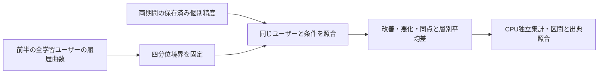

# 本人履歴方式の改善・悪化と履歴量

## 目的と範囲

- [直近性×頻度](history-combination.md)と直近順の保存済み個別精度を比較し、平均だけでは見えない悪化人数を調べる
- 前半・後半とも全学習119,133人を母集団とし、指標ごとの正解ありユーザーで改善・悪化・同点を数える。正解なしを同点や0点に置き換えない
- 学習内の曲数で4層に分ける。前半の全学習ユーザーの四分位境界52/169/491曲を後半にも固定適用する
- Q1は52曲以下、Q2は53〜169曲、Q3は170〜491曲、Q4は492曲以上。後半では各層が同人数になるとは限らない
- 選択ルールの学習・採用判断・Testを使った閾値調整は行わない。層別は探索的診断である
- 全K2〜20・30/90/180日・日数重みを集計。層別は精度の診断に限り、層別の多様性・費用は未測定。全体の4観点は`overall.csv`と[比較原本](history-combination.md)を参照する



## 結果

- [全条件CSV](../data/experiments/history_frequency/recency-log-count/diagnostics/metrics.csv) / [2指標同時変化](../data/experiments/history_frequency/recency-log-count/diagnostics/joint.csv) / [設定・出典](../data/experiments/history_frequency/recency-log-count/diagnostics/config.json) / [検算](../data/provenance/history-diagnostics-20261112/verification.json)
- 表は90日/K20/日数重み1。改善・悪化は「組合せ−直近順」で判定し、絶対差1e-12以下は同点

| 期間・指標 | 改善 | 悪化 | 同点 | 分母 |
| --- | ---: | ---: | ---: | ---: |
| 前半 Repeat Recall | 41.85% | 13.17% | 44.98% | 19,268人 |
| 後半 Repeat Recall | 47.70% | 13.40% | 38.91% | 14,594人 |
| 前半 Graded NDCG | 61.50% | 22.65% | 15.85% | 19,268人 |
| 後半 Graded NDCG | 66.49% | 21.58% | 11.92% | 14,594人 |

- 後半で両指標が改善したのは6,607人（45.27%）、両指標が悪化したのは1,482人（10.15%）。残りには片方だけの変化や逆方向の変化が含まれる
- これは有効な将来観測があるユーザー内の割合であり、全119,133人に対する改善率やオンライン満足度ではない

| 後半の履歴層 | 正解あり人数 | Recall差（ポイント） | 95%区間（ポイント） |
| --- | ---: | ---: | --- |
| Q1: 52曲以下 | 94 | −0.169 | −3.280〜+2.825 |
| Q2: 53〜169曲 | 448 | +4.567 | +2.514〜+6.569 |
| Q3: 170〜491曲 | 2,297 | +3.305 | +2.618〜+4.105 |
| Q4: 492曲以上 | 11,755 | +1.758 | +1.606〜+1.918 |

- Q1はRecallで改善7人・悪化5人・同点82人。平均差の区間が0を含み、改善も悪化も断定できない。前半Q1は146人であり、両期間とも有効人数が少ない
- NDCGの層別平均差は後半の全層で正だが、Q1の少なさと2指標の違いを無視して全員への有効性を主張しない
- 区間は層内のユーザー対応bootstrap 2,000回、seed42。多重比較補正・別期間への一般化保証は含まない
- 層ごとの人数や有効観測率が異なる。層別差の単純平均は全体差にならず、観測のない利用者へ外挿しない
- **平均改善は多数のユーザーでの改善を伴うが、明確な個人差もある。履歴が少ない層の扱いと悪化ユーザーの特徴を、採用判断前の残課題にする**
- この診断から即座に「Q1は直近順」の規則を作らない。新ルールの提案・学習はValidation内でユーザー分離し、既見Testで規則を最適化しない

## 実行と検証

```bash
CUDA_PATH=/usr PYTHONUTF8=1 .venv/bin/python -m backend.interfaces.cli.history_diagnostics --root data/experiments/history_frequency
```

- 元の推薦・スコア・結果は変更せず、`recency-log-count/diagnostics/`へ保存。同名出力を上書きしない
- [実装](../backend/infrastructure/research/history_diagnostics.py)はGPU集計・bootstrap。区間はソート後の線形補間を使い、単一列を含めCPU/GPUの一致を試験する
- 6,270行の平均・差・改善/悪化/同点人数と20区間を独立CPU計算し、保存原本と出典hashを照合する
- 図は[Recall差](../data/experiments/history_frequency/recency-log-count/diagnostics/repeat_recall.png)と[NDCG差](../data/experiments/history_frequency/recency-log-count/diagnostics/graded_ndcg.png)に分ける。API未使用
