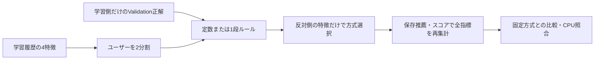

# 本人履歴方式のユーザー別選択

## 比較設計

- [個人差の診断](history-diagnostics.md)を受け、直近順と直近性×対数頻度を個人別に選ぶ追加価値をValidation内で検証する
- 元の2方式の推薦・個別スコアを再利用。Testは開かず、ユーザー別の未来正解を推論入力へ渡さない
- 入力は学習内の履歴曲数、総再生回数、曲別再生日数の合計、最頻曲の再生回数シェアの4特徴
- 全119,133人をseed42で均等に2分割。一方だけでルールを学習して、他方へ適用する操作を交代する
- 閾値は学習側の全ユーザーの四分位から作る。各葉に正解ありユーザー200人以上を要求し、分岐は最大1段
- NDCG向け・Recall向けを別々に学習。目的は90日/K20/日数重み1の学習側平均を最大化し、主指標や採用版は確定しない
- 「直近順固定」「組合せ固定」「2つの選択ルール」「各学習側で選ぶ固定方式」の6条件を比較する
- 新規推薦は2候補で同じため、選択ルールでは直近順へ固定。両タスク・全K2〜20・30/90/180日・日数重み0/0.5/1/2・4観点・分布を再集計する



- 候補自体はこのValidationを見ながら開発済み。ユーザー分離をしても、未使用期間の独立確認とは呼ばない
- 平均精度を最大化する実験であり、個人の悪化を禁止する制約や悪化人数最小化の実験ではない

## 結果

- [結果](../data/experiments/history_frequency/recency-log-count/selector/result.json) / [学習したルール](../data/experiments/history_frequency/recency-log-count/selector/rules.json) / [選択人数](../data/experiments/history_frequency/recency-log-count/selector/choices.csv) / [対応差](../data/experiments/history_frequency/recency-log-count/selector/paired.csv) / [検算](../data/provenance/history-selection-20261112/verification.json)
- 2目的×2分割の全4ケースで、分岐なしの「直近性×頻度を全員へ適用」が選ばれた
- ルール・学習側固定対照は再聴119,133人全員で組合せ方式を選択。直近順への切替は0人

| 再聴・90日/K20/日数重み1 | 組合せ固定 | NDCG向けルール | Recall向けルール |
| --- | ---: | ---: | ---: |
| Graded NDCG | 0.334802 | 0.334802 | 0.334802 |
| Repeat Recall | 22.3703% | 22.3703% | 22.3703% |

- 精度の分母は19,268人。追加改善は0、対応差の区間も[0,0]。評価対象全員で同じ候補を選んだことによる一致で、有効性の強い証明とは呼ばない
- 保存順位が同じため多様性・Coverage・Noveltyも組合せ固定と同じ。[4観点CSV](../data/experiments/history_frequency/recency-log-count/selector/metrics.csv) / [共通ILD](../data/experiments/history_frequency/recency-log-count/selector/ild.csv)
- 最低葉人数・候補閾値・4特徴・1段分岐という今回の範囲での結果。他の特徴や全ての個人別選択を否定するものではない
- [診断で確認した悪化ユーザー](history-diagnostics.md)がいなくなったわけではない。集約特徴から、その人を事前に識別して切り替える追加価値は示せなかった
- 学習はNDCG向け0.129秒・Recall向け0.023秒。定数分岐のベクトル適用は約0.020µs/人で、推薦計算・特徴生成・通信を含むオンライン応答時間ではない
- 学習対象と評価対象の分離をテストし、評価側ラベルを変更しても評価側の予測・閾値が変わらないことを確認する
- 全119,133人のfold・選択をCPUで再現。2目的のルールと3,762精度集計値を照合し、元の固定方式の精度・多様性・出典hashも検証する

## 判断と次の範囲

- **今回の使い分けを追加する根拠はない。現時点の比較基準は、より単純な直近性×頻度の固定方式を維持する**
- [30日頻度への置換](history-combination.md#直近30日頻度の結果)でも追加改善なし。深い木や窓幅探索へ進む前に、古い再生を残す時間減衰などの情報表現を一要因ずつ検証する
- 次の新方式もValidationで比較し、既見Testで閾値・混合係数を調整しない。主指標・多様性の許容幅・採用判断・独立期間・実ユーザー試験は未確定

## 実行

```bash
CUDA_PATH=/usr PYTHONUTF8=1 .venv/bin/python -m backend.interfaces.cli.history_selection --config configs/history_frequency/recency-log-count.json
```

- 同じ[実験JSON](../configs/history_frequency/recency-log-count.json)を明示指定し、その出力の`selector/`へ保存する。入力・既存結果は上書きしない
- [学習処理](../backend/infrastructure/research/history_policy.py) / [評価処理](../backend/infrastructure/research/history_selection.py)。APIは使わず、未測定料金・token等はnull
