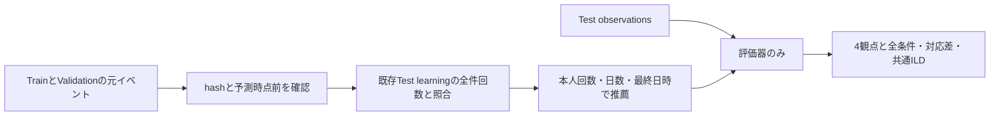

# 本人履歴方式の後半期間検証

## 比較の位置付け

- [Validationでの直近性改善](ease-weighting.md#直近性の比較結果)が別時点でも続くかを確認する
- 予測時点は2018-09-21、学習はTrain＋Validationの全履歴。全学習ユーザーを対象にする
- 既存Testは他方式の結果を既に確認済み。今回は探索的な後半期間の追加検証で、未使用期間の独立確認とは呼ばない
- [実行前に固定した条件](../data/provenance/history-later-period-20261112/protocol.json)に従い、本人回数順・日数順・最終再生日時順を全て比較する。結果を見て条件を変更しない
- 主タスク・主指標・採用版は未選択。90日/K20/日数重み1は表示条件であり、採用用指標の確定ではない

## 入力と漏洩防止



- 回数・日数は不変のTest learningから取得。最終日時はTrain＋Validationだけから再集約する
- 元Testイベントは推薦器が開かない。Test observationsを学習・パラメータ調整へ使わない
- 最終日時の集約は全ユーザー・曲の回数をTest learningと完全照合。未来イベント、欠落、出典hash違いは停止する
- GPU採点・順位・指標集計は既存経路を使用。最終日時集約と入力検証はCPU/DuckDB、メモリ上限16,384MB
- 30/90/180日、K2〜20、日数重み0/0.5/1/2、再生回数/日数分布、4観点を保存する
- 新規曲は本人スコアが全て0で、全体の学習再生回数→曲IDで同点解消。3方式の新規順位一致を検算する

## 実行

```bash
CUDA_PATH=/usr PYTHONUTF8=1 .venv/bin/python -m backend.interfaces.cli.evaluate --config configs/history_frequency/base.json --phase test
CUDA_PATH=/usr PYTHONUTF8=1 .venv/bin/python -m backend.interfaces.cli.evaluate --config configs/history_frequency/active-days.json --phase test
CUDA_PATH=/usr PYTHONUTF8=1 .venv/bin/python -m backend.interfaces.cli.evaluate --config configs/history_frequency/last-play.json --phase test
CUDA_PATH=/usr PYTHONUTF8=1 .venv/bin/python -m backend.interfaces.cli.weighting_comparison --config configs/history_frequency/last-play.json --phase test --reference history-count=data/experiments/history_frequency/count/test --reference history-active-days=data/experiments/history_frequency/active-days/test --run
```

- 既存の同じ実験JSONを使い、出力は各方式ディレクトリの`test/`。元Validationや既存Testを上書きしない
- 3方式の比較は`data/experiments/history_frequency/last-play/test/comparison/`。入力・評価条件・母集団・原本hashの一致を確認する
- 時間は入力準備・評価・GPU順位取得を分ける。バッチ償却時間はオンライン応答時間ではない
- API未使用。未測定token/API料金/LLM・tool callはnullのまま保持する

## 結果と解釈

- [3方式の比較](../data/experiments/history_frequency/last-play/test/comparison/result.json) / [対応差](../data/experiments/history_frequency/last-play/test/comparison/paired.csv) / [共通ILD](../data/experiments/history_frequency/last-play/test/comparison/ild.csv) / [独立検算](../data/provenance/history-later-period-20261112/verification.json)
- 全119,133人。90日/K20/日数重み1の再聴精度は正解のある14,594人の平均、正解なし104,539人は精度平均から除外

| 観点・指標 | 回数順 | 日数順 | 最終日時順 |
| --- | ---: | ---: | ---: |
| 再聴Graded NDCG | 0.236611 | 0.236400 | 0.308218 |
| Repeat Recall | 12.2608% | 12.2447% | 17.8967% |
| 再聴共通ILD（91,216人） | 0.698342 | 0.691782 | 0.713726 |
| 再聴Catalog Coverage | 84.7383% | 82.4115% | 96.5539% |
| 再聴Novelty（bit） | 5.567516 | 5.518475 | 6.027387 |
| 入力準備（秒） | 58.68 | 58.96 | 77.40 |
| GPU順位取得・全238,266要求（秒） | 27.32 | 27.44 | 27.40 |
| 評価全体（秒） | 124.94 | 123.94 | 123.86 |

- 最終日時順は回数順に対しNDCG相対+30.26%、Recall相対+45.97%（+5.6359ポイント）。NDCGを正解率とは呼ばない
- ユーザー対応bootstrap 2,000回の探索的95%区間はNDCG差+0.067218〜+0.075949、Recall差+5.2662〜+6.0137ポイント。日数順との差も両区間が正
- 日数順−回数順は両指標の95%区間が0を含む。日数化の小幅なValidation改善を期間を超えた一律優位とは言えない
- 最終日時順−回数順の再聴2指標は30/90/180日×K2〜20の全57条件で平均が正。NDCGは日数重み0/0.5/1/2全てで一致。各条件の有意性や未知期間の保証ではない
- 新規順位は全119,133人で3方式一致。再聴の改善を新規推薦の改善へ拡張しない
- 共通ILDは全方式でタグ特徴が使えるユーザーの積集合。タグ欠損による除外は最終日時順で増える。タグ空間の多様性と主観的な多様性は別
- 各方式627値、合計1,881精度値をCPUで独立再計算。最大差約3.45e-15。最終日時順は無作為100人の元Train＋Validationから順位を独立照合し、固定処理版・原本hashを確認
- 最終日時順のGPUバッチ償却は約0.115ms/要求。入力準備は回数順より約18.7秒多いが、一括順位取得はほぼ同程度。単発オンラインの待ち時間は未測定
- **直近性の利点は前半と後半の両期間で確認できた。再聴のモデル・融合・選択器は、本人直近順を必須対照にして追加価値を測る必要がある**
- 新方式を開発する場合はValidationへ戻り、既見Testで重みやルールを調整しない。未使用期間での独立確認と実ユーザー試験、主指標・採用版の決定は残る
