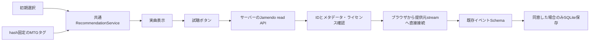

# Jamendo実曲モード

公式仕様確認日: 2026-10-16。アプリ登録は承認待ち、実API・実音源の成功は未確認
デモ/ベンチマークとは別の `mode=jamendo`、既定設定は変更しない

## 本人による登録と設定

1. [Developer Portal](https://devportal.jamendo.com/)で開発者登録し、music-recsysアプリを作成
2. 非商用の教育用推薦プロトタイプ、MTGタグ利用・read APIによるメタデータ/stream利用・音源再配布なしを説明
3. Read Onlyで申請し、承認後にClient IDを取得。今回はClient Secret・OAuthは不要
4. リポジトリ直下のGit管理外 `.env` に `JAMENDO_CLIENT_ID=取得値` を設定、既存内容を上書きしない
5. キーはチャット・コマンド引数・VITE変数・ビルド成果物へ記載しない

[認証仕様](https://developer.jamendo.com/v3.0/authentication)では各read APIにclient_idが必要
承認待ちなら申請を待つ。別ID・停止中試験IDで回避しない
`--env-file`/`--jamendo-env-file`は指定したファイルからこのキーだけを読み、shell展開しない
環境変数が設定済みなら優先する

## 100曲の検証と起動

```bash
# 出力先は毎回新規。承認後に初めて実API・実音源を検証する
PLAYWRIGHT_BROWSERS_PATH=/tmp/music-recsys-browsers .venv/bin/python \
  -m music_recsys.jamendo_poc --env-file .env \
  --sample data/poc/mtg-jamendo-100 \
  --output data/app/jamendo-verified --browser

# APIを使わずメタデータと推薦だけ準備する場合は --env-file / --browser を省略
.venv/bin/python -m music_recsys.webapp.server \
  --config data/app/jamendo-verified/config.json \
  --database data/app/jamendo-verified/local.sqlite \
  --model-version mtg-tags-poc --jamendo-env-file .env --port 8767
```

ChromiumはPlaywrightで別途導入する。上のブラウザパスは今回の検証環境の値
未認証の準備済み設定は `data/app/jamendo/config.json`。`--jamendo-env-file`なしで起動できる
推薦モデルは特徴ファイルから起動時ロード、リクエストごとの再学習なし
features/spec/catalogのSHA256と相互参照を検証する
タグのL2正規化・正のCosineだけを推薦。初期選択と聴取履歴は既存ProfileRequestで区別
無入力・共通特徴不足では空結果と案内を返し、架空のPopularityで補わない



## API・録音・再生の区別

- [tracks API](https://developer.jamendo.com/v3.0/tracks)へID指定、single/albumtrack両方、最大200件以内のbatch
- `audio`はstream用、`audiodownload`は使用しない。音源の取得保存・再配信をしない
- HTTP成功でもheaders.statusを確認。停止code=11・429・認証拒否・通信失敗を分類
- 上流URL・認証値を含む例外をそのまま返さない。自動無限retryは行わない
- 成功応答の未返却曲はnot_returned。削除/地域制限を推測で確定しない
- ID＋正規化タイトル＋artist一致はid_metadata_consistent。音声指紋による証明とは異なる
- live/remix等の版表記は保持。矛盾はmetadata_conflictで再生を止める
- stream URLと画像はHTTPSのJamendo系ドメインのみ。client_idを含むURLは公開しない
- 実再生前に現在のCCライセンスURLがあることを確認、プレイヤーにライセンス表示
- playback_status=availableは短時間キャッシュ内のURL提供可。ブラウザ成功と同義ではない
- URLは試聴開始時に再解決、キャッシュ60秒。未知なら試聴ボタンから確認できる
- HTML audioのplaying/pause/ended/errorを既存play/pause/ended/errorへ接続、skipはアプリ操作
- playingイベントは再生開始であり、一定時間聴いたことや満足度の証明にはしない
- 再生IDを推薦リクエスト/曲/セッションへ結び付け、未発行IDでの操作を拒否
- 外部再生時は利用者のIP等が配信元へ送られることを画面に表示、公開前にprivacy説明を整備

`--browser`は取得できた許諾URLについてChromiumで再生時間の進行と停止を測る
短時間確認なので自然終了は未検証。endedイベントの接続はMock統合テストで確認
ブラウザのエラーから地域制限や削除を推測しない
result.jsonはmetadata率、ID整合率、URL率、browser試行数/成功率を別保存
ブラウザ試行対象が全100曲でない場合、全標本の成功率はnullのままにする
今回100曲はすべて未認証、取得率・照合率・URL率・再生率はnull、ブラウザ試行0
`data/app/jamendo/result.json`に未設定状態を保存。前回PoC結果を上書きしない

## テストと制約

```bash
OMP_NUM_THREADS=1 OPENBLAS_NUM_THREADS=1 MKL_NUM_THREADS=1 .venv/bin/pytest -q \
  tests/test_jamendo.py tests/test_catalog_poc.py tests/test_listenbrainz_poc.py \
  tests/test_webapp.py tests/test_webapp_study.py tests/test_app_foundation.py
cd frontend
npm run build
```

認証未設定の8767サーバーを起動後、`OTOLAB_TEST_JAMENDO_UI=1`で`tests/test_jamendo_browser.py`を実行可能
Mockテスト: read応答/停止/レート制限/秘密保護/録音版の矛盾/推薦/再生ID/イベント/非同意時の永続化抑止
実ブラウザ: スマホ幅で実メタデータ→初期選択→Content推薦→未認証の試聴エラーを確認
これは実音源再生成功ではない。画像はAPI承認後のsnapshot取得から表示可能、今回は未取得
本番公開・課金・有料契約・実被験者ログ収集は未実施

## 共存・運用

学習カタログと再生可用性は独立。新曲は特徴があればContent、CFはバッチ再学習まで対象外
履歴が不足した新規ユーザーは選択曲Contentを使用。CFとHybridの自動切替は未実装
今後のStrategyでCFが適用不能ならContentへ明示フォールバックし、その経路をログへ残す
LLM/Agentも既存Strategyを交換。外部コンテンツをLLMへ入力する権利は別途確認
[ListenBrainzの調査・500件PoC](listenbrainz-poc.md)を参照

[Jamendo規約](https://devportal.jamendo.com/api_terms_of_use)は非商用API無料、将来の課金/制限変更可能性あり
50万hitsは無条件の固定無料枠ではなく、超過見込み時の連絡基準。応答の利用制限に従う
[Cloudflare](cloudflare.md)の静的無料枠・同一Origin API中継を維持、CSPにJamendo media/imageのみ追加
[Render無料枠](https://render.com/docs/free)は15分idle停止、復帰約1分、ローカルSQLiteが失われる
永続ログは研究室内の許可された保存先等が決まるまで収集開始しない。無料disk永続化を仮定しない
起動時のモデルロードはローカル計測可能だが、Render初回/ネットワーク/API/実再生レイテンシは未測定
再生は直接配信元なのでバックエンドの音声保存容量・音声転送負担を増やさない
本実装の外部API処理は同期かつセッションlock内、少人数PoC用。複数同時試聴時の待ち時間は要実測
