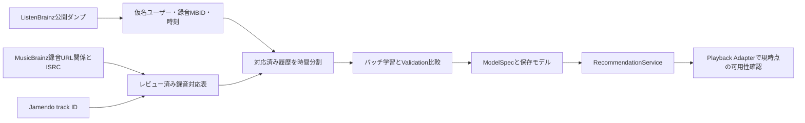

# ListenBrainzとJamendoの協調フィルタリング接続

確認日: 2026-10-16。Music4All評価・music-recsysの既定カタログは変更しない

## 判断

ListenBrainzのユーザー別時刻付き履歴はPopularity・ItemCF・ALS・BPRの入力に使える
ただしJamendoとの録音単位の対応と、十分な複数ユーザーの重複聴取が必要
今回の小標本ではその条件を満たさず、CFモデルを学習していない
当面はJamendo Contentを使い、将来の実操作履歴を同意範囲内で蓄積する案を推奨
CFデータ源としては、更新・許諾が明確なListenBrainzダンプを次の調査対象とする

## 利用条件と取得

- [ListenBrainz data](https://listenbrainz.org/data/): 聴取履歴・テキストはCC0。商用/非商用の学習を妨げるNC条件はないが、音源の権利は含まない
- [公開履歴API](https://listenbrainz.readthedocs.io/en/latest/users/api/core.html): 今回は認証なしの最近の500件を1回取得。全履歴の連続ページ取得は行わない
- [API制限](https://listenbrainz.readthedocs.io/en/latest/users/api/index.html): 最大1req/s、429とRateLimitヘッダーに従う。再取得時は連絡先URL付きUser-Agentを指定
- [データダンプ](https://listenbrainz.readthedocs.io/en/latest/users/listenbrainz-dumps.html): fullとincrementalで継続更新できる。削除履歴の反映にはfull再取込が必要
- 同ページにincremental頻度の記述不一致があるため、取得時に実ファイル時刻を確認する
- [個人履歴export](https://listenbrainz.readthedocs.io/en/latest/users/api/export.html): 本人tokenによる一括取得の別経路。今回未実施
- [MusicBrainzライセンス](https://musicbrainz.org/doc/About/Data_License): coreはCC0、supplementaryはCC BY-NC-SA 3.0。利用フィールドの区分を確認する
- [ISRC](https://musicbrainz.org/doc/ISRC)は録音識別の根拠だが重複・誤登録を除外するため、録音MBID・版・長さ・出典も確認する
- [MusicBrainz API](https://musicbrainz.org/doc/MusicBrainz_API)の録音URL関係を利用してJamendo track URLへ接続する候補。今回、実APIによるcrosswalk取得は未実施
- 代替[MLHD/MLHD+](https://blog.metabrainz.org/2022/10/28/cleaning-up-the-music-listening-histories-dataset/)は大規模だがMBID誤対応/正規化が課題。利用する配布版のライセンス確認未完了のため採用・取得しない

## 実データPoC

母集団代表性を持たない便宜標本: 公開アカウント1名のAPI取得時点の最新500イベント
1アカウントを固定し、Jamendo照合結果に応じた再抽出はしていない
ユーザー名を公開文書・集計に出さず、元レスポンスをGit管理外の権限制限ファイルに保持
対象Jamendoは前回seed=42の100曲をそのまま利用

| 項目 | 実測/状態 |
| --- | --- |
| 取得履歴 | 500イベント、1ユーザー |
| recording MBIDあり | 499/500イベント、247ユニークMBID |
| 投稿されたJamendo track URLのID候補 | 0/500イベント |
| 正規化タイトル＋アーティスト一致候補 | 0/500イベント |
| 未照合 | 500/500イベント |
| 候補率 | 0/500 = 0% |
| 確認済み同一録音照合率・誤一致率 | 未測定/null |
| 実再生率 | 未測定/null |

この0%をListenBrainz全体とJamendo全体の重なりの推定に使わない
名前はNFKC・空白・大小文字だけ正規化し、live/remix等の版表記を削除しない
名前一致は曖昧候補、投稿URL一致も未レビューのID候補に留める
MSIDはMusicBrainz recording MBIDと別物。release/artist MBIDも録音同一性の証拠にしない
今回の候補がないことから、誤一致率0やJamendo曲がListenBrainzに存在しないとは言えない

成果物:
- `data/poc/listenbrainz-input/listens.json`: 元レスポンス、0600、Git管理外
- `data/poc/listenbrainz-jamendo-500/result.json`: 分母・null・入力SHA256
- 同`matches.csv`: ユーザー名を除いたイベント単位の候補/未照合

再集計は新しい出力先で実行:

```bash
.venv/bin/python -m music_recsys.listenbrainz_poc \
  --listens data/poc/listenbrainz-input/listens.json \
  --catalog data/poc/mtg-jamendo-100/tracks.csv \
  --output data/poc/listenbrainz-jamendo-check
.venv/bin/pytest -q tests/test_listenbrainz_poc.py
```

## 次の接続



先にJamendo側の録音MBID/ISRCを確保し、複数ユーザーの履歴を絞り込む
学習可否はユーザー数・曲数・履歴数・ユーザー間重複・時間分割後の被覆率を集計して判断
利用可能曲だけで評価すると選択バイアスがあるため、絞込み前後の分母を保存する
新規ユーザーは選択曲Content、履歴が十分ならItemCF、ALS fold-inは既存機構を再利用
BPRはユーザー因子が必要なので再学習前は明示的にContentへフォールバックする
新曲は特徴があればContentで扱い、CFでは次のバッチ学習まで未対応とする
同意したアプリ操作を履歴に変換するときは、再生開始と実聴取・スキップを区別する
今回の500件からアプリ利用者の嗜好や架空履歴を作らない
