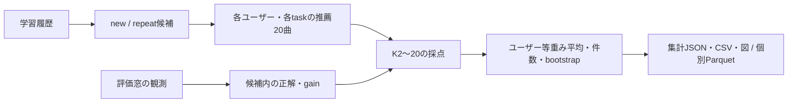

# オフライン評価指標

## 評価の4観点

| 観点 | 全モデルで測る指標 |
| --- | --- |
| 新規発見 | Binary NDCG・Recall |
| 継続的な嗜好 | Graded NDCG・Repeat Recall、再生回数・再生日数の分布 |
| 多様性・発見性 | ILD・Catalog Coverage・Novelty |
| 効率性 | 学習/評価時間・推薦レイテンシ・入出力トークン・API料金・LLM call・tool call |

- Popularity・CF・Content・将来のLLM/Agentで同じ4観点を使用する
- 効率性以外はK=2〜20の整数、同じ先頭20曲から感度分析する
- 主指標はこの一式から設定選択に使う一部、未指定でも他の観点を省かない
- 未測定はnull、実測0は0、全値nullのPNGは生成・表示しない
- オンラインの行動・主観評価は[オンライン評価](online-study.md)で別管理する

## 入力と期間

| 項目 | 現行listening-v2 |
| --- | --- |
| Train | 2017-03-29 00:00:00より前 |
| Validation | Train終端以上、2018-09-21 00:00:00未満 |
| Test | Validation終端以上 |
| 学習 | ValidationではTrain、TestではTrain＋Validation |
| 観測窓 | 推薦時点から30/90/180日、開始以上・終了未満 |
| 時刻 | timezone-naiveの配布値、UTC/JSTを後付けしない |
| 母集団 | 学習履歴のある全ユーザー、学習期間に観測された楽曲 |
| 主表示 | 90日・日数重み1、現行selection.k=10、選択用タスク/主指標は別指定 |

- Validation窓がTest開始を越える設定は拒否する
- 将来の再生活動の有無でユーザーを抽出せず、正解保有人数・除外人数を条件別に保存する
- 保存済み全件入力の学習ユーザーは119,133人、別データではmanifestの母集団を確認する
- ログ最終時刻は各ユーザーを窓末尾まで観測した保証ではない
- cold user / cold itemはこのwarm評価に混ぜない

## 候補・正解と指標名

| 保存task / 指標 | 推薦候補 | 正解集合・意味 |
| --- | --- | --- |
| discovery / recall | 本人の学習期間に未聴の学習曲 | 評価窓で再生した未聴曲、New Recallに相当 |
| discovery / binary_ndcg | 同上 | 同じ未聴正解によるNew Binary NDCG |
| retention_proxy / graded_ndcg | discoveryと同じ順位 | 未聴曲の評価窓内の再生強度、定着の代理指標 |
| repeat / repeat_recall | 本人の学習期間の既聴曲 | 評価窓でも再生した既聴曲、Repeat Recall |
| repeat / graded_ndcg | 同上 | 既聴曲の評価窓内の再生強度 |
| 総合Recall / 総合Binary NDCG | 既聴・未聴を混ぜた全候補 | 現行全件経路では未実装・未測定 |

- New Recallの正解は「評価窓で再生、学習期間は未聴」、通常の全聴取曲Recallと区別する
- 新規とは保存した学習履歴にないこと、生涯初回の聴取とは限らない
- New NDCGは既存discovery/binary_ndcg、総合NDCGと読み替えない
- 初期プロフィールの選択曲は聴取履歴ではなく、オンライン被験者実験をこの母集団へ混ぜない
- 過去のRecall図は保存task・候補・正解定義を確認し、異なるプロトコルの値を直接比較しない

## 計算

```text
n = 評価窓の再生回数
d = 異なる再生日数
λ = 非負の日数重み（0 / 0.5 / 1 / 2）
binary_gain = 1[n >= 1]
graded_gain = log2(1+n) + λ * log2(1+d)
DCG@K = sum(gain(rank_r) / log2(r+1), r=1..K)
NDCG@K = DCG@K / IDCG@K
Recall@K = 先頭K位置で当たったユニーク正解数 / 候補内の全正解数
```

- graded_gainを再び指数変換しない、IDCGは候補内の全正解から理想上位Kを計算する
- 分母0はnull、正解保有ユーザーを等重みで平均し、条件別評価/除外人数を併記する
- 観測行がない組のgainは0、嫌いであることを意味しない
- モデルへ渡すのはlearning.parquetのみ、observations.parquetの将来回数/日数はEvaluatorが読む



## 多様性・発見性

| 指標 | 定義・集計条件 |
| --- | --- |
| ILD@K | 有効推薦曲のタグCosine距離の全ペア平均、2曲以上かつ全曲の非ゼロ特徴が必要 |
| Catalog Coverage@K | 推薦されたユニーク曲数 / 全ユーザーの当該task候補の和集合サイズ |
| Novelty@K | `-log2((曲の学習ユニークユーザー数+1)/(全学習ユーザー数+2))`の有効曲平均 |

- 将来正解のないユーザーも多様性の母集団から除外しない
- 特徴欠損・ゼロノルム・候補なし・有効曲不足を分けて件数を保存する
- 同じ共通特徴artifactを全モデルのILDに使い、特徴hashが違う結果を同条件としない
- 継続的な嗜好の解釈には再生回数・再生日数分布を添え、因果的な推薦効果と断定しない

## 効率性・不確実性

- 学習・評価・描画・モデル保存の時間を区別し、保存前の実測がない旧結果はnullのままにする
- CPU推薦レイテンシは順位取得、GPU評価は転送・安定整列込みのバッチ時間を要求数で割った値
- GPUバッチの償却時間を、ブラウザ経由の単発応答時間やCPU単発時間と直接同一視しない
- オンラインでは選択・推論・API応答・画面表示の時間を別計測する
- token・料金・call・メモリはAdapter等の実測値のみ、非LLMでも未計測を0に補完しない
- 同一推薦を窓・K・日数重みの数だけ生成し直したり、料金を重複計上したりしない
- bootstrapはユーザー単位、全件の主窓/重みで2,000回・seed42、2人未満は未測定
- bootstrap区間はユーザー間の不確実性であり、学習seed間・GPU非決定性の幅ではない

## 不正出力・欠測

- new/repeatを各1回生成、空候補なら推薦呼出しを省略する
- 無効ID・重複IDの位置はgain0、後続を繰り上げず、重複加点は最初の有効出現だけ
- 先頭20位置を固定し、短い出力の不足位置・正解ありの推薦失敗は0点
- 正解なしは失敗時もnull、推薦失敗そのものはdiagnosticsへ残す
- 不足・重複・無効・超過・失敗の件数を保存し、未実行を成功として補完しない
- JSONの集計と個別Parquetをhashで関連付け、保存先は[実行フロー](experiment-workflow.md#保存物)
- binary-v1は互換Readerだけを保持、listening-v2と同じ条件として混ぜない

## 設定選択と追加評価

| 推薦目的 | 今後の選択用候補 | 現状 |
| --- | --- | --- |
| 新規発見 | New Recall@20 | discovery/recallとして測定可能 |
| 再聴取 | Repeat Recall@20 | repeat/repeat_recallとして測定可能 |
| 総合推薦 | Binary NDCG@20 | 混合候補taskの実装・評価が必要 |

- 上表は目的別方針、採用モデル・各実験の主タスクは未確定のまま比較可能にする
- 総合評価は既聴・未聴を除外しない一つの順位と正解和集合で計算する新taskを追加する案
- 新taskでは結果版・分母・除外人数を明記し、既存new/repeatの数値・正解集合を変更しない
- Validationで比較・選択し、確認/固定後に最終Test、Test値から配信用設定を選ばない
- [研究計画](research-plan.md)と[考察](discussion.md)で目的別のトレードオフを扱う
