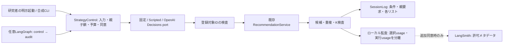

# LLM・Reactive Agentの検証基盤

## 実装の範囲

- 登録済み推薦対象を選ぶ研究用の制御基盤。[研究者向けFastAPI接続](control-http.md)に対応し、参加者UI/実験割当・実API運用には未接続
- `StrategyControl`で固定・単発選択・Reactiveの入力検査、明示調整、予算、失敗、監査を共通化
- 選択後は既存`RecommendationService`で推論し、共通の候補・重複・K検査を再利用する
- 現在の対象は登録`ModelSpec.version_id`。完成パイプラインの登録・融合・再ランキングは未実装
- 研究者HTTPの実行基盤はLangGraph、観測先は任意のLangSmith。この2つを使う構成とする
- 実API呼出し・トレース外部送信・実参加者による検証は未実施。合成試験を推薦品質の評価にしない
- [研究順序・未決事項](research-plan.md) / [戦略制御設計](recommendation-design.md) / [オンライン比較](online-comparison.md)

| ツール | 現在の接続 | 採用する役割 |
| --- | --- | --- |
| LangGraph | ローカルAdapterで`START → control → audit → END`、checkpointerなし | 研究者HTTPの戦略制御基盤。参加者APIは未接続。DB再開は安全に拒否 |
| LangSmith | 明示Clientによる許可済みメタデータ送信Adapter、実送信は未実施 | 任意の観測先。推薦の実行・参加者ログ保存には必須にしない |

- [LangGraphはLangChainの高水準APIなしでも利用可能](https://docs.langchain.com/oss/python/langgraph/overview)。LangChainのagent/chainは採用しない。`uv.lock`の`langchain-core`等はLangGraphの推移的依存として保持する
- [LangSmith Developer](https://www.langchain.com/pricing)は1席・月5,000 base tracesまで含み、超過は従量制。請求ゼロを条件とする運用ではローカル監査を既定とする

## 責務と実行



| 層 | ファイル | 責務 |
| --- | --- | --- |
| Domain | `src/domain/recommendation/control.py` | 判断入力/結果、feedback、予算、送信許可、監査形式、入力hash |
| Application | `src/application/ports/control.py` | 判断・トレースport |
| Application | `src/application/strategy_control.py` | 条件内の状態・明示調整・共通Service/SessionLogへの接続 |
| Infrastructure | `src/infrastructure/research/decision_providers.py` | ScriptedとOpenAI Decisions Adapter |
| Infrastructure | `src/infrastructure/research/control_graph.py` | 同じ制御のLangGraph実行、環境変数による自動traceを抑止 |
| Infrastructure | `src/infrastructure/research/control_traces.py` | 明示Client/プロジェクトを使う限定LangSmith送信 |
| Interfaces | `src/interfaces/cli/control_rehearsal.py` | 合成データだけを使うネットワーク不要の契約確認 |

## 判断とAgentの区別

- `fixed`は研究者が指定した対象を維持し、外部判断を呼ばない
- `llm_once`は各明示起動につき1判断。固定入力の件数・taskと今回のfeedbackを判断portへ渡す
- `reactive`は同じ入力に、その条件の過去に選んだ対象IDを加えて1判断する
- 初回の後は明示調整と最新の親request_idが必須。条件別に初回＋最大2調整、他条件の履歴は参照しない
- 内部の自律反復、toolを追加実行するloop、外部LLMによる自由な行動生成は未実装
- この最小状態保持がAgentの研究上の採用構成を確定するものではない。反復の利益はまだ比較していない
- 各条件は同じ推薦入力を保持する。feedbackや実際の試聴内容まで同一と保証するものではない
- 共通の入力権限・feedback語彙・候補・予算を研究者が指定する。語彙や採用対象を自動選定しない

## 許可・予算・失敗

- APIモデル、対象IDと説明、feedback選択肢、call上限、timeoutを起動側で明示する
- APIモデル・料金単価の既定値はない。対象の説明に参加者情報や自由文を埋め込まない
- 外部送信は`ExternalPermission.decision_input`、自由文はさらに`feedback_text`が必要
- 長期嗜好のローカル保存同意は外部送信許可を兼ねない。既存同意UIからこれらの許可を生成しない
- 判断入力にはparticipant/session/request ID、曲ID、実履歴、長期プロフィール本文を含めない
- 現在の件数中心の入力では音楽的嗜好の選択効果は検証できない。入力内容の拡張は同意・比較設計の決定後
- SDKはtimeoutを指定し自動retryを無効化する。timeout、拒否、不正ID、推論失敗は評価リストを作らない
- 失敗した判断もcall上限へ算入する。失敗メッセージや自由文を監査へ書き出さない
- `max_cost_usd`は既に測定できた判断費用に基づく次回呼出しの停止条件
- 未測定費用がある場合、費用上限を指定した後続呼出しを停止する。料金の事前見積や課金側のハード上限ではない
- 初回1callの費用超過を保証できないため、実利用前に提供側の予算・単価・上限運用を別途確認する
- Decisionsはtoken/callを保存するが、料金単価を採用していないため`api_cost_usd`はnull
- 推論側と判断側のusageは別々に保持する。既存の推論usageに判断usageを上書き/重複加算しない
- 履歴・候補・K・task・ユーザーが途中変更された要求を拒否する

## 監査・保持と外部トレース

- `ControlStep.audit()`は`music-recsys-control-step-v1`、session/condition/request/親ID・list_number・調整回数を持つ
- 選択/推論時間、provider/model、nullable usage、status/停止理由、trace状態を対応付ける
- 成功時だけ既存`SessionLog.record(..., adjustment_scope="condition")`へ推薦結果を関連付けられる
- 自由文・曲履歴・認証情報は監査出力に含めない。元のSessionLogには既存契約の情報が残る
- LangSmithは追加許可`trace_metadata`がある場合だけ、mode/status/理由/調整番号/選択時間を送る
- 外部trace IDはランダムUUID。participant/session/request/曲ID・feedback本文・入力hashを送らない
- LangGraph状態やOpenAI clientを自動trace/wrapしない。`LANGSMITH_TRACING=true`だけで状態を送信しない
- トレース障害は推薦を取り消さず`trace_status=failed`にする。失敗内容・再送キューを外部へ残さない
- 制御オブジェクトはメモリ内。研究者HTTPはmarker・監査を既存Sessionへ保存し、再起動時のcontrol継続は拒否する。参加者への接続・DBからの制御状態復元は未実装
- 既存の参加者保持期限・削除機構と外部traceの保持/削除条件を接続するまで実参加者へ有効化しない
- CLIは合成データの新規0600出力のみ。既存ファイル・元ログ・モデル・実験結果を上書きしない

## 合成確認

```bash
uv sync --locked --group llm
.venv/bin/pytest -q tests/test_strategy_control.py tests/test_architecture.py
.venv/bin/python -m src.interfaces.cli.control_rehearsal \
  --synthetic --engine python --output /tmp/control-python.json
.venv/bin/python -m src.interfaces.cli.control_rehearsal \
  --synthetic --engine langgraph --output /tmp/control-langgraph.json
```

- `--synthetic`とengine指定が必須。ネットワーク・APIキー・常駐DBは不要
- 2個の合成登録対象で固定/単発/Reactiveそれぞれ初回＋2調整を実行する
- 合成の昇順/降順・選択順は契約確認専用で、採用モデル・推薦戦略・性能値を表さない
- 満足度・試聴・料金・LLM usageを作らない。未測定usageはnull、元の合成SessionLogへ追跡できる
- SDK試験は実OpenAI SDKとメモリ内MockTransport、graph試験は実LangGraphを使う
- `llm`は任意dependency group。標準オフライン評価・Mac配信の必須依存へ追加しない
- 再現に使う版は`uv.lock`。合成LangGraph出力にもOpenAI/LangGraph/LangSmithの実パッケージ版を保存する

## 外部SDKの根拠と未決事項

- [OpenAI公式Decisions guide](https://developers.openai.com/api/docs/guides/decisions): `client.decisions.create`のchoiceを使い、判断後の実行はアプリ側
- [OpenAI公式Python API reference](https://developers.openai.com/api/reference/python/resources/decisions/methods/create): input/model/questions・answers/usage。Adapterで返答型・名前・選択IDを検査する
- [LangGraph公式quickstart](https://docs.langchain.com/oss/python/langgraph/quickstart): `StateGraph`のnode/edge、compile/invokeをローカルAdapterで利用
- [LangSmith公式tracing設定](https://docs.langchain.com/langsmith/trace-without-env-vars): 明示clientと`tracing_context`で制御
- 利用可能モデル・SDK/API可用性・料金は実利用直前に公式仕様とアカウントで再確認する

| 優先 | 実参加者への接続前に決めること | 選択肢・制約 |
| --- | --- | --- |
| P0 | 外部送信する根拠・追加同意・保持/本人削除 | 件数だけ/許諾済み特徴/明示feedback、外部traceも別目的として整理 |
| P0 | モデル・単価・費用予算・timeout/再試行 | 現行は未指定、call制限と測定済み費用の停止だけ |
| P1 | 選択対象の粒度 | 登録推薦器/完成済みパイプライン。後者の登録・検査は別対応 |
| P1 | Agentの許可行動・内部反復・停止 | 現行は1起動1判断、融合や再ランキングを自由に作らせない |
| P1 | DB状態・権限・排他・復帰・削除 | 既存Session/SessionLogへ接続し再起動で予算/調整上限をリセットさせない |
| P1 | 固定/LLM/Agentの共通入力と研究条件 | 同じprofile時点・入力権限・候補・調整機会、実行動の差は記述する |
| P2 | LangSmithの評価dataset・grader・比較画面 | 個人データを送らないfixture評価から検討、今回は匿名trace接続のみ |
