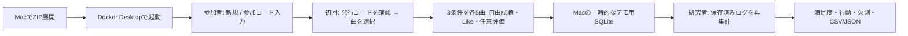

# MacでZIP版の画面を確認する

- ZIPをMacへコピーして展開し、Docker Desktopでアプリを起動する
- ブラウザはMac内のアプリへ接続する。研究室サーバーの起動・ポート転送・外部公開は不要
- `-demo`配布は独自合成音源による操作確認用。実曲の研究結果や採用モデルを表すものではない
- 初回はDocker image・依存パッケージの取得にネット接続が必要。MacへPython/Nodeを直接入れる必要はない

## 起動

1. 旧アプリが動いている場合は旧フォルダで`bash deploy/mac.sh stop`を実行する
2. Docker Desktopを起動する
3. ZIPを新しいフォルダへ展開する。旧コードへ上書きしない
4. ターミナルで展開フォルダへ移動し、以下を実行する

```bash
cd "$HOME/Downloads/music-recsys-mac-0.4.2-demo"
# デモ操作ログを既存の参加者データとは別の場所に保存する
export MUSIC_RECSYS_STATE="$HOME/music-recsys/demo-online-state"
export MUSIC_RECSYS_RETENTION_DAYS=1
bash deploy/mac.sh start
bash deploy/mac.sh researcher
```

- 参加者画面: `http://127.0.0.1:8765/`
- 研究者画面: `http://localhost:8766/#online-analysis`
- ホスト名を分けることで、同じブラウザでも参加者/研究者のセッションcookieを混ぜない
- 研究者画面はMacのloopbackだけで待受け、遠隔用認証設定があるターミナルからの起動を拒否する
- 通常の`start`は参加者サービスだけを起動する。研究者画面は`researcher`を明示した場合だけ起動する
- 上記の保持1日・保存先はデモ確認用の明示設定。本実験の保持規程を決定するものではない
- 旧ログの検出で停止した場合は自動移行/削除せず、[既存の移行手順](app-architecture.md#macで起動更新)を確認する

## 画面の確認



- 最初は「初めて利用する」または参加コード入力。説明と保存/再利用の同意内容は右上の「？」で確認する
- 初回は発行されたコードを控えてから好きな曲を選び、3回の推薦リストを試す
- 各リストの満足度と新規発見は任意回答。モデル名は参加者へ表示しない
- 研究者画面の「オンライン比較実験の分析」を開き「保存済みログを再集計」を押す
- 最初のデータは空。自分が操作した結果だけを表示し、架空の被験者結果を同梱しない
- 合成プレビューは8秒なので、有効試聴10秒の実曲評価を検証する音源には使わない
- 計算式と不足ログの扱いは[オンライン指標](online-metrics.md)、割当と分析は[比較実験](online-comparison.md)

## 停止と保存先

```bash
# 起動時と同じターミナル・環境変数で実行
bash deploy/mac.sh status
bash deploy/mac.sh stop
```

- `stop`は参加者/研究者の両サービスを停止する。データ削除とは区別し、保存先のSQLiteを消さない
- デモログは`~/music-recsys/demo-online-state/sessions.sqlite`、本人削除・保持期限の対象となる
- 手動取得した分析コピーは自動削除されない。自分で保管/削除を管理する
- Mac実機・Docker Desktopでの起動は利用者側で確認する。LinuxのCLI/ブラウザ試験とは区別する

## 配布物と遠隔公開

- ZIPとchecksumは`data/app/music-recsys-mac-0.4.2-demo.zip`と同じ階層に置く。配布物用の入れ子フォルダは作らない
- 遠隔公開は[MacのTunnel/Access設定](app-architecture.md#cloudflare-tunnel--accessでの遠隔接続)を使う。Pages/Workersへデプロイしない
- 公開ホスト名はMac側のTunnel設定で確定する。Access認証・本人削除・保持期限を確認後、READMEとGitHub Aboutへ掲載する
