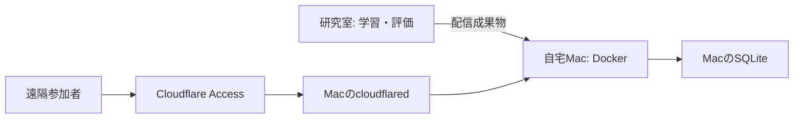

# Macでのmusic-recsys運用

研究室サーバーで学習・評価し、配信成果物を個人Macへ移してCPU推論する
研究室サーバー/回線の外部公開・ポート開放・Tunnel起動は行わない
Docker DesktopはMacで動作確認済み。研究用のルートcompose.yamlとは独立した構成



## 起動と更新

版付きZIPをダウンロードして展開する。フォルダ名は`music-recsys-mac-<version>`
旧フォルダへ重ねて展開せず、実験終了後に更新する

```bash
cd "$HOME/Downloads/music-recsys-mac-0.3.1"
bash deploy/mac.sh start
```

Finderでは同梱の`MusicRecsys.command`からも起動でき、成功するとブラウザを開く
URL: http://127.0.0.1:8765
停止・状態・ログは`bash deploy/mac.sh stop|status|logs`で確認する
初回は依存・image取得とbuildが必要。Mac本体へのPython/Node導入は不要

- ホスト側待受は127.0.0.1だけ。1 workerでモデルを起動時ロードする
- モデル・catalog・音源はbundleの読取り専用mount、ログは共通`~/OtoLab/state`へ保存する
- OTOLAB_STATEで保存先を明示変更できる。旧配布版のフォルダ内に既存DBがあれば継続利用する
- 旧フォルダ内のDBを共通領域へ移す場合は、停止後に行い、移動先の既存DBへ上書きしない
- 再起動後にブラウザセッションは復帰しない。実験中に更新・再起動しない
- 起動済みの旧版は新しい版の起動時に同じCompose projectとして置き換わる
- 不要な旧ZIP/コードフォルダは手動削除できる。state・実験結果・モデルを一緒に削除しない

## 配布物の作成

検証済みbundleを指定する。学習入力・評価JSON・ログ・認証情報は含めない
モデル採用設定は自動選択しない。Music4Allの準備状況は[研究室の実験準備](lab-study.md)を参照

```bash
# bundleをまだ作っていない場合だけ、新しい出力先に作成する
.venv/bin/python -m music_recsys.webapp.bundle \
  --config data/app/demo/config.json --study deploy/demo-study.json \
  --output data/app/mac-demo

.venv/bin/python -m music_recsys.webapp.distribution \
  --root . --bundle data/app/mac-demo --version 0.3.1 \
  --output data/app/music-recsys-mac-0.3.1.zip
```

ZIPは現在の作業ツリーのコードを含む。Git未コミットの実装も転送可能
VERSIONと配信コード・依存lock・モデルmanifest/hashを保持する。既存ZIPは上書きしない
実データを持ち出せる場所は、所属・データ提供条件に従う
Apple Silicon/Intel間の数値差は別途実機検証する

GitHubではコードのtagとReleaseを揃え、許諾済みデモZIPだけを添付する運用を推奨
名称変更前からのOTOLAB_*設定名・Compose project・state保存先は互換性のため維持する
現在はローカルで版付きZIPを生成する。commit/tag/push/Release公開は明示依頼時だけ行う
研究データ・Music4All音源・実モデル・ログ・秘密情報を公開Releaseへ添付しない

## 遠隔接続（自宅Macのみ）

ローカル操作確認後に設定する。ドメイン・アカウント設定と公開は未実施
実参加者収集には、音源条件・実施者・同意文・保存/削除規程の確定が必要

1. 利用するホスト名を決める。新規ドメイン費用は別途確認する
2. Cloudflare AccessのSelf-hosted applicationを全パスに適用し、参加者のメールだけAllowする
3. 自宅Macでnamed tunnelを作り、資格情報JSONをGit管理外へ保存する
4. `deploy/cloudflared.example.yml`をリポジトリ外へコピーし、UUID/host/team/AUD/資格情報パスを設定する
5. 下記設定でDockerを再作成し、未認証リクエストの401を確認後にTunnelを起動する

```bash
export OTOLAB_BUNDLE="/absolute/path/to/bundle"
export OTOLAB_STATE="$HOME/OtoLab/state"
export OTOLAB_ACCESS_TEAM="team名"
export OTOLAB_ACCESS_AUD="AccessアプリAUD"
export OTOLAB_ALLOWED_ORIGINS="https://ホスト名"
export OTOLAB_ALLOWED_HOSTS="ホスト名"
docker compose -f deploy/compose.yaml up --build -d
# 自宅Macで公開する段階にだけ実行
cloudflared tunnel --config /private/path/otolab.yml run
```

Macの電源・Docker・ネット接続を維持し、予約した実験時間帯はスリープさせない
Access認証はUI/API/音声へ適用し、署名・issuer・audience・有効期限をAPIでも検証する
JWT/メールを行動ログに保存しない。Access認証と研究同意は別の手続き
既存Workers Static Assets設定は保持する。この構成ではUIもMacから配信する

## 検証と資料

Compose構文・最小推論依存・移行後の推薦一致・JWT検証はローカルテスト対象
研究室ではDockerソケット権限がなくimage build不可。実TunnelとMacでの新UIは未検証
音源・モデル・実験UIの制約は[アプリMVP](app-mvp.md)、[オンライン実験](online-pilot.md)を参照

- [Composeサービス](https://docs.docker.com/reference/compose-file/services/)
- [Cloudflare Tunnel](https://developers.cloudflare.com/tunnel/)
- [Accessアプリ](https://developers.cloudflare.com/cloudflare-one/access-controls/applications/http-apps/self-hosted-public-app/)
