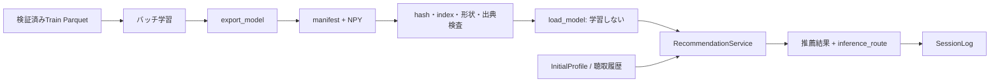

# 学習済みモデルの配信

## 対象と分離

対象はベンチマークのFullItemCF・FullALS・FullBPR、および同じ集約統計を使うFullPopularity
小規模Recommenderの契約は維持し、配信では全件モデルの配列をDeployedRecommenderへ接続する
小規模ALS/BPRと全件版は学習実装・bias・同点処理が異なるため、成果物を暗黙に相互変換しない



## 保存形式と整合性

`model_artifacts.py`のexport_model/load_modelを使用する
既存ディレクトリへの保存は拒否、評価結果とは別のGit管理外ディレクトリに置く
manifestを最後にrenameして公開し、失敗時は新規作成したディレクトリを除去する
pickleは使用しない

| ファイル | 内容 |
| --- | --- |
| manifest.json | ModelSpec、解決済みパラメータ、seed、学習入力hash、Git revision、コード/uv.lock hash、配列hash・shape・dtype、学習実行情報 |
| items.npy / plays.npy | 学習楽曲の順序と総再生回数 |
| scores.npy | Popularityの再生回数またはユーザー数 |
| targets.npy / weights.npy | ItemCFの近傍indexと重み |
| users.npy / user_factors.npy / item_factors.npy | ALS/BPRのユーザーindexと因子 |
| active_users.npy | BPRで全曲観測ユーザーをPopularity補完するためのマスク |

- ModelSpecのcatalog_refは順序付きitem_id列のhash
- implementation_refは実装ソースhash、Git revisionはmanifestのprovenanceに別記
- Gitやuv.lockを取得できない配置ではnull、確認済みの値に偽装しない
- provenanceは学習コンストラクタで記録し、export時にパラメータを手入力させない
- ItemCFキャッシュは入力hashを検証して再利用、cache_originに出典を残す
- 旧キャッシュに元の学習コード出典がない場合はnull、新規キャッシュでは出典も保存
- loadはファイル集合、SHA-256、dtype/shape、有限値、index範囲・重複、モデル仕様を検査
- 全件BPRの追加bias次元とactive_usersを保持する
- NPYはread-only mmapで開き、起動時の検証後はリクエストごとに読込み直さない
- hashは署名ではないため、外部から来た成果物を信用する根拠にはならない
- 本番では信頼済み配布経路からmanifest hashを受け取り、expected_manifest_sha256へ指定する
- mmap元ファイルは配信中に変更しない、更新は新しいディレクトリとモデル版で行う
- ユーザーID・因子を含む成果物はサーバー専用、ブラウザへ配布しない

## 保存・読込み

```python
from music_recsys.model_artifacts import export_model, load_model
from music_recsys.serving import FixedStrategy, RecommendationService

# trained_modelは既に学習済みのFullItemCF / FullALS / FullBPR / FullPopularity
manifest_hash = export_model(trained_model, "models/itemcf-v1", version_id="itemcf-v1")
spec, recommender = load_model("models/itemcf-v1", expected_manifest_sha256=manifest_hash)
service = RecommendationService(((spec, recommender),))
execution = service.recommend(request, FixedStrategy(spec.version_id))
```

次回の全件Validation実行と一緒に保存する場合:

```bash
.venv/bin/python -m music_recsys.full_evaluation \
  --config /path/to/new-output-experiment.json \
  --export-model models/itemcf-v1 --model-version itemcf-v1
```

指定するJSONは既存の共通設定形式を使い、未使用の実験出力先を明示する
このCLIは**学習・評価を行うバッチ処理**であり、配信起動時には実行しない
exportは同じプロセスの学習済み状態を使用し、ALS/BPRを再学習しない
Popularityのexportだけは学習Parquetの統計を再集約する
保存時間は既存の学習時間・評価時間に加算しない
既存結果を上書きしたり、Testスコアから設定を自動選択したりしない
すでに終了した旧ALS/BPR実験の重みを、結果JSONから復元することはできない

## 新規ユーザーと初期プロフィール

`InitialProfile(user_id, selected_item_ids, selected_artist_ids)`を使用する
artist IDは内部の確認済み対応表artist_tracksを通して曲IDへ変換する
アーティスト名の曖昧検索や外部サービスへの問合せは行わない
未対応アーティストだけなら空の選択となり、Popularityへフォールバックする

```python
from music_recsys.profiles import InitialProfile

profile = InitialProfile("participant:001", selected_item_ids=("music4all-item-id",))
request = profile.to_request("request:001", candidate_ids=tuple(recommender.index), top_k=20)
execution = service.recommend(request, FixedStrategy(spec.version_id))
```

初期プロフィールはProfileRequestとして既存RecommendationRequestを拡張する
input_kind=initial_profileを記録し、同じIDが学習ユーザーに存在してもそのユーザー因子を流用しない
選択は「再生済み」と同義ではないためnew専用、Repeat Recallの履歴として扱わない
既存ユーザーの実履歴は従来のRecommendationRequestを使い、サーバー側で本人との対応を認可する

| 推薦器 | 既存ユーザー | 初期プロフィール・未知ユーザー | 不足時 |
| --- | --- | --- | --- |
| Popularity | 保存済み統計 | 同じ統計 | 対応する候補がなければ空 |
| ItemCF | 入力履歴の近傍スコア | 選択曲の近傍スコア | 学習済み曲なし→総再生回数 |
| ALS | 保存済みユーザー因子 | 明示的にfold-inを有効化可能 | 既定または学習済み選択曲なし→総再生回数 |
| BPR | 保存済みユーザー因子 | ユーザー因子の推定は未実装 | 総再生回数 |

ALS fold-inはload_model(..., als_fold_in=True)で有効化する
固定した楽曲因子に対し既存als_solveを使い、選択曲の二値重み1と学習時のalpha/regularization/transformで解く
楽曲因子のGram行列はロード時に一度計算し、要求ごとの全楽曲再集計を避ける
全モデルの再学習ではないが、要求ごとの小さな正規方程式計算が発生する
選択を再生回数と同じ強度で扱う妥当性は未検証、独立したcold-start条件として評価する
BPRではユーザー因子のみのSGD適応が候補だが、負例・ステップ数・正則化の追加評価が必要
ALSの解法をBPRへ流用しない

## 順位と対象カタログ

- 既存ユーザー・同一候補の順位は全件rankと照合する
- Popularityはscore→item_id、それ以外はscore→学習総再生回数→item_idで同点解決
- new/repeat候補制約を既存eligible_candidatesで適用する
- 全件BPRで非activeのユーザーは従来同様Popularityへ補完する
- 学習index外の候補は返さない、Catalogへ登録しただけでは推薦可能にならない
- 新曲を扱うContent経路や再学習は別途設計し、暗黙に0スコアで混ぜない
- 現在の配信AdapterはNumPyの単一要求参照実装、GPUバッチ評価とは別経路
- GPU学習済み配列の精度を保持するが、配信GPU常駐・同時要求・レイテンシの検証は未実施
- 本番のデバイス選択は単一要求とバッチの実測・VRAMを比較して決め、CPU高速とは仮定しない

## UIへ公開する操作と研究公開前の境界

ローカルAPI・UI・同意ログの接続は[アプリMVP](app-mvp.md)を参照

| 操作 | 現在の接続先 | 公開前に必要なもの |
| --- | --- | --- |
| 曲・アーティストの候補表示 | Catalog、内部artist対応表 | 検索・表示メタデータと利用許諾 |
| 初期プロフィール作成 | InitialProfile.to_request | 本人認証、入力上限、プロフィール保存 |
| 推薦取得 | 起動時load済みRecommendationService | 認可、要求上限、タイムアウト、モデル版の配布管理 |
| 試聴・状態表示 | Catalog.presentation / CatalogAdapter | [再生元の選択](catalog-poc.md)、SDK接続 |
| 行動記録 | SessionLog.record / append | 同意、永続化、撤回削除、再生イベントの正規化 |

inference_routeとinput_kindはログへ保存し、BPRのPopularity補完をBPR固有の新規ユーザー性能と数えない
固定・ルール・LLM・Agentは同じ候補・再生条件・時間予算・入力権限で比較する
従来のオフライン全ユーザー評価とcold-start被験者実験は別母集団として報告する
自然な操作ログを中心にし、回答はセッション末尾の短い主観評価を候補とする
Agentの再推薦回数は別予算とし、一回推薦と同じ条件だと扱わない

## 検証

```bash
OMP_NUM_THREADS=1 OPENBLAS_NUM_THREADS=1 MKL_NUM_THREADS=1 \
  .venv/bin/pytest -q tests/test_model_artifacts.py tests/test_full_evaluation.py
```

合成データで実際の全件クラスを学習し、保存前後・候補制約・cold-start・破損拒否を検証する
この単体テストは新規ユーザーの推薦品質評価を実施した意味ではない
実データの配信準備と接続状況は[アプリMVP](app-mvp.md)を参照
