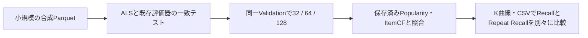

# 従来モデル一式

全モデルが同じRequest / Response、new / repeat候補、Benchmark / Search Runnerを使う。モデル名はTOMLの`model.name`、単発Benchmarkでは`benchmark.model`に指定する。LLM・Agentは未実装。

| モデル | 学習・スコア | 主な探索パラメータ |
| --- | --- | --- |
| popularity | 学習の再生回数。既存実装を維持 | なし |
| itemcf | 二値の曲共聴ユーザー集合。履歴曲の保存近傍の類似度合計 | neighbors、similarity |
| usercf | 二値の既聴集合。本人を除いた保存近傍の類似度合計 | neighbors、similarity |
| als | 暗黙の信頼度付き行列分解。潜在因子内積 | factors、iterations、alpha、regularization |
| bpr | 学習の既聴／未聴ペアによる行列分解。潜在因子内積 | factors、iterations、learning_rate、regularization |
| content | 重み付きタグと学習履歴の嗜好ベクトルのCosine | use_idf、aggregation |
| hybrid | CFとContentの取得順位を重み付きRRFで融合 | cf_model、cf_weight、rrf_constant、pool_size、基底設定 |

## 共通の動作

- 候補はnewなら本人未聴、repeatなら本人既聴。全モデルで学習カタログを使用する。
- モデルの根拠がない場合は、学習再生回数降順・ID昇順のPopularity補完を説明に残す。因子モデルは学習可能なユーザー・曲のスコアを先に並べ、未知の因子を0として上位へ入れない。
- 類似度・タグスコアの同点はPopularity、続いてIDで決定する。再現にはデータ・設定・コード・lock・seedを固定する。
- `explain`は数値スコア・寄与・補完を返し、03に表示する。因子内積から架空のジャンルや因果理由を作らない。
- モデルの学習と推薦はTrainだけを入力する。Validation／Testの観測はEvaluatorだけが読む。

## ItemCF

`itemcf`は、学習期間のユーザー×楽曲を二値化したItem-based Collaborative Filtering。繰り返し再生は類似度の重みを増やさない。再生回数を使うモデルは別条件として追加する。

曲iを聴いた学習ユーザー集合をU(i)とし、Cosineは`|U(i)∩U(j)| / sqrt(|U(i)|*|U(j)|)`、Jaccardは`|U(i)∩U(j)| / |U(i)∪U(j)|`。自己類似度を除き、各曲について正の類似度の上位`neighbors`曲を学習時に保存する。近傍の同点はID昇順。全曲×全曲の密行列は作らないが、共起集計の時間は履歴の密度に依存する。

推薦スコアは、本人の各履歴曲の保存近傍に候補曲が含まれる場合の類似度合計。候補ごとに近傍を選び直さない。スコア降順、同点は学習再生回数降順・ID昇順。根拠がない候補のスコアは0で、Popularityにより補完する。03では`fallback="popularity"`と理由を表示する。選択したデータ・seedは保存するが、このモデル自体は決定的である。

参考：[Sarwar et al., Item-Based Collaborative Filtering Recommendation Algorithms](https://files.grouplens.org/papers/www10_sarwar.pdf)。本実装の二値化・近傍の切り方・補完規則は上記の研究用ベースライン仕様に固定する。


## UserCF

本人の曲集合と他ユーザーの曲集合のCosine / Jaccardを計算する。各ユーザーについて正の類似度の上位`neighbors`人を学習時に保存し、候補曲を聴いた近傍の類似度を足す。再生重複は類似度を増やさない。全ユーザー×曲の密行列を保持しない。ItemCFの定義は以下を参照する。

## ALS・BPR

数値計算依存は`uv sync --locked --group models`で導入する。既存Popularity・近傍・タグ推薦はNumPyを必要としない。

ALSは選好`p_ui=1[n_ui>0]`、信頼度`c_ui=1+alpha*n_ui`の正則化付き二乗誤差を交互に解く。未観測の選好0・信頼度1もGram行列へ含める。正則化は正数、alphaは非負とする。参考：[Hu et al.](https://yifanhu.net/PUB/cf.pdf)。

BPRは1 iterationで学習の全ユニーク正例ペアをseed付きで並べ替え、各ペアに本人未聴の学習曲を一様に1曲抽出する。再生回数で正例を複製しない。全曲既聴のユーザーは抽出対象外とし、そのユーザーにはPopularity補完を使う。正例・負例のいずれとしても更新されなかった曲因子も補完対象とし、初期乱数を嗜好の根拠にしない。補集合内の乱数順位から曲を二分探索し、棄却抽出の無限ループを避ける。参考：[Rendle et al.](https://proceedings.mlr.press/r7/rendle09a.html)。

既定の因子数32、ALSは10 iterations・alpha=10・regularization=.1、BPRは20 iterations・learning_rate=.05・regularization=.01。`memory_budget_mb=512`は因子・行取得・solve用の推定配列サイズを確保前に制限する。Python indexやプロセス全体RSSの上限ではない。数値発散は失敗として記録する。

## Content-Based・Hybrid

特徴artifactは`dataset_id / snapshot_id / features`を持つ既存JSON形式を使用する。新exportは元メタデータhashと変換版、必須の内容checksumも持つ。新形式でchecksumだけ欠けたファイルは拒否する。単発・探索のbinary-v1とlistening-v2の保存結果にも特徴hashを記録し、異なる特徴の結果を同条件として比較しない。

ファイル運用では `lab_data` がfeatures.jsonを生成する
DB経路のexportは[任意のDB機能](optional-storage.md)を参照

探索では`experiment.features`、単発Benchmarkでは`benchmark.features`へパスを指定する。同じartifactを全モデルのILDにも使用する。異なる出典・特徴hashの実験は直接比較しない。

Contentは学習カタログだけで`idf=log((1+n_items)/(1+df))+1`を求める。曲ごとにL2正規化し、本人の履歴を`aggregation="binary"`または`"log_count"`（log1p学習再生回数）で集約して再度正規化する。`use_idf=false`でIDFを使用しない。欠損とゼロベクトルは類似度の根拠に使わない。学習外の特徴行を追加してもIDFは変わらない。

HybridのCFは`cf_model="itemcf"`または`"usercf"`。スコアは`cf_weight/(rrf_constant+cf_rank) + (1-cf_weight)/(rrf_constant+content_rank)`。取得されない成分の寄与は0。基底がPopularity補完を使ったかも説明に表示する。既定cf_weight=.5、rrf_constant=60、pool_size=100（20以上、要求K以上の候補を取得）。重み1／0は各基底の順位に一致する。順位融合の参考：[Cormack et al.](https://research.google/pubs/reciprocal-rank-fusion-outperforms-condorcet-and-individual-rank-learning-methods/)。

## 合成データで全工程を確認する

```bash
uv run --locked --group data --group models python tests/fixtures/examples/toy/create_listening.py
export MUSIC_RECSYS_EXPERIMENT_CONFIG="$PWD/tests/fixtures/configs/workflow-suite-usercf.toml"
uv run --locked --group data --group models --group tracking python -m music_recsys.experiment_search --config "$MUSIC_RECSYS_EXPERIMENT_CONFIG" smoke
uv run --locked --group data --group models --group tracking python -m music_recsys.experiment_search --config "$MUSIC_RECSYS_EXPERIMENT_CONFIG" search
uv run --locked --group data --group models --group tracking python -m music_recsys.experiment_search --config "$MUSIC_RECSYS_EXPERIMENT_CONFIG" select
```

`workflow-suite-{popularity,itemcf,usercf,als,bpr,content,hybrid}.toml`は同じ合成データ・特徴・評価条件の例。UserCFは1変数の線、ItemCFなどは2変数のヒートマップを確認できる。主条件repeat / graded_ndcgは操作確認用であり、実研究の決定を意味しない。

01→02→03で確認し、`review --accept`→`freeze`→`test`へ進む。全モデルを固定・Test評価した場合、02で同条件の最終比較ができる。既存の生成済み合成bundleは上書きしないため、古い例にfeatures.jsonがなければ新しい出力先を指定してTOMLのパスを揃える。

主指標未指定の診断探索では、02に指定trial（未指定なら最初の成功trial）を表示できる。02の`DIAGNOSTIC_TRIAL_ID`で変更する。この表示は最良設定の選択ではなく、選択・固定・Testは引き続き禁止する。CLIは結果を保存し、Notebookを閉じても失われない。

## 標準Parquet経路のImplicit ALS

[configs/als.json](../configs/als.json)はfactors=32 / 64 / 128、iterations=20、regularization=0.1、seed=0を比較する。選択用の主タスク・主指標は未指定のまま保持する。

- 信頼度は `c_ui=1+alpha*log1p(n_ui)`、選好は `p_ui=1[n_ui>0]`
- alphaの初期値は10。既存ALSの基準値を引き継ぎ、log1pで大量再生の影響を圧縮する比較開始値。1回で約7.93、10回で約24.98、100回で約47.15の信頼度となり、最適性を主張しない
- `confidence_transform="linear"`で従来式も指定可能。小規模用ALSの従来既定値は互換性のため維持
- 集約再生回数からCSR疎行列を作り、既存ALSと同じ正規方程式をfloat64で解く。未観測の信頼度1もGram行列に含む
- 学習に渡すのは検証済みlearning.parquetだけ。観測値・特徴は学習に渡さず、評価器だけが使用する
- newは学習カタログの本人未聴曲、repeatは本人既聴曲に限定。内積降順、同点は学習再生回数降順・ID昇順
- 全学習ユーザーを評価し、指標・窓・K・候補・除外定義は[共通評価仕様](listening-evaluation.md)を再利用
- 設定・seed・入力hash・コードhash・uv.lock hash・NumPy版・スレッド環境を保存。異なるBLAS環境間のビット一致は保証しない
- JSON例の`memory_budget_mb=4096`は疎行列・因子・solve作業配列の推定上限。読込み時の文字列・index・一時配列を含むプロセスRSSの上限ではない
- 正規方程式を直接解くため、因子数・履歴密度で学習時間が増える。全件の所要時間は未測定



実行例（先に小規模テストを実行、比較対象は保存済み結果が必要）:

```bash
OPENBLAS_NUM_THREADS=1 .venv/bin/pytest -q tests/test_full_als.py tests/test_full_popularity.py
OPENBLAS_NUM_THREADS=1 .venv/bin/python -m music_recsys.als_grid \
  --config configs/als.json \
  --compare configs/popularity-plays.json --compare configs/itemcf.json
```

`--compare`は省略・複数指定可能。ItemCFのgrid JSONは各条件へ展開する。入力manifest・特徴hash・母集団・全評価条件が異なる結果、改変された個別成果物は拒否する。コードhashは出典として保持するため、異なる実装時期の比較では保存された実装差も確認する。

各条件を`configs/als/{32,64,128}.json`へ展開し、`data/experiments/als-{32,64,128}/`に共通の全指標・観測分布・推薦/スコアParquetを保存する。既存の条件設定や成功結果は上書きしない。中断後は同じコマンドで完了条件を再利用する。ALS再利用時はコード・uv.lockのhash一致も必須とする。単一条件は`music_recsys.full_evaluation --config configs/als/32.json`でも実行できる。

追加の256因子は[configs/als/256.json](../configs/als/256.json)を使い、他の条件を揃えて`data/experiments/als-256/`へ保存する。Notebook 02でもこのJSONを明示的に読み込む。

```bash
OMP_NUM_THREADS=1 OPENBLAS_NUM_THREADS=1 MKL_NUM_THREADS=1 \
  .venv/bin/python -m music_recsys.full_evaluation --config configs/als/256.json
```

集約先`data/experiments/als/`は1指標1PNGとmetrics.csvを持つ。`recall_factors.png`・`repeat_recall_factors.png`・`binary_ndcg_factors.png`はALS条件間、同名の`_factors`なしは指定した既存モデルも含む比較。Graded NDCG・ILD・Coverage・Novelty・実測効率も個別出力し、全値未測定の図は作らない。

Notebook 02では同じ`configs/als.json`を明示読込みして結果を確認する。CSVの同一task・metric・kでfactorsを比較し、RecallとRepeat Recallの最大値・同点・差を別々に確認する。曲線の交差やK依存も確認し、片方の最良条件を両タスク共通の最良設定と見なさない。これはValidationの診断で、設定選択・固定・最終Testは自動実行しない。
