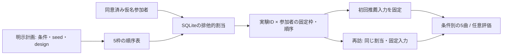

# 5人程度のオンライン比較実験

## 研究上の位置付け

- 最大5人の探索的な被験者内比較。一般的な方式の優劣・統計的有意性の証明には用いない
- 主指標は任意のリスト満足度1〜5。補助指標の式・分母/分子・欠測は[オンライン指標](online-metrics.md)を再利用する
- オフラインの全学習ユーザー・4観点・Validation/Test分離と、未確定のモデル選定基準は変更しない
- 参加者画面は[既存UI](online-ux.md)。研究者の画面/APIを参加者へ公開しない

| 実験 | 条件・リスト | 実行の状態 |
| --- | --- | --- |
| ①通常推薦 | 3条件すべて、各5曲、任意評価 | 選定済みの登録モデルを計画へ指定すると実行可能。採用モデルは未選定 |
| ②戦略比較 | LLM単発再選択 / Reactive Agent、初回各5曲、明示希望時に各条件最大2調整 | 割当・親子要求・集計基盤のみ。推論・調整API/UIは未実装、配信起動を拒否 |

## 計画と割り当て

- `StudyPlan.design`は`exploratory_standard`（3条件）または`exploratory_strategy`（2条件）、ともにK=5
- `design`を省略した旧計画は、従来の仮名ID＋seedによる順序・計画hash・再開互換を維持する
- 新計画は保存同意済みの登録参加者を必要とし、最大5枠をSQLiteのトランザクションで確保する
- 通常比較はABC/ACB/BAC/BCA/CAB/CBAをseed＋protocol_idでシャッフルし、先頭5通りを使用する
- 5枠が埋まると各条件の提示位置は1〜2回ずつ。6通りすべての完全均等化にはならない
- 戦略比較はAB/BAの順序を同様にシャッフルして繰り返し、5人で3対2にする
- 割当は登録順の空き枠に対応する。seed・protocol_id・枠・登録時刻・順序を保存し、再訪/再起動で変えない
- 複数人の同時登録を直列化する。同じ人の同時再接続も同じ枠を返す
- 本人削除/期限切れは本人の枠・固定入力も削除する。他の参加者の順序は変更せず、空いた枠を再利用できる
- 実験IDの計画hash・配信config hashは変更不可。条件/seed/モデル/入力カタログ変更は別protocol_idとする
- 非個人の実験ID/hashレジストリは、削除後も計画の誤った再利用を防ぐため保持する
- 同一人物の複数コード発行を自動判定しない。研究者が募集名簿と研究用の仮名IDを別管理し、重複参加を確認する



## 通常比較の計画例

- 以下のversionは未選定を示すプレースホルダー。Validationを参考に研究者が3版を選び、置換してから使用する
- `required_route`を指定できる。未知ユーザーでPopularity補完になった要求を本来のBPR等として提示しない

```json
{
  "protocol_id": "pilot-standard-01",
  "seed": 42,
  "top_k": 5,
  "design": "exploratory_standard",
  "conditions": [
    {"condition_id": "A", "version": "REPLACE_SELECTED_MODEL_A"},
    {"condition_id": "B", "version": "REPLACE_SELECTED_MODEL_B"},
    {"condition_id": "C", "version": "REPLACE_SELECTED_MODEL_C"}
  ]
}
```

- 戦略比較は別protocol_id・`design=exploratory_strategy`、2条件に`controller=llm_single` / `reactive_agent`を必須指定する
- そのversionは将来の実行対象の参照枠であり、モデル・Agent内部構成の採用を意味しない
- `online_assignment --study ...`のみなら、DBに触れず5枠の予定順序を表示する
- 既存の同意済み参加者を事前割当する場合のみ、同じ配信config・既存DB・仮名IDを明示する

```bash
.venv/bin/python -m src.interfaces.cli.online_assignment --study /private/study.json
.venv/bin/python -m src.interfaces.cli.online_assignment --study /private/study.json \
  --database /private/sessions.sqlite --config /private/app.json --participant-id PSEUDONYM
# 通常比較のみ配信可能。研究者用は同じDBを指定した別ローカル起動
.venv/bin/python -m src.interfaces.http.server --config /private/app.json \
  --database /private/sessions.sqlite --study /private/study.json
```

## 固定入力と長期嗜好

- 初回推薦要求を作る時点で、選択曲/artistとプロフィール根拠を割当へ固定する
- 失敗した初回要求でも固定を維持する。入力を変更する再実験は別protocol_idで準備する
- 同じ実験への後日の新セッションも固定入力を使う。プロフィール画面の選択変更を無効化する
- 長期嗜好を使った固定入力は、再訪時にも保存/再利用への同意が必要。説明v6では本文へ統合し、全データ削除による撤回は既存どおり
- 比較途中のLike・試聴・曲移動・評価は履歴として蓄積するが、別条件の推薦入力へ渡さない
- 保存嗜好の修正は通常利用/別実験の次回入力へ適用し、進行中の実験の固定入力を更新しない
- [長期嗜好管理](participant-profile.md)とSession Contextの分離を維持する。将来の調整Contextは条件/要求へ限定する

## 集計と再訪の扱い

| 出力 | 集計単位・計算 |
| --- | --- |
| lists | 既存`summarize_online`の要求別指標、分子/分母/欠測・試聴閾値・診断・latency/usage |
| outcomes | 参加者×session×condition。未開始条件も残す。初回/調整1/調整2/最終・調整数・各段階差 |
| conditions | 条件別の満足度分布・回答/欠測・平均/中央値・行動率・効率性 |
| paired_differences | 同じ参加者の条件B−A。初回/最終を分離し、両方に有効値がある時だけ計算 |
| order_effects | 条件×提示位置の初回満足度・回答数。順序効果を因果推定したとは扱わない |
| assignments / sessions | 仮名ID・枠/順序・開始/保持期限・完了/明示離脱/未終了・出典hash |

- 実験ID・計画hash・配信config hashごとに集計する。異なるカタログ/配信モデル構成を混ぜない
- 同一セッションの同内容exportは1回だけ採用する。内容が違う同一session_idは拒否し、研究者が正本を明示する
- 条件別平均/中央値は、各参加者の有効セッション内平均を1人1値として集計する。セッションを別人として扱わない
- 満足度1〜5の分布と回答/欠測数はリスト単位。平均対象の参加者数・元session IDも併記する
- 行動率はリスト率→参加者内平均→参加者間平均。曲/再生の分子分母を単純合算した率とは区別する
- Discoveryは回答リストにおける成功曲数・成功リスト数/率・質問回答率を併記する。反復分は独立した人ではない
- 初回→最終改善は調整あり・両方回答済みの場合だけ算出する。未調整・未開始・未回答は別状態でnull
- 各調整間の満足度差/行動率差も両側有効時のみ計算する。未調整者の初回/最終と調整数0は残す
- 調整1/2の集計はその段階に到達したリストが分母。調整なしを未回答リストや0点改善へ変換しない
- 総時間・token/call/料金は観測された要求の各項目が全件計測済みの時のみ総計を返す。部分小計・欠測件数を別記する
- 初回表示時間は各リストの最初の可視まで。待機を含むAPI/表示とモデル推論を足して二重計上しない
- 完了/明示離脱はサーバーの終了理由、未終了は通信断・中断・再訪待ち等を含み離脱と断定しない
- 固定入力差・割当不一致・不正な親子列は診断付きで生データを残し、比較集計から除外する。旧ログの入力未記録は不明と表示する
- p値・自動勝者判定を出さない。複数セッションの採用/除外、休憩・重複曲の扱いは予備実験前に確定する

## 研究者画面と出力

- ローカルの`--audience researcher`で「オンライン比較実験の分析」を開き「保存済みログを再集計」を押す
- 同じSQLiteを指定し、実験ID/計画版で切替。Validation表と別に、参加者数・割当・完了・満足度/個人差を表示する
- 満足度分布・対応差・行動率/試聴閾値・Discovery・調整推移・欠測/エラー・順序・時間/料金を確認する
- リストのsession/request/event IDとsource_sha256から元の管理ログへ追跡できる。モデル自動選定は行わない
- 全値未測定のグラフは描かず、未回答/未測定を表示する。LLM/Agentの架空値を作らない
- `GET /api/online-analysis`と`/api/online-analysis/export?format=json|csv&table=lists`は研究者起動のみ、参加者は404
- 出力時に全実験を再集計する。CSV対象は上表の7種、JSONは全表と計画/処理版/時刻を保持する
- APIはno-storeでサーバーに分析コピーを残さない。cookie/参加コード/hash・自由文・初期選択そのものを出力しない
- CSVの入れ子はドット列、配列はJSON、nullは空欄、実測0は0。数式として解釈される識別子には先頭`'`を付ける

```bash
# 既存DBをread-onlyで読み、期限内の同意済み記録だけを解析。元DB・成果物を変更しない
.venv/bin/python -m src.interfaces.cli.online_analysis --database /private/sessions.sqlite \
  --output /private/analysis-new.json
# または管理exportを複数指定。旧schema 1/2対応、参加者向け簡略exportでは項目が不足する
.venv/bin/python -m src.interfaces.cli.online_analysis --input /private/s1.json /private/s2.json \
  --format csv --table outcomes --output /private/outcomes-new.csv
```

- CLIは0600の新規ファイルへ完成後に排他的公開し、既存出力を上書きしない。`--study`で空の将来計画も分析表示できる
- 本人削除/期限切れはDBの履歴・固定入力・割当へ伝播する。研究者画面は再集計時に反映する
- 取得済みの画面表示・手動ダウンロード/分析コピー/バックアップをサーバーから回収できない。保持期限・アクセス権・撤回時の照合/削除を分析者が管理する

## 戦略比較で今後接続する契約

- 両条件へ同じ入力権限・選択肢＋任意文UI・各条件最大2調整・候補制約を提供する。実際の入力内容や試聴行動の一致は保証しない
- 同一session/conditionの親要求を指定し、単一鎖のlist_number=1/2/3・adjustment_index=0/1/2を記録する
- `SessionLog.record(..., adjustment_scope="condition")`は条件ごとの上限を検査。省略時は旧セッション全体2回の契約を維持する
- 旧リスト任意評価→明示feedback→新しい子要求→新リスト、という[将来画面](online-ux.md#将来のreactive-agent-未実装)を共通化する
- 調整操作のHTTP認可・feedbackと子要求の結合・条件別Context・失敗/再試行/外部選択usageは今後の実装。Agent本体なしで調整UIを公開しない

## 予備実験前の確認順

1. P0: Validationを参考に通常比較3版・必要入力/実経路・共通候補/音源を選び、計画を固定する
2. P0: 同意文・音源許諾・保持/本人削除・分析コピー管理・Macの参加者認証を確認する
3. P0: 同一参加者の再訪を含むリハーサルで割当・順序・5曲・任意回答・通信断/欠測を確認する
4. P1: 再試行セッションの採用/除外、休憩・重複曲・試聴機会と記述分析を事前合意する
5. P1: LLM/Agentの選択単位・情報権限・候補/費用予算・外部送信同意・失敗時処理を決めてから実装する
