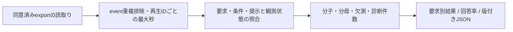

# オンライン評価指標

## 対象と実装

- オンラインは実際の参加者の受け取り方、[オフライン評価](listening-evaluation.md)は過去の履歴予測を測る
- 以下は実装済みの計測定義。[最大5人の探索的比較](online-comparison.md)の主指標はリスト満足度1〜5、採用モデル・方式の優位性は未確定
- 実装: [イベント契約](../src/domain/study/events.py) / [検証](../src/domain/study/online_events.py) / [集計](../src/domain/study/online_metrics.py)
- UI・任意回答は[画面仕様](online-ux.md)、同意・保存・削除は[オンライン評価](online-study.md)

## 共通の集計単位と欠測

| 項目 | 定義 |
| --- | --- |
| 曲単位 | participant × session × period/condition × request_id × item_id |
| 再生単位 | 上記にplayback_idを追加。再開のplayは同じIDなら開始数を増やさない |
| リスト単位 | request_id。初回と将来の調整後は別要求・親ID・list_number・adjustment_indexで識別 |
| 提示 | 有効なimpressionがあるユニーク曲。生成しただけの曲を分母にしない |
| 再送 | event_idの同内容再送を除去。同じ要求の重複impression/Likeも曲単位で集約 |
| 観測終了 | UIが最終試聴秒と未送信イベントのACKを確認し、list_evaluationで明示的に閉じる |
| 観測不十分 | 終了未確認、observation_gap、再読込み、記録された非表示/通信断、再生可否不明を区別 |
| 出力 | 率はvalue・numerator・denominator・missing。分母0または未確定の対象を含む率はvalue=null |

- 確認できた正の行動や累積秒は保持する。未観測の非発生を実測0にしない
- Likeなしは不満足、短い試聴や早期移動は不満足の確定値ではない
- 本文は要求別の値と同一セッション内の主観/発見集計。複数セッションの参加者内平均・対応差・研究者画面/出力は[比較集計](online-comparison.md#集計と再訪の扱い)へ集約する
- 条件をまたいで同曲をまとめず、Agentの反復を単発1リストと同じ試聴機会として扱わない



## Satisfaction: 主観的満足

| 項目 | 定義 |
| --- | --- |
| 目的 | 推薦リスト全体が好みに合ったかを測る |
| 回答 | 1〜5、1リストにつき1回、任意。曲単位の満足度は導入しない |
| 式 | 有効rating合計 / 有効回答リスト数。合計・回答数・未回答数も返す |
| ログ | evaluation_shown、list_evaluation、rating、instrument_id=list-satisfaction-v2、尺度1〜5 |
| 欠測 | 未回答はnull。未完了・未回答・旧ログの曖昧な複数回答を0点にしない |
| 限界 | 任意回答による回答者偏りがある。Like・試聴秒とは別の概念 |

- list_evaluationは満足度・発見質問の回答状態を同時保存し、同一要求への別IDの再評価を拒否する
- 評価後はリストを閉じ、同一event_idの再送だけを許可。再開時も回答状態を復元する
- 旧satisfaction-v1は曲IDなしの回答が1件の場合のみリスト値として読める。曲評価へ読み替えない

## Like Rate: 好意的反応

| 項目 | 定義 |
| --- | --- |
| 目的 | 明示的な好意行動の割合 |
| 分子 | impressionで提示を確認でき、Likeされたユニーク曲数 |
| 分母 | 有効なimpressionで確認できたユニーク曲数 |
| ログ | impression・like・request_id・item_id |
| 欠測 | 観測不十分な非Like曲があれば率はnull。Likeのみでimpressionなしは分子へ入れず診断件数にする |
| 限界 | Likeなしは不満足を意味しない。ボタン習慣・既知曲への好意にも影響される |

## Listen Rate: 試聴行動

| 指標 | 分子 | 分母 |
| --- | --- | --- |
| Play Start Rate | playがあるユニーク曲数 | 提示され、提示時にavailableと確認できた曲数 |
| Engaged Listen Rate | 累積試聴10秒以上のユニーク曲数 | 同上 |
| 感度分析 | 累積試聴5秒・15秒・20秒以上のユニーク曲数 | 同上 |

- 分子はいずれも分母の曲集合内。再生可否不明は不明件数として保持し、率をnullにする
- 約30秒のpreviewを想定し主閾値10秒を採用。合成デモは8秒で、実曲の有効試聴評価には代用しない
- 同じplayback_idのlistened_secondsは最大値。異なる再生IDの実測秒は同一要求×曲内で合算する
- position_secondsは音源位置であり、seekによる移動を試聴秒へ加算しない
- 必要ログ: impression、提示時playability、play/progress/pause/ended/error、playback_id、累積秒
- 観測不十分・再生エラーで非開始/閾値未到達を確定できない曲は欠測。閾値到達済みの実測は保持する
- unavailable/expired、可否不明、再生エラー、観測終了まで未再生を分ける。長時間試聴は満足の保証ではない

## Skip Rate: 中断曲移動行動

| 指標 | 分子 | 分母 |
| --- | --- | --- |
| Track Switch Rate | 再生中に別曲へ移動した再生ID数 | playを確認できたユニーク再生ID数 |
| Early Skip Rate | 10秒未満で再生中に別曲へ移動した再生ID数 | 同上 |

- track_switchにmovement=next/previous/direct・移動元/先曲ID・playback_id・累積秒・音源位置・was_playingを保存
- pause・hidden/exit・error・endedを曲移動に変換しない。停止中の曲選びは記録するが率の分子には含めない
- 次/前の曲・カード/キューの直接選択で同じ記録処理を使い、同じ再生を重複加点しない
- 10秒ちょうどは早期移動に含めない。早期移動を不満足の確定値にしない
- 移動/自然終了/エラーを確認できずリストも閉じていない再生は欠測として率をnullにする
- 旧skipは移動方向・再生IDが不明なため、診断件数として残し新指標へ混ぜない

## Discovery Success: 新規発見

| 項目 | 定義 |
| --- | --- |
| 質問 | リスト評価画面でLike済み曲だけを表示し「今回初めて知った曲」を複数選択 |
| 回答状態 | selected=1曲以上選択、none=明示的な該当なし、unanswered=未回答 |
| 成功曲数 | selectedのLike済みユニーク曲数。noneは実測0、unansweredはnull |
| 成功リスト率 | 1曲以上の成功がある有効回答リスト数 / 発見質問へ有効回答したリスト数 |
| 回答率 | selectedまたはnoneと回答したリスト数 / Likeがあり発見質問を提示したリスト数 |
| ログ | Like・evaluation_shown・discovery_status・discovery_item_ids・request_id |
| 欠測 | 未回答・未提示・分母0は成功0にしない。Likeなしで質問対象がないリストは回答率の分母から除外 |
| 限界 | 自己申告・Likeの任意性・事後想起の影響がある。長期定着や継続聴取の証明ではない |

- 学習履歴上の未聴を本人の未知と推定しない。オフラインNovelty/Recallとは別の指標

## Latency / Cost

- selection_seconds、inference_seconds、response_latency_ms、first_display_latency_msを分ける
- API往復は推薦要求の開始から応答まで。初期プロフィール保存・画面進行APIはその計時から分離する
- 表示は各曲の初回可視時刻を記録し、最小の値を初回表示時間とする。後方カードのスクロール待ちと区別する
- 将来のLLM/tool call・token・料金はResponseのnullable usageを保持。未計測はnullで、非LLMだからと0を埋めない
- 選択APIのusage、Agentの各step・失敗/再試行の体系的計測は未実装。計算予算と料金根拠を定めてから拡張する
- GPUバッチ償却時間とブラウザ単発待ちを同じ速度指標にしない

## 読取り専用の集計CLI

```bash
.venv/bin/python -m src.interfaces.cli.online_metrics \
  --input /private/exports/SESSION_ID.json --output /private/metrics-new.json
```

- [管理export](online-study.md#管理操作)のコピーまたは内部payloadを入力。元ログ/DB/モデルを変更しない
- 出力はmusic-recsys-online-metrics-v1、0600の新規JSONへ完成後に排他的公開、既存出力は上書きしない
- schema_version=1/2を読込み、旧未計測項目は欠測。参加者向け簡略exportだけでは可否・使用量等が不足する
- 実参加者での計測完全性・質問負担・分析計画は別途確認し、[研究計画](research-plan.md)に従う
