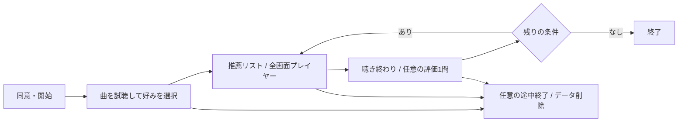

# music-recsysのオンライン予備実験

実曲・参加者認証・研究同意は未準備。現在の実験モードは合成データでの動作確認用
3〜5人への実験開始を自動承認する機能ではない

## 体験と役割



- 通常モード：起動時に明示指定したモデルで自由に再推薦する
- 実験モード：サーバー側の計画で条件を割当て、各条件1回の推薦を再送時に再利用する
- 研究者モード：`--audience researcher`で別のローカルプロセスを起動し、モデル・Validationを確認する
- 参加者APIのstatus・推薦・自分のログにはモデル名・パラメータ・経路・推論時間を含めない
- `/api/comparison`とOpenAPIは参加者向けに公開しない。URLやbodyで条件を選べない
- 外部認証を有効にしたAPIはresearcher audienceでの起動を拒否する

利用説明は専用領域を最後までスクロールして同意する。ログの24時間保存は別の任意チェック
説明版local-ui-v2を開始時刻とともに記録する。端末へのプロフィール保存は行わない
外側のページは固定し、同意文・楽曲一覧・PCの再生キューのみ内部スクロールする
ページ再読込みではサーバーの有効なセッションへ復帰できるが、サーバー再起動後の復元は未対応
別セッション間で同一人物を追跡する機能は未実装

初期選択中の試聴は推薦イベント・heardへ加算しない。現在はその試聴の行動ログも保存しない
デモの注記はフッターに表示する。楽曲タップでプレイヤーを開き、閉じると一覧へ戻る
スマホはアートワーク・曲名・再生操作、PCはこれに再生キューを並べる
画面は端末設定によらずライト表示。再生操作はシャッフル・前曲・再生/停止・次曲・リピートを等間隔に配置
曲切替中もプレイヤーを開いたままにし、前曲は再生履歴を優先する。動画・歌詞・外部castは未実装

## 計画の例

以下はデモの動作確認用で、採用モデル・本実験条件の決定ではない

```json
{
  "protocol_id": "demo-ux-only",
  "seed": 42,
  "top_k": 5,
  "conditions": [
    {"condition_id": "a", "version": "demo-itemcf", "required_route": "itemcf_history"},
    {"condition_id": "b", "version": "demo-als", "required_route": "als_fold_in_binary_seeds"}
  ]
}
```

上記をGit管理外の計画JSONへ保存し、起動時に明示指定する

```bash
.venv/bin/python -m music_recsys.webapp.server \
  --config data/app/demo/config.json --study /path/to/demo-study.json
```

各条件の任意`required_route`は実際の推論経路と照合し、不一致なら推薦提示・評価ログ登録を拒否する
省略時は従来どおりフォールバックを許容する。BPRの未知ユーザーをBPR性能として比較する場合は、
`trained_user`を指定してPopularityへの代替を拒否する（現在の新規参加者にはBPR個別推薦は未対応）

条件の順序は仮名IDとseedから再現できるランダム順。少人数で均等割付を保証しない
3〜5人での順序効果を抑える実験には、割付表・人数・休憩等を研究者が確定する必要がある
各条件で同じ初期プロフィール・候補集合・Kを使用し、途中の再生で後続条件の嗜好入力を変えない
同じ曲の再提示・学習効果が生じうるため、盲検だけで順序効果が消えるとはみなさない
現行実験モードはcold-startの未聴推薦。Repeat/総合の比較を実施したことにはならない
モデルはロード済み版のみ、候補は全条件で共通のメタデータ・許諾音源がある楽曲に限定する
条件の不足・音源不足は起動時に拒否し、実モデルからデモへの補完を行わない

## ログと離脱

既存のSessionLog/InteractionEventを再利用し、追加情報はアプリ側の関連データとして保存する

| 情報 | 保存内容 |
| --- | --- |
| study / plan_sha256 / order | 計画・seed・割当順・版、モデル条件と任意offline_run_ref |
| goals[request_id] | period・condition・入力種別・目的・K・提示時の再生可否 |
| requests / events | モデル版・出典・推薦順位・実測時間・自然な再生操作・任意評価 |
| funnel | セッション開始後の画面到達・非表示・再表示・明示終了、period、サーバー受信時刻 |

同意なしはメモリのみ、同意ありは既存の保持期限・削除境界を適用する
プロフィール選択前に開始することで、登録段階での中断も最後の観測段階として残せる
同意・開始前の閲覧は追跡しない。削除要求は離脱記録を含めて削除する
hiddenはバックグラウンド化も含む。通知不達・ネットワーク切断もあるため、離脱の確定値にしない
最後の観測段階、明示終了、未完了を分けて分析し、未通知を0に埋めない

## オフラインとオンラインの接続

- model manifest、training_ref、catalog_ref、実験計画hashとoffline_run_refで出典を関連付ける
- 学習履歴のある全ユーザーのオフライン評価と、初期選択から始める新規参加者を別母集団とする
- 音源許諾・メタデータで絞った候補集合の性能は、元の全カタログ指標と直接同一視しない
- 比較対象はNew Recall/Repeat Recall/総合NDCGの目的に応じてValidationで検討し、Testで選ばない
- BPRのPopularity補完等のinference_routeを研究ログで確認し、方式固有の効果として集計しない
- 満足度・再生・skipはオフライン正解の代用品ではなく、関連・差を検討する別の観測とする

## 次の準備

実曲の音源・メタデータと許諾の出典、ALS/BPR実重み、割付表・同意・保持規程を確認する
Music4Allの取得・試聴条件は申請済み、回答待ち。[実曲の実験準備](lab-study.md)を参照
これらを確定後、3〜5人で操作理解・離脱段階・ログ欠損・アンケート負担を確認する
一般的な推薦性能差の結論を少人数のUX予備実験だけで出さない
