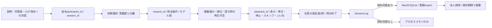

# オンライン評価・参加者ログ管理

## 対象と現在の境界

- 自然な試聴・いいね・スキップと任意の満足度1問を中心に、小規模な被験者内比較を準備する
- 現在の説明文は開発用、実被験者の収集は保持/削除規程・音源条件・アクセス方針を確定してから開始する
- 学習ユーザー全員の[オフライン評価](listening-evaluation.md)と、新規参加者の主観評価を分けて管理する
- 参加者画面にモデル名・パラメータ・推論経路・Validation表を表示しない
- 配信はMacのReact＋FastAPI 1コンテナとTunnel/Access、[構成・保存先・容量](app-architecture.md)に従う



## 保存する情報

| 区分 | 主な項目 |
| --- | --- |
| セッション | session_id・仮名participant_id・study_id・protocol_version・開始時刻・保持期限・同意版 |
| 実験計画 | plan_sha256・seed・条件一覧・割当order・sequence・period・condition・任意offline_run_ref |
| プロフィール | 初期選択曲/内部artist ID、推薦時の選択スナップショット、実際に再生したheard_item_ids |
| 推薦要求 | request_id・goal・effective_task・input_kind・top_k・履歴/候補件数・記録時刻 |
| 利用モデル | ModelSpecの版・方式・パラメータ・seed・training/catalog/implementation参照 |
| 選択戦略 | strategy_id・strategy_version・選択モデル版・inference_route |
| 推薦応答 | response.item_idsの順番が順位、状態・使用量・推薦回数・提示時のplayability |
| 操作 | event_id・session_id・request_id・kind・対象item_id・サーバー受信時刻 |
| 再生 | playback_id・position_seconds・listened_seconds |
| 主観評価 | rating・instrument_id・scale_min/max、現在はsatisfaction-v1の1〜5、任意回答 |
| レイテンシ | selection_seconds・inference_seconds・response_latency_ms・display_latency_ms |
| 到達/離脱 | funnelのphase・enter/hidden/visible/exit・period・受信時刻、finished・termination_reason |

- 操作種別はimpression/play/pause/ended/error/skip/like/rating、過去互換用のsave契約は保持
- 参加者画面に保存ボタンは置かず、いいね/スキップを記録、いいねでモデルをオンライン更新しない
- 自由文入力は参加者画面に置かない、研究者APIでも保存の別同意がなければ内容・hashとも残さない
- 初期選択中の試聴は推薦イベント・heardへ加算せず、現在はその試聴ログも保存しない
- 生cookie・APIキー・Access JWT/メールを研究ログへ入れない、研究者が設定するModelSpecにも秘密情報を入れない
- 参加コードと本人cookieで仮名参加者を再開する、Accessのメールとの実名対応表は保存しない

## 計測と解釈

| 計測 | 解釈・限界 |
| --- | --- |
| impression | 推薦生成とは別、カードが見えた時点で記録 |
| listened_seconds | 再生IDごとの累積進行秒、各IDの最大値を使い、イベントごとの値を足さない |
| position_seconds | 音源上の位置、seek移動分を試聴時間へ加算しない |
| response_latency_ms | クライアントのAPI開始から応答まで |
| display_latency_ms | 同じ開始からカード初回可視まで、後スクロール分は操作待ちも含む |
| hidden/exit | 非表示・明示終了の観測、通信断やブラウザ強制終了を確実には検出しない |
| like/skip | 行動の観測、満足/不満足の確定値やオフライン正解の代用品にしない |

- 通信断・未表示・再生不能・未送信は欠測として区別し、0評価で埋めない
- イベント時刻はWeb APIではサーバー受信時刻、基盤型のoccurred_atは時刻境界を検証する
- 再生IDはセッション/要求/曲の組へ結び付け、別人・未提示曲への操作を拒否する
- event_idの同内容再送は重複計上せず、内容が変わる再送を拒否する
- 初期選択・実履歴・ALS fold-in・BPRのPopularity補完を分けて集計する
- ログに学習生履歴・候補全ID集合を複製しないため、ログだけで推論を完全再現できるとは限らない
- 未計測の料金/token/callはnull、Agentステップログ・失敗要求の体系的監視は未実装

## 保存・権限・削除

| 項目 | 現行実装 |
| --- | --- |
| 旧APIで保存しない場合 | プロセスメモリ内だけ、本人削除/期限/プロセス停止で破棄、新UIは保存同意が開始条件 |
| Mac既定 | `~/music-recsys/state/sessions.sqlite`、Docker内は`/state/sessions.sqlite` |
| Python直接起動 | `--database`で指定、既定`data/app/local.sqlite` |
| アクセス権 | SQLite/管理exportは0600、管理exportディレクトリ0700、生tokenの代わりにhashを保存 |
| 保持期限 | 新UIはMUSIC_RECSYS_RETENTION_DAYSで明示、参加者登録時に固定、旧セッションは24時間 |
| 本人の削除 | 起動画面/画面上部からDELETE /api/session、メモリ・DB・管理exportを削除 |
| 再起動後 | 保存同意あり・期限内・同じconfig/計画/公開範囲なら復元、同じcookieまたは参加コードで再開 |
| 管理者の取得 | Mac上のCLIだけ、未期限切れ・同意済みセッションを一覧/非上書きexport |

- 同意UIの現行説明版はlocal-ui-v4、保持日数未設定時は新規参加を開始できない、旧v2/v3は読込み互換を維持
- 新UIは説明文の末尾までスクロールし、ログ保存へ同意後に開始する、拒否時は開始しない
- 退室と本人データ削除は区別し、削除は参加コード・関連セッション・プロフィールにも適用する
- サーバー停止中は削除タイマーが動かない、再起動時に期限切れを削除する
- `secure_delete=ON`はSQLite内の削除補助であり、SSD・OSバックアップの完全消去保証ではない
- DBの暗号化・自動バックアップ・管理者アクセス監査は未実装、Mac利用者/管理者のOS権限で保護する
- exports外へ手動コピーしたファイル・OSバックアップは自動削除できない、分析コピーの保管/削除手順を別途確定する
- Docker/SQLiteがあるだけでは研究利用の同意取得・認証が完了したことにならない

## 管理操作

```bash
# 個人Mac、アプリ起動中に実行
bash deploy/mac.sh sessions
bash deploy/mac.sh export SESSION_ID
# 保存先: ~/music-recsys/state/exports/SESSION_ID.json

# Pythonでの管理: 所有する既存DBを明示
.venv/bin/python -m src.interfaces.cli.online_logs --database /private/sessions.sqlite list
.venv/bin/python -m src.interfaces.cli.online_logs --database /private/sessions.sqlite export SESSION_ID
```

- 管理exportは`music-recsys-log-v1`のJSON、export時刻と元payloadを保持し、既存ファイルを上書きしない
- DB削除/期限削除は同じ管理領域のUUID.jsonにも伝播し、削除とexportの競合でデータを復活させない
- 管理CLIやSQLiteをHTTP公開しない、参加者用export APIは研究者向け詳細を除いた本人ログだけを返す
- 保存先変更・旧OtoLabからの移行・遠隔認証は[アプリ構成](app-architecture.md)

## 比較実験

| 揃える条件 | 現行・準備内容 |
| --- | --- |
| 入力 | 同じ初期プロフィール、後の条件へ途中再生による嗜好変化を持ち越さない |
| 候補 | 全条件共通の学習曲の部分集合、media --itemsで固定したカタログ・音源、hashを計画と併せて保管 |
| 提示 | 同じK・プレイヤー・試聴長・質問/尺度、モデル名は秘匿 |
| 順序 | 仮名IDとseedによる再現可能なランダム順、少人数の均等割付は未実装 |
| 呼出し | 各条件1要求、再送は同じ推薦を再利用、Agent再推薦は別の明示予算 |
| 経路 | required_routeが不一致なら提示を拒否、BPR補完をBPRとして評価しない |

```json
{
  "protocol_id": "demo-ux-only",
  "seed": 42,
  "top_k": 5,
  "conditions": [
    {"condition_id": "a", "version": "demo-itemcf", "required_route": "itemcf_history"},
    {"condition_id": "b", "version": "demo-als", "required_route": "als_fold_in_binary_seeds"}
  ]
}
```

- 上記は合成デモの操作計画、採用モデル・本実験の確定条件ではない
- 起動は`--study <計画JSON>`、現在の比較モードはcold-startの未聴推薦、Repeat/混合総合の比較は未実装
- 参加者APIからモデルや条件を選べず、研究者画面は別プロセスの`--audience researcher`
- `/api/comparison`・OpenAPI・モデル詳細は参加者に公開せず、外部認証付き研究者起動を拒否する
- 同じ曲の再提示・順序効果を秘匿だけでは解消しない、休憩・割付表・曲の重複方針を研究者が決める

## 研究開始までの判断

- 実施目的・対象者・任意参加/撤回・保持期間・分析者・保管場所・コピー/バックアップ削除方法を説明文にする
- 音源取得条件と招待者へのWeb試聴許諾を確認し、Macの参加者認証を通して動作検証する
- 3〜5人の予備実験は操作理解・負担・欠測を調べる段階、一般的な性能差や有意差を断定しない
- オフライン実験へはmodel manifest・training_ref・catalog_ref・offline_run_ref・計画hashで関連付ける
- 音源条件で候補が狭まったオンライン結果と全カタログのオフライン値を同一視しない
- 中間/最終報告までの目標・未許諾時の分岐は[研究計画](research-plan.md)
