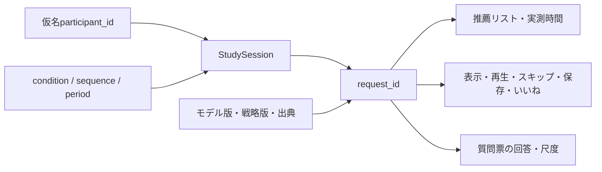
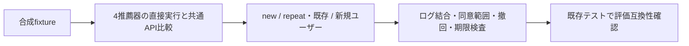

# オンライン研究ログ

## 位置付け

`events.py`は同意済みセッションの型とメモリ内検証を提供する
開発用SQLite・Web API・同意UI・期限削除は[アプリMVP](app-mvp.md)で接続
研究用の参加者認証・同意取得と保持規程は未確定
実参加者へ公開する前に、研究計画と運用に沿ってこれらを実装する
全体の選択肢と判断事項は[アプリ基盤](app-foundation.md)を参照

## 関連付け



| 契約 | 保持する情報 |
| --- | --- |
| StudySession | study/protocol、participant、condition、sequence、period、consent版、開始・保持期限 |
| RecommendationExecution | 既存要求・応答、モデル・戦略、選択/推論の実測時間 |
| SessionLogの要求行 | 要求ID、task/top_k、履歴/候補件数、推薦結果、使用量、モデル・戦略・出典 |
| InteractionEvent | event/request/session ID、時刻、種別、対象曲または回答・尺度 |

- アプリは1セッション内の複数条件をgoalsのperiod/conditionと割当orderで識別する
- 割付手法・ウォッシュアウト・条件数・質問票は研究計画で決定し、コードで自動決定しない
- offline_run_refは対応する保存済み実験への任意の参照、数値の同一性を保証するものではない
- 推薦の生成とimpressionは別事象、画面表示時にimpressionを記録する
- play/skip/save/likeは対象曲がその推薦に含まれる場合のみ受理する
- ratingはリスト全体または対象曲に紐づけられ、instrument_idは質問・版を識別する
- ratingの最小・最大・回答を保存し、異なる質問や尺度を黙って混ぜない
- クライアント由来時刻をそのまま信用せず、受信側で時刻差と送信者を検証する

## 検証と欠損値

- 要求は一意、イベントの同一ID・同一内容の再送は重複計上しない
- 同じイベントIDで内容が異なる場合は拒否する
- 別セッション・未記録要求・別ユーザーの要求・未来のイベント時刻を拒否する
- 選択モデル版と実行モデル版が一致することを検査する
- 失敗した推薦への操作イベントは拒否する
- nullは未測定のまま保持し、API費用やcall数を0に補完しない
- input_kindとinference_routeで初期選択・実履歴、fold-in・Popularity補完を区別する
- 自由文はログ用の任意入力で、現在のFixedStrategyの選択には使用しない
- 自由文の保存同意がなければ、内容もそのhashも保存しない
- playback_idとposition_secondsを任意項目として記録する
- listened_secondsと応答/表示レイテンシは任意計測。リクエスト失敗監視・Agentのステップログは未実装
- 既存のRecall・NDCG・ILD等の算出コード・正解集合は変更しない

## 同意と保存の責務

`StudySession`は**同意取得済み**の事実を信頼できるサーバー側から渡す内部契約
consent_versionだけでは同意取得の証明にならない
本実装前に同意の取得時刻・説明内容・撤回履歴を別途管理する必要がある
participant_idには仮名を使い、実氏名・メール・配信サービスの認証情報を渡さない
要求user_idは同じ仮名であることを検査し、第三者のモデル履歴を本人の履歴として扱わない
実名と仮名の対応が必要なら分析ログとは別の権限領域へ保管する

SessionLogは要求の全履歴・候補ID集合を保存せず、件数のみ残す
そのため、このログだけでは推論の完全再現はできない
完全再現が必要なら、同意・保持期限を適用した入力スナップショットの別管理を設計する
登録するModelSpecのパラメータや出典にも秘密情報を入れない

- `allow_request_text=False`が既定、自由文の二次利用には別途方針が必要
- retain_untilは必須、保持日数の既定値を勝手に設定しない
- `withdraw()`はメモリ内の要求・イベントを消し、以後の追記・取得を拒否する
- 操作時に保持期限を検査し、期限切れならメモリ内の要求・イベントを消す
- メモリ内実装には自動タイマーがないため、無操作時の期限到達では自動削除しない
- exportで返したコピー、バックアップ、別ストアはこのクラスから削除できない
- 永続化時には認可、暗号化方針、削除ジョブ、撤回の伝播、アクセス記録が必要
- 新規UIから直接SessionLogを操作させず、認証済みバックエンド経由にする

## 検証手順



```bash
.venv/bin/pytest -q tests/test_app_foundation.py
```

この検証は基盤契約のテストであり、実ユーザー評価・性能ベンチマークではない

## プレイヤー接続の情報

play/pause/ended/errorとplayback_id、再生位置を追加済み
listened_secondsは再生IDごとの累積進行時間。各IDの最大値を使い、イベントごとに足し合わせない
request_idだけでは同じ推薦曲を複数回試聴したケースを識別できないためplayback_idが必要
タイムラインの位置と実再生秒数は分け、seekで飛ばした区間を再生時間に数えない
skipは明示操作、自然終了・通信失敗・タブ非表示と区別し、不満足の確定値へ変換しない
impressionと試聴機会を分母にし、未表示・再生不能・未測定を0評価に補完しない
通信断による未送信分は欠測。計測値だけで実際に聴いたことを証明しない
アンケートは任意のセッション末尾評価等に抑え、操作ログを満足度の正解そのものとはみなさない
再生元の条件は[再生方式](playback-options.md)、アプリ操作は[モデル配信](model-serving.md)を参照
