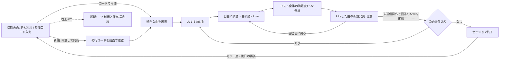
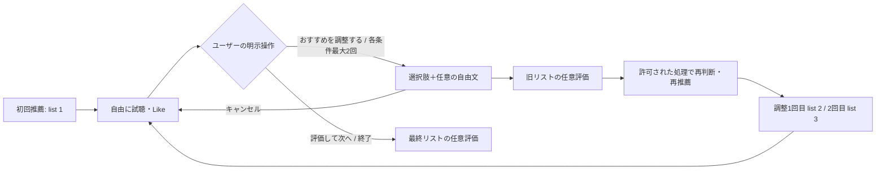

# オンライン評価のUI/UX

## 共通体験と現在の境界

- 自然な試聴を優先し、モデル名・パラメータ・推論経路を参加者へ表示しない
- おすすめ5曲を自由に再生・曲移動・Likeし、リスト評価画面で任意回答する
- 曲を聴くたびの必須フォームや曲ごとの満足度は導入しない
- LLM/Agentは研究用の[検証基盤](llm-agent-evaluation.md)のみ。参加者の「おすすめを調整する」は未公開
- 指標の式・欠測は[オンライン指標](online-metrics.md)、同意/削除は[オンライン評価](online-study.md)

## 現行の画面遷移



- 満足度と新規発見は同じ評価画面に置く。未回答のまま次へ進める
- DiscoveryはLikeした曲だけを複数選択でき、明示的な「該当なし」と未回答を区別する
- 回答送信後はリストを閉じ、リストにつき1回。再読込みで送信済み評価を復元する
- 通常モードの「おすすめを更新」でも旧リストの任意評価を経て新リストを取得する。Agentの調整ではない
- 比較モードは同じ初期プロフィールで割当条件を提示し、条件途中のプロフィール変更を拒否する
- 前/次/カード/キューからの曲移動は共通の記録処理を使い、pause・自然終了・エラーと区別する
- 初期選択時の試聴は推薦後の再生履歴へ加算しない

## 継続利用と保存プロフィール

- 説明v6は長期保存/再利用を本文へ統合。初期画面に要約と開始による同意を明示し、詳しい説明は「？」でいつでも確認する
- 初回は発行コードを確認してから曲選択へ進む。旧v5の任意追加同意なしのセッションを新しい同意へ読み替えない
- 「保存した好み」でユーザー設定・Like由来の曲・根拠・確認済みアーティスト情報・保存期限を確認できる
- チェックを変更して保存すると次セッションに反映。比較中の入力スナップショットは変更しない
- 履歴からの再利用候補が既存の30曲制限を超える場合、独自の順位で切り捨てずユーザーに選択を委ねる
- 全参加データの削除でプロフィール・履歴・参加コード・管理exportを連動削除する
- セッション終了/退室は削除と区別し、後日は同じparticipant_idで新しいsession_idを発行できる
- 保持期限は参加者登録時に固定し、再訪ごとに延長しない。詳細は[長期嗜好管理](participant-profile.md)

## 将来のReactive Agent: 未実装



- Agentは明示要求でのみ起動。Like・Skip・時間経過・無操作を起動条件にしない
- [戦略比較](online-comparison.md)ではセッション内の各条件につき最大2調整。旧契約のセッション全体2回と区別し、生涯回数を制限しない
- フィードバックは選択肢＋任意自由文とする方針が確定。選択肢の語句・許可行動・内部step/停止条件は未確定
- 固定・LLM・Agentへ同等のfeedback入力/試聴機会を提供して比較する。共通の評価画面・ログを使う
- 自由文保存/外部送信には別同意が必要。現在の参加者UIは自由文を収集せず、外部APIを呼ばない
- 親要求・調整番号・条件の記録契約は準備済み。調整用API・Agent推論・選択肢フォームは未公開
- 戦略比較のLLM側も同じ調整フォームを使い、明示要求ごとに単発で再選択する将来案。以下の遷移と任意評価を両条件で共有する

## 公平な比較と提示バイアス

| 論点 | 方針・未決事項 |
| --- | --- |
| 条件間の履歴リーク | セッション開始時の嗜好スナップショットと最初に確認した初期選択を全条件で共有する |
| 同等feedback | 固定/LLM/Agentへ同じ入力機会を用意し、Agentだけ情報量や試聴回数が増えないよう比較予算を事前指定 |
| 順序/疲労 | 新しい探索的比較は最大5人の均衡順序を固定。旧計画は維持。休憩・重複曲の方針は予備実験前に確定 |
| 同曲の反復 | 再提示による既知化がある。同曲を許す/抑える場合の候補差は実験計画に明記する |
| 試聴機会 | 共通K・preview条件・プレイヤー・質問を維持し、実際の提示・試聴秒・離脱を記録する |
| 調整利用の自己選択 | 条件割当ベースと調整利用者内の前後差を分ける分析を検討する |
| 盲検の限界 | モデル名秘匿だけでは待ち時間や追加操作からの条件識別を防げない |

- 機会数・料金・時間予算を合わせる方法、固定/ルール再推薦の対照条件、分析方法は本比較前に確定する
- LLM単発再選択とAgentへ同じ入力権限/UI/調整回数/候補制約を用意する。実際の入力内容や試聴行動の一致は保証しない
- 研究者分析画面・出力は[比較プロトコル](online-comparison.md#研究者画面と出力)。同じ実験への再訪では固定入力を表示し、選択変更を無効化する
- 新UIは引き続き開発用。研究利用の説明・音源許諾・実参加者での欠測/回答負担の確認を代替しない

## 実装と検証

- [Participant](../frontend/src/presentation/participant/Participant.tsx) / [状態管理](../frontend/src/presentation/participant/useParticipantSession.ts)
- [リスト評価](../frontend/src/presentation/participant/ListEvaluation.tsx) / [保存嗜好](../frontend/src/presentation/participant/SavedPreferences.tsx)
- [プレイヤー](../frontend/src/presentation/player/Player.tsx) / [試聴秒の純粋関数](../frontend/src/domain/listening.ts) / [送信再試行](../frontend/src/application/eventOutbox.ts)
- [ブラウザ試験](../tests/test_online_ui_browser.py)は合成データ・一時DBで新規発見、曲移動、再訪を確認する

```bash
npm --prefix frontend test
npm --prefix frontend run build
MUSIC_RECSYS_TEST_ONLINE_UI=1 .venv/bin/pytest -q tests/test_online_ui_browser.py
```

- ブラウザ試験にはPlaywrightのChromiumが必要。実参加者DBや音源を試験へ流用しない
- 調整実行側と戦略制御側の将来案は[推薦拡張設計](recommendation-design.md)を参照
