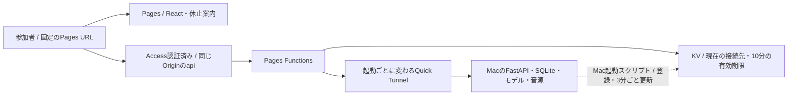
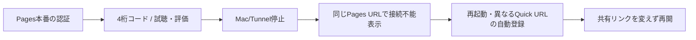

# ドメインなしのPages＋Quick Tunnel

## 構成と現在の範囲

- 独自ドメイン・固定Tunnelを持たない場合の無料枠向け構成
- 配布するURLはPages本番の`https://PROJECT.pages.dev/`、Mac再起動後も同じURLを使う
- バックエンドは起動ごとに変わるQuick Tunnel。Mac起動スクリプトが接続先を登録し、Pages Functionsが`/api/`を中継する
- [中継コード](../deploy/pages/gateway.mjs)・[Mac起動口](../deploy/pages.sh)は実装済み。Cloudflareへの公開とMac実機の疎通は未実施
- 通常のnamed Tunnelはドメインが必要だが、[Quick Tunnel](https://developers.cloudflare.com/tunnel/get-started/quick-tunnels/)はドメインなしで使える



- URLの役割を分ける。参加者へ配るPages URLは固定、Quick Tunnel URLは内部の接続先として更新する
- Mac停止時も画面はPagesから開く。APIの503/接続失敗を受けて「現在接続できません」と表示し、再確認できる
- 既に開いている画面も30秒ごとの接続確認に失敗したら接続不能表示へ戻す。通信断の瞬間に検出できるとは限らない
- MacのIPアドレスやローカルportを参加者へ配らず、研究室サーバーは公開しない
- 音源をMacに置く間は音声本文もTunnelを通る。[音源分離と容量](sharing.md#フロントapi音源の分離案)は別に判断する

## 無料枠と制約

- [Pagesの静的配信](https://developers.cloudflare.com/pages/functions/pricing/)は無料・無制限、Functionsの呼出しはWorkers Freeの枠を使う
- [Workers Free / KV](https://developers.cloudflare.com/workers/platform/pricing/)の枠内で構成する。KVは1日1,000 write、3分ごとの常時更新は1台で480 write/日＋起動時登録
- 起動のたびに新しいURLを配り直す作業は不要だが、KVの伝播/キャッシュによって新しい接続先の反映が遅れる場合がある
- 更新が止まると登録は10分で期限切れとなる。それ以前もTunnelが接続不能ならAPIは503を返す
- Quick Tunnelは開発向け・稼働保証なし、同時処理200件・SSE非対応。大規模運用やLLMのSSE配信の基盤として確定しない
- Cloudflare経由の音源配信を無制限無料と仮定せず、許諾・配信条件・実転送量を確認する
- 有料プランへの切替・独自ドメイン購入を起動スクリプトで行わない。無料枠を超えた時も動き続ける保証はない

## Cloudflare側の初回設定

1. Pagesプロジェクトを用意し、本番の`PROJECT.pages.dev`を固定する
2. FreeのKV namespaceを1つ作り、`deploy/pages/wrangler.jsonc`のIDを設定する。`TUNNEL_ORIGINS` bindingを本番Functionsへ接続する
3. 非公開のランダム64桁hexをPages secretの`TUNNEL_PUBLISH_TOKEN`へ設定する。同じ値をMacの`MUSIC_RECSYS_PUBLISH_TOKEN`へ非公開設定する
4. PagesのEnable access policyで作ったAccess applicationを開き、hostnameのwildcardを外して`PROJECT.pages.dev`本番を保護する。参加者だけをAllowとし、previewも別applicationで保護する
5. 登録専用の`/api/_tunnel`だけAccessのBypassにし、この経路は64桁tokenを検証するFunctionsで保護する。その他の`/api/*`へBypassを広げない
6. Access TEAMとApplication AUDをMacへ設定する。Macは中継されたJWTの署名・期限・AUDを全アプリ経路で検証する

- [Pagesの本番Access設定](https://developers.cloudflare.com/pages/platform/known-issues/#enable-access-on-your-pagesdev-domain)を確認する。認証設定をしていない環境では、中継側もJWTなしの要求を401で拒否する
- token・Access credentialsをReactの`VITE_*`やGitに含めない。KVへ保存するのは接続先だけ
- 登録APIはMacからのPUT＋Bearer token専用。ブラウザOrigin付き要求を拒否し、`https://*.trycloudflare.com`のOriginだけを登録する
- 設定後、frontendを通常buildし、`deploy/pages/`を作業ディレクトリとしてWrangler CLIでPagesへ配布する。`functions/`と`gateway.mjs`を一緒にビルド対象とする。dashboardのdrag-and-dropではFunctionsを配布できない
- 設定例のnamespace IDや`PROJECT`は実値ではない。公開済みURLとして配布しない

## Macで起動

- Docker Desktopとcloudflaredを準備し、ZIP全体を展開する。MacへPython/Nodeを直接入れずにアプリを起動できる
- 以下の値はMacの非公開設定から読み込む。保存期間は説明・保持規程に合わせて明示する

```bash
export MUSIC_RECSYS_PAGES_URL=https://PROJECT.pages.dev
export MUSIC_RECSYS_ACCESS_TEAM=REPLACE_WITH_TEAM
export MUSIC_RECSYS_ACCESS_AUD=REPLACE_WITH_APPLICATION_AUD
export MUSIC_RECSYS_RETENTION_DAYS=REPLACE_WITH_DAYS
# MUSIC_RECSYS_PUBLISH_TOKENも非公開設定から読み込む
bash deploy/mac.sh start-pages
```

- アプリをAccess必須で起動後、Quick Tunnelを開始し、変わる接続先を登録する。参加者へ表示するリンクはPages URLだけ
- cloudflaredのHost headerをPages hostnameへ固定し、FastAPIのallowed host・Origin検査を維持する
- ターミナルを閉じるとTunnelと接続先更新が止まる。DockerのSQLiteを削除しない
- 参加コードの研究者発行・初回/再訪の扱いは[参加コード](sharing.md#参加コード)を参照

## 検証



- `node --test --experimental-test-isolation=none deploy/pages/gateway.test.mjs`で模擬KV・模擬upstreamを確認する
- 音声Range・cookie・JWT・Origin・再送・本人削除・期限を実接続で確認する。模擬試験をMac実機確認と読み替えない
- フロント単独の配置と接続先自動更新は、この資料の未公開実装。既存のMac ZIPやCloudflare上の旧サービスは自動更新されない
