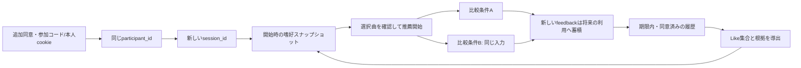

# セッションをまたぐ嗜好管理

## 身元・同意・保持期限

- participant_idは仮名ユーザー、session_idは1回のWeb利用、request_idは1つの推薦リストを識別する
- 既存の参加コード・本人cookie・SQLiteのparticipants/sessionsを再利用し、新しい常駐DBは導入しない
- 説明版local-ui-v5に、長期嗜好の保存・後日の再利用に対する任意の追加同意を設ける
- 追加同意なしでもセッション内の試聴・評価を利用できる。v5ではそのセッションの行動を長期嗜好へ使わない
- 旧v2/v3/v4のログから長期利用の同意を推定しない。既存の進行中セッションは元の同意範囲で再開する
- 期限は参加者登録時に固定し、再訪で延長しない。旧セッションの期限も変更しない
- 自由文保存や外部API送信は別同意が必要。現在の参加者画面は両方を行わない
- 新説明も開発用であり、実参加者での研究利用に必要な説明・音源条件・保持/分析規程を代替しない

## 3種類の情報

| 情報 | 保存・利用方法 |
| --- | --- |
| Interaction History | 同意済みsession payloadの初期選択・Like・実測試聴秒・曲移動・リスト評価・要求/条件参照を保持 |
| Long-term Profile | ユーザー設定・除外曲・同意版/時刻と、導出済みプロフィールをparticipants.profileへ保存 |
| Session Context | 現在の要望をsessionsのsession_contextへ分離。次セッションへ自動コピーせず長期嗜好の入力に使わない |

- 生の行動履歴は既存セッション保存を正本とし、別の履歴JSONへ二重コピーしない
- Like・プロフィール取得/編集・新セッション開始で導出を更新し、derived_profileへ処理版・計算時刻・カタログ出典・根拠付き曲/artistを保存する
- 長期嗜好の導出は同一participant・期限内・追加同意あり・同じconfig出典の履歴に限定する
- 別カタログのIDや旧ログを無断で対応付けず、利用できない情報を合成データで埋めない

## 初期の抽出方法

- 処理版はexplicit-like-set-v1。Likeした曲をユニーク集合として抽出し、元session/request/event IDを根拠にする
- 好意曲の確認済みメタデータからartistと対応曲集合を示す。artistを好きだと断定せず、ユーザーが確認して設定できる
- ユーザー自身の設定とLike履歴由来の候補を表示上区別する
- スキップ・試聴秒は履歴として残すが、今回は負の嗜好や嗜好スコアに変換しない
- ジャンル・ムードの根拠がなければ推定しない。行動の重み、時間減衰、LLMの意味解釈は未採用
- これは説明可能な初期基盤であり、研究上最良のプロフィール推定方式を採用したものではない

## 再訪と比較条件の分離

- 新セッションではユーザー設定とLike由来の曲を初期候補にする。既存の30曲制限内なら集合のまま再利用する
- 30曲を超える場合は独自の重み/順位で30曲を選ばず、ユーザー設定を残して保存画面での選択を促す
- 比較開始前に初期選択を確認し、以後は全条件で固定する。別条件の途中Likeや再生を推薦入力へ持ち込まない
- 推薦ごとのgoalsへ嗜好スナップショットとSession Contextのコピーを記録する
- 保存プロフィールの編集は次セッション用。現在の比較の要求・入力スナップショットを変更しない
- 新しい[探索的比較](online-comparison.md#固定入力と長期嗜好)は実験ID×参加者の入力をSQLiteへ固定し、同じ実験への再訪でも更新後の嗜好を混ぜない
- 1セッションを終了しても期限内なら同一参加者として新セッションを開始できる
- 将来の戦略比較はセッション内の各条件最大2調整。旧契約のセッション全体2回は維持し、生涯回数を制限しない

## 本人による確認・修正・削除

- 「保存した好み」でユーザー設定、履歴由来候補、元イベントの根拠、保存期限を確認する
- 曲/artistの選択変更を保存でき、除外した履歴由来曲は次回の自動候補に戻さない
- 推薦開始画面で改めて選択した曲はユーザー確認済みの設定として保存する
- 「プロフィールと全参加データを削除」または既存の本人削除で、プロフィール・全セッション履歴・参加コード・割当/固定入力・管理exportを連動削除する
- この全データ削除を長期同意の撤回手段とする。プロフィールだけを消して履歴から再生成する挙動は提供しない
- 終了/退室は削除ではない。期限切れは既存purgeで削除し、停止中は再起動時に処理する
- 削除後の古い登録セッション保存を拒否し、別プロセスの古いcookieでも本人確認・保存済みセッション確認を行う
- 手動コピー・OSバックアップは自動削除の対象外。[ログ管理](online-study.md#保存権限削除)の制約を維持する

## APIと実装

| 契約 | 用途 |
| --- | --- |
| POST /api/sessions | local-ui-v5・persist・long_term_consentを明示して開始/再開 |
| GET /api/profile/long-term | 本人cookieと追加同意がある場合だけ履歴/設定/導出/根拠を返す |
| PUT /api/profile/long-term | items・artists・excluded_itemsを次セッション用に保存 |
| DELETE /api/session | 本人の全参加データ・履歴・プロフィールを削除 |
| PUT /api/session/context | 研究者起動だけの記録用契約。選択肢＋別同意のある自由文を保存し、推論は行わない |

- Session Contextの候補値はcalmer/more_energy/different_style、自由文は最大500文字。研究での質問語句の採用ではない
- 調整フォーム・自由文の参加者収集・外部API・Agentは未公開。研究者契約だけで実参加者への有効化条件を満たしたとはしない
- [Applicationサービス](../src/application/study/preferences.py) / [純粋な導出](../src/domain/study/preferences.py) / [SQLite](../src/infrastructure/persistence/sessions.py) / [HTTP](../src/interfaces/http/profiles.py)
- [テスト](../tests/test_online_preferences.py)は追加同意・再訪・分離・修正・期限・削除・旧ログを一時DBで確認する
