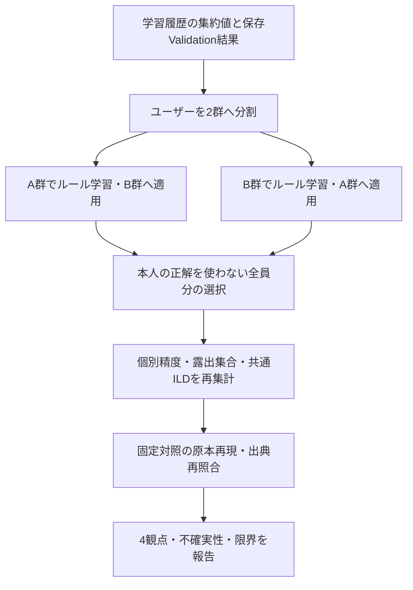

# 個人別選択の探索的Validation実験

## 目的と比較

- 学習履歴の集約値から推薦方式を選び、固定方式より改善するかを調べる。LLMの効果や採用版は未確定
- 以下は旧4候補内の比較。[本人頻度の追加対照](ease-weighting.md#頻度対照を加えた結論)が再聴で強いため、旧候補内の改善を新対照への優位としない
- 入力7項目・4候補の出典は[選択器比較](selector-study.md)。個人IDは照合と分割だけに使い、ルールの特徴へ渡さない
- 母集団は学習履歴のある全119,133人。新規・再聴を別々に扱い、正解なしのユーザーも方式選択・多様性評価から除かない
- 固定4群・タスク別ルールに加え、NDCG用とRecall用の個人別ルール、各目的に対応する学習側選定の固定方式を比較する
- `rule-ndcg`は新規Binary NDCG/再聴Graded NDCG、`rule-recall`は新規Recall/Repeat Recallを学習目的に使う
- 90日/K20/日数重み1は今回の探索用学習条件。研究全体の採用用主指標へ昇格させない。両目的の全指標を表示する

## 分割・学習・評価

1. ID順の全ユーザーをseed42で並べ替え、均衡した2群へ分割。同じ人の新規/再聴は同じ群に置く
2. 一方でルールを学習して他方を評価し、群を入れ替える。各人の選択は本人のValidation正解を使わずに決まる
3. ルールは定数または1分岐だけ。6個の数値特徴について学習側ユーザーの25/50/75百分位を候補閾値とする
4. 学習側の正解があるユーザーだけで平均評価値を求め、分岐の左右それぞれ最低200人を要求。欠測を0にしない
5. 同値の場合は定数を優先。方式の同点順はEASE/RRF/MMR0.8/MMR0.5。改善幅1e-12超の分岐だけを追加
6. 対応する定数対照も学習側だけで方式を決める。評価側で最良の固定方式を選んだ値も参照するが、運用可能な選定とは区別
7. 学習した選択は全K・全窓で固定。各ユーザーの選択をBPRの3seedへ共通適用し、個別精度をseed平均して比較

- 推薦モデル自体は再学習しない。修正版Validationの保存順位・個別スコアを出典照合して使う
- Coverageは選択後の露出曲集合からseed別に再計算。元モデルのCoverageの加重平均で代用しない
- 共通ILDは4候補・全seedで特徴が有効な共通ユーザー上で計算。元比較のBPR単独を含む共通集合とは異なる
- 個別ILDの有効人数・除外人数、Novelty、全K2〜20・全窓・全日数重み、再生回数/日数分布を保存
- 90日/K20の4精度について、2,000回のユーザー対応bootstrapで差の95%区間を求める
- 区間は学習済みの交差評価ルールと固定3seedに条件付ける。ルール再学習の不確実性と多重比較補正は含まない



## Oracle上限診断

- 各指標・各Kで、正解を見て4候補のうち最大の個別スコアを選ぶ。3seedは先にユーザー単位で平均する
- これは実用的な選択器ではなく、候補内の改善余地の上限。未来情報を使うためルール/LLMの性能と混同しない
- K・指標ごとに選択先が変わる診断なので、統一された推薦リストの多様性や応答時間は定義しない
- 固定4候補内の最大平均との差と、改善するユーザーの割合を`oracle.csv`へ保存

## 実行と保存

```bash
CUDA_PATH=/usr OMP_NUM_THREADS=1 OPENBLAS_NUM_THREADS=1 .venv/bin/python -m backend.interfaces.cli.personal_selection --config configs/hybrid/base.json --run
```

- `--run`なしは計画表示。実行前にホストGPUの空きを確認する。`CUDA_PATH=/usr`は現ホストのToolkit配置
- 出力は同じ実験JSONの出力先配下`selector-personal/`。既存結果・`.partial`があれば停止する
- 元の順位・スコアは複製せずhash参照。個人別の選択先・評価foldは`selections.parquet`へ保存する
- `rules.json`に実際の閾値と分岐先、`metrics.csv`に4観点、`paired.csv`に差の区間、`ild.csv`に共通ILDを保存
- `choices.csv`は全員の選択数、`timing.csv`は学習と適用の時間。図は指標別PNGのみ
- 固定4対照の全精度・多様性平均を元CSVと照合してから公開。出典・処理版が変わった場合は停止する
- 選択時間はCPU上の配列処理とfold振り分け。保存順位の読込み・推薦の実推論・API・オンライン待ち時間は含まない
- 未測定の費用・応答時間はnull。実APIは実行せず、別途概算額と送信条件の確認後に進める

## 解釈の限界

- Validationを見て候補方式を設計済みなので、ユーザーを分離しても独立した未見Testにはならない
- 閾値やルールの追加調整は探索に当たる。結果を見て有利な指標だけを採用しない
- 特徴の関連は因果関係ではない。タグ有無の違いを本人の多様性嗜好と解釈しない
- LLMも同じ情報制約で比較する。単純ルールが成功してもLLMが成功する保証にはならない

## 結果と考察

- [結果・出典](../data/experiments/hybrid/validation-corrected/selector-personal/result.json) / [全指標](../data/experiments/hybrid/validation-corrected/selector-personal/metrics.csv) / [差の区間](../data/experiments/hybrid/validation-corrected/selector-personal/paired.csv) / [上限診断](../data/experiments/hybrid/validation-corrected/selector-personal/oracle.csv)
- 全119,133人に9群を適用。90日精度の有効人数は新規18,601人、再聴19,268人。正解なしはそれぞれ100,532人、99,865人
- 下表は90日/K20/日数重み1。各指標に対応するルールと、評価上で最大平均だった固定方式を比較。単一の勝者や採用用主指標の宣言ではない

| 指標 | 固定方式・平均 | 個人別ルール | 相対改善 | 差の95%区間 |
| --- | --- | ---: | ---: | --- |
| 新規NDCG | RRF・0.037145 | 0.038071 | +2.49% | +0.000298〜+0.001553 |
| 新規Recall | EASE・2.8675% | 2.9907% | +4.30% | +0.0433〜+0.2020ポイント |
| 再聴NDCG | MMR0.8・0.112624 | 0.112909 | +0.25% | −0.000055〜+0.000633 |
| Repeat Recall | MMR0.5・7.0512% | 7.2622% | +2.99% | +0.1536〜+0.2717ポイント |

- 新規2指標とRepeat Recallでは上記の条件付き区間が0を含まない。再聴NDCGの改善は明確ではない
- 学習側だけで方式を選ぶ定数対照に対しても、新規2指標とRepeat Recallの差の区間は正。評価側で選んだ固定最良との比較だけに依存しない
- 90日K2〜20で、新規NDCGは19/19点、Repeat Recallは19/19点で表の固定対照より平均が高い。新規Recallは17/19点、再聴NDCGは10/19点。全Kでの優位は主張しない
- 新規NDCGの180日では1/19点で低下。新規Recall・Repeat Recallは30/180日の全Kで平均が高いが、K全点の対応区間を計算したという意味ではない

### 実際のルール

- [全foldのルール](../data/experiments/hybrid/validation-corrected/selector-personal/rules.json) / [割当数](../data/experiments/hybrid/validation-corrected/selector-personal/choices.csv)
- 新規NDCG: タグ特徴あり履歴の割合が約99.31%以下ならRRF、超えればEASE。2foldで同じ特徴と近い閾値。EASE89,350人、RRF29,783人
- 新規Recall: 同じ特徴・閾値でMMR0.8/EASE。EASE89,350人、MMR0.8が29,783人
- 再聴NDCG: 一方のfoldは履歴170曲、他方は曲別再生日数合計383を境に、少ない側でMMR0.5、多い側でMMR0.8。特徴選択自体が安定していない
- Repeat Recall: 曲別再生日数合計1,663/1,670以下でMMR0.5、超えればMMR0.8。MMR0.5が89,377人、MMR0.8が29,756人
- タグ割合の閾値は高く、欠損と聴取行動の関連を拾っている可能性がある。タグ欠損が推薦嗜好を決める因果関係は示していない

### 多様性・発見性

- [共通ILD](../data/experiments/hybrid/validation-corrected/selector-personal/ild.csv)はK20で新規99,588人・再聴111,368人。個別有効人数もmetricsに別記録
- 新規NDCGルールはRRFに対し共通ILD0.6094→0.6929と上昇する一方、Coverage92.13→91.03%、Novelty6.093→5.755bitへ低下
- 新規RecallルールはEASEに対し共通ILD0.7049→0.7074、Coverage73.17→91.56%、Novelty5.528→5.801bit
- Repeat RecallルールはMMR0.5に対し共通ILD0.7964→0.7471、Coverage87.19→86.45%、Novelty5.838→5.743bitへ低下
- 個人別選択も全観点を同時に改善するわけではない。タグ空間の多様性を本人の満足度と同一視しない

### 改善余地と効率

- 正解を知って選ぶ上限の固定最良比は、新規NDCG+52.56%、新規Recall+59.75%、再聴NDCG+32.49%、Repeat Recall+44.02%
- 今回のルールが実現した上限との差の割合は、それぞれ約4.74/7.20/0.78/6.80%。上限の残りが入力7項目やLLMで達成可能とは限らない
- 実行はRTX3090/CuPy・float64、seed42。読込み・集計・描画・検証を含む成功実行は56.7秒。推薦モデル再学習なし
- 目的/タスクごとの2foldルール学習は約0.031〜0.125秒、全119,133人への配列適用は約2.7〜2.8ms。単発オンライン応答・推薦時間ではない
- API呼出しなし。料金・token・オンライン応答時間は未測定null。固定対照2,964項目は原本との差最大約1.78e-14
- [独立照合](../data/provenance/personal-selection-20261112/verification.json)で全238,266行のfold・出典、Domainルール476,532判定、主要精度36項目のCPU再計算を確認。CPU差は最大約1.39e-16
- 結論: 単純な個人別選択にも追加改善の兆候があり、LLMを比較する対照として有用。次は同じ入力でLLMがこれを上回るかを、費用・失敗・多様性も含めて検証する

## 深さ2の決定木との比較

- [原本](../data/experiments/hybrid/validation-corrected/selector-tree/result.json) / [全指標](../data/experiments/hybrid/validation-corrected/selector-tree/metrics.csv) / [対応差](../data/experiments/hybrid/validation-corrected/selector-tree/paired.csv) / [木の分岐](../data/experiments/hybrid/validation-corrected/selector-tree/trees.json)
- 同じ全員・2fold・6数値特徴・学習目的・候補版を使い、深さ2、最大4葉に限定。結果に応じた深さ探索はしない
- 各節点で学習側の平均評価値を最大化する分岐を選ぶ方策木。正解方式の分類正解率を最適化する通常の分類木とは区別する
- 子節点でも学習側の四分位候補・正解保有者最低200人を維持。親の分岐に改善がなければ、その節点で定数にする
- CLIに`--include-tree`を追加すると`selector-tree/`へ11群を保存。前回の`selector-personal/`は保持する

| 指標（90日/K20） | 単純ルール | 深さ2の木 | 木の単純ルール比 | 木と単純ルールの差の95%区間 |
| --- | ---: | ---: | ---: | --- |
| 新規NDCG | 0.038071 | 0.037788 | −0.74% | −0.000658〜+0.000099 |
| 新規Recall | 2.9907% | 2.9749% | −0.53% | −0.0671〜+0.0304ポイント |
| 再聴NDCG | 0.112909 | 0.112706 | −0.18% | −0.000552〜+0.000127 |
| Repeat Recall | 7.2622% | 7.2417% | −0.28% | −0.0700〜+0.0265ポイント |

- 4指標とも代表条件の平均は低下し、差の区間は0を含む。単純ルールを上回る証拠も、木が有意に劣るという証拠もない
- 新規NDCGは全30/90/180日・全Kで木の平均が低い。他指標にはKによって木が高い点もあり、一律の劣位とはしない
- 新規NDCG用の木は単純ルールに対してCoverage91.03→91.16%、Novelty5.755→5.791bitだが、共通ILD0.6929→0.6793
- 再聴Recall用の木はCoverage86.45→86.22%、Novelty5.743→5.695bit、共通ILD0.7471→0.7276。全4観点・K感度は原本CSV/PNGを参照
- 成功実行は57.5秒。木の2fold学習は目的/タスク別に約0.066〜0.072秒、全員への配列適用は約4.7〜5.1ms。単発オンライン応答ではなく、計測順の影響もある
- [独立照合](../data/provenance/personal-tree-20261112/verification.json)で476,532件の木の適用、主要精度8項目のCPU再計算を確認。前回9群の割当と品質6,669項目は不変
- 結論: この特徴・学習法・分割で複雑化を進める根拠は得られなかった。LLM比較には単純ルールを主要な学習型対照として残し、木の結果も保持する

## 時系列検証の準備状況

- [設定と期間の監査](../data/provenance/personal-tree-20261112/later-period-audit.json)では、保存実験の評価窓は最大180日、既存Test末端は2019-03-20T00:00:00
- 元TestイベントのParquet統計には2020-03-20までの記録がある。既存窓より後の期間は新しい時系列検証の候補。今回は期間メタデータだけを確認し、その期間の精度を見ていない
- この監査は保存された設定が対象で、リポジトリ外の利用履歴まで保証しない。新しい予測時点・学習範囲・評価窓・候補版を固定するまでは独立Test完了と呼ばない
- 新時点の学習入力・モデルを不変保存する容量が必要。既存Testの学習Parquetだけでも約344MiBあり、同規模の新入力・評価出力・一時領域が必要。保存先の空き容量を再確認してから生成する
- 既存Testの再利用だけで独立検証と呼ばず、容量確保後に新時点の入力・推薦候補を用意する。API比較は別途、実行前の概算と送信条件の了承を必要とする
