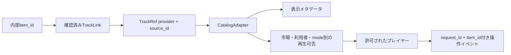

# 楽曲取得・再生方式の比較

公式公開資料を2026-10-16に確認、API接続・認証設定・音源取得は実施していない
公開資料の仕様と利用条件を分け、未確認の許諾を「研究用途だから可能」と扱わない

## 機能比較

| 観点 | Music4All | Spotify | Apple Music | SoundCloud | FMA / 許諾済みローカル音源 |
| --- | --- | --- | --- | --- | --- |
| 検索・メタデータ | 配布メタデータをローカル検索 | Web APIで検索・曲/artist/ISRC等 | Catalog APIで検索・曲/artist等 | APIで曲/ユーザー検索、access状態 | FMAのCSV、許諾音源の内部カタログ |
| 30秒試聴 | 原版に30秒clip、別途申請 | preview_urlは非推奨・nullable、提供保証なし | Previewリソースあり、30秒固定・全曲提供は仮定しない | preview/playable/blocked、30秒固定ではない | FMAの30秒版、独自clipは編集許諾次第 |
| フル再生 | 原版clipからは不可 | Premium＋SDKの対象範囲 | 購読＋MusicKitの対象範囲 | 公開・streamable等の条件次第 | FMA full版あり、個別音源の許諾次第 |
| ブラウザ | 許諾後にHTML audio | Web Playback SDK / Embed | MusicKit JS | Widget API / 許可されたcustom stream | HTML audio |
| 認証・契約 | データ提供申請、試聴提供範囲の確認 | OAuth、SDK再生にPremium、開発者もPremium条件 | Developer token、個人化に利用者認可、フル再生に購読 | APIアプリ認証、privateは利用者認可、Widgetは別経路 | 配信サービス契約不要、アプリ側の参加者認証 |
| 操作イベント | HTMLのplay/pause/ended等 | SDKの状態変化、アプリ操作記録 | JSの再生状態・時間・item変化 | WidgetのPLAY/PAUSE/FINISH/SEEK/PROGRESS | HTMLのplay/pause/ended等 |
| Music4All対応 | 元の16文字ID | 原版にspotifyid、現在の同一録音を再確認 | ISRC・曲名等から候補を照合 | 名称・録音情報等から候補を照合 | 原則別カタログ、重複は保証されない |

根拠: [Music4All公式](https://sites.google.com/view/contact4music4all)、[Onion v2](https://zenodo.org/records/15394646)、[Spotify Track](https://developer.spotify.com/documentation/web-api/reference/get-track)、[Spotify SDK](https://developer.spotify.com/documentation/web-playback-sdk/reference)、[MusicKit](https://developer.apple.com/musickit/)、[Apple Preview](https://developer.apple.com/documentation/applemusicapi/preview)、[SoundCloud Guide](https://developers.soundcloud.com/docs/api/guide)、[Widget API](https://developers.soundcloud.com/docs/api/html5-widget)、[FMA配布元](https://github.com/mdeff/fma)

## 利用条件・研究への適合

| 候補 | 研究・推薦・AI利用 | 少人数実験 | 一般公開への制約 |
| --- | --- | --- | --- |
| Music4All | 研究用DBの提供説明はあるが、Web試聴・再配布・AI利用の包括許諾は公開ページだけでは確定できない | 既存モデルと同じ曲を使える点で有利、音源許諾が前提 | 研究提供条件をそのまま一般向け配信へ拡張しない |
| Spotify | Platform/Contentの学習・AI入力禁止、分析/benchmark/派生listenership指標の制限、他サービス統合制限 | 開発モード最大5認証ユーザー、実験分析との適合確認が先 | 拡張審査・組織要件等があり、研究MVPからの拡張を保証できない |
| Apple Music | 購読アクセスを促進する目的、音源改変・再ホスト制限、メタデータ用途制限 | 全員の購読・端末条件を揃えられる場合の候補 | 契約・Identity Guidelines・用途適合の確認が必要 |
| SoundCloud | API User ContentのAI学習・入力・fingerprintを制限、無許諾の集約配信等も制限 | 公開Widgetは導入しやすいが、研究アプリの利用許諾まで意味しない | 外部再生不可曲・地域・権利者設定、サービス用途の制限 |
| FMA / 明示許諾音源 | FMAメタデータはCC BY 4.0、音源はアーティストごとのライセンス | 音源ごとの条件を確認できればSDK・購読によるばらつきを抑えられる | NC/ND/SA等を個別確認、商用化・加工・再配布を一括許可とみなさない |

根拠: [Spotify Policy](https://developer.spotify.com/policy)、[Spotify Quota](https://developer.spotify.com/documentation/web-api/concepts/quota-modes)、[Apple契約 §3.3.6 D](https://developer.apple.com/support/terms/apple-developer-program-license-agreement/)、[SoundCloud API Terms](https://developers.soundcloud.com/docs/api/terms-of-use)、[FMA License説明](https://github.com/mdeff/fma#license)

## Music4Allを使う場合

公式原版は30秒clip・曲名・artist・spotifyidなどを説明し、メールでの取得申請を案内している
現在使用するOnion v2の履歴・特徴量配布は、原版音源の利用許諾と同一ではない
Onionの配布ライセンスから原曲のWeb配信権が付与されたとは解釈しない
研究室がすでに受けた提供条件があれば、被験者向けの認証付き試聴を含むか確認する
未確認なら利用目的・人数・配信範囲・保存期間を明記して提供元に確認する
今回、連絡・ダウンロード・被験者への公開は行っていない

実装候補は認証付き音源配信＋HTML audio、Music4All item_idを維持した内部カタログ
元のspotifyidは照合候補の根拠であり、現在も同一録音・再生可能である保証にはしない
まず学習カタログとの重複と利用可能音源数を調べ、再生不能が評価条件に偏らないか確認する

## Spotifyを使う場合

技術的にはWeb APIで検索し、SDKでユーザーのブラウザを再生デバイスにできる
player_state_changed等から状態を取得できるが、自然終了と手動skipはアプリ操作との照合が必要
preview_urlは非推奨・欠損可能なので、安定した30秒試聴基盤に採用しない
Policyはプレビューを販促目的に限定し、personalization用途にも制約がある
研究用の再生統計・benchmarkやLLMへのメタデータ入力は許可済みと扱わない

現在の[Quota文書](https://developer.spotify.com/documentation/web-api/concepts/quota-modes)は開発モード最大5人、開発者Premiumを要求する
一般公開用の拡張申請には組織・稼働サービス・25万MAU等の要件が記載されている
[2026年7月更新](https://developer.spotify.com/blog/2026-07-23-web-api-quota-updates)の25はClient ID作成上限であり、被験者25人の意味ではない
この制約から、今回の研究用試聴基盤の第一候補にはしない

## Apple Musicを使う場合

MusicKit JS＋Catalog検索＋ユーザー認可・購読判定を一つのAdapterで扱う
preview属性があることと、独立した研究用clipサービスを作れることを区別する
[契約 §3.3.6 D](https://developer.apple.com/support/terms/apple-developer-program-license-agreement/)は購読アクセスと無関係な用途を制限する
再生提供時はフル曲の再生を可能にし、利用者開始・通常のplay/pause/skipを要求している
独自に30秒で切る条件や音源再ホストを既定にしない
メタデータの利用範囲・主観評価・操作ログの研究分析は具体的な実験内容で適合確認が必要

[MusicKit JS v3イベント資料](https://js-cdn.music.apple.com/musickit/v3/docs/index.html?path=/docs/reference-javascript-events--page)で再生状態を接続する設計とする
このページはJS描画のため、今回取得できた公開テキストだけでは全イベント仕様を検証できていない
実接続前にSDK版を固定してplay/pause/seek/終了/失敗を検証する
APIで取得した音源・メタデータの学習利用を許す包括的根拠は確認できていない

## SoundCloudを使う場合

Widgetを使えばPLAY/PAUSE/FINISH/SEEK/PLAY_PROGRESSを取得できる
custom playerでは公開曲でもAPI認証が必要、利用者セッション不要とアプリ認証不要を混同しない
access=playable/preview/blockedをCatalogの文脈別状態に写像し、地域・削除・権利設定変更に対応する
AI入力禁止と集約配信制限を踏まえ、複数曲の推薦サービスを無条件に構築できるとは判断しない
Go専用contentのAPI利用には別の書面契約等が必要とされている
権利者の直接許諾音源を別途取得する場合も、API利用条件を迂回できるとは仮定しない

## 追加候補と推奨

**研究MVPの推奨は、試聴提供・ログ分析の許諾を確認できる音源をローカル配信する方式**
まずMusic4Allの提供条件を確認し、既存学習曲を利用できればモデル比較を継続しやすい
確認が取れない場合は、FMA等の個別ライセンスを確認した曲、または権利者から明示許諾を得た曲を候補にする

| 方針 | メリット | デメリット・判断事項 |
| --- | --- | --- |
| 許諾済みMusic4All clip | 既存モデル・ID・評価対象との連続性 | 音源提供と被験者試聴の許諾が未確定 |
| FMA / 直接許諾音源 | 再生UIとイベントを制御しやすい、個別条件を追跡可能 | Music4Allモデルの学習外曲が多い可能性、カタログ・推薦モデルを別途準備 |
| MusicKit | 商用カタログの検索・フル再生体験 | 購読・SDK・研究用途適合の確認、統一したclip実験には不向きな条件 |
| Spotify / SoundCloud | 既存配信カタログとSDK | 今回の研究・AI・集約用途への制限が大きい |

FMAの曲を登録しても既存ALS/BPRの因子は存在しないため、今のモデル性能比較にはそのまま使えない
採用するなら新カタログのContent推薦や別の学習データが必要で、Music4All結果と直接比較しない
Jamendoも候補だがAPI・曲ライセンス・研究条件の個別確認が必要で、今回の第一候補には追加しない
[API利用条件](https://devportal.jamendo.com/api_terms_of_use)と[API仕様](https://developer.jamendo.com/v3.0/docs)を分けて判断する

## Catalogとイベントの接続

TrackLinkはsame_recordingとevidence_refを要求し、different_version/unconfirmedを既存曲へ統合しない
ISRC・長さ・artist・曲名・版表記等を根拠に確認し、自動的な録音fingerprint取得は行わない
Catalog.presentationは表示可否と再生状態を別々に返し、期限切れはunknownにする
リンク可能、preview可能、full可能は別modeで判定し、片方から他方を推測しない
APIのエラーや未確認状態を「ユーザーが嫌ってskipした」としてログに変換しない
具体的なSDK・URL発行・キャッシュ・認証は再生元決定後に実装する
