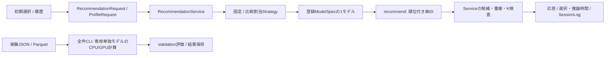
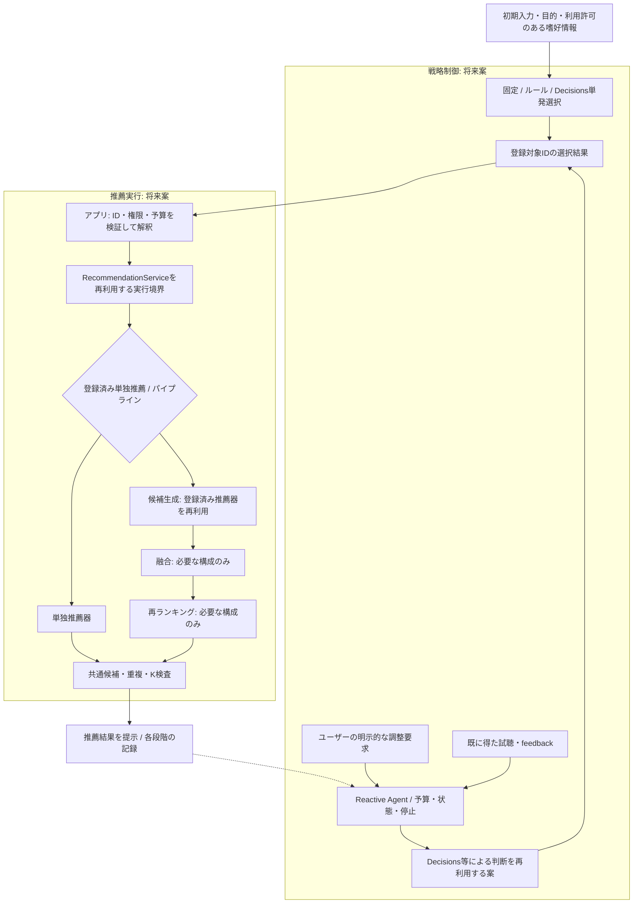

# 多段階推薦・戦略制御の拡張設計

## 設計の範囲

- [研究計画](research-plan.md#研究の4フェーズ)のPhase 2〜4を見据えた拡張案。研究用制御の実装範囲は[検証基盤](llm-agent-evaluation.md)へ分離する
- 推薦実行と戦略制御を分離し、既存契約・モデル・候補検証を可能な限り再利用する
- 多段階の組合せ/融合/再ランキング、選択単位、Agentの操作範囲/実行基盤は未確定
- 将来図のコンポーネント名は責務を説明する仮称。配信UI/APIや未採用のパイプライン構成を実装済みとしない
- 現行推薦方式・Cold-start・出典管理は[推薦アーキテクチャ](architecture.md)、試聴環境は[アプリ構成](app-architecture.md)

## 現行コードとの対応

| 現行の契約/実装 | 対応済み | 拡張時の不足・境界 |
| --- | --- | --- |
| [Strategy](../src/application/ports/recommendation.py) | requestと登録ModelSpecを受けてSelectionを返すport | 選択結果は1個のmodel_version_id、完成パイプライン/Agent行動の専用契約はない |
| [FixedStrategy / ComparisonStrategy](../src/domain/recommendation/models.py) | 固定モデル/割当モデルを選択 | ルール推論・外部判断・feedback後の再判断はない |
| [RecommendationService](../src/application/recommendation.py) | 登録モデルを1回選択・推論、ID/重複/K/候補を検査、選択と推論を別計時 | 中間候補・融合・段階別の検査/計測・Agentの状態/停止を持たない |
| [ModelSpec / Selection](../src/domain/recommendation/models.py) | モデル版・パラメータ・学習/カタログ/実装参照・戦略版 | パイプライン構成・各段階の版・親子stepの出典は未定義 |
| [RecommendationRequest / Response](../src/domain/recommendation/contracts.py) | 履歴・候補・new/repeat・K、順位付き曲ID・状態・nullable usage | goal/自由文/feedbackはこの基本Requestの項目ではない。中間scoreや融合根拠も専用契約なし |
| [ProfileRequest](../src/domain/recommendation/profiles.py) | 初期プロフィールをinput_kindで実履歴と区別 | 戦略判断用の入力を別Contextにするか、既存要求を互換拡張するかは未確定 |
| [HybridRecommender](../src/infrastructure/recommenders/hybrid.py) | 小規模RunnerでItemCF/UserCF＋Contentの重み付きRRF | 全件評価・配信統合・汎用段階構成は未実装、RRF採用を確定する根拠ではない |
| [RecommendationActions](../src/application/study/recommendations.py) | 共通候補・割当・required_route・要求/結果ログ、通常比較は条件ごと1要求 | StudyPlanは探索的design/controllerと均衡割当を保持。LLM/Agentの配信は拒否、パイプライン/反復実行は未実装 |
| [full_evaluation](../src/interfaces/cli/full_evaluation.py) | 全学習ユーザーの単独方式・Validation・保存結果 | 全件計算は専用CPU/GPU経路。Serviceへ差し替えるだけで多段階・Test対応になるわけではない |

- `RecommendationRequest`はnew/repeatのみ。混合総合taskは[評価仕様](listening-evaluation.md#設定選択と追加評価)の未実装案
- オンラインではgoalを別ログに持つが、自然文の意味解釈やLLM入力Contextは実装されていない
- ModelSpecをそのままパイプライン定義と見なしたり、既存Selectionで任意toolを表せると見なしたりしない
- 現行Selectionにusageはなく、SessionLogは推薦Responseのusageを記録する。研究用ControlStepでは判断usageを分離し、配信ログ/分析への統合は未対応

## 現行実行: 実装済み経路

## 将来の責務分離案: Phase 2〜4

- 破線は実行結果の参照であり、自動起動の指示ではない。Agent起動はユーザーの明示要求に限定する
- 調整は[戦略比較](online-comparison.md)の各条件最大2回、入力は選択肢＋任意自由文。1調整内の内部反復・許可行動・停止は未確定。Proactive介入は対象外
- 図の融合・再ランキングは構成候補。全段階を必須としたり、LLMに楽曲順位を直接生成させたりする設計ではない

## 推薦実行側の候補

| 責務 | 検討案 | 比較・記録する内容 |
| --- | --- | --- |
| 単独推薦 | 既存Recommenderをそのまま基準として残す | モデル版・推論経路・補完・品質・時間 |
| 候補生成 | 複数推薦器の上位pool、または1方式で取得 | 構成/候補数・候補源・候補の欠落・取得時間、pool拡大と計算量 |
| 融合 | 順位融合、スコア正規化後の融合、段階的な絞込み | 異なるscore尺度の扱い、重み/順序・同点規則・不足時の扱い |
| 再ランキング | ルール/多様性制御、学習型などを別候補として検討 | 学習データ・目的関数・精度とのトレードオフ・追加計算 |
| 最終返却 | 既存Responseの順位付きIDを維持する案 | 共通候補内・重複なし・K以内、音源権限、空/失敗/補完 |

- 候補制約を各段階へ引き継ぎ、Validation/Testの正解・未来の観測を候補生成・融合・再判断へ渡さない
- オンラインで既に観測したfeedbackは、参加者の明示要求と同意範囲内で使う。未来の応答を先取りしない
- 中間候補/scoreはモデル間で意味が異なる。最終IDだけの既存Responseと分けて保持する案を検討する
- 最終検査だけに依存せず各段階の候補逸脱も検出する案。補完は実経路として記録し、他方式の品質に混ぜない
- 全件の段階出力が必要ならParquetと出典hashで関連付け、巨大JSON重複や既存成果物上書きを避ける

## 戦略の選択単位: 未確定

| 案 | 既存契約の再利用 | トレードオフ |
| --- | --- | --- |
| 推薦器単位 | Strategyが登録ModelSpecを選ぶ | 現行Serviceと近いが、段階構成や融合パラメータの判断は別設計が必要 |
| 完成パイプライン単位 | パイプラインをRecommenderとして登録する案 | 比較・出典を固定しやすいが、構成数が増え、内部の柔軟な変更は制限される |
| 専用のパイプライン契約 | 既存Serviceの周囲に実行対象registryと仕様を置く案 | 各段階の監査は明確になるが、Selection/StudyPlan等の互換拡張が増える |

- Phase 2で再利用性・実測コストを確認してから判断粒度を決める。今回ModelSpec/Selectionを変更しない
- 任意のコードやパラメータを外部判断で組み立てず、登録済み・検証済みの対象へ解釈する構造を想定する

## Decisions APIとAgentの境界

- [OpenAI公式Decisionsガイド](https://developers.openai.com/api/docs/guides/decisions)はpredicate/choice/scoreの型付き判断を説明している
- Phase 3ではchoice等を登録対象IDへ対応付ける方向。判断結果の検査・推薦実行はアプリ側が担う
- Decisionsを使う方向は確定。利用モデル・入力範囲・SDK/料金/実利用可否・失敗時処理は実装前に確認する
- Decisionsの返答を楽曲リストや実行済みtool結果として扱わない。戦略比較のLLM側は明示feedback後に単発判断を再度行う方針で、Agent内の反復制御とは区別する
- Agentは明示要求後の状態、行動選択、許可された処理の実行、結果参照、停止/予算を管理するアプリ側の責務
- Agent内でDecisionsを再利用する構造を想定するが、API自体に反復・ユーザー起動・停止制御を委ねない
- モデル切替・融合変更・再ランキング等は許可行動の候補。どれをAgentへ公開するかは未確定
- 研究者HTTPはLangGraphで実行し、LangSmithを任意の観測先とする。[採用構成と接続範囲](llm-agent-evaluation.md)を参照。推薦方式・許可行動の採用とは分ける
- 自由文・嗜好・操作情報の外部送信は現行のローカル保存同意とは別の利用範囲を設計する

## 実装済みの基盤と不足コンポーネント

- 共通評価UI/指標集計、長期嗜好の同意・再訪・編集・削除は実装済み。[オンライン指標](online-metrics.md) / [長期嗜好管理](participant-profile.md)を参照
- 固定/単発/Reactive制御・Decisions port/Adapter・任意LangGraph/LangSmith・合成CLIは[検証基盤](llm-agent-evaluation.md)に実装。実API・参加者UI・自律反復へ未接続
- SessionLogは親要求ID・条件・list_number・adjustment_indexと単一鎖を検査する。既定は旧セッション全体2調整、新戦略比較はcondition範囲を明示できる。現在の推薦は初回のみ
- 明示調整に対応する画面/実行APIは未公開。初回と調整後で評価を再利用する[将来の画面遷移](online-ux.md#将来のreactive-agent-未実装)に従う

| 段階 | コンポーネント候補 | 実装前に決めること |
| --- | --- | --- |
| Phase 2 | 段階実行Adapter、候補/融合/再ランキング契約、パイプライン出典・全件/配信接続 | 構成と候補予算、比較の基準、失敗/不足時の扱い |
| Phase 3 | 既存研究用Decisions Adapterの配信接続、Rule選択、実usage検証 | 選択単位・共通入力・同意・timeout/再試行/fallback・費用予算 |
| Phase 4 | 研究用Reactive状態の永続化/削除、明示調整UI/API、内部反復 | 操作範囲・1調整内の反復・失敗時処理。最大2調整/選択肢＋任意文は確定 |
| 共通 | StudyPlanのdesign/controller・固定割当/入力・親子集計は対応済み。パイプライン/step/選択usage/失敗監視は不足 | ログ版・instrument版・保持/削除の伝播、旧ログとの互換性 |
| オンライン評価 | 共通評価基盤を調整前後の各要求へ接続、外部判断のusage/失敗監視 | 主指標はSatisfaction。予算・自由文/外部送信同意、実参加者での観測確認 |
| 評価 | 同条件の単独対多段階・固定/ルール/単発/反復の実行経路 | 入力権限・候補・予算・分母/観測窓・採用前のValidation比較 |

- Domainは不変の要求/結果/判断値、Applicationは実行/制御port、InfrastructureはAPI/モデル/保存Adapter、InterfacesはUI/HTTP/CLIを担う案
- 具象Adapterはbootstrapで注入し、Domain/ApplicationからSDK・DB・UIへ依存させない
- ステップID・親要求ID・条件ID、選択対象/版、入力種別、経路、停止理由、時間/token/料金/callを対応付ける案
- 秘密情報・生の認証情報は記録しない。自由文の内容/hashの保存には別同意が必要という現行境界を維持する
- Agent比較は初回と調整後の品質・総費用を分離し、追加情報と試聴機会の差を[UX比較案](online-ux.md#公平な比較と提示バイアス)に従って明示する
- 定義・主指標・採用設定の確定順は[研究計画](research-plan.md#未確定事項と推奨検討順序)を参照
