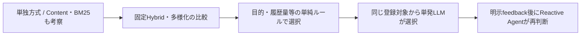

# 現在の考察から見た次の推薦比較

## 比較の根拠

- 実測値と仮説は[考察](discussion.md)を原本とする。以下は追加比較の提案で、採用方式や選択用の主指標を確定しない
- Popularityは新規発見のRecallが低く、再生回数版とユーザー数版で新規/再聴の有利不利が異なる
- ItemCFは新規発見で少数近傍、再聴で大きい近傍が有利。ALSも因子数の効果がタスク別に異なる
- BPRは128因子で500epochまで改善し、100epochだけで学習不足/表現能力の限界を判定できない
- ContentとBM25の結果の考察は未完了。その良否や相補性を仮定して次の方式を決めない
- このリポジトリのBM25は聴取行列へのBM25重み付けを使う近傍方式。曲説明文を検索するBM25とは区別する

## 優先順位の提案

- 次に追加する学習モデルは**EASE**を第一候補とする。ItemCFの類似度ベースとALS/BPRの潜在因子に対し、学習した曲間関係を比較できるため
- 個人内の再生回数順・直近再生日順は再聴の解釈を補う安価な比較基準であり、次の主要モデルを複数へ広げる提案とは分ける
- 既存Content/BM25の単独結果の考察を完了し、EASE比較の後に固定Hybridへ進む。EASEの資源条件が合わない場合の代案がSLIM

| 順 | 比較候補 | 調べたい問い | 実装・解釈上の条件 |
| --- | --- | --- | --- |
| 1 | EASE、計算資源が合わなければSLIM | 手作業の類似度より、学習した曲間関係が有効か | 人気/ItemCF/潜在因子との違いを調べる強い線形比較対象 |
| 補助 | 個人内の再生回数順・直近再生日順 | ALSの再聴性能は単純な本人履歴を超えるか | 学習期間だけで順位を作り、同じrepeat候補・全学習ユーザーで比較 |
| 3 | 固定Hybrid: CF＋Content、ItemCF＋ALS等 | 相補的な候補/順位を混ぜるだけで改善するか | Content/BM25の単独考察後、候補の重なりと的中ユーザーを調べる |
| 4 | MMR等の多様性再ランキング | 精度をどこまで保ってILD/Coverageを改善できるか | 同じ候補生成結果を使い、多様化なしと比較。既知特徴の類似度だけを使う |
| 5 | LightGCN | 多段の共聴取関係が既存の因子モデルを超えるか | 線形/Hybrid比較の後。学習・採点・全件指標のGPU経路と費用を確認 |

- EASEと補助基準が、現状の「個人化と再聴」「局所の類似度と潜在因子」の考察を直接検証しやすい
- [EASE原論文](https://arxiv.org/abs/1905.03375)は単層線形モデル、[SLIM原著者の実装案内](https://papers.karypis.org/glaros/software/overview.html)は疎な曲間係数を学習する方式
- [EASEの実装・CLI・資源条件](ease.md)は二値X・GPU in-place Cholesky・列ブロック解法。単一λ=500の診断設定は最適値の選択を意味しない。収まらない場合に母集団を黙って削らない
- [RRF原論文](https://cormack.uwaterloo.ca/cormack/cormacksigir09-rrf.pdf)は順位を融合する方式。既存の小規模`HybridRecommender`は再利用候補だが、全件CLI・配信統合は未対応
- Hybridは固定重み/RRFを先に比較し、LLM選択だけの効果と、複数推薦器を組み合わせた効果を分ける
- [LightGCN原論文](https://arxiv.org/abs/2002.02126)を候補とする理由は、多段のユーザー・曲関係を扱えるため。本データでの優越は未測定
- 逐次モデルは後段候補。時系列分割があることと、曲順・セッション順の信頼できる学習入力が準備できることは別

## LLM・Agentとの関係

- LLMへ曲IDを自由生成させる方式より、検証済み推薦器/パイプラインを選ぶ現行の研究方向と整合する
- 固定・単純ルール・単発LLM・Agentを比較し、LLMを使う追加の利益を検証する
- Agentには同条件の過去選択と観測済みfeedbackだけを許可し、未来のValidation/Test正解を渡さない
- 現在の実装は[LLM/Agent検証基盤](llm-agent-evaluation.md)の研究用制御まで。研究者HTTP接続に対応し、参加者UI・外部API運用・多段階融合は未接続
- 5人のオンライン試聴は探索的な体験評価。全学習ユーザーのオフライン予測性能や一般化性能の代用品にはしない

## 共通の確認条件

- 学習・候補・分割・母集団を揃え、Validationで比較する。最終Test・主指標・採用設定は明示決定後に扱う
- 新規発見: Binary NDCG・Recall、継続的嗜好: Graded NDCG・Repeat Recall
- 多様性/発見性: ILD・Catalog Coverage・Novelty、効率性: Latency・token・料金・LLM/tool call
- 効率性以外はK=2〜20。再生回数/再生日数分布、ユーザー単位の対応のある差と不確実性も確認する
- CPU/GPU・精度・solver・seed・時間を記録し、未測定値はnullのまま保持する
