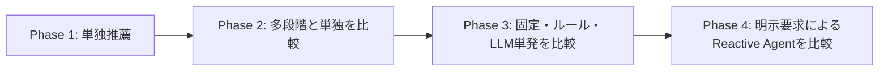

# 研究計画

## 目的・対象

- 中間報告は2026年11月末、最終報告は2027年1月末頃を想定
- 発表の正式日程・外部発表は未確定。オンラインは最大5人程度の探索的比較とし、以下は到達目標として管理する
- 音楽推薦における「何を推薦するか」と「どの推薦戦略をいつ選ぶか」を分離して検証する
- Music4Allのオフライン比較を維持し、許諾済み実曲の小規模主観評価へ接続する
- [既存の考察](discussion.md)を残し、観測結果・仮説と新たな検証計画を区別する

## 研究の4フェーズ

| フェーズ | 確定した方針・比較 | 未確定の設計 |
| --- | --- | --- |
| Phase 1: 単独推薦 | Popularity・ItemCF・BM25・ALS・BPR・Content等のハイパーパラメータを変えて比較 | 採用モデル・主タスク/主指標 |
| Phase 2: 多段階推薦 | 単独評価後に候補生成・融合・再ランキング等を検証し、単独との差を測る。Phase 3以降から再利用できる構造を検討 | 推薦器の組合せ・融合/再ランキング手法・段階構成 |
| Phase 3: LLMの戦略選択 | OpenAI Decisions APIを活用する方向。入力・嗜好・目的から登録済みの推薦処理を選び、アプリが判断を解釈して実行。固定/ルール選択と比較 | 推薦器単位か完成パイプライン単位か、利用モデル・入力・予算 |
| Phase 4: Reactive Agent | 明示要求で起動し、試聴/feedbackから再判断。選択肢＋任意文、戦略比較では各条件最大2調整、各リストを別評価。固定/LLMと同等のfeedback機会で比較 | 許可するモデル切替・融合・再ランキング等の範囲、内部反復/停止・実行基盤 |

- 各段階で[オフライン4観点](listening-evaluation.md)・同一条件・Validation/Test分離を維持する
- Phase 3の主目的は戦略選択であり、LLMによる直接の楽曲ランキング生成を主目的にしない
- Phase 4はユーザー主導型。自発的に介入するProactive Agentは今回の対象外
- 4フェーズは研究順序。日付到来だけで未検証の段階を飛ばしたり、実装/有料呼出しを開始したりしない
- 現行/将来の境界と契約の再利用は[拡張設計](recommendation-design.md)、画面は[UI/UX案](online-ux.md)を参照

## 研究上の問い

| 問い | 比較・確認する内容 |
| --- | --- |
| 目的ごとに有効な方式が変わるか | 新規発見・再聴取・ランキング上位・多様性・効率のトレードオフ |
| ランキング学習は有効か | BPRとALS/ItemCFのNew Recall・Repeat Recall・Binary NDCG、因子数・収束・コスト |
| 内容特徴・多段階は何を補うか | ContentとCFの差、候補生成/融合/再ランキングの単独方式に対する増分 |
| 単発の戦略選択は有効か | 固定/ルールとDecisionsによる選択妥当性・推薦品質・コスト |
| 明示要求後の再判断は有効か | 固定/単発とReactive Agentの比較、情報量・試聴機会・反復予算の差を明記 |
| オフライン差は体験と対応するか | 履歴予測と[オンラインの受け取り方](online-metrics.md)を分離し、母集団・候補差を考慮 |

- Decisionsの任意Adapter・LangGraph実行・LangSmith匿名traceは[研究用検証基盤](llm-agent-evaluation.md)に実装。参加者UI/実APIは未接続、モデル/予算・汎用多段階推薦は未採用
- 新規発見=New Recall@20、再聴取=Repeat Recall@20、総合=混合Binary NDCG@20を選択用候補とする
- 混合総合評価は未実装、採用モデル/主指標を勝手に固定せず、常に[4観点](listening-evaluation.md)を保存する

## マイルストーン

| 期限目安 | 優先作業 | 達成基準 |
| --- | --- | --- |
| 10月後半 | 従来方式の共通比較・入力/結果監査 | 全学習ユーザー、同一期間/候補/正解、K2〜20、4観点、hash付き保存物が揃う |
| 10月末 | 実曲の提供条件・配信用重み・ログ運用 | 音源/metadata入手条件が明確、ItemCFの実推薦経路、保持/撤回/アクセス方針の草案 |
| 11月前半 | 目的別評価の不足実装・Cold-start確認 | New/Repeat/総合の区別、ALS fold-in実測、BPR補完を比較から分離 |
| 11月中旬 | 条件固定候補・3〜5人のUX予備実験 | 許諾等が揃えば操作→試聴→任意評価→ログ/削除を確認、欠測/負担を修正 |
| 11月末・中間報告 | 従来方式の比較と研究課題の明示 | 図/正確な表/再現手順/未検証を提示、LLM/Agentの比較設計を説明 |
| 12月前半 | Phase 2の比較を先行し、その後にPhase 3 | 単独対多段階を確認してから固定/ルール/LLMの入力・候補・K・予算を揃える |
| 12月後半 | 前段完了後にPhase 4の設計・小規模検証 | 明示起動・許可行動・再推薦上限・停止理由と追加callの利益/費用を確認 |
| 1月前半 | 設定確認/固定・許可された最終評価 | Testに触れる前に条件と分析を固定、実曲利用可能なら被験者比較を実施 |
| 1月中旬 | 分析・再現性監査・報告作成 | 観点別比較・時間/料金・失敗/欠測・限界を整理、図と保存値を照合 |
| 1月末頃・最終報告 | 実装・比較結果・限界の提示 | 動作可能なコードと明示手順、データ/モデル出典、追試可能な結果参照 |

## 中間報告の最小成果

- 従来方式の比較: Popularity・ItemCF・ALS・BPR、Content/BM25の追加比較
- 目的別の観測差と設定依存: 近傍数・因子数・New/Repeat・NDCG・多様性・効率
- 現在の結果と未測定を区別した表、再生回数/日数分布、候補・ユーザー数・期間の説明
- 推薦器とStrategyを分離した[構成図](architecture.md)、[実行/保存フロー](experiment-workflow.md)
- 主観評価環境の動作と開始条件、実曲利用が未許可なら合成デモは操作検証としてのみ提示
- 多段階・LLM単発・Reactive Agentの仮説と比較設計、未実装を完成扱いしない

## 最終報告の優先範囲

| 優先 | 目標 | 成立条件 |
| --- | --- | --- |
| 必須 | Phase 1の単独比較を土台にPhase 2→3を検証 | 同一条件・Validationでの確認/固定・使用量/失敗の実測 |
| 高 | 実曲の少人数主観評価とオフライン差の対応 | 音源/metadata・同意・参加者アクセス・保持/削除方針 |
| 追加 | Phase 4の再判断による改善/効率の比較 | 単発比較が安定、明示起動・tool回数/料金/時間の予算とログが揃う |
| 追加 | 新曲・長期利用の分析 | 内容特徴と行動データ、期限内の検証資源がある |

- Agentや被験者数の拡大より、比較の公平性・実測・再現性を優先する
- 3〜5人はUX/実行可能性の予備確認、推薦一般の優劣や有意差を主張する人数としない
- [オンライン比較](online-comparison.md)は最大5人、通常3条件/戦略2条件、主指標Satisfaction。均衡割当・記述分析を準備し、再訪の採否・休憩・重複曲の方針は実施前に合意する

## 実験設計・品質ゲート

- Test結果をモデル採用/ハイパーパラメータ選択へ使わない
- 全件最終Testは現行Validation CLIとは別の追加対応が必要、小規模Runnerの対応を全件対応と誤認しない
- 同じ履歴/候補/楽曲数/試聴条件を使用し、Agentの追加情報/試聴機会を明示する。[対照条件と予算の案](online-ux.md#公平な比較と提示バイアス)を本比較前に選ぶ
- 学習時間・単発/バッチ推論・API往復・画面表示を分け、token/料金/callは実測だけを記録する
- オンラインはモデル名秘匿、少人数の順序割付、未提示/再生不能/未送信の欠測を管理する
- [オンライン評価](online-study.md)の同意・期限・撤回/削除テストを実参加者開始前の必須条件とする

## リスクと分岐

| リスク | 対応・報告範囲 |
| --- | --- |
| Music4All音源の提供/試聴許諾が間に合わない | オフライン比較と合成操作検証を継続、実曲主観評価の結果を作らない |
| 別カタログへ切替が必要 | 履歴・特徴・再生許諾を改めて確認し、Music4All結果とは別実験にする |
| BPR新規ユーザー因子が使えない | 人気補完をBPR評価とせず、未知ユーザー適応の別検証かオンライン対象から除外 |
| GPUが使用中・計算が長い | 共有GPUの空きを確認して順次実行、全学習ユーザーの母集団を黙って縮めない |
| 後段の期限・料金が厳しい | Phase 1→2→3の順序を維持し、未到達段階を明示。Agentを追加分析へ下げる |
| Mac停止・通信断・少人数の欠測 | 稼働時間を案内し、未送信を欠測で記録、無理に遠隔常時公開しない |
| 小規模比較で差が不明確 | 効果量・個人差・操作負担・失敗を記述し、効果なしの証明としない |

## 未確定事項と推奨検討順序

- 優先度は依存関係に基づく検討順であり、以下の案を採用済みとはしない

| 順序・優先度 | 決める事項 | 比較案とトレードオフ | 参照 |
| --- | --- | --- | --- |
| 1・P0 | 通常比較3モデル・再訪/除外・休憩/重複曲の方針 | 最大5人・Satisfaction主指標・均衡割当は確定。Validationを参考にモデルを明示選定し、記述分析の運用を固定する | [比較実験](online-comparison.md) |
| 2・P0 | 音源・入力・同意・保持/削除・外部送信範囲 | ローカル完結と外部判断では情報利用範囲が異なる。許諾・説明・分析コピー管理を整える | [運用](online-study.md) |
| 3・P0 | 確定した評価定義の実参加者での成立性 | リスト満足度・10秒試聴/感度分析・Like曲の未知申告は実装済み。欠測/負担・音源長・分析計画を予備確認する | [指標](online-metrics.md) / [UX](online-ux.md) |
| 4・P1 | Phase 2の推薦器・候補数・融合/再ランキング | 順位融合はscore尺度差に強い/score融合は正規化が必要。段階追加は品質と計算量を比較 | [拡張設計](recommendation-design.md) |
| 5・P1 | Phase 3の選択粒度・共通入力・APIモデル/予算 | 推薦器単位は現行契約に近い/完成パイプラインは条件固定しやすい。失敗時処理も決める | [選択単位](recommendation-design.md#戦略の選択単位-未確定) |
| 6・P1 | Phase 4の許可行動・入力語句・内部反復/停止 | 選択肢＋任意自由文/最大2調整は確定。モデル切替/融合/再ランキング、直接SDK/状態機械/フレームワークは未採用案 | [拡張設計](recommendation-design.md) / [画面案](online-ux.md#将来のreactive-agent-未実装) |
| 7・P1 | Agentの選択対象・費用予算・条件別Context | LLM単発再選択と同じ入力権限/UI/各条件2調整/候補制約を用意する。実際の入力と行動は異なり得る | [公平性](online-ux.md#公平な比較と提示バイアス) |
| 8・P2 | 条件/ログ版と本評価の固定 | 不足ログ・配信/全件経路を検証し、設定確認/固定を経て許可されたTest/本比較へ進む | [実行フロー](experiment-workflow.md) |

## 実施上の確認事項

- Music4Allからデータ提供の連絡を受領、受領時に取得範囲・招待者への試聴・保存/帰属/削除条件を確認する
- 配信用ALS/BPR重みの追加学習と、BPR未知ユーザー対応の範囲を決める
- 本比較の主目的・条件・保持期間・実施者・参加者アクセス・分析用コピーの管理者を決める
- 中間報告の正式日程を確認し、実曲未取得時の発表範囲も事前に合意する
