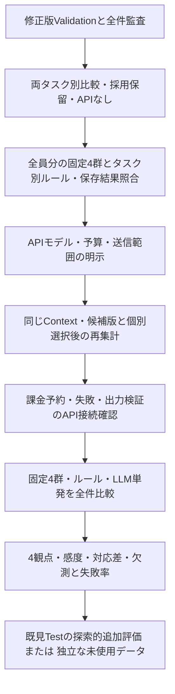

# 固定・ルール・LLM単発の比較設計と監査

## 状態と根拠

- 対象は完成した推薦方式を選ぶ選択器。研究上の採用モデルを決めたものではない
- 比較候補は既存Validationに基づく4方式。修正版Testの最大値から候補を選び直さない
- new/repeatを別々に比較し、総合順位を付けない。改善・悪化と不確実性を報告し、採用判断は保留する。固定4群とタスク別ルールをローカル比較し、外部APIを使用しない
- [全件監査記録](../data/provenance/selector-design-audit-20261109/result.json)は確認済み事項と実行前の未充足条件を区別する
- 指標の定義は[評価指標](evaluation.md)、入力契約は[アーキテクチャ](architecture.md#選択器の共通入力)、既存数値は[HybridのValidation](discussion.md#hybridのvalidation)を正本とする

## 4候補を残す根拠

| 比較候補 / 論理ID | 精度上の役割 | 多様性・発見性上の役割 | 旧ValidationのGPUバッチ償却ms/要求 |
| --- | --- | --- | ---: |
| EASE / `ease` | 単独の基準。RRFが常に全精度で上回るとは限らない | RRFより共通ILDが高い一方、Coverage・Noveltyは低い | 0.184 |
| EASE+BPR RRF / `ease-bpr-rrf` | NDCGとRepeat Recallの改善を調べる融合対照。新規Recallの対応区間は0を含む | 露出・低人気帯のRecallを広げる一方、共通ILDは下がる | 0.289 |
| MMR 0.8 / `ease-bpr-mmr0.8` | RRFとの精度・多様性の調整幅を調べる | RRFより共通ILDを高める中間条件 | 0.545 |
| MMR 0.5 / `ease-bpr-mmr0.5` | 新規精度の低下を含む強い調整を対照に残す | 高いタグ空間ILDと精度の交換関係を調べる | 0.544 |

- 費用欄は[旧Validation CSV](../data/experiments/hybrid/validation/metrics.csv)の`latency_mean×1000`を丸めた値。取得top200込み、BPRは3seed平均。単発オンライン応答時間・API往復・修正版の費用ではない
- 段階ごとの測定範囲と再現差は[GPU段階費用](discussion.md#gpu段階費用)を参照。MMR 0.5が0.8より速いという一般的結論を丸め値から出さない
- 4候補は異なる調整幅を持つ比較集合。4候補のどれが個々の要求に最適か、LLMが必要かは未検証
- BM25/Content等の既存条件と原本は保持する。今回の選択器候補を4方式に限定する設計であり、他方式の無効性を主張しない
- 人気帯・履歴量の層別結果は集団の関連。個人の最適方式やルールの正しさを保証しない

## 比較群と公平性

| 群 | 条件 | 同じにするもの |
| --- | --- | --- |
| 固定 | 4候補をそれぞれ全要求へ適用する4対照 | 母集団・入力・候補版・評価窓・K |
| ルール | 学習集計Contextだけから事前定義した規則で論理IDを選ぶ | LLMと同じ7項目・候補説明・出力集合 |
| LLM単発 | 同じContextと候補説明から1回で論理IDを選ぶ | 追加の曲情報・正解・実行中の評価フィードバックを渡さない |

- 4固定群＋1ルール群＋1LLM群を比較する設計。固定対照をTest結果で都合よく間引かない
- 各群は全119,133人×new/repeatの238,266要求を対象とする。精度の正解保有者・除外数と、推薦生成の母集団を分ける
- EASEは1実行、BPRを使う候補はseed42/43/44を維持。選択器の方式選択を同じuser/taskの3seedへ共通適用し、個別スコアをユーザー単位で平均する
- seedを選択器へ渡さず、BPRの3seedをAPIの3反復やユーザー数の3倍として数えない。LLM自体の反復は別の追加設計
- 全群に同じ情報へのアクセスと推薦条件を与え、実際の計算量・料金差は測定する。費用を合わせるために固定群へ不要なAPI呼出しを加えない
- 方式選択は最終TopKに関わらず一度行い、同じ順位のprefixでK2〜20を評価する
- オフラインでは選択した版の保存順位を再生できるが、出典が一致した版に限る。保存順位の読込み時間を実推論時間として報告しない
- 将来個人別ルールを実装・評価する場合、具体的な分岐・閾値は事前登録する。学習分布から求める閾値の定義・同値処理を記録し、Validationで調整した場合は探索として申告する
- 層別傾向を根拠に複雑なルールを正当化しない。現在のtaskだけで切り替える規則を対照に残す

### ローカル比較のルール

- 規則は`new → ease`、`repeat → ease-bpr-rrf`。閾値は設けず、同じuser/taskの全seed・全Kへ同じ選択を適用する。履歴量・再生の偏りによる分岐はない
- 既存Validationを確認した後の探索的な案であり、事前に独立した未見比較ではない。新規のRecallとNDCGでは優劣が一致せず、この割当てが全指標で最適という意味ではない
- 4固定対照と同じ4観点・全窓・全Kで比較する。タスク内の全員に同じ方式を選ぶため、新規の品質はEASE、再聴はRRFと厳密に同じ。個人別適応による改善を示す比較ではなく、主指標・採用版も選ばない

### ローカル比較の実行と読込み

```bash
.venv/bin/python -m backend.interfaces.cli.hybrid_selection --config configs/hybrid/base.json --run-local --rule-new ease --rule-repeat ease-bpr-rrf
```

- 既定は計画表示。2タスクの方式を明示し、`--prepare`と`--run-local`を同時指定しない。出力`selector-local/`と途中保存`.partial`は既存時に拒否する
- 比較結果と解釈は[考察](discussion.md#固定4群とタスク別ルール)を参照。`selections.parquet`は選択先と選択時間、configは各先のseed別推薦・スコアの参照を持ち、元の巨大Parquetを複製しない
- [全件検証](../data/provenance/selector-local-20261109/verification.json)で選択行の一意性・全員の割当て、3,705品質行・2,280対応差行と出典、14枚のPNGを照合する
- `metrics.csv`は4観点・全窓・全K・日数重み感度、`ild.csv`は元のEASE/BPR群全条件・seedの共通母集団、`paired.csv`は右−左のユーザー対応差。既存の個別スコアとseed平均に基づく区間を参照し、同じ順位の比較は有効人数がある場合だけ厳密な差0とする
- `choices.csv`に全要求の割当数、`source_efficiency.csv`に元の全タスクGPUバッチ費用を保存。選択器の`latency_mean`・API料金等はnull。Python分岐の時間と入力読込み・レポート処理時間を分け、分岐の単一走行・固定順での計測を推薦応答時間や方式間の速度優位と呼ばない
- PNGは90日・日数重み1の全K、共通ILD、多様性・発見性、選択時間、再生回数/日数分布。未測定だけの指標は描画しない。表はCSVから読める
- Domainの`TaskPolicy`へ渡すのは7項目Contextだけ。品質の参照は全員分の選択記録後に行い、出典・候補版・人数・ユーザー/タスク順の不一致は成功結果を公開せず停止する。外部API・暗黙fallback・自動retryはない
- この集計参照はタスク内で方式が一定の比較だけに限定する。ユーザー別ルールやLLMへ拡張する際は、選択後の個別スコア・Coverage・共通ILD・失敗分母を再集計する

## 候補版を固定する契約

- 上表のIDは方式名。配信用モデルの`version_id`や検証済み新registryが既に存在するという意味ではない
- 実行前に各論理IDを、phase・学習/特徴hash・ソース版・候補artifact hash・RRF/MMR条件・seedごとの順位artifactへ結び付ける
- 取得m=100、診断用取得200、union最大200、等重みRRF/c60、λ1/0.8/0.5、同点規則は[既存仕様](architecture.md#多段階推薦)を維持する
- EASEの基準と融合3方式の情報取得量の差は方式の差として測る。RRF/MMR間では同一pool hashを要求する
- 元Validationは修正前の処理版。順位差が小さいことを、修正版の原本との同一性の根拠にはしない
- 選択器比較用の正本は[修正版Validation](../data/experiments/hybrid/validation-corrected/result.json)。全119,133人・10条件・18実行の順位・4観点・共通ILD・GPUバッチ費用とhashを保持する。[全件検証](../data/provenance/hybrid-validation-corrected-20261109/verification.json)を参照し、論理IDの接続時はこの候補版へ結び付ける
- [修正版の共通入力](../data/experiments/hybrid/validation-corrected/selection-context/result.json)は全119,133人・238,266行。[全件照合](../data/provenance/selector-input-corrected-20261109/verification.json)で学習集計・人数・出典を確認する。configの`candidates`に4論理ID・静的説明・10個のseed別実行と推薦・スコア・取得候補のhashを持ち、Context生成版と推薦生成版は別々に記録する
- 修正版Testは数値処理と固定Hybrid比較の検証根拠。選択器の候補絞込み・ルール閾値・プロンプト調整には使わない
- 同じTestを再利用する場合は既見の探索的追加比較として報告する。完全未見の確認には、独立した未使用期間・データ等を別途用意する

## 入力・出力・失敗の契約案

- 共通入力は既存`SelectionContext.payload()`の7項目だけ。意味・欠測の扱いは[入力契約](architecture.md#選択器の共通入力)を参照する
- 候補説明は学習方式・融合・λ・タグ依存などの静的説明に限定する。Test値、ユーザー別oracle、将来の再生・評価値は入力しない
- 初回比較では自由文feedback、曲名、曲ID、user_id、元の聴取履歴、外部検索・推薦ツールを与えない。直接IDを除いても集計値の匿名性を保証するものではない
- 出力案は`{"target_id":"ease-bpr-rrf"}`のような4値enumのみ。seed・λ・重み・候補曲・任意の内部パラメータは生成させない
- 追加フィールド、不明ID、拒否、timeout、不正形式、通信失敗は失敗として記録する。理由文や思考過程の返却は要求しない
- 自動再試行0、推薦ツール呼出し0、1要求あたり選択呼出し最大1を初回設計案とする。失敗を隠す別方式への暗黙fallbackはしない
- 失敗は要求数から除かず、失敗理由・試行数・実測時間・分かる使用量を保持する。正解なしと選択失敗は別の除外理由にする
- 成功要求のみの品質、成功率、全割当要求でのサービス指標を分ける。失敗品質を0に置換した値を実測推薦精度と呼ばない
- 順位品質の対応差は全群で有効な対応要求の条件付き解析とし、人数・群ごとの脱落率・対象差を併記する。全割当要求の成功/失敗率を必ず報告し、失敗を含む判定規約が未合意なら優越性や採用を判断しない

## 主目的・品質・API条件の確認欄

| 項目 | 準備した選択肢・契約 | 現在の状態 |
| --- | --- | --- |
| 比較目的 | new/repeatを別々に比較し、総合点・総合順位・単一の勝者を決めない | 確定 |
| 窓・日数重み | 90日・K20・日数重み1は表示基準を維持。採用用の主指標・閾値には昇格させない | 採用判断は保留 |
| 品質の扱い | 改善・悪化の効果量と対応区間などの不確実性を報告。許容低下幅を勝手に設定しない | 採用判断は保留で確定 |
| APIモデル | 今回は選定・使用しない。実API実験を別途依頼された場合に指定 | 今回の対象外 |
| 料金上限 | 今回はAPI実行なし。将来の実行時に全体上限と1要求の予約額を指定 | 今回は指定不要 |
| 外部送信 | 今回は送信しない。7項目と静的候補説明の案は将来の検討用 | 送信なしで確定 |
| 外部ログ | 研究データ・プロンプトの外部traceを無効、ローカルに必要な版と計測値を保持 | 設計案 |
| 実行範囲 | 固定4群とタスク別ルールのローカル比較。API接続・全件LLM比較は別途条件確認後 | ローカル比較まで |

- どの主目的を選んでも[4観点と全K・全窓・日数重み感度](evaluation.md#固定する4観点)を省略しない。複数指標の無断な総合点化はしない
- 両タスク並列の場合はタスク別に結論を出し、単一の勝者を決めない。確認的検定を行うなら多重比較の扱いも事前に指定する
- 金額・モデルが未指定なので価格や実行可能人数を推測で埋めない。現段階のAPI料金・tokenは未測定null
- 以下の費用・実行契約は将来のAPI実験用であり、今回の実行許可を意味しない
- Decisions APIが必要になる段階で利用者へ知らせ、モデル・料金上限・外部送信内容を確認してから接続する
- 1反復の全件LLM比較は最大238,266試行。予算が不足する場合は開始しない。人数を黙って減らさず、少数の接続確認は全件評価と別に明示する
- 料金見積りはモデル・単価の出典/取得日・入力token見積り・出力上限・価格区分を固定して作る。見積りと実測請求を混同しない
- 実験全体の上限を超えないよう、呼出し前に最大費用を予約し、使用量と料金の確定後に精算する契約が必要。金額不明の試行が出たら追加送信を停止する
- 既存`ControlBudget`は制御インスタンス単位で、呼出し前の費用予約や全件共有の料金台帳は未実装。これだけで実験全体の課金上限を保証しない

## 監査の判定

| 観点 | 確認した根拠 | 判定・残る制約 |
| --- | --- | --- |
| 依存方向 | [architecture試験](../tests/test_architecture.py)、[監査試験ログ](../data/provenance/selector-design-audit-20261109/tests.log) | Domain/Applicationの内向き依存と循環を確認。全ユースケースのApplication分離完了を意味しない |
| 学習/未来の境界 | [候補生成](../backend/infrastructure/research/hybrid.py)、[Context生成試験](../tests/test_selection_contexts.py) | モデル入力はlearningと特徴、将来正解はEvaluator。静的タグの付与日時は未確認 |
| Context | 119,133人・238,266行と7項目payloadを全件照合 | user_idはローカル照合用。payloadへ含まれない。実APIへの新入力接続は未実装 |
| 分母・欠測 | [GPUAccuracy/GPUDiversity](../backend/infrastructure/evaluation/gpu_metrics.py)、指標試験、[Test全件検証](../data/provenance/hybrid-test-corrected-20261109/verification.json) | 正解全体からIDCG/Recall分母を作り、正解なしを除外。選択失敗の別集計は新runnerで必要 |
| 候補の公平性 | 保存候補hash、[同一union対照](../data/experiments/hybrid/validation/union-control/result.json)、Testのpool照合 | RRF/MMRの同一poolを確認。A100対unionの差には取得枠の差を含む |
| 数値処理 | [全件数値診断](../data/provenance/hybrid-numeric-validation-20261109/manifest.json)、修正版Validation/Test | 旧Validationの値・費用と修正版の版を混ぜない |
| タグ依存 | Content・MMR・ILDが同じ特徴を利用 | ILD上昇は独立な音楽的多様性や満足度の証明ではない |
| 効率 | 取得/融合/MMRの実測、効率欄のnull | GPU償却・保存候補処理・単発応答は別。新選択器の実応答時間は未測定 |
| Adapter接続 | [ローカル比較](../backend/infrastructure/research/local_selection.py)、[既存provider](../backend/infrastructure/research/decision_providers.py) | 固定・タスク別ルールは保存結果へ接続。既存`DecisionInput`は別契約で、新Contextの実API接続・推薦の実推論接続は未実装 |
| 料金・外部送信 | 既存mock transport試験、権限・retry・失敗の試験 | SDK契約試験を実API動作や請求の確認とは呼ばない。新送信allowlistと全件料金予約が必要 |

- 監査試験は62件通過・1件スキップ。スキップは明示GPU有効化を要する経路で、今回GPU試験を再実行したとはしない
- 結論は「設計の根拠と未充足条件を整理済み」。API実験の開始可能・比較版の採用済みという判定ではない


