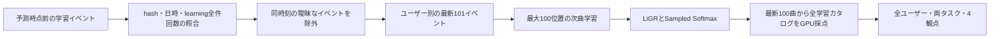

# eSASRec型の系列モデル

## 現在の状態

- LiGR層・Shifted Sequence・Sampled Softmaxを既存CLIへ接続し、CPUの小規模fixture試験を実施
- [検証記録と依存容量の目録](../data/provenance/esasrec-readiness-20261113/verification.json): 関連32件成功、CUDA試験1件未実行。静的・整形・lock整合性を確認
- **実データの学習・全件精度・GPU性能は未測定**。CPU試験を実データの改善根拠にはしない
- GPU版PyTorchとCUDA依存の展開サイズは約4.99GiB、取得サイズは約2.84GiB。現在の空き容量では導入できない。インストール一時領域・結果用の余裕も必要
- 追加の保存先を確保し、CUDA試験と実バッチの所要時間・VRAMを確認してから長時間学習を開始する。CPUへ暗黙に切り替えない

## 根拠と実装の対応

- [eSASRec論文](https://arxiv.org/html/2508.06450v1) / [著者実装](https://github.com/blondered/transformer_benchmark) / [RecTools 0.13.0](https://github.com/MTSWebServices/RecTools/tree/v0.13.0/rectools/models/nn/transformers)
- LiGRのPre-LN attention、sigmoid gate付き残差、SwiGLU、逆位置埋込み、共有アイテム埋込み、Adamのbetas=(0.9,0.98)を使用する
- 著者実装のLiGR blob `4f39f773aa0f514a14177fa8a2bcf9bb7ce84a00`、SwiGLU blob `332d63b139c69a83811f80bc86cdaf1e0ffeda4f`を参照。Apache-2.0の[ライセンス](../backend/infrastructure/recommenders/licenses/transformer-benchmark.txt)と[NOTICE](../NOTICE)を同梱
- RecTools/Lightning本体は追加せず、[ネットワーク](../backend/infrastructure/recommenders/sequence_network.py)と[学習・全件採点Adapter](../backend/infrastructure/recommenders/full_sequence.py)を分離した改変実装。原論文の数値再現を主張しない
- Adapterは入力と採点を担当し、最適化ループは[sequence_training.py](../backend/infrastructure/recommenders/sequence_training.py)、完成した重みの公開は[sequence_checkpoint.py](../backend/infrastructure/recommenders/sequence_checkpoint.py)へ分離する
- 明示的な相違はpadding keyの遮断、曖昧な同時刻イベントの除外、固定epoch数、全体時系列分割と期間内複数正解の評価。原著の早期停止・探索予算とは異なる

## 入力・学習・推薦



- 系列順序を作れない同一user/timestampの全イベントを除外する。ユーザー・既聴集合・評価人数は減らさない
- 初回聴取条件では学習期間全体の初出を先に判定し、曖昧時刻を消した後の再聴を初回へ昇格させない
- 系列は最新101イベントを保持し、入力100位置→1位置先の曲を学習する。左paddingは0、曲IDは1から。paddingを入力にする最初の曲の予測は損失から除外
- 入力の未来位置とpadding keyをattentionで遮断する。padding query自身の対角のみ開け、全遮断によるNaNを防ぐ
- 負例は学習カタログから位置ごとに256曲を一様・復元抽出する。正例との衝突と重複は参照実装と同様に保持し、logQ補正は行わない
- 全再生と初回聴取の2条件を用意する。初回聴取は学習と推薦文脈の両方を変更するため、遷移モデルの「学習列だけ変更」と同じ比較ではない
- 2イベント未満のユーザーは次曲学習に寄与できないが、評価対象として残す。順序付きイベントが0件ならスコア0を明示し、学習全体の人気度→曲IDで同点解消する
- 推薦は最新100曲をその場で符号化し、全カタログを採点。newは学習既聴曲を除外、repeatは既聴曲へ制限する。ユーザー符号化時間も順位取得時間へ含める
- 全4観点、K2〜20、30/90/180日、日数重み、再生回数/日数分布は[共通仕様](evaluation.md)を使う。主タスク・主指標・採用版は未指定

## 条件と保存

- [全再生](../configs/esasrec/all.json) / [初回聴取](../configs/esasrec/first-listen.json)は同じcommon.jsonを継承
- 64次元・2層・2head・長さ100・dropout0.2・256負例・batch128・学習率0.001・100epoch・seed0。小規模fixtureは試験内で明示的に縮小し、研究条件へ混ぜない
- 100epochは実行候補であり実行済みではない。実バッチ計測後、実行前に計算予算を記録する。GPU容量不足や性能未確認のまま開始しない
- PyTorch float32、CUDA版・GPU・cuDNN・TF32設定・各epochの損失/時間/有効位置数・学習ピーク割当メモリをexecutionへ記録する
- seedを固定してもCPU/CUDAや解法の差によるbitwise一致は保証しない。CUDAを指定して利用できない場合は失敗する
- 保存先は`data/experiments/esasrec/<条件>/`。標準成果物に加え、モデルstate_dict・曲ID順・seedを`model.pt`へ保存し、result.jsonのartifact hashで照合する
- checkpointは同じディレクトリの一時ファイルへ書込み・同期後に公開する。保存例外では一時ファイルを除去し、既存ファイルや競合した保存を上書きしない
- checkpointは重みであり配信用モデルではない。再構築にはconfig.jsonと同じ学習入力・系列処理が必要。配信exportと学習途中再開は未対応
- Testは同じ条件の成功済みValidationを要求し、Train＋Validationだけで再学習する。既見Testで調整しない

## 環境と実行

- Python 3.12・uv.lockを維持し、PyTorch 2.6.0のCPU/CUDAを排他的extraで明示指定。通常の研究室経路へ必須依存として追加しない
- CPU版は小規模試験用。Linux x86_64のGPU実行には`sequence-cuda`と既存`gpu` groupを使う。`--inexact`で他の導入済みgroupを保持する

```bash
uv sync --locked --inexact --extra sequence-cpu --group data --group models --group notebook --group tracking
OMP_NUM_THREADS=1 OPENBLAS_NUM_THREADS=1 .venv/bin/pytest -q tests/test_sequence.py
```

- 容量確保後にCUDA版へ切り替え、ホストのGPU使用状況とCPU/CUDAのスコア・勾配一致を検証する

```bash
uv sync --locked --inexact --extra sequence-cuda --group data --group models --group notebook --group tracking --group gpu
nvidia-smi
CUDA_PATH=/usr MUSIC_RECSYS_TEST_GPU=1 .venv/bin/pytest -q tests/test_sequence.py
CUDA_PATH=/usr .venv/bin/python -m backend.interfaces.cli.sequence_probe --config configs/esasrec/all.json --output data/provenance/esasrec-profile --batches 5
CUDA_PATH=/usr .venv/bin/python -m backend.interfaces.cli.evaluate --config configs/esasrec/all.json
```

- 2条件を直列実行し、[正規化遷移](transition-normalization.md)・EASE・時間減衰の保存対照と`backend.interfaces.cli.weighting_comparison`で比較する。既存出力を上書きしない
- probeは実際の学習入力で指定バッチ数だけ測り、各バッチ時間・全epochのバッチ数・GPU割当メモリを記録する。精度・checkpoint・推薦結果を生成せず、そのモデルでの評価も拒否する
- 小規模試験では因果マスク、padding、Sampled Softmaxと全カタログ損失の一致、バッチ境界の系列、未来データ分離、checkpoint、全員推薦を確認する
