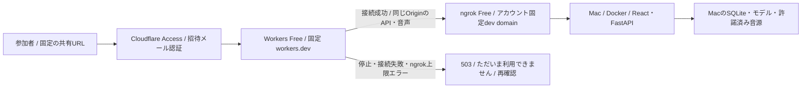
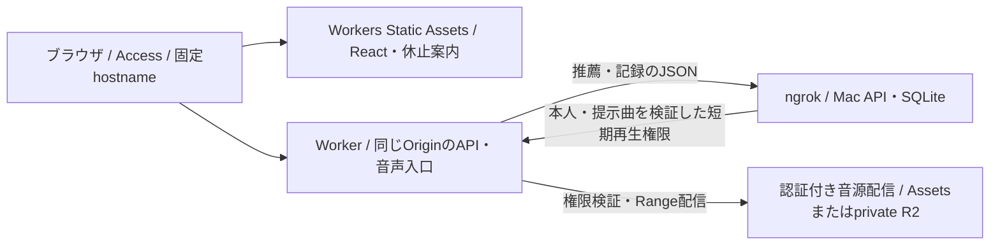
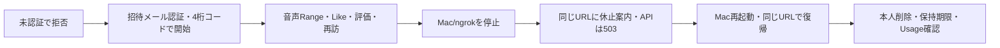

# 無料の固定共有URLと休止案内

## 構成と実装範囲

- 独自ドメイン・固定Tunnelがない場合は[Pages＋Quick Tunnel](pages-sharing.md)を利用する案を優先する。Pagesの共有URLを固定し、変わるバックエンドの接続先を起動スクリプトで更新する

- 実装済みの最小構成はCloudflare Workers Free＋Access＋ngrok Free＋Macの既存Docker。転送量を減らす分離案は[フロント・API・音源の分離](#フロントapi音源の分離案)を参照
- 独自ドメイン・固定IP・クラウド上の推論サーバーは不要。配布URLは`https://WORKER.ACCOUNT.workers.dev/`
- Worker名とアカウントsubdomainを維持すれば、Mac/Docker/ngrok再起動でも共有URLを変更しない
- [Worker](../deploy/share/worker.mjs)・[設定](../deploy/share/wrangler.jsonc)・Mac起動口は実装済み。アカウント作成・実URL発行・Macとの実接続は未実施
- モデル・音源・SQLiteの永続保存先はMac。HTTP通信はCloudflare/ngrokを通る。研究室サーバーは公開しない



- Access認証後、起動中はアプリを直接表示し、接続できなければWorkerが休止案内を返す
- Mac停止とネットワーク障害を断定的に区別せず「休止しているか、接続を確認できない」と表示する
- APIには同じ503のJSONを返す。保存/回答の成功に見せず、復帰後は既存の再送・同じ参加者での再開を使う
- 再確認は利用者のボタン操作。停止中の無限pollingや、Macからの定期heartbeat・外部DBは不要
- WorkerはAccess JWT・本人session cookie・音声Rangeを中継し、レスポンスを保存・キャッシュしない
- FastAPIも既存のAccess署名/AUD検証を全パスへ適用し、ngrok URLへの直アクセスでも認証を省略しない
- 8秒で応答ヘッダーを受け取れなければ案内へ切替。音声本文はストリーム配信し、この8秒で試聴を打ち切らない
- 配信中の回線断は再生エラーになり得る。案内の生成と、すでに開いているプレイヤーの連続稼働は別

## 比較した方式

| 方式 | 固定URL・無料の条件 | Mac停止中の案内 | 判断 |
| --- | --- | --- | --- |
| ngrok Freeだけ | 無料割当のdev domainを維持 | ngrokのエラー画面 | 構成は最小、希望の日本語案内には入口が必要 |
| Workers Free＋ngrok Free | 提供subdomainだけで構成可能 | Workerが独立して表示 | 実装済みの最小構成。音源もngrokの月間枠を使う |
| Workers＋Quick Tunnel | 共有URLは固定、裏のURLは毎回変更 | Workerで表示可能 | URL登録・期限・認証の運用が増える。Quick Tunnelは開発向け |
| named Cloudflare Tunnel | 既存ドメインがあれば追加ドメイン購入不要 | Tunnelだけでは独自案内を配信できない | 既存の設定例は利用可能。新規ドメイン購入が必要なら無料条件に合わない |
| Tailscale Funnel＋独立入口 | 提供ts.net名を利用、プランの利用資格を確認 | 独立入口が必要 | 別候補。帯域制限とMac側の設定条件を確認する必要がある |
| アプリ全体を無料クラウドへ移す | メモリ・音源転送・永続ディスクの無料枠次第 | Macに依存しない | 今回は必要性が低い。モデル/ログ/音源の移行が増える |

## 無料枠と運用

- [ngrok Free](https://ngrok.com/docs/pricing-limits/free-plan-limits): dev domain 1個、外向き転送1GB/月、HTTP 20,000件/月。利用者が選ぶ独自の名前は有料機能
- [Workers Free](https://developers.cloudflare.com/workers/platform/pricing/): 100,000 requests/日、CPU 10ms/呼出し。音声の待ち時間とCPU実行時間は別
- [workers.dev](https://developers.cloudflare.com/workers/configuration/routing/workers-dev/)は独自ドメインなしで利用でき、production URLにもAccessを設定できる
- [Cloudflare Accessの無料枠](https://www.cloudflare.com/plans/zero-trust-services/)を利用し、課金プランへの変更・有料ドメイン取得を前提にしない。アカウント上の現在の枠も設定時に確認する
- 5人という人数だけで1GB以内とは確定できない。実際の転送bytes・音源の先読み・再訪・API件数をngrokのUsageで確認する
- 無料枠を使い切った場合は利用停止として扱い、有料プランへ自動移行する運用にしない
- 無料枠/認証サービス自体が停止した場合、Workerの案内も保証できない。Mac停止時の案内と区別する
- 外部LLM APIはこの構成で呼ばない。将来のLLM費用は[検証基盤](llm-agent-evaluation.md)の別項目

## フロント・API・音源の分離案

- フロント分離も許容する場合の追加設計。以下の分離配信・R2認可は未実装、音源の外部保管も未実施
- React buildをWorkers Static Assetsへ置き、同じ固定hostnameの`/api/`だけをMacへ転送する
- [静的assets](https://developers.cloudflare.com/workers/static-assets/billing-and-limitations/)自体の配信は無料・無制限。Worker処理を実行する要求には別の呼出し枠がある
- 音源をMacから配信する間は、フロントを分けても音源のngrok転送量は減らない
- 音源の外部保管が許可される場合は別配信を検討する。[Static Assetsの無料枠](https://developers.cloudflare.com/workers/platform/limits/)は1 WorkerあたりUIを含む20,000ファイル・1ファイル25MiBまで。収まれば、音源も認証/短期再生権限を検証するWorker経由のAssetsから配信する案を先に検討する
- 45,888曲の音源全件は1 Workerの20,000件枠に収まらない。無料枠に合わせて研究候補を暗黙に減らさない。ファイル数/サイズが合わない場合の比較候補がprivate R2 Standard



- Macが推薦・再生IDを発行し、本人・提示曲・保持期限に結び付く短期再生権限をWorkerが検証する。推測可能な曲IDだけで公開しない
- 音源本文は外部の音源配信→Worker→ブラウザと流れ、ngrokにはJSONと操作ログだけを通す。研究用モデルとSQLiteはMacに残す。AssetsのRange応答と認可も実地検証する
- Mac停止後も画面は開けるが、API未接続として新規推薦・記録を停止する。既存音声の再生可否は短期権限の期限と別に定義する
- [R2料金](https://developers.cloudflare.com/r2/pricing/): Standardの無料枠は10GB-month・Class A月100万回・Class B月1,000万回、インターネット転送料は無料
- R2は無料枠付き従量制であり、超過しても無料で停止するサービスとは扱わない。請求ゼロが必須なら、利用制限を含む運用を検証するまで採用しない
- 音源をMacに置く案では、実ファイルサイズ×取得回数に先読み・再試行・Range再取得を含めて見積もる。試聴秒数だけで課金対象bytesを推定しない
- 例: 5MBの音源を5人が15曲ずつ1回取得すると375MB。各人が同じ音源を合計3回取得すると1,125MBとなり、ngrokの月1GB枠を超える。実データの測定値ではない
- 音源サイズと外部保管条件が未確定のため、現時点で分離案の完全無料運用を確認済みとはしない

## 初回設定

1. Cloudflare Workers Freeで`deploy/share/worker.mjs`を配置し、Worker名とアカウントsubdomainを固定する
2. Workerのproduction `workers.dev` URLにAccessを設定する。対象5人のメールだけをAllowにし、TEAMとApplication AUDを控える
3. ngrok FreeをMacへ導入し、認証情報はngrokの非公開設定へ登録する。割当済みdev domainを控える
4. Workerの`TUNNEL_ORIGIN`へその`https://割当済み.ngrok-free.app`等を設定する。preview URLは無効、Workerのobservabilityは無効とする
5. 以下をMacの非公開設定に保存し、起動するターミナルへ読み込む。例の値は実URLではない

```bash
export MUSIC_RECSYS_SHARE_URL=https://WORKER.ACCOUNT.workers.dev
export MUSIC_RECSYS_TUNNEL_URL=https://ASSIGNED.ngrok-free.app
export MUSIC_RECSYS_ACCESS_TEAM=REPLACE_WITH_TEAM
export MUSIC_RECSYS_ACCESS_AUD=REPLACE_WITH_APPLICATION_AUD
export MUSIC_RECSYS_RETENTION_DAYS=REPLACE_WITH_DAYS
bash deploy/mac.sh start-share
```

- `start-share`は既存の`start-remote`を使いAccess必須で起動後、ngrokを前面で実行する。ターミナルを終了すると遠隔接続が止まる
- ngrokのHTTP inspectionは無効。JWT/参加コード/cookieをアプリの研究ログや外部診断ログへ追加しない
- `bash deploy/mac.sh share-link`で固定リンクを表示できる。研究室サイトにはこのリンクを掲載する
- Worker設定の反映・Accessのメール認証・Mac間の署名ヘッダー通過は実環境で確認が必要。設定例を公開済みURLと扱わない

## 参加コード

- 参加者自身による新規発行を参加者UI/APIで禁止。研究者がMacで発行し、1人へ1つずつ個別に配布する
- 初回・再訪・Cookie削除後とも同じ4桁コードを使う。先頭の0を保持し、旧24文字コードも読込み互換を維持する
- コードの再発行でもparticipant_idは変更しない。他人へのコード共有まで防ぐ本人確認方式ではない
- 4桁は参加者識別用で、外部公開の唯一の認証にはしない。招待メールのAccess認証と組み合わせる
- コード検査/開始の失敗はサーバープロセス全体で60秒10回まで。再起動でリセット、複数workerで共有しない。現行は1 worker運用
- 保持期限は研究者のコード発行時に固定。未利用の期間も含み、初回ログインや再訪で延長しない

```bash
# 起動中のMacで、既存の保持規程に合う日数を明示して実行
bash deploy/mac.sh issue-codes 5
```

- 出力は秘密の参加コードを含むため研究者だけで控え、Git/共有サイトへ掲載しない。再実行は別のコード/参加者を追加する操作
- 研究者向けAPIのローカル検証用発行は維持するが、遠隔向けparticipant audienceからは利用できない

## 実地確認



- `node --test deploy/share/worker.test.mjs`は擬似upstreamでの試験。Mac/Docker/Access/ngrokとの実接続の代用ではない
- 認証なしのngrok直アクセスで401、公開URLでSecure cookie、別Origin更新拒否も確認する
